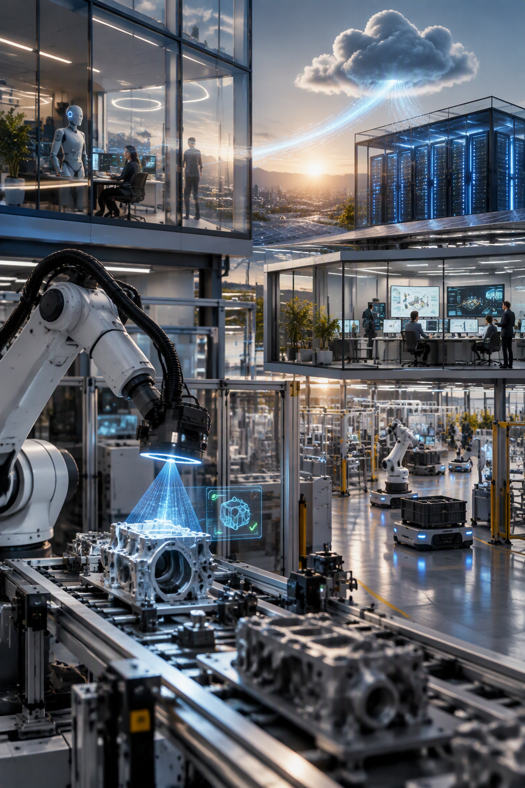

  

<h1 align="center">The Sixth Industrial Revolution</h1>
<h3 align="center">The Last Industrial Revolution That Will Involve Human Beings</h3>

<strong>Andrea Bruno</strong> · Graphene Lab · 2026

  
  
  
  

---

**A book about the industrial revolution that is already running on the shop floor — and about the human being who, for the first time, is not the muscle, the rhythm or the memory of the machine, but the one who decides.**

Industry 4.0 connected the machines. The sixth revolution teaches them to perceive, to remember, to decide and to act — on a chip the size of a coin, inside a cloud that never leaves the factory walls, driven by software that can prove it is right. This book tells that story in one arc, from the first steam engine to the agent that closes the month-end at midnight, and it ends with a question most technology books avoid: what is left for us.

---

## Download the book

Every edition is free and delivered as a direct file download — no account, no paywall, no intermediary page.

| Language | PDF | ePub |
|---|---|---|
| **English** — *The Sixth Industrial Revolution* | [**Download PDF**](https://github.com/Graphene-Lab/the-sixth-industrial-revolution/releases/download/v1.0.0/sixth-industrial-revolution-EN.pdf) | [**Download ePub**](https://github.com/Graphene-Lab/the-sixth-industrial-revolution/releases/download/v1.0.0/sixth-industrial-revolution-EN.epub) |
| **Italiano** — *La sesta rivoluzione industriale* | [**Scarica il PDF**](https://github.com/Graphene-Lab/the-sixth-industrial-revolution/releases/download/v1.0.0/sixth-industrial-revolution-IT.pdf) | [**Scarica l'ePub**](https://github.com/Graphene-Lab/the-sixth-industrial-revolution/releases/download/v1.0.0/sixth-industrial-revolution-IT.epub) |

- The **PDF** is the reading edition: A5, 263 pages, typeset for screen and print, diagrams in vector form.
- The **ePub** is the e-reader edition: reflowable text, covers and diagrams embedded as high-resolution images, works on Kindle (via Send to Kindle), Kobo, Apple Books, Calibre and every standard reader.
- All files are attached to the [**latest release**](https://github.com/Graphene-Lab/the-sixth-industrial-revolution/releases/latest), where older versions remain available.
- The full text also lives in this repository as Markdown: [`books/EN`](books/EN) · [`books/IT`](books/IT).

---

## What the book is about

The book is built as a single argument told through scenes, history and real numbers, in seven parts.

**It starts from the ground.** Four industrial revolutions changed what a human body could do; the fifth — the digital one — changed what a human could calculate, but it never finished the job. The factories were left with islands: a PLC that knows one machine, an ERP that knows the invoices, a cloud that knows everything and belongs to someone else.

**It puts intelligence where the work happens.** A machine that perceives, decides and acts no longer needs a datacenter: it fits in a sealed, fanless box inside the cabinet, it costs no more than a power tool, and it speaks the language of the sensors around it. The chapters walk through edge AI, the quiet death of the classic PLC, the engineering of a device that must run for years without a fan, and the sensory loop that turns a machine into an actor.

**It takes privacy seriously, technically.** The data scandal of 2013 taught industry a lesson it is still paying for: the cloud that holds your production data also holds your company. The answer is architectural, not contractual — a private, zero-knowledge cloud inside the walls, where telemetry becomes the nervous system of the factory without ever leaving it.

**It separates two kinds of mind.** Statistical intelligence is extraordinary at guessing and cannot prove anything. Deterministic AI is the opposite: it derives, it verifies, it can show its work. The book argues that a factory needs both, and that the difference between them is the difference between a suggestion and a signature.

**It follows the chain into the office.** The same loop that runs a machine runs a department: perception, memory, decision, action. An agent that knows the business, a graph that connects customers, orders, machines and documents, and an office that keeps working after the lights go out — the chapters show how the shop floor and the back office become one organism, and where a human signature is still required by law and by sense.

**It ends with the machine that walks — and with us.** Humanoids on the floor, the cost curve that collapsed, how a factory is actually started from an empty shed, and finally the hard reading of the title: this is the last industrial revolution that will *involve* human beings. Not the last we will watch. The last we will be part of.

---

## Who should read it

- **Manufacturing and operations leaders** deciding where intelligence belongs: on the machine, in the plant, or in someone else's cloud.
- **Automation, OT and controls engineers** who suspect the PLC has reached its ceiling and want to see what replaces it.
- **Software architects and CIOs** building private, sovereign infrastructure for industrial data.
- **Founders and investors** in industrial AI, edge computing and robotics.
- **Readers of history and technology** who want the long arc — Watt, Taylor, the transistor, the datagate, the agent — told as one story.

No engineering degree is required. Every technical term is explained where it appears, and collected again in a glossary at the end.

---

## Table of contents

**Part I — The Long Arc of Machines**
1. The Revolutions That Made the Earth
2. What a Revolution Does to a Person
3. A Brief Timeline of Metal and Light
4. The Fifth Revolution That Didn't Quite Finish

**Prologue — The Machine That Dreamed**

**Part II — The Machine That Thinks**
5. The Silicon That Touches the Field
6. Intelligence on the Shop Floor
7. The Quiet Death of the PLC
8. Fanless, Silent, and Cheap
9. A Machine That Perceives, Decides, and Acts

**Part III — The Cloud That Trusts No One**
10. When the Cloud Stole Your Company
11. The Cloud Within the Walls
12. Telemetry as the Nervous System of the Factory

**Part IV — Two Kinds of Mind**
13. Two Kinds of Mind
14. The Assembly as the Last Truth
15. When Certainty Matters

**Part V — The Office Chain**
16. The Office at Midnight
17. The Agent That Knows Your Business
18. The Chain: Machine, Cloud, and Department
19. Automating the Departments
20. The Graph That Connects Everything

**Part VI — When the Machine Walks**
21. When the Machine Walks
22. Where the Human Is Still Needed

**Part VII — The New Era**
23. The Cost That Collapsed
24. How a Factory Starts
25. The Last Revolution That Involves Us

**Epilogue — The Factory That Dreamed**

**Appendices** — A: A Glossary of the New Language · B: The Projects Behind the Vision, and Further Reading · C: Real Cases and Real Numbers

---

## The technologies behind the story

Every system described in the book is built in the open by **Graphene Lab**:

| Project | What it is |
|---|---|
| [**AgentBridge**](https://github.com/Graphene-Lab/AgentBridge) | The agentic assistant that automates office work while the data stays private |
| [**CloudServer**](https://github.com/Graphene-Lab/CloudServer) | The private, trustless, zero-knowledge cloud kept inside the company |
| [**UISupportBlazor**](https://github.com/Graphene-Lab/UISupportBlazor) | Deterministic AI for automatic front-end and API generation |

More at [github.com/orgs/Graphene-Lab](https://github.com/orgs/Graphene-Lab).

---

## About the author

**Andrea Bruno** is the founder of Graphene Lab, where he designs and builds the industrial intelligence described in this book: edge devices that think on the shop floor, private clouds that keep production data inside the factory, and agents that run the office chain. He writes about the sixth industrial revolution because he is building it — and because the question of what remains for human beings deserves an honest answer rather than a comfortable one.

---

## Translations

The book is written in English and Italian. The Italian edition is not a literal translation: it corrects the factual errors of the first edition and adds four sections, so the two editions differ by design. Further languages are in preparation.

## Feedback and contact

Disagreement is welcome — the argument is meant to be tested. Open an [issue](https://github.com/Graphene-Lab/the-sixth-industrial-revolution/issues), or scan the QR code inside the book to reach the Telegram channel where the work is shown rather than described.

  

---

© 2026 Andrea Bruno · Graphene Lab. The book is distributed free of charge in PDF and ePub. The Markdown sources in this repository are the working text behind those editions.

