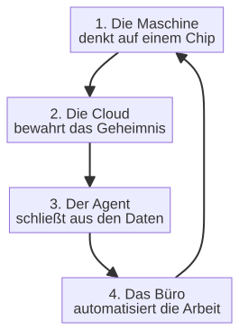

# Kapitel 1 --- Die Revolutionen, die die Erde machten

## Die Feuer

Jede Industrierevolution begann mit einem Feuer. Nicht metaphorisch; die erste von ihnen verbrannte echte Kohle, und die anderen folgten einer ähnlichen Logik der kontrollierten Verbrennung. Die Industrierevolution ist in ihrer Grundlegung eine Geschichte darüber, wie Menschen lernten, Energie zu konzentrieren und sie dorthin zu lenken, wo sie es wählten. Vor dieser Konzentierung war die Arbeit dünn über Menschen und Muskelkraft, die Geduld des Wetters und die begrenzte Ausdauer von Zugtieren verteilt. Der Reichtum einer Nation war, ganz wörtlich, die Summe ihrer Rücken und ihrer Winde. Die Revolution geschah im Moment, als eine Spezies entdeckte, dass sie Energie speichern konnte --- in dem komprimierten Dampf eines Kessels, später im verbrannten Öl einer Maschine, später im umgeleiteten Fluss eines Stromnetzes --- und dadurch außerhalb der täglichen Grenzen von Fett und Wind treten konnte.

Die klassische Erzählung nennt vier Revolutionen. Die erste war Dampf und Maschinerie, von etwa 1760 bis 1830. Die zweite war Elektrizität und die Fließbandfertigung, von etwa 1870 bis 1914. Die dritte war Rechnen und das Internet, von etwa 1960 bis zum frühen 2000er-Jahren. Wir stehen, so proposes dieses Buch, am Ende der fünften --- nennen wir sie Automatisierung und Intelligenz --- obwohl die populäre Zahl für sechse steht, weil einige Erzähler die Elektrizitäts-und-Rechnen-Welle in zwei aufteilen. Die Nummerierung ist egal; der Charakter jeder Welle ist wichtig, und ich komme auf diesen Charakter bald zurück. Beachten wir vorerst nur, dass jede Revolution etwas tat, das die vorherige überhaupt nicht tun konnte, und dass sie es schneller tat.

## Die Feuer, die alles veränderten

Um das Gewicht der ersten Revolution zu fühlen, hilft es, für einen Moment innerhalb eines Bergwerks vor dem Dampfmaschine zu stehen. Im frühen achtzehnten Jahrhundert wurden Bergwerke tiefer, da die an der Oberfläche liegende Kohle ausging, und tiefe Bergwerke hatten ein Problem, das keine Menge an Pferdekraft an der Oberfläche lösen konnte: Wasser kam fortlaufend herein. Ein Bergwerk, das hinabsteigt, erreicht schließlich den Grundwasserspiegel, und sobald Wasser eingedrungen ist, ist das Bergwerk nutzlos, es sei denn, das Wasser kann von Hand oder von Tieren, die eine Rolle im Schichtbetrieb drehen, herausgehoben werden. Die Bergwerke waren nicht dadurch begrenzt, wie stark Menschen graben konnten, sondern dadurch, wie viel Wasser herausgebracht werden konnte, bevor der Schürfer ertrank.

Thomas Savery baute 1712, und dann Thomas Newcomet, 1712, Dampfmaschinen --- roh, verschwenderisch und monumental --- deren einziger Zweck darin bestand, Wasser aus Bergwerken zu pumpen. Es ist leicht, diese Maschinen zu unterschätzen, die Kohle verbrannten, um einen Kessel zu erhitzen, die einen Kolben verschoben, der Wasser hob, und die fast nichts anderes taten. Aber bedenken wir die Logik: eine Maschine, die Kohle verbrannte, um mehr Kohle frei zu machen. Es war ein einzelner Appetit, mechanisch befriedigt, aber sie etablierte die erste Gebot der Industrierevolution --- *Energie in Dampf speichern, dann sie auf Abruf freisetzen.* Und sobald dieses Gebot etabliert war, folgte der Rest der Geschichte fast unweigerlich.

Die Dampfmaschine blieb nicht lange eine Wasserpumpe. James Watt, der in Schottland in den 1760er- und 1770er-Jahren arbeitete, machte sie für weit mehr als das Pumpen nützlich, indem er den Kondensator vom Zylinder trennte und eine Drehbewegung aus dem Auf-und-Ab des Kolbens machte. Mit Watts Verbesserung konnte die Dampfmaschine sich drehen, und mit dem Drehen konnte sie alles antreiben. Sie konnte tausend Spindeln drehen, wo tausend Männer zehn Spindeln drehen konnten. Sie konnte die großen Wellen der neuen Fabriken drehen. Die Maschine hatte einen enorm mächtigen Körper, aber --- und hier ist der Punkt, auf den ich immer wieder zurückkommen werde --- immer noch keinen Verstand. Sie konnte Kraft vervelfachen, aber sie hatte keine Meinung darüber, welche Spindeln zu drehen sind, kein Gedächtnis für die Nachfrage von gestern, kein Plan für die Reparatur von morgen. Sie war ein enorm mächtiger Körper mit dem Verstand eines sehr geduldigen Felsen.

## Die Partnerschaft, die es real machte

Es gibt eine Neugier, die es sich hier wert ist, festzuhalten, weil sie leise die Frage beantwortet, „warum hat es so lange gedauert?“ Watts separater Kondensator war ein Wunder der Physik, aber ein Wunder der Physik ist keine Revolution, bis jemand bereit ist, sie zu bauen. Watt selbst war ein schlechter Geschäftsmann, und seine Maschine funktionierte in ihrer frühesten Form kaum und verkaufte sich kaum. Was die Maschine zu einer Industrie machte, war nicht eine weitere Einsicht der Physik, sondern eine weitere Einsicht der *Herstellung*: die Zwischen zwischen Watt und Matthew Boulton, deren Soho-Gießerei in Birmingham das schwere, undichtungsanfällige Eisen tatsächlich gießen und maschinell bearbeiten konnte, das eine Dampfmaschine verlangt. Watt lieferte die Idee und das Patent; Boulton lieferte das Kapital, die Werkstatt und die Sturrheit, weiter Maschinen zu bauen, die weiter brachen, bis sie funktionierten. Das Unternehmen Watt und Boulton betrieb das Dampfmaschinengeschäft über Jahrzeh hinweg mit Verlust, bevor es Gewinn abwarf, gerade weil die Sache so schwer herzustellen war.

Die Lektion ist nützlich für später, wenn wir die sechste Revolution treffen: Eine Idee ist nie der Flaschenhals. Der Flaschenhals ist immer der *Körper* --- die Fähigkeit, die Sache herzustellen, die Sache zu vertrauen, die Sache zu skalieren. Dampf hatte das gedankenlose Körperproblem bis 1800 gelöst. Die Intelligenzrevolution hat ihr eigenes Körperproblem, das noch gelöst wird, und es lohnt sich, sich zu merken, wessen Aufgabe es war, das erste zu lösen.

## Die Revolution schränkte den Kontinent ein

Die Dampfmaschine hörte nicht in der Fabrik auf. Sobald das Prinzip etabliert war --- Energie in Dampf speichern, sie auf Abruf freisetzen und sie zu dem machen, was auch immer ihr wählen --- wurde bald dieselbe Maschine, die die Bergwerke entleerte, gebeten, etwas zu tun, das keine Oberflächenmaschine je versucht hatte: sich bewegen. Richard Trevithick fuhr die erste vollmaßstäbliche Eisenbahn-Dampflokomotive 1802, und George Stepherson gewann mit seiner *Rocket* die Rainhill-Versuche von 1829. Im Oktober desselben Jahres zog die *Rocket* einen Zug die Liverpool-to-Manchester-Strecke hinauf, und im September 1830 eröffnete diese Strecke als die weltweit erste vollständig dampfbetriebene interurbane Eisenbahn für Passagiere. Dies ist eine jener Fakten, die nur verständlich ist, wenn man ihr Gewicht fühlt. Vor einer Lokomotive war eine Nation eine Ansammlung von Städten, die sich nicht schneller erreichen konnten als Pferde traben --- Tage zwischen Städten, die hundert Meilen voneinander entfernt liegen, Waren, die auf der Straße verrotteten, eine Wirtschaft, die nicht national sein konnte, weil ein Land geografisch schlicht zu groß ist, um schnell durchquert zu werden.

Dampf schränkte den Kontinent ein. Die Eisenbahn machte eine einzige nationale Wirtschaft zum ersten Mal möglich, indem sie die Entfernung in eine Zahl umwandelte, die in Minuten statt in Tagen gemessen wurde. Es ist eine kleine, seltsame Tatsache, dass dasselbe Prinzip, das ein Bergwerk entleerte --- konzentrierte Energie, die auf Abruf freigesetzt wird --- auch das ist, was die moderne Welt *nah* machte. Die Entfernung starb, und mit ihr die Isolation, die das menschliche Leben zehntausend Jahre lang definiert hatte. Jede Industrierevolution konzentrierte eine andere Ressource: Dampf konzentrierte Kraft, Elektrizität konzentrierte einen Strom, und Rechnen konzentrierte Information. Dampf, zumindest, konzentrierte auch *Ort*, indem er den Kontinent so faltete, dass zwei Städte, die eine Pferdereitstunde voneinander entfernt waren, nun eine Zugstunde des Nachmittags voneinander entfernt waren.

## Der menschliche Faden

Was die vier vorherigen Revolutionen gemeinsam hatten --- und dies ist der Faden, den dieses Buch bis zum allerletzten Moment ziehen wird --- ist, dass sie alle den Menschen zum letzten Glied in der Kette machten. Die Dampfmaschine wurde von einem Menschen bedient. Die Fließbandfertigung wurde von einem Menschen getaktet. Der Computer wurde von einem Menschen gespeist, und seine Ergebnisse wurden von einem Menschen gelesen. In jedem Fall konnte die Maschine Kraft, Rhythmus und Gedächtnis vervelfachen, aber sie konnte nicht eigenständig die Schleife zwischen dem Wahrnehmen einer Sache in der Welt und dem Tun von etwas daran schließen. Der Mensch stand am Ende jedes Prozesses, der letzte Richter und die letzte Hand. Die Maschine dachte --- in dem engen Sinne, in dem eine Maschine jener Epoche denken konnte --- aber der Mensch handelte.

Und das war in Ordnung, und es war lange Zeit wohlhabend. Die vorherigen Revolutionen hoben das menschliche Leben so dramatisch --- die Lebenserwartung verdoppelte sich, die Ausgabe pro Arbeiter vervelfachte sich, Waren, die einst nur Königen gehörten, wurden billig genug für alle --- dass niemand innehielt, um zu fragen, ob das letzte Glied ebenfalls automatisierbar sei. Es schien einfach offensichtlich, dass der Mensch am Ende der Kette der Punkt der Kette war, der Grund, warum die Energie überhaupt erst konzentriert wurde.

Es gibt hier eine kleine, nützliche Anekdote. Wenn sich das mechanische Webstuhl über England im frühen neunzehnten Jahrhundert ausbreitete, protestierten nicht nur die Arbeiter, die Stoff von Hand webten; sie zerstörten die Webstühle. Sie waren die Ludditen --- oft fälschlich als anti-technische Reaktionäre in Erinnerung behalten, wenn in Wahrheit viele von ihnen qualifizierte Handwerker waren, die ihrem Handwerk und ihrem Lebensunterhalt zusahen, wie sie über Nacht verschwinden. Die Ludditen lagen in Bezug auf die Zukunft falsch, aber sie lagen nicht falsch darin, dass eine Zukunft kam, die sie nicht brauchen würde. Ihr Zorn war nicht töricht; er war einfach voreilig. Jede Industrierevolution hat Ludditen hervorgebracht, deren Zorn im Moment logisch und in der langen Laufzeit falsch war. Die sechste Revolution bringt sie jetzt hervor, und ihre Ludditen befürchten etwas noch Neues: nicht den Verlust ihrer Muskeln, sondern den Verlust ihrer Verstände.

## Die Revolution machte eine Klasse

Es gibt noch eine weitere Sache, die jede Revolution machte, und sie ist leicht zwischen den Maschinen und dem Code zu übersehen. Eine Revolution verändert nicht nur Maschinen; sie verändert *Menschen* zu neuen Arten von Menschen, und sie ordnet die Karte neu, um sie aufzunehmen. Die Industrierevolution baute nicht nur Fabriken --- sie schuf zwei neue Klassen, die Eigentümer der Fabriken und die Menschen, die in ihnen arbeiteten, und sie brachte sie aus dem Dorf und in die Stadt. Vor dem Dampf war die Arbeit dünn über die Landstraße verteilt: ein Weber am Webstuhl in einer Hütte, ein Farmer auf seinem Feld, ein Schmied in seiner Werkstatt. Dampf, und die Maschinen, die er antrieb, verlangten *Konzentrierung*. Menschen mussten sich dort versammeln, wo die Maschinerie war, und so wuchs die Fabrikstadt --- und später die große Industriestadt --- fast über Nacht um die Mühle herum, die ihnen ihre Arbeit und ihren Namen gab. Dies ist der Grund, warum die moderne Stadt, mit ihren Eisenbahnen, ihren Kanalisationen, ihren Menschenmengen und ihrem Rauch, selbst ein Produkt der ersten Revolution ist, nicht nur ein Hintergrund dafür.

Es lohnt sich, dies im Kopf zu behalten, weil die sechste Revolution dasselbe mit einer anderen Art von Arbeit tut. Sie versammelt die Arbeiter --- nicht zu einer Mühle, sondern zu einem *System* --- und sie schafft neue Arten von Menschen, die vor einem Jahrzehnoch nicht existierten: der Dateningenieur, der Agent-Aufsichtliche, derjenige, der die Maschine ehrlich hält. Die Maschinen verändern sich; die Menschen verändern sich mit ihnen; und die Karte verändert sich, um sie aufzunehmen. Jede Industrierevolution ist am Ende eine Geschichte über eine neue Art von menschlichem Wesen, ermöglicht durch eine neue Art von Maschine.

> **Eine Neugier.** Das Wort für die neue Arbeiterklasse ist nicht zufällig. Vor den Fabriken betrieben die meisten Menschen Landwirtschaft, oder handelten, oder dienten. Der *Proletariat* --- vom lateinischen *plebs*, die gewöhnlichen Menschen --- und die sehr Idee von „einem Arbeiter“ als eine distincte soziale Kategorie, sind Produkte dieses Moments. Selbst die Sprache jener Epoche musste erfunden werden, um sie zu beschreiben: die Fabriksirene, der Arbeitstag, die Schicht, der Streik. Eine Revolution verändert nicht nur, was Menschen tun; sie verändert die Wörter, die sie braucht, um über das zu sprechen, was sie tun. Die sechste Revolution erfindet bereits ihre eigene Sprache --- das Prompt, der Agent, der Leitbalken, der Kontextfenster --- und in einem Jahrzehnoch werden wir uns keinen Tag ohne sie merken.

## Der Bruch

Die fünfte und sechste Revolution sind deshalb anders, weil sie auf dieses letzte Gliel abzielen. Sie fragen nicht danach, die Muskeln, den Rhythmus oder das Gedächtnis eines Menschen zu vervelfachen. Sie fragen danach, die Urteilskraft eines Menschen zu vervelfachen und diese Urteilskraft den ganzen Weg hinaus in die Welt zu tragen, in die Handlung, ohne an einem Menschen, der entscheidet, zu stoppen. Die Maschine wird den Fehler wahrnehmen, darüber reasoning, die richtige Antwort entscheiden, mit der Cloud sprechen, die Antwort durch ein Büro dispatchen, und in den neuesten Fabriken sogar zum Fehler in einem metallenen Körper laufen und ihn reparieren. Die Schleife schließt sich. Der Mensch ist nicht mehr das letzte Glied; der Mensch ist der Architekt eines Systems, das fertig machen kann, was es begonnen hat.

Dies ist der Grund, warum die Nummerierung --- fünft oder sechse --- sich so anders anfühlt als die anderen. Die früheren Revolutionen erweiterten, was ein Menschen tun konnte. Diese hier erweitert, was ein Menschen entscheiden und dann durchsehen kann, ohne einschübernde Hände. Es ist der Unterschied zwischen einem Werkzeug, das einen Arbeiter schneller macht, und einem System, das einen Arbeiter zu einem Dirigenten macht.

## Eine kleine Karte der vor uns liegenden Straße

Bevor wir reisen, hilft es, das Gebiet zu kennen. Die Kette, die die sechste Revolution möglich macht, hat vier Komponenten, und sie erscheinen in diesem Buch in der Reihenfolge, in der sie zusammengestellt werden müssen:

Das erste Glied, die Maschine, die denkt, ist das Thema von Teil II. Das zweite, die private Cloud, ist Teil III. Das dritte und vierte, der reasoning Agent und das automatisierte Büro, sind Teil V. Zwischen ihnen sitzt Teil IV, der die einzelne wichtigste Frage der ganzen Geschichte stellt: nicht wie man Intelligenz baut, sondern welche Art von Intelligenz eine Fabrik mit ihrer eigenen Sicherheit vertrauen kann. Wir werden darauf zurückkommen, und es lohnt sich, sich jetzt zu merken, dass die Antwort das ist, was diese Revolution --- und dieses Buch --- von allem unterscheidet, das vorangegangen ist.

## Die Nummerierungsfrage

Es lohnt sich, auf der Zahl innezuhalten, weil Leser sie begegnen werden und es ehrlich ist, sie anzusprechen. Der populäre Ausdruck für die aktuelle Welle ist die „sechste Industrierevolution“, aber Technologiehistoriker sind uneinig, und die Uneinigkeit ist selbst informativ. Einige Erzähler zählen fünf Revolutionen, endend mit Automatisierung; andere teilen die digitale Welle und zählen sechs; einige zählen nur drei oder vier und falten alles in „die digitale Revolution“. Die Zahl, die ihr wählt, sagt mehr über eure Methode als über die Welt aus.

Es gibt jedoch ein Framing, das für dieses Buch nützlich ist, und es läuft so. Jede Revolution kann durch die dominante Ressource charakterisiert werden, die sie zähmte: die erste zähmte Dampf (gespeicherte thermische Energie), die zweite Elektrizität (gespeicherte elektrische Energie, die durch Drähte fließt), die dritte Rechnen und das Internet (gespeicherte und übermittelte Information), und die vierte (in diesem Framing) Automatisierung und Robotik (Maschinen, die ohne fortlaufende menschliche Anleitung handeln). Die fünfte, im Framing, das dieses Buch annimmt, ist Intelligenz --- Maschinen, die wahrnehmen, entscheiden und koordinieren; die sechste ist die *Integration* jener Intelligenz in ein selbstkoordinierendes Ganzes, die Industry 7.0-Fabrik, die wir in Teil V treffen werden. Unter dieser Lesart ist die sechste Revolution nicht bloß „mehr Intelligenz“; sie ist der Moment, in dem Intelligenz aufhört, ein Merkmal einzelner Maschinen zu sein, und zum verbindenden Gewebe eines gesamten Unternehmens wird. Das ist die Unterscheidung, die dieses Buch von der ersten bis zur letzten Seite verteidigen wird.

## Warum Geschichte einen Leser angeht

Ihr könnt zu recht fragen, warum ein Buch über die Zukunft der Industriomatisierung ein Kapitel nach hinten wirft. Die Antwort ist, dass Geschichte hier kein Luxus ist; sie ist ein Entscheidungswerkzeug. Jede Generation von AI hat mehr versprochen, als sie geliefert hat, und das Muster zu kennen macht dich schwerer zu täuschen. Wenn ein Anbieter dir sagt, ihr Produkt werde „deine Fabrik mit AI transformieren“, wurde das Wort „transformieren“ über zweihundert Jahre lang verwendet, und jede frühere Verwendung bezog sich auf eine Revolution, die real war, aber enger als das Marketing nahelegte. Die Person, die das Muster versteht, ist besser ausgerüstet, die echte Revolution vom umgepackten Hype zu trennen.

Zudem wiederholen sich die Fehler mit neuer Sprache. Jedes Mal, wenn AI stockte, stockte sie für einen benennbaren Grund: nicht genug Daten, nicht genug Rechenleistung, oder ein Problem, das härter war, als es aussah. Dieselben drei Gründe entscheiden immer noch, ob eige Adoption-Projekt funktioniert. Die Person, die das Muster einmal gesehen hat, wird es wieder sehen; die Person, die nur das neueste Hype gehört hat, wird beim zweiten Mal überrascht sein. Dieses Buch wird dich mit dem Muster ausrüsten, so dass, wenn die Versprechen der sechsten Revolution gemacht werden, du sie gegen die Revolutionen messen kannst, die vorangegangen sind.

Es hilft, einen konkreten Fall im Kopf zu haben, weil „die Fehler wiederholen sich“ leichter zu merken ist, wenn du die letzte Zeit benennen kannst, in der es geschah. Das zwanzigste Jahrhundert hatte seine eigenen Artificial-Intelligence-Winter. In den späten 1960er-Jahren kündigten eine Handvoll der prominentesten Computerwissenschaftler jener Epoche mit echter Autorität an, dass eine Allzweck-Denkmaschine „greifbar sei“ innerhalb einer Generation; wenn die Maschinen nicht ankamen --- weil der Speicher zu klein war, die Rechenleistung zu schwach, und die Probleme zu unstrukturiert für die verfügbaren Algorithmen --- folgte eine Enttäuschung. Ein Bericht von 1973 in Großbritannien schloss, dass das Feld überversprochen hatte, und die Forschungsfinanzierung trocknete jahrelang aus. Dann, als die Hardware und die Algorithmen und die Daten schließlich aufholten, kehrte das Feld lauter als zuvor zu seinem ursprünglichen Versprechen zurück. Das Muster ist nicht, dass die Wissenschaftler Narren waren; es ist, dass sie *früh* waren, und früh ist unterscheidbar von falsch, bis der dritte der drei fehlenden Zutaten --- Rechenleistung, Daten, oder ein geeigneter Algorithmus --- endlich erscheint. Die Person, die einen Winter beobachtet hat, lernt, eine einzelne, ruhige Frage an jedes neue Versprechen zu stellen: *was ist die fehlige Zutat, die dies möglich machen wird, und wie lange bis sie nicht mehr fehlt?* Diese Frage ist das Ganze dieses Kapitels.

Lassen Sie uns nun den ganzen Bogen in eine kompakte Zeitleinie komprimieren, so dass das Tempo, mit dem jede Revolution ankam, sichtbar ist, und so dass die charakteristische Langsamkeit der Intelligenzrevolution --- und ihre plötzliche, jüngste Beschleunigung --- in einem Blick sichtbar werden kann. Das ist das Thema des nächsten Kapitels.
