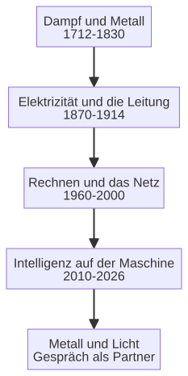

# Kapitel 3 --- Eine kurze Zeitleinie von Metall und Licht

## Die Idee

Wenn Sie die sechste Revolution verstehen wollen, brauchen Sie ein Gefühl für den langen Bogen, zusammengepresst. Die Geschichte der Industrie ist in ihrem Wesen eine Geschichte über zwei Materialien. Das erste ist *Metall*: die Maschinen, die Kraft konzentrieren. Das zweite ist *Licht*: die Signale, die Elektrizität und schließlich die Photonen und Elektronenpulse, die Informationen tragen. Den größten Teil des Bogens hindurch herrachte das Metall, und das Licht war nur sein Diener --- ein Pfeife, eine Flagge, ein Relais. In den letzten dreißig Jahren ist das Licht ein Meister seiner selbst geworden, und die beiden haben endlich begonnen, miteinander zu sprechen. Dieses Kapitel ist die Zeitleinie dieser Unterhaltung, erzählt in jener Handvoll von Momenten, die tatsächlich die Richtung des Weges veränderten.

## Die Zeitleinie

**1712 --- Die Pumpmaschine.** Thomas Savery, dann Thomas Newcomet, bauten Dampfmaschinen, die Wasser aus Minen pumpten. Die Maschinen waren zu nichts anderem tauglich; sie verbrannten Kohle, um einen Kessel zu erhitzen, der Wasser aus einer Mine saugte, was die Mine tiefer gehen ließ, was mehr Kohle hervorbachte. Es war eine Maschine im Dienste eines einzigen Verlangens. Aber sie etablierte das Muster: *Energie in Dampf speichern, dann sie auf Anforderung freigeben.* Dies ist das erste der industriellen Gebote.

**1785 --- Die Kraftwebmaschine.** Edmund Cartwright verwandelte Dampf in einen *Prozess*, nicht bloß eine Pumpe. Die Webmaschine spann Faden kontinuierlich, mechanisch, und das Handwerk des Handspinnens begann seinen langen Tod. Metall war nicht mehr bloß dabei, Dinge zu bewegen; es *verwandelte* sie.

**1804 --- Das Konzept des gespeicherten Programms (versehentlich).** Im Jahre 1804 nahm die Webmaschine von Joseph Marie Jacquard Lochkarten an, die ein Muster vorschrieben. Die Karten erzeugten keinen Stoff; sie *beschrieben* den Stoff, und die Webmaschine gehorchte der Beschreibung. Ändern Sie die Karten, und das Produkt ändert sich. Dies ist der Vorläufer der Software, erbaut von einem Weber, hundertfünfzig Jahre bevor jemand das Wort „Computer" hatte. Metall lernte, Anweisungen zu folgen.

**1822 --- Die Maschine, die zu denken bestimmt war (und es nie ganz tat).** Der englische Mathematiker Charles Babbage entwarf die Analytische Maschine, einen mechanischen Rechner mit Lochkarteneingabe, der prinzipiell *irgendetwas Berechenbares* berechnen konnte --- nicht, weil ein Draum neu verdrahtet wurde, sondern weil eine Liste von Anweisungen, ein *Programm*, eingeführt wurde. Er hatte, im Wesen, den Allzweckcomputer ein Jahrhundert vor der Elektronik zu seiner Herstellung erfunden, und es fehlten ihm einfach das Geld und die Maschinen, um eine zu bauen. Seine Maschine war ein Gespenst --- ein Entwurf, ein Traum, ein Nicht-in-die-Wirklichkeit-Treten --- doch sie bewies, dass eine Maschine *programmiert* statt *verdrahtet* werden konnte, und Programmierung würde später bedeuten, dass eine einzelne Maschine unendlich neu konfiguriert werden konnte, um fast alles zu tun. Babbage ist der Vorläufer des gespeicherten Programms und der Idee, dass eine Maschine nicht für ein einziges Verlangen gebaut werden muss, sondern dass ihr jede Aufgabe durch Änderung nur ihrer Anweisungen gegeben werden könnte.

**1831 --- Faraday und der elektrische Generator.** Michael Faraday entdeckte, dass das Bewegen eines Magneten Elektrizität erzeugte, und die ganze Welt kippte. Zum ersten Mal konnte Energie *auf Anforderung* erzeugt, überall und über Drähte bewegt werden. Dies ist der Moment, in dem *Licht* --- das Signal des Elektronenflusses --- als Kraft in die Geschichte eintrat. Elektrizität war die erste informationstragende Kraft, die Menschen bei Geschwindigkeit kontrollieren konnten.

**1844 --- Das Telegraph.** Der amerikanische Maler, der Wissenschaftler wurde, Samuel Morse, sendete 1844 die erste elektrische Nachricht über einen Draht, von Washington nach Baltimore, und die Worte --- oft mit „What hath God wrought" zitiert --- waren an sich nicht bemerkenswert. Bemerkenswert war, dass sie *auf Elektrizität statt auf einem Pferd reisten*, Stunden vor einem Reiter angekommen. Zum ersten Mal konnte Information den physikalischen Gegenstand, der sie trug, überholen, bei der Geschwindigkeit des Stroms. Das Telegraphenwesen verwandelte die Nation und dann die Welt in einen Ort, an dem eine Nachricht vor einem Mann ankommen konnte, der sie mit sich trug. Dies ist der Samen jedes Signals, jeder Steuerleitung, jedes Netzes --- und jeder Wolke, die je existieren würde --- die seitdem nachfolgten, und es ist der Moment, in dem *Licht* (das Signal des Elektronenflusses) begann, Bedeutung über Distanz bei Geschwindigkeit zu tragen.

**1876 --- Das Telefon.** Alexander Graham Bell verwandelte Ton in ein Elektronensignal, und Information begann ihre lange Reise frei des physikalischen Gegenstandes, den sie trug. Ein Wort konnte nun schneller als ein Pferd reisen. Dies ist der Samen jeder Kommunikation, jedes Steuersignals, jeder Wolke, die je existieren würde.

**1896 --- Die Fließbandstraße (im Embryo, und dann in voller Blüte).** Frederick Winslow Taylor vermessene Arbeit in Sekunden. Henry Ford schuf 1913 die bewegte Linie und verkürzte die Zeit zum Bau eines Autos von zwölf Stunden auf neunzig Minuten. Der Mensch wurde in den Rhythmus integriert; die Maschine setzte das Tempo.

**1936 --- Die Idee der Universalmaschine.** Alan Turing, ein junger Mathematiker in Britannien, veröffentlichte eine Arbeit, die eine Maschine beschrieb, die *irgendetwas Berechesbares* durch Folge eines gespeicherten Regelwerks berechnen konnte. Es war reines Licht --- reine Information --- ganz ohne Metall darin jenseits der Abstraktion. Turing bewies, dass eine Maschine *programmiert* statt *verdrahtet* werden konnte, und Programmierung würde später bedeuten, dass eine einzelne Maschine unendlich neu verdrahtet werden konnte, um alles zu tun.

**1947 --- Der Transistor.** Die Erfindung des Transistors in den Bell Labs ersetzte heiße Vakuumröhren durch ein kleines Stück geätztes Halbleitermaterial, und man kann dies leicht unterschätzen. Der Transistor war klein, billig und konnte ein Signal eine Million Mal pro Sekunde schalten ohne Aufwärmzeit. Jedes Stück moderner Intelligenz --- im Telefon, im Auto, im Fühlersensor einer Fabrik --- ruht auf diesem kleinen silbrigen Schalter. Es ist das Atom des Informationszeitalters.

**1957 --- Das erste Signal im Weltraum.** Wenn die Sowjetunion Sputnik 1 in die Umlahn brachte, sendete sie das erste elektronische Signal jenseits der Atmosphäre zurück, und die Welt erkannte, in einer einzigen kalten Nacht, dass Information nun die Erde vollständig verlassen konnte. Das Rennen, das Sputnik auslöste --- das Weltraumrennen --- war, unter den Flaggen und den Raketen, ein *Rechen*-Rennen: ein Rennen, Information schneller und zuverlässiger zu speichern, zu verarbeiten und zu übertragen als die andere Seite. Sputnik wird oft als Moment in der Politik oder der Physik in Erinnerung behalten; es war, leiser, ein Moment in der Autorität des Lichts. Es bestätigte, für Regierungen und für die Industrie gleichermaßen, dass die Informationsseite der Geschichte --- das Signal, der Strom, das gespeichertes Programm --- nun stark genug war, die Sterne zu erreichen, und das Ausgeben und das Ingenieurwesen, das nachfolgten, gossen den Beton für die gesamte Informationsrevolution.

**1969 --- Die erste Nachricht.** Ein Netz namens ARPANET sendete 1969 sein erstes Paket, ein kleines, unzuverlässiges und bedeutsames erstes Stadium hin zu dem, was das Internet werden würde. Vor ARPANET standen Computer allein; nach ihm konnten sie, stockend, *miteinander sprechen*. Die Nachricht selbst ist fast vergessen (sie verfälschte sich nach drei Buchstaben), aber das Prinzip war nicht: Maschinen konnten Information durch ein verteiltes Netz teilen, ausreichend widerstandsfähig, um den Verlust eines einzelnen Knotens zu überleben. Dies ist der Vorläufer des modernen Internets und der Wolke --- nicht der *öffentlichen* Wolke, die beobachtet, sondern des *Netzes*, das schließlich die privaten Wolken dieses Buches beherbergen würde. Es ist der Moment, in dem Licht nicht bloß ein Signal, sondern eine *Unterhaltung* wurde, und der Moment, in dem die Maschine begann, leise, mit anderen Maschinen zu sprechen.

**1971 --- Der Mikroprozessor.** Intel brachte eine ganze zentrale Verarbeitungseinheit auf einen einzelnen Chip. Der Computer war nicht mehr ein Raum; er war eine Münze. Dies ist es, was schließlich die Fühlerin der Spindel ermöglichte, und es lohnt sich, sich zu erinnern, dass das ganze Gehirn des Fühlers ein Nachkomme dieser Münze ist.

**1977 --- Der Personalcomputer erreicht den Schreibtisch.** Eine Allzweckmaschine, die jemand auf einem Schreibtisch behalten und für seine eigenen Aufgaben programmieren konnte, erreichte schließlich das Büro und dann das Heim. Vor diesem war der leistungsstarke Computer ein Raum voller Maschinen und ein Room voller Spezialisten; nach diesem war die Fähigkeit zu rechnen, zu speichern und zu scripten innerhalb der Reichweite eines jeden einzelnen Arbeiters. Der Personalcomputer war die Brücke zwischen der monströsen Maschine der 1960er Jahre und dem intimen Gerät der 2000er Jahre, und es lohnt sich, sich zu erinnern, dass es *billig* war --- billig genug für ein Büro, dann ein Heim, und schließlich eine Maschine auf einem Fabrikboden. Es trug dasselbe Prinzip wie der Mikroprozessor: das Gehirn eines ganzen Computers, klein genug und billig genug, um auf einer Spindel zu sitzen.

**1991 --- Das World Wide Web.** Tim Berners-Lee machte Information frei und leicht teilbar. Das Internet wurde zum Nervensystem der modernen Wirtschaft, und die Wolke, die schließlich sie beherbergen würde, begann, leise, als ein *Ort* gedacht zu werden --- ein Gebäude ohne Türen, irgendwo aufbewahrt, das man erreichen konnte.

**2006 --- Die Wolke wird zur_utilität.** Als Amazon seine Webservices 2006 startete, hörte das Rechnen auf, eine Maschine zu sein, die man besaß, und wurde zu einem Dienst, den man stundenweise bezahlte. Das klingt nach einer kleinen Veränderung, aber es ist jene, die die Wolke --- öffentlich und später privat --- bei jedem Maßstab wirtschaftlich möglich machte. Vor ihr musste ein Unternehmen, das mehr Rechenleistung wollte, mehr Maschinen kaufen; nach ihr konnte ein Unternehmen sie stundenweise für den Preis eines Kaffees anmieten. Die Wolke hörte auf, ein *zu wartendes Gebäude* zu sein, und wurde zu einem *Hahn, den man aufdreht*, und das ist genau die Qualität, die die sechste Revolution auf dem Fabrikboden braucht: Intelligenz, die man stundenweise aufdrehen kann, ohne das ganze Gerät zu kaufen.

**2007 --- Das Gerät in Ihrer Tasche.** Wenn das erste moderne Smartphone ankam, trug es, in einem einzigen handgroßen Platten, den Allzweckcomputer des Schreibtisches, die Kamera der Wahrnehmung, das Netz der Wolke, und --- leise, fast unsichtbar --- einen dedizierten Prozessor zum Ausführen gelernter Modelle. Zum ersten Mal konnte eine Maschine *sehen und entscheiden lernen* auf einer Batterie, in Ihrer Tasche, ohne eine Datenzentrale eine Frage zu stellen. Dies ist der Samen der maschineninternen Intelligenz, auf die die sechste Revolution aufbauen wird: nicht eine Maschine, die mit der Wolke spricht, sondern eine Maschine, die *für sich selbst denkt*, lokal, in Mikrosekunden, frei von Bandbreite. Das Smartphone bewies, auf kommerziellem Maßstab, dass die ganze Kette --- wahrnehmen, entscheiden, handeln --- auf einem kleinen Chip leben konnte.

**2012 --- Der Durchbruch des Deep Learning.** Ein Netz namens AlexNet gewann einen großen Bilderkennungswettbewerb mit großem Vorsprung und bewies, dass eine Maschine *sehen lernen* von Beispielen statt der Anweisung der Regeln. Dies ist der Moment, in dem die Maschine gewann, auf praktische Weise, etwas, das wir *Wahrnehmung* nennen könnte.

**2016 --- Der NPU erreicht Ihre Tasche.** Apple, dann Qualcomm und andere, begannen, dedizierte neuronale Prozessoren --- NPUs --- auf ihren mobilen Chips einzubetten. Zum ersten Mal konnte eine Maschine ein gelerntes Modell der Welt *lokal* ausführen, ohne die Wolke zu fragen, in Mikrosekunden, ohne die Batterie auf eine Rundreise auszugeben. Dies ist der Samen der maschineninternen Intelligenz, auf die die sechste Revolution aufgebaut wird.

**2017 --- Die Idee, die Aufmerksamkeit zahlt.** Eine Arbeit mit dem Titel „Attention Is All You Need" führte den Transformer ein, eine Architektur, die einem Modell erlaubte, die Wichtigkeit jedes Informationsteils gegen jedes andere abzuwägen, statt es ein Wort oder ein Messung nach dem anderen zu verarbeiten. Diese einzelne Idee wurde zum Rückgrat jedes großen Sprachmodells und jedes modernen Agenten, der nachfolgten; es ist der Mechanismus, der einem Programm erlaubt, ein ganzes Dokument zu lesen --- oder die Telemetrie einer ganzen Maschine zu lesen --- und gleichzeitig zu wissen, was wichtig ist. Ohne den Transformer würde der Agent dieses Buches nicht existieren; mit ihm konnte die Maschine endlich über lange, reiche Informationsströme schlussfolgern statt über einen dünnen Tropf von Anweisungen. Es ist der Geist, den der maschineninterne Chip bald beherbergen würde.

**2022--2026 --- Die Unterhaltung der Maschinen.** Große Sprachmodelle, billige leistungsstarke Randchips und private Wolken konvergierten. Maschinen, die wahrnehmen, schlussfolgern und sprechen, begannen sich zu verbinden --- nicht mit einer öffentlichen Wolke, die sie beobachtet, sondern mit einer privaten Wolke innerhalb des Unternehmens, angetrieben von Agenten, die die Arbeit vollenden. Der Bogen schließt sich, und die Maschine, die im Prolog träumte, wird möglich.

## Die Unterhaltung von Metall und Licht

Wenn Sie die Zeitleinie als Ganzes betrachtet, zeichnet sich eine Form ab. Für etwa zweihundertfünfzig Jahre war die Geschichte fast ausschließlich *Metall*: Maschinen, die bewegten, pressten, spannen und schnitten. Die Informationsseite --- das Licht --- war ein Diener der Kontrolle: eine Pfeife, ein Signal, ein Relais. Dann, in der letzten halben Jahrhundert, holte das Licht auf. Der Transistor, der Mikroprozessor, das Netz, das neuronale Netz --- diese gaben dem Licht einen *Geist* seiner eigenen. Und nun, in der sechsten Revolution, sind Metall und Licht nicht mehr Herr und Diener. Sie sind *Partner*, und die Partnerschaft heißt die Fabrik, die denkt. Sie können den ganzen Bogen in einem einzigen Blick lesen:

Zwei Jahrhunderte lang herrachte das Metall, und das Licht war nur sein Diener; dann begann das Licht, einem Geist seiner eigenen durch den Transistor, den Mikroprozessor, das Netz und das neuronale Netz gegeben, mit Metall zu unterhalten. In der sechsten Revolution sind die beiden nicht mehr Herr und Diener, sondern Partner, und die Partnerschaft ist die Fabrik, die denkt.

## Die Zeitleinie lehrt eine Lektion

Wenn Sie die Zeitleinie als Ganzes betrachtet, jenseits der einzelnen Daten, zeichnet sich eine Form ab, die interessanter ist als jedes einzelne Ereignis: die *Geschwindigkeit* selbst beschleunigt. Für etwa zweihundertfünfzig Jahre bewegte sich die Geschichte langsam, und jede Revolution wartete darauf, dass die vorherige vollständig erbaut war, bevor die nächste beginnen konnte. Dampf wurde in Minen geboren, reifte auf Eisenbahnen und in Fabriken, und erst dann --- erst nach dem Sich-Niederlassen der Maschinen, der Arbeiter, der Gesetze und der Städte --- kam Elektrizität an. Elektrizität füllte wiederum die Welt mit Drähten und Maschinen, bevor das Rechnen Halt gewinnen konnte. Die Revolutionen türten sich langsam auf, eine Generation nach der anderen.

Dann änderte sich etwas. In den letzten hundert Jahren durchbrach die Geschwindigkeit der Geschichte ihr altes rhythmisches Muster. Der Transistor folgte der Vakuumröhre um einige Jahrzehnte; der Mikroprozessor folgte dem Transistor um ein paar mehr; das Netz folgte dem Mikroprozessor fast im Lauf; das neuronale Netz folgte dem Netz in einer Reihe von Jahren; und die Maschine, die wahrnehmen, entscheiden und sprechen konnte, folgte dem neuronalen Netz in einer einzigen, atemberaubenden Dekade. Die Intervalle schrumpften weiter. Die Informationsseite der Geschichte holt Metall nicht bloß auf; sie *holt sich selbst auf*, indem sie die nächste Generation der vorherigen Generation schneller baut als jede vorherige Revolution je sich bewegte.

Dies ist die charakteristische Eigenschaft der sechsten Revolution, und es ist der Grund, warum die Zeitleinie, als Ganzes betrachtet, erschreckender und hoffnungsvoller ist als jeder einzelne Eintrag. Die früheren Revolutionen waren langsam, weil jede ihren Körper von Grund auf bauen musste --- Stein, Eisen, Kupfer, Glas --- und Körper brauchen Zeit, gemacht zu werden. Der Körper der Informationsrevolution besteht aus Information, und Information kann kopiert, verbessert und bei der Geschwindigkeit des Lichts erneut eingesetzt werden. Es ist eine kleine, schwindelerregende Tatsache, dass der ganze Bogen, vom Pumpenmotor bis zum maschineninternen Agenten, sich weniger wie eine Reihe separater Ereignisse liest und mehr wie ein einzelner Prozess, der, in den letzten wenigen Jahren, endlich die Geschwindigkeit seiner eigenen Natur erreicht hat. Das ist der Moment, in dem die Maschine, die im Prolog träumte, möglich wird, und der Moment, in dem die Unterhaltung von Metall und Licht zur Fabrik wird, die denkt.

Es gibt eine weitere Lektion in der Zeitleinie, und sie ist leise tröstlich. Jeder einzelne der Einträge von 1936 an --- Turings Universalmaschine, der Transistor, der Mikroprozessor, das Netz, das neuronale Netz, der Transformer, der NPU --- war ein Stück *Licht*, nicht Metall. Die zweihundertfünfzigjährige Spannweite der Zeitleinie war fast ausschließlich Metall; die letzten hundert Jahre wurde die ganze Bewegung des Weges vom Licht getragen. Das Metall der Fabrik wird nicht vom Licht ersetzt; es wird *vollendet* von ihm, ein Nervensystem, ein Reflex, ein Geist gegeben. Die Zeitleinie endet nicht mit der denkenden Maschine auf einem Chip. Sie *ist* diese Maschine, die ankommt --- langsam, dann plötzlich --- am Ende ihrer eigenen langen Konstruktion. Der Chip auf der Spindel ist der Moment, in dem diese Partnerschaft physisch und billig wurde. Das ist das Thema des nächsten Teils dieses Buches.

## Der nächste Schritt

Der Chip auf der Spindel ist keine kleine Karte, die an einer Maschine verschraubt wird; es ist der Moment, in dem der ganze Bogen --- vom Pumpenmotor bis zum Transformer --- endlich hinabsteigt und auf dem Fabrikboden landet. Jede Komponente der sechsten Revolution ist nun in der Zeitleinie dieses Kapitels zusammengefügt worden: die Maschine, die denkt (der NPU), die Wolke, die das Geheimnis bewahrt (die private Wolke), der Agent, der schlussfolgert (das große Sprachmodell) und das Büro, das automatisiert (das deterministische Front-End). Zu sehen bleibt, wie sie an einer einzigen Spindel zusammengefügt werden, und wie eine Fabrik aussieht, sobald sie für sich selbst wahrnehmen, entscheiden und handeln kann. Die Maschine hat geträumt; es ist Zeit, sie erwachen zu lassen.

Das ist das Thema des nächsten Kapitels --- der Einplatinencomputer, der auf einem ARM-Prozessor mit einem eingebauten neuronalen Prozessor basiert, und die Weise, in der sie einer Maschine erlaubt, das Feld direkt zu berühren, ohne eine Rundreise irgendwohin.
