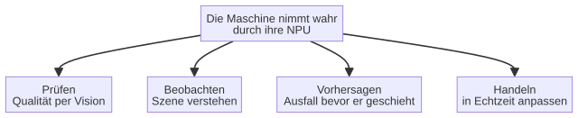

# Kapitel 6 --- Intelligenz auf der Werksflche

## Die vier Aufgaben

Wenn ein kleiner intelligenter Chip in eine Maschine eingebaut wird, werden ihr effektiv vier menschlich anmutende Aufgaben zugewiesen, die vorher ohne ein ganzes Zimmer voller Spezialisten und eine langsame Rundreise in die Cloud nicht möglich waren. Diese vier Aufgaben --- **Prüfen, Beobachten, Vorhersagen und Handeln** --- sind das ganze Vokabular der maschinenintelligenten Verarbeitung, und sobald man sie hat, sieht man sie überall.

Lassen Sie uns sie einzeln betrachten, weil jede bereits echte Arbeit in echten Fabriken verrichtet, und jede ein kleines Wunder der Art ist, um die es in diesem Buch geht.

## 1. Prüfen --- das Auge, das nie blinkt

Die ausgereifteste der vier Aufgaben ist die automatisierte visuelle Prüfung. Eine Fabrik, die irgendetwas herstellt, musste ihre Produkte traditionellerweise prüfen, und traditionell bedeutete das entweder ein menschliches Auge, das nach dem zwanzigsten Teil müde wird, oder eine feste Kamera mit starren Regeln, die sich nicht anpassen konnte. Der NPU verändert beide.

Stellen Sie sich eine Kamera vor, die eine Förderbahn entlang blickt, auf der maschinell bearbeitete Motorblöcke transportiert werden. Ein menschlicher Prüfer hat am Ende einer Schicht Fehler übersehen, die direkt vor ihm lagen, weil Menschen müde werden, weil Menschen wegschauen, weil ein Fehler, den sie schon tausendmal gesehen haben, im Hintergrund verschwimmt. Die intelligente Kamera tut keines dieser Dinge. Sie hat von tausenden Beispielen guter und schlechter Teile gelernt, wie ein Fehler *aussieht*, und klassifiziert jeden Teil in Millisekunden --- nicht mit starren Regeln, sondern mit der flexiblen Urteilskraft eines gelernten Modells. Sie wird müde. Sie schaut nicht weg. Sie läuft vollständig auf der Maschine, auf der Werksfläche, sodass die Bilder das Gebäude nie verlassen und die Prüfung nie auf die Cloud wartet.

Dies ist die „automatisierte Qualitätsprüfung", und sie ist die stille Arbeitspferd der Revolution der denkenden Maschine. Sie tritt auf in Schweißnähten, in Gussteilen, in gedruckten Schaltungen, in den Aufklebern auf einer Flasche. Überall dort, wo ein Produkt gegen einen Standard bewertet werden muss, den ein Mensch artikulieren kann, der aber ein Computer nicht leicht von Hand codieren kann, schlägt ein gelerntes Modell auf einem lokalen Chip sowohl das müde menschliche Auge als auch die starre regelbasierte Kamera.

## 2. Beobachten --- der Geist hinter der Überwachungskamera

Die zweite Aufgabe ist die intelligente Überwachung, dort wo die Kamera aufhört, rein *aufzunehmen* und beginnt, zu *verstehen*. Ein traditionelles CCTV-System nimmt auf, was geschieht, und sonst nichts; das Filmmaterial ist nur nachträglich nützlich, einem Detektiv, der nach einer Kennzeichennummer sucht. Ein intelligentes System, das einem lokalen NPU zugeführt wird, versteht die Szene, während sie stattfindet: es erkennt, dass eine Person eine Zone betreten hat, in die sie nicht Zutritt hat, dass eine Sicherheitsbarriere überschritten wurde, dass ein Feuer entstanden ist, bevor Rauch da war, dass ein Flurförderzeug sich zu schnell auf einen Fußgänger zubewegt.

Der wesentliche Punkt --- und der Grund, warum dies zur sechsten Revolution gehört statt zur gewöhnlichen dritten --- ist, dass das Verstehen *lokal* geschieht. Die Kameras können einen Wächter alarmieren, eine Maschine anhalten oder eine Warnung in Echtzeit ausstoßen, ohne einen Live-Mitschnitt der Werksfläche an einen externen Dienst zu senden. In einem Zeitalter, in dem ein Live-Videomitschnitt einer Fabrik genau die Art von sensiblen Daten ist, die das Gebäude nie verlassen sollte, ist lokales Verstehen nicht nur bequem; es ist die einzig verantwortungsvolle Wahl.

## 3. Vorhersagen --- die Maschine, die weiß, dass sie gleich ausfällt

Die dritte Aufgabe ist die prädiktive Instandhaltung, und sie ist vielleicht die schönste der vier. Eine Maschine sendet fortlaufend Signale aus --- die Vibration ihrer Lager, die Temperatur ihres Motors, die Form des Stroms, den sie zieht, der Ton, den sie macht. Dies sind die *Gesundheitssignale* der Maschine, und sie waren schon immer da, darauf wartend, gelesen zu werden. Der NPU liest sie, nicht als rohe Zahlen, sondern als *Geschichte*.

Das Modell hat von einer langen Geschichte der Signale einer bestimmten Maschine den Ton dieser Maschine bei der Arbeit und den Ton einer Maschine in Not gelernt. Es erkennt, Tage oder Stunden vor einem Ausfall, die subtile Verschiebung, die sagt: *Ich beginne zu klagen*. Es hebt dann nicht nur eine Alarmanhebung; es denkt über die Zukunft nach. Es kann dem Instandhaltungsteam weitherzig und mit echter Vorlaufzeit sagen, dass ein bestimmtes Lager auf einer bestimmten Bahn voraussichtlich ausfallen wird, und es kann die Reparatur *vor* dem Ausfall koordinieren --- vor dem Stillstehen der Bahn, vor der Verspätung eines Kunden, vor dem Versand eines Ersatzteils per Nachtexpress.

Dies ist der Unterschied zwischen dem Reparieren einer Sache, wenn sie gebrochen ist, und dem Reparieren, wenn sie *dir sagt*, dass sie gleich gebrochen wird. Es ist der Unterschied zwischen einer teuren, ungeplanten Notlage und einer billigen, geplanten Intervention. Es ist mit anderen Worten das Geld, das die denkende Maschine der Fabrik fortlaufend in stillen Raten zurückzahlt.

## 4. Handeln --- die Maschine, die etwas tut

Die vierte Aufgabe ist diejenige, die Intelligenz in *Handlungsfähigkeit* verwandelt: die Maschine, die verwendet, was sie wahrnimmt, vorhersagt und beobachtet, um tatsächlich *etwas zu tun*. Ein Arm passt seinen Weg an, weil eine Kamera sah, dass der Teil nicht passte. Eine Roboterhand lockert ihren Griff, weil ein Sensor die Zerbrechlichkeit des Objekts fühlte. Eine Regelungsschleife verspannt oder lockert sich selbst als Reaktion auf die sich ändernden Bedingungen des Schnitts. Dies ist die Grenze zwischen einer Maschine, die bloß *berichtet*, und einer Maschine, die *handelt*, und dort wird die maschinenintelligente Verarbeitung wirklich revolutionär.

Der Grund, warum der lokale NPU diese vierte Aufgabe nicht nur möglich macht, sondern tatsächlich *notwendig* macht, ist die Geschwindigkeit. Um in Echtzeit auf die Welt einzuwirken, muss die Entscheidung lokal, auf der Maschine, in Mikrosekunden getroffen werden. Eine Rundreise in die Cloud wäre viel zu langsam; bis die Antwort zurückkam, war der Moment für das Handeln vorbei. Der NPU auf der Maschine ist es, was die Wahrnehmung schnell genug in Handlung verwandelt, dass es eine Rolle spielt.

## 5. Die Schleife, die sich selbst schließt

Die vier Aufgaben sitzen nicht nebeneinander; sie bilden eine Schleife, die sich selbst schließt, und das Zeichnen dieser Schleife macht das ganze Kapitel klarer als jede beliebige Liste von vier. Die Maschine prüft die Welt, achtet auf das, was sich ändert, vorherzusagen, was sich als Nächstes ändern wird, und handelt --- und durch das Handeln verändert sie genau die Welt, die sie prüft, sodass die Schleife eine Sekunde später wieder beginnt. Auf der Werksfläche dreht sich diese Schleife nicht einmal am Tag; sie dreht sich tausende Male pro Sekunde, in der Zeit, die es dauert, einen einzelnen Teil herzustellen.

Dies ist das Vokabular des ganzen Kapitels auf einen Blick: wahrnehmen, dann beobachten, dann vorherzusagen, dann handeln, und wieder. Jeder Schritt nährt den nächsten, und der Pfeil von *Handeln* zurück zu *Prüfen* ist der Punkt --- die Maschine liest keine feste Instruktionsliste; sie liest fortlaufend die Welt neu, die sie gerade verändert hat. Ein Reflex, abermals, bleibt innerhalb des Körpers; diese Schleife bleibt innerhalb der Maschine.

## Das Auge, das gelernt hat

Es lohnt sich, bei der ersten Aufgabe innezuhalten, weil die automatisierte visuelle Prüfung diejenige ist, die den längsten Weg zurückgelegt hat, und weil sie die ganze Lektion im Kleinen lehrt. Die meiste Zeit des zwanzigsten Jahrhunderts bedeutete die Prüfung eines Teils durch Kamera das Schreiben von Regeln --- miss diese Länge, prüfe, dass diese Ecke rechtwinklig ist, markiere die Farbe außerhalb dieses Bereichs. Solche *regelbasierte* Maschinenblick ist noch weit verbreitet und hervorragend für eine feste, genau definierte Aufgabe. Aber Regeln sind spröde: ändern Sie die Beleuchtung, verschieben Sie den Teil um eine halbe Millimeter, und die Regeln要么 fallen要么 müssen von Hand neu geschrieben werden, immer wieder, von einem Spezialisten, der für genau das ein sehr hohes Geld verdient.

Das gelerntes Modell verwandelt dies von einer Pflicht in ein Geschenk, und es tut dies in einer Weise, die spiegelt, wie ein menschlicher Prüfer tatsächlich sieht. Statt der Kamera eine Checkliste starrer Maße zu übergeben, übergeben ihr ihr eine große Menge von Beispielen --- Fotografien guter Teile, Fotografien defekter Teile --- und lasst sie selbstständig die Merkmale entdecken, die die beiden trennen. Sie kann eine haarfeine Risse finden, an die ein Regel-Schreiber nie dachte, sie zu spezifizieren, weil eine Regel nur sagen kann, was ein Mensch sich zu schreiben erinnerte, während ein Modell sieht, was tatsächlich da ist. Deshalb schlägt, bei echten Prüfungsaufgaben, das gelerntes Modell auf einem lokalen NPU sowohl das müde menschliche Auge als auch die starre regelbasierte Kamera: es wird nicht müde, es schaut nicht weg, und es hat mehr Fehler gesehen als jeder einzelne Prüfer je sehen wird. Die Geschichte des Fachgebiets --- von den ersten regelbasierten Blicksystemen der 1970er Jahre bis zu den gelernten Modellen von heute --- ist die Geschichte einer Industrie, die lernt, die Kamera nicht mehr zu instruieren und ihr schlicht die Welt zu zeigen.

## Eine Linie in der Praxis

Es hilft, die vier Aufgaben zusammen in einem echten Umfeld zu sehen, damit das abstrakte Vokabular zu einer Fabrik wird, die man sich vorstellen kann. Stellen Sie sich eine kleine Linie vor, die Präzisions-Metalteile für die Automobilindustrie bearbeitet: eine CNC-Werkzeugmaschine schneidet jeden Teil, ein Roboterarm befördert ihn zu einer Waschstation, dann zu einer Prüfungskamera, dann zu einer Verpackungsstation, und eine Förderbahn befördert die fertigen Teile ab. Bringen Sie eine billige intelligente Karte an dieser Linie an, und die vier Aufgaben leben zusammen auf.

Die Kamera *prüft* jeden frisch geschnittenen Teil --- nicht mit starren Regeln, sondern mit einem gelerntes Modell, das weiß, wie ein guter Teil aussieht, und markiert die, die außerhalb der Toleranz sind. Der Arm *beobachtet* seine eigene Bewegung durch den Strom, den er zieht, und die Gleichmäßigkeit seines Weges; wenn er eine Erschütterung fühlt, die sagt, dass eine Führung verschleißt, notiert die Karte es. Ein Vibrationsensor am Werkzeugspindel *vorhersagt*: über Wochen lernt die Karte den Ton eines gesunden Schneidwerks und markiert, Tage vor seinem Bruch, die fahle Verschiebung, die bedeutet, dass ein Werkzeug gleich abplatzt --- viel früher, als der Teil der Kamera den Fehler zeigen würde. Und die Karte *handelt*: sie leitet den Arm um die verdächtige Station herum, verlangsamt die Linie und meldet dem Instandhaltungsteam das genaue Werkzeug zum Ersetzen und den Teil, der sich derzeit darauf befindet, sodass die Änderung während einer geplanten Pause geschieht statt mitten im Lauf. Vier Aufgaben, eine Karte, eine Linie, keine Rundreise irgendetwas Cloud. Das ist maschinenintelligente Verarbeitung bei der Arbeit, im gewöhnlichen Wunder einer gewöhnlichen Fabrik.

## Wenn die Maschine falsch liegt

Es gibt hier auch eine ehrliche Kapitel zu schreiben, weil eine Maschine, die wahrnimmt, eine Maschine ist, die falsch liegen kann, und das Fachgebiet muss sich damit auseinandersetzen statt es wegzupretenden. Ein gelerntes Modell wird auf Beispielen trainiert, und so kann es nur so gut sein wie die Daten, die es gesehen hat. Wenn die Beispielen dünn, voreingenommen oder nicht repräsentativ sind, wird das Modell selbstsichere Fehler machen --- einen Fehler falsch einschätzen, der nie in seinem Training war, oder einen vollkommen guten Teil als schlecht markieren. Dies ist kein Fehler, der beseitigt werden muss; es ist eine Bedingung, die verwaltet werden muss. Die Praxis, die sie verwaltet, ist einfach: füttern Sie das Modell mit guten, repräsentativen, aktuellen Beispielen; beobachten Sie, wie es auf der tatsächlichen Werksfläche performt; und trainieren Sie es neu, wenn sich die Welt ändert --- ein neuer Teil, eine neue Beleuchtung, ein neuer Lieferant. Es ist dieselbe Disziplin, die jeder ehrliche Ingenieur an jedem ehrlichen Instrument anwendet: keine Messung ist unfehlbar, aber eine gut gewartete ist vertrauenswürdig, und eine schlecht gewartete ist es nicht.

Die menschliche Rolle verschwindet daher nicht, wenn die Maschine wahrnimmt; sie verändert sich. Der Bediener prüft nicht mehr jeden zwanzigsten Teil mit dem Auge; stattdessen kuratiert der Bediener, zusammen mit dem Instandhaltungsteam, die Beispielen, beobachtet die Urteile der Maschine über die Zeit und bleibt die letzte Autorität, wo die Einsätze hoch sind --- wo eine falsche Markierung einen Rückruf der Sendung bedeutet, oder eine verpasste einen fehlerhaften Teil nach außen zu einem Kunden gehen lässt. Die intelligente Kamera auf der Werksfläche ersetzt den Menschen nicht; sie hebt den Menschen auf eine höhere Aufgabe, vom Drehen eines Reglers jeden zwanzigsten Teil hin zum Gesundhalten des Auges der Maschine. Das ist die ehrliche und die bessere Nachricht des ganzen Kapitels: maschinenintelligente Verarbeitung hebt den Menschen nicht von der Werksfläche ab; sie hebt die Aufgabe des Menschen eine Stufe hinauf, von der Wiederholung zur Aufsicht.

## Die Kosten eines verpassten Teils

Es gibt noch einen weiteren Grund, warum die vier Aufgaben wichtig sind, und es ist der Grund, aus dem der Fabrikbesitzer tatsächlich kümmert: die Wirtschaftlichkeit eines verpassten Teils. Ein Fehler, der die Prüfung entgeht, ist selten kostenlos. Er kostet den verworfenen Teil, ja, aber auch den Teil, den er stromabwärts beschädigt, die Ausfallzeit, die er verursacht, den Kunden, den man verliert, und den Rückruf --- manchmal den Rückruf --- den ein einzelner ungesichteter Mangel in Gang setzen kann. Auf einer schnellen Linie bleibt ein verpaster Fehler nicht eine kleine Kostenstelle; er verzinst sich, und bis zum Ende der Schicht kann er sich zu einer Krise aufschaukeln. Dies ist die Arithmetik, die die intelligente Kamera von einer Haftung in ein Vermögen verwandelt.

Die Wirtschaftlichkeit ergibt sich natürlich. Ein menschlicher Prüfer, der nach dem zwanzigsten Teil müde wird, könnte neun von zehn Fehlern erwischen und den zehnten entgehen lassen --- und der zehnte ist derjenige, der einen Kunden erreicht. Eine regelbasierte Kamera, spröde gegenüber Beleuchtung und der halben-Millimeter-Verschiebung eines Teils, kann diejenige verpassen, die sich bewegen. Das gelerntes Modell auf einem lokalen NPU verpasst fast nichts, weil es nicht müde wird, es schaut nicht weg, und ihm wurden mehr Beispielen gezeigt als jeder Mensch in einem Leben übersiehen könnte. Das Ergebnis ist keine marginale Verbesserung, sondern eine andere Art von Wirtschaftlichkeit: wo ein Mensch oder eine starre Kamera einen kleinen Bruchteil der Fehler durchlässt --- einen Bruchteil, der bei hoher Liniengeschwindigkeit eine Flut ist --- lässt die intelligente Kamera fast keinen durch, und die Einsparungen sind daher groß, fortlaufend und still. Dies ist das Geld, das die denkende Maschine der Fabrik in stillen Raten zurückzahlt, für Jahre. Und es ist nicht das Geld eines Wunders; es ist das Geld einer Maschine, die einfach die vier Aufgaben, für die sie gebaut wurde, besser tut als jeder Mensch oder jede Regel.

## Der einzelne Faden

Prüfen. Beobachten. Vorhersagen. Handeln. Diese vier Aufgaben sind das Ganze der maschinenintelligenten Verarbeitung, und sie teilen alle eine wesentliche Qualität: sie passieren *auf der Maschine*, lokal, sofort, privat. Das ist der Faden, der dieses Kapitel mit jedem anderen Kapitel in Teil II verbindet. Die Intelligenz ist kein Gast in einem Raum; sie ist ein Einwohner des Feldes, auf dem Spindel, direkt das Feld berührend. Und sobald die Maschine für sich selbst sehen, beobachten, vorherzusagen und handeln kann, folgt eine Frage natürlich: *was ersetzen wir, um dies möglich zu machen?* Die Antwort ist überraschend eines der dauerhaftesten und vertrautesten Stücke von Hardware in der modernen Fabrik. Das ist das Thema des nächsten Kapitels.
