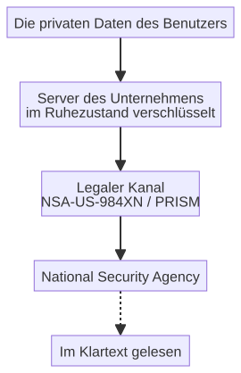

# Kapitel 10 --- Wenn die Wolke dein Unternehmen stahl

## Der Morgen, an dem sich die Welt veränderte

Am sechsten Juni des Jahres zweitausenddreizeig veröffentlichten zwei Zeitungen --- *The Guardian* und *The Washington Post* --- am selben Tag eine Geschichte, die stillsam und dauerhaft verändern sollte, wie die Welt über Daten dachte. Seit Jahren betrieb eine amerikanische Behörde namens National Security Agency ein Programm zur Sammlung gewaltiger Mengen privater Kommunikation, und die neu veröffentlichten Dokumente enthüllten nicht nur, dass dieses Programm existierte, sondern dass auch die großen Technologieunternehmen *beteiligt* gewesen waren, indem sie die Daten ihrer Nutzer an die Behörde weitergaben. Das Programm trug einen Namen: **PRISM**.

Ein Mann hatte diese Geschichten ans Licht gebracht. Sein Name war Edward Snowden, ein amerikanischer Auftragsarbeiter, der im vorherigen Monat mit Dokumenten nach Hongkong geflogen war, die alles verändern würden. Die Zeitungen, die seinen Anteil an der Geschichte veröffentlichten, *The Guardian* und *The Washington Post*, würden später den Pulitzer-Preis für Öffentlichkeitsarbeit 2014 teilen. Es lohnt sich, diesen Moment zu erinnern, nicht weil er fern liegt, sondern weil er der Moment ist, in dem die moderne Wolke --- die Wolke, mit der dieses Buch am Ende die Fabrik verbinden wird --- für die meisten Menschen erstmals ein Ort wurde, über den man *vorsichtig* sein sollte.

Der Tag, an dem die Geschichte bekannt wurde, brachte nicht die kalte, analytische Reaktion der Ingenieure hervor, sondern die wärmere, schärfere Reaktion von Menschen, die sich als verraten fühlen. Ein Dienst, den man *wählte*, um ihn zu nutzen --- ein Dienst, dem man gerade weil er praktisch war, vertraute --- hatte ohne sein Wissen und ohne seine Zustimmung seine privaten Nachrichten an eine Regierung weitergegeben. Der Sinn des Verrats ist der Punkt: Wir haben nichts dagegen, dass ein Staat *unsere* Briefe lesen *kann*; wir haben dagegen, dass er es tat, stillsam, durch genau die Unternehmen, denen wir vertraut hatten, sie zu schützen. Und dieser Unterschied --- der Unterschied zwischen einer *Fähigkeit* und einem *Verrat* --- ist das ganze moralische Gewicht des Dataskandals, und er ist zugleich das ganze moralische Gewicht des folgenden Kapitels.

## Der italienische Name

In der englischsprachigen Welt ist der Skandal unter mehreren Namen bekannt: PRISM, die NSA, der Überwachungsstaat. In der italienischen Presse, wo die Geschichte mit besonderer Intensität verfolgt wurde, trägt er einen eigenen Namen: **datagate** --- ein Suffix, das sich das „-gate" leiht, das Watergate erfand, um jeden Skandal zu markieren, der einen Machtmissbrauch beinhaltet. Die italienische Presse griff nach diesem Suffix, weil die Geschichte in ihrem Kern eine Geschichte über Machtmissbrauch war: die Macht eines Staates, zu lesen, was private Menschen als privat angesehen hatten.

Der technische Name des Programms ist PRISM, mit der NSA-Bezeichnung **US-984XN**. Es erschien nicht über Nacht. Seine rechtliche Grundlage wurde in **Section 702 des FISA Amendments Act von 2008** gefestigt --- später, in 2012 und erneut in 2024, wieder autorisiert --- und es lief, laut den veröffentlichten Dokumenten, seit etwa 2007. Wenn wir also sagen, dass der Skandal 2013 ausbrach, meinen wir, dass er *dann* für die Öffentlichkeit ausbrach; die Maschine war seit Jahren völlig außerhalb des Blickfelds in Betrieb.

## Der Mechanismus des Verrats

Was die veröffentlichten Dokumente am wirksamsten zeigten, war nicht *dass* die Unternehmen beteiligt waren, sondern *wie*. Der Mechanismus war auf seine Weise banal, und gerade seine Banalität ist es, die ihn wichtig macht. PRISM erforderte nicht, dass die NSA in die Systeme der Unternehmen einbrach --- das ist das Kino der Spionage, nicht ihre Praxis. Stattdessen hielt jedes Unternehmen, gesetzlich verpflichtet, einen direkten Kanal, durch den es *angefordert* werden konnte --- und in den meisten Fällen *gezwungen* wurde --- die Daten eines bestimmten Users weiterzugeben. Das Unternehmen wurde statt gebrochen zu werden, zu einem *Wächter*: einem Punkt, durch den die Daten aller seiner Nutzer auf Anforderung in die Behörde gegossen werden konnten.

Dies ist ein subtiler, aber entscheidender Unterschied, und es lohnt sich, ihn sorgfältig festzuhalten, weil er die Weise verändert, wie wir über Verantwortung denken. Ein Unternehmen, dessen Systeme *gehackt* werden, ist ein Opfer. Ein Unternehmen, das eine Tür hält, durch die der Staat eintreten kann --- eine Tür, die es das Gesetz zwingt, offen zu halten --- ist, einen unangenehmen Wortgebrauch verwendet, ein *Partner*. Die veröffentlichten Dokumente deuteten für die meisten der auf der Liste stehenden Unternehmen auf letzteres hin: nicht eine erzwungene Hand, sondern eine willige, oder zumindest eine kooperative, bis zu dem Punkt, an dem das Gesetz mehr verlangte. Die genaue Balance aus Zwang und Kooperation variierte von Unternehmen zu Unternehmen und im Laufe der Jahre; das veröffentlichte Archiv klärt sie nicht, und ich werde nicht so tun, als kläre sie dies.

Das Unternehmen, das die Tür offen hielt, las deine Nachrichten nicht und gab sie von Hand weiter. Es hielt auf der Ebene der Architektur einen Punkt, an dem deine Daten *entnommen werden konnten*. Der Verrat war nicht persönlich; er war *strukturell*. Er war eingebacken in den Entwurf des Dienstes, in die Nutzungsbedingungen, die man ohne Lesen akzeptierte, in das rechtliche Gefüge, das Widerleistung ohne Wider gegen das Gesetz selbst unmöglich machte. Und genau dieses Detail muss der Fabrikbesitzer verinnerlichen, weil die sechste Revolution eine identische strukturelle Wahl zu bestehen hat.

Das obere Diagramm ist ein vereinfachtes Bild des Mechanismus: deine Daten, die von einem Unternehmen hinter seinen eigenen Mauern gehalten wurden, durchquerten einen *legalen Kanal* zur Behörde, die sie im Klartext lesen konnte. Das Schlüsselwort ist *Kanal* --- das Unternehmen verlor die Kontrolle über die Daten nicht an einen Dieb; es hielt freiwillig einen Eingang, durch den der Staat gehen konnte. Das ist der Unterschied zwischen einem Einbruch und einer Verschwörung, und datagate war im Kern eine Verschwörung, die in die Architektur der modernen Wolken eingebacken war.

## Die Liste der Beteiligten

Der auffälligste Detail in den veröffentlichten Dokumenten war eine Liste. Sie nannte, mit dem Jahr ihres Beitritts, die großen Technologieunternehmen, die sich --- unter rechtlichem Zwang oder, wie das Archiv nahelegt, in williger Kooperation --- bereit gefunden hatten, der NSA Zugang zu den Daten ihrer Nutzer zu gewähren. Die Liste liest sich wie ein Who's-Who des digitalen Zeitalters:

  Unternehmen                 Jahr ihres Beitritts zu PRISM
  ------------------------- ----------------------------------
  Microsoft                 2007
  Yahoo                     2008
  Google                    2009
  Facebook (heute Meta)     2009
  Paltalk                   2009
  YouTube                   2010
  AOL                       2011
  Skype                     2011
  Apple                     2012

Neun der vertrautesten Namen der Technologie, datiert, als ob sie auf einem Inventar standen. Genau dieser Detail machte die Geschichte im öffentlichen Geist haften: nicht die abstrakte Idee der Überwachung, sondern eine *Liste*, alphabetisch und vollständig, der Unternehmen, die sich nicht zwischen ihre Nutzer und den Staat stellen würden. Es ist leicht, dies als Politik abzutun, und ein Großteil der Berichterstattung über datagate war tatsächlich politisch. Aber es gibt hier eine Lehre für den Fabrikbesitzer und das Unternehmen, und sie ist diese: **Wenn du deine Daten an eine öffentliche Wolke sendest, gibst du, in genau derselben Weise, einer dritten Partei Zugang zu ihnen --- egal ob diese dritte Partei ein Staat, ein Hacker oder ein Unternehmen ist, das Aufmerksamkeit verkauft.** Der Mechanismus des Verrats ist derselbe. Die einzige Frage ist, wem man die Schlüssel übergeben hat.

## Der persönliche Preis

Es lohnt sich, auf den menschlichen Detail einzugehen, weil Statistiken über Millionen das Grauen verwischen, und weil die veröffentlichten Dokumente im Laufe der Zeit spezifische Menschen nannten, die in der Maschine gefangen waren. Das am häufigsten genannte Beispiel ist das eines deutschen Staatsbürgers, der 2014 von *The Guardian* berichtet wurde, dessen Name auf einer Watchlist der Central Intelligence Agency erschien, fast ausschließlich wegen der Dinge, die er auf Facebook *gemocht* hatte --- eine Handvoll Interessen, die für einen ausländischen Geheimdienst ausreichend waren, Aufmerksamkeit zu rechtfertigen. Er hatte nichts Illegales getan; er hatte einfach *einige Seiten gemocht*, und eine Datenbank, die gebaut wurde, um die Kommunikation aller zu sammeln, hatte ihn unter alle mit fortgerissen. Es gab in der Berichterstattung keine indication, dass er je bedroht worden war --- nur dass er *gesehen* wurde, automatisch, von einer Maschine, die nicht kümmerte, ob er schuldig war.

## Die Reaktion und die Reue

Es lohnt sich, auf die Reaktion einzugehen, weil sie zeigt, wie die Öffentlichkeit schließlich die Gefahr verstand --- verspätet, aber unbestreitbar. Die erste und einflussreichste Reaktion kam nicht von den betroffenen Nutzern, sondern von den Gründern der Unternehmen selbst. In 2013 schrieb Bill Gates einen weit gelesenen offenen Brief, in dem er mit leiser Dringlichkeit argumentierte, dass Verschlüsselung bewahrt werden müsse und dass die Vereinigten Staaten „auf dem falschen Weg" seien in Bezug auf Überwachung; dass die Abhilfe nicht sei, den Staat mehr zu vertrauen, sondern *weniger* ihm zu vertrauen, indem man die Daten für seinen Inhaber unlesbar machte. In jenem Jahr unterzeichneten die Gründer von zehn der einflussreichsten Technologieunternehmen --- Google, Apple, Microsoft und andere --- öffentlich einen Brief, gerichtet an den Präsidenten der Vereinigten Staaten, der für die Bewahrung starker Verschlüsselung argumentierte; es war, in Wirkung, eine Industrie, die gemeinsam anerkannte, dass datagate die alte Annahme als falsch gezeigt hatte.

Die Industrie begann langsam, ihre Seite zu nehmen: End-zu-End-Verschlüsselung verbreitete sich von Messaging-Apps bis hin zu Cloud-Speicher, gerade weil die Lehre von datagate war, dass ein Unternehmen, das deine Daten lesen kann, auch *gezwungen* werden kann, deine Daten zu lesen. Dies ist der entscheidende Wendepunkt, und er ist das Scharnier, an dem sich der Rest dieses Buches dreht. Die Öffentlichkeit erkannte im Nachgang von datagate, dass die wahre Garantie der Privatsphäre nicht das *gute Vertrauen* des Wolkenbetreibers war, sondern dessen *Unfähigkeit zu lesen*. Ein Tresor, der von einem ehrlichen Wächter gehalten wird, ist dennoch verwundbar --- der Wächter kann bestochen, gefeuert oder durch Vorladung gezwungen werden. Ein Tresor, dessen Schloss niemand außer dir hält, ist das nicht. Diese Einsicht --- dass Sicherheit eine Eigenschaft der *Architektur* sein muss und nicht des *Charakters des Betreibers* --- ist die gesamte Prämisse der vertrauenslosen, Zero-Knowledge-Wolken, die dieser Skandal zur Existenz gezwungen hat.

## Die Zahl, die nie geklärt wurde

Eine Zahl, die die veröffentlichten Dokumente nie klären konnten, war die schiere Menge der gesammelten Daten. Unterschiedliche Schätzungen schwankten wild, von etwa fünfzigtausend Dokumenten bis hin zu einer halben Million. Der Bereich ist kein Mangel in der Berichterstattung; er ist selbst der Punkt. Selbst die *niedrigste* Schätzung ist groß genug, um zu zählen, und die Tatsache, dass niemand sich über die *Gesamtmenge* einigen konnte, ist gerade der Beweis dafür, wie viel entnommen wurde. Die Daten eines Unternehmens --- seine Produktionszahlen, seine Lieferantenverträge, seine Kundenlisten, seine Pläne --- könnten prinzipiell unter jenen Millionen entnommener Bytes sein, und niemand könnte dir sagen, welche, oder ob sie je gelesen wurden.

Die ungeklärte Zahl ist in Wahrheit ein Geschenk für den sorgfältigen Leser, weil sie eine allgemeine Regel lehrt, die ich durch dieses Buch hindurch mitführen werde: **Wenn du nicht benennen kannst, wie viel Daten entnommen wurden, kannst du auch nicht vertrauen, dass irgendeiner deiner Daten verschont wurde.** Ein Unternehmen, das „alles, unverdiebt" sammelt, sammelt *dich* unter dem alles, und der einzige Weg, sicher zu sein, dass man nicht gesammelt wird, ist, deine Daten so zu machen, dass sie unlesbar sind, selbst wenn sie entnommen werden. Das ist das Versprechen der Wolken, die innerhalb der Mauern gehalten werden.

## Was ein Unternehmen tun kann

Die Lehre von datagate ist nicht bloß warnend; sie ist *handhabbar*, und es lohnt sich, klar zu benennen, was ein Unternehmen --- jedes Unternehmen, jeder Größe --- tun kann, um den Fehler zu vermeiden, den der Skandal offengelegt hat. Die Prinzipien sind wenige, und keines von ihnen ist exotisch.

Das erste ist, *den Schlüssel zu halten*. Jede Daten, die es zu schützen lohnt, muss mit einem Schlüssel verschlüsselt werden, den das Unternehmen selbst hält, so dass selbst das System, das die Daten speichert und bewegt, sie nicht lesen kann. Dies ist der einzelne wichtigste Zug, und er ist derjenige, der „wir vertrauen unserem Wolkenanbieter" in „wir müssen unserem Wolkenanbieter nicht vertrauen" verwandelt.

Das zweite ist, *die Wolken innen zu halten*. Wo die Daten das Bild der Zukunft des Unternehmens sind --- seine Produktion, seine Lieferanten, seine Kunden --- sollte die Wolken, die sie hält, unter der eigenen Kontrolle des Unternehmens stehen, nicht ein gigantisches öffentliches Datenzentrum, das von einer Handvoll Firmen gehört. Eine private, Zero-Knowledge-Wolken ist kein Luxus für die Paranoiden; sie ist die gewöhnliche Umsicht eines Unternehmens, das gelernt hat, was eine öffentliche Wolken zu tun gezwungen werden kann.

Das dritte ist, *nur zu senden, was nötig ist*. Das Volumenproblem des vorherigen Kapitels ist zugleich ein Datenschutzproblem: Indem das Unternehmen die Daten am Rand reduziert, sendet es Zusammenfassungen und Alarme statt des rohen Geständnisses seiner Operationen, und hält das tiefe, intime Detail lokal. Die wenigste Daten, die reisen, sind die wenigsten Daten im Risiko.

Diese drei Züge erfordern kein Fachpersonal oder ein Datenzentrum-Budget; sie erfordern eine Entscheidung, einmal getroffen, die Daten des Unternehmens als seine eigenen zu behandeln. Und diese Entscheidung ist, am Ende, dieselbe Entscheidung, die die sechste Revolution von jeder Fabrik verlangt: die Intelligenz, und die Daten, und den Schlüssel auf deiner Seite der Mauer zu halten.

## Die Lehre für die Fabrik

Warum betrifft ein Skandal über Spione eine Fabrik, die eine intelligente Maschine aufbaut? Weil die sechste Revolution die Neigung hat, eine ganze Menge der Daten dieser Fabrik *nach außen* zu senden. Eine Maschine, die wahrnimmt, vorhersagt und berichtet, wird Telemetrie erzeugen --- Produktionsraten, Komponentenbilder, Lieferanteninformationen, Betriebsmuster --- und diese Telemetrie muss *irgendwohin* gehen. Für die meisten der Wolkenära bedeutete „irgendwohin" die öffentliche Wolken: die gigantischen Datenzentren, die von einer Handvoll Firmen gehören, genau die Unternehmen auf jener Liste.

datagate war der Moment, in dem die Öffentlichkeit verstand, in der Weise, die ein Skandal immer erzeugt, dass eine öffentliche Wolken kein Tresor ist. Sie ist der Computer eines anderen, und der Betreiber dieses Computers kann --- oder kann willig sein --- dazu gezwungen, alles zu lesen, was man dort speichert. Die Fabrik, die ihre kostbare Telemetrie in eine öffentliche Wolken sendet, gibt, in genau derselben Weise wie die Nutzer auf jener Liste, einer dritten Partei Zugang zu ihren empfindlichsten Informationen. Es ist eine Lehre, die die sechste Revolution sich nicht leisten kann zu ignorieren, weil die Daten einer Fabrik, ganz wörtlich, ihre Zukunft ist, die sichtbar gemacht wurde. Das nächste Kapitel ist um die Antwort, die dieser Skandal zur Existenz gezwungen hat: die Wolken, die ihr Geheimnis hält, die Wolken, die *innerhalb* der Mauern gehalten wird.
