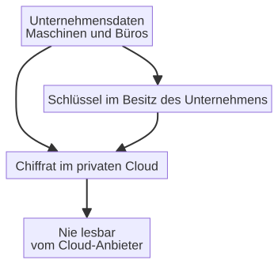

# Kapitel 11 --- Die Wolke innerhalb der Mauern

## Der Widerspruch

Bis zur Mitte der 2010er Jahre hatte sich ein Widerspruch bei der Nutzung der Wolke eingestellt, und es war ein Widerspruch, den jeder durchdachte Ingenieur fühlen konnte, den aber noch niemand gelöst hatte. Auf der einen Seite war die Wolke unbestreitbar nützlich --- sie bot Speicher, Rechenleistung und Konnektivität auf einer Skala, die kein einzelnes Unternehmen erreichen konnte, und sie ließ Maschinen und Büros über Distanz miteinander sprechen. Auf der anderen Seite hatte der Skandal um Datagate ebenso deutlich gemacht, dass eine öffentliche Wolk ein Ort ist, an dem man *niemandem vertrauen kann* --- der Betreiber könnte gezwungen werden oder bereit sein, alles zu lesen, was man dort speichert, und sobald deine Daten dein Gebäude verlassen hatten, hattest du ihre Kontrolle nicht mehr.

So wurde die Frage scharf und unausweichlich. Gibt es eine Wolke, die die *Nützlichkeit* der Wolke --- den Speicher, die Synchronisierung, die Fähigkeit von Maschinen und Büros, eine einzige lebendige Kopie der Wahrheit zu teilen --- bewährt, während sie das *Geheimnis* aufrecht erhält, das die öffentliche Wolke preisgegeben hat? Kann ein Unternehmen eine Wolke haben, die genuinely seine eigene ist, so dass seine Daten das Gebäude nie verlassen, und nie, selbst unter Zwang, von einer dritten Partei gelesen werden?

Die Antwort, wie sich die Projekte hinter diesem Buch bei ihrem Aufbau herausstellte, lautet ja --- aber nur, wenn du bereit bist, der Wolke zwei neue Eigenschaften zu geben, die die alte Wolke nie hatte: sie muss **vertrauenslos** sein, und sie muss **nullwissend** sein. Lasst uns diese zwei Worte ernst nehmen, denn sie sind die ganze Innovation.

## Die vertrauenslose Wolke

"Vertrauenslos" ist ein Ausdruck, der aus der Welt der Kryptographie und der verteilten Systeme stammt, und er klingt wie eine seltsache Sache, die man von etwas so Hilfreichem wie einer Wolke wünscht. Wir *vertrauen* normalerweise den Diensten, die wir nutzen; genau deshalb nutzen wir sie. Eine Wolke als "vertrauenslos" zu bezeichnen, heißt zu sagen, dass du dem Betreiber nicht *vertrauen musst*, um deine Daten korrekt zu behandeln. Du musst nicht vertrauen, dass sie deine Daten nicht weiterleiten, dass sie nicht bestochen werden, dass sie nicht gezwungen werden, deine Dateien herauszugeben und sie zu lesen. In einer vertrauenslosen Wolke ist es die Architektur des Systems --- nicht die guten Absichten des Betreibers --- was deine Daten sicher hält.

Der Weg, auf dem dies erreicht wird, besteht darin, sicherzustellen, dass die Daten *mit Schlüsseln verschlüsselt sind*, die nur dein Unternehmen hält, und dass die Wolk die Daten verarbeiten, speichern und synchronisieren kann, *ohne jemals in der Lage zu sein, sie im Klartext zu sehen*. Die Wolke bewegt deine Daten, hält sie konsistent, macht sie für deine Maschinen und dein Büro verfügbar --- aber sie besitzt nie die Macht, sie zu *lesen*, weil sie den Schlüssel nicht hält. Es ist wie ein Kurier, der einen verschlossenen Safe liefern kann, aber nicht öffnen kann. Der Kurier ist nützlich und zuverlässig, und er ist völlig unfähig, dich zu verraten. Das ist die vertrauenslose Wolke: nützlich, und unfähig, dich zu verraten.

## Der entscheidende Unterschied

Es gibt ein Detail, das fast jeder missversteht, und es lohnt sich, es langsam zu betrachten, denn es ist der ganze Punkt. Die öffentliche Wolk --- die riesige, zentralisierte, kommerzielle Wolk der 2010er Jahre --- *verschlüsselt* deine Daten. Sie verschlüsselt sie, während sie über das Netzwerk reisen (Verschlüsselung in Transit), und sie verschlüsselt sie, während sie auf der Festplatte schläft (Verschlüsselung im Ruhezustand). Also tut der naive Einwand, "verschlüssle sie einfach", nichts zur Lösung des Problems, weil die öffentliche Wolk bereits verschlüsselt.

Der relevante Unterschied ist dieser: In der öffentlichen Wolk hält der *Betreiber die Schlüssel*. Die Verschlüsselung ist die eigene des Betreibers; sie wird für die eigenen Gründe des Betreibers angewendet --- um eine Vorschrift zu erfüllen, um die Haftung zu begrenzen, um vor äußeren Dieben zu schützen. Aber der Betreiber kann jederzeit deine Daten entsperren, lesen, herausgeben. Die Verschlüsselung im Ruhezustand ist eine *Bequemlichkeit* für den Betreiber, keine *Garantie* für dich. Wenn der Betreiber gezwungen wird, oder bereit ist, kann er einfach seinen Schlüssel anwenden, und deine Daten --- im Klartext, lesbar, nicht mehr deine --- werden dem übergeben, der darum gebeten hat.

Die vertrauenslose, nullwissende Wolk verändert *wer den Schlüssel hält*. In dieser Wolk ist der Schlüssel nicht der des Betreibers; er ist *deiner*, und er verlässt nie dein Gebäude. Die Daten werden verschlüsselt, bevor sie gesendet werden, mit einem Schlüssel, den der Betreiber nicht besitzt, so dass selbst die Verschlüsselung im Ruhezustand auf der Festplatte des Betreibers für sie bedeutungslos ist. Sie können deinen verschlossenen Safe speichern, bewegen, Kopien davon halten, über ihre Server synchronisieren --- aber sie können ihn nicht öffnen, weil sie den Schlüssel nie hatten. Die Verschlüsselung ist keine Bequemlichkeit des Betreibers mehr; sie ist *deine* Garantie, auf einer Ebene angewendet, die der Betreiber nicht rückgängig machen kann. Das ist der Unterschied zwischen einem Tresor, der von einem ehrlichen Wächter des Betreibers bewahrt wird, und einem Tresor, der von Design her nicht zu öffnen ist. Ersteres ist Datagate; letzteres ist die Wolke innerhalb der Mauern.

## Die nullwissende Wolke

"Nullwissend" ist ein Ausdruck aus einem Zweig der Kryptographie, der fast paradox klingt, und es lohnt sich, es langsam zu betrachten. In der Kryptographie ist ein "Nullwissens-Beweis" eine Möglichkeit, dass eine Partei einer anderen beweisen kann, dass eine Aussage wahr ist --- *ohne irgendwelke Informationen jenseits der Wahrheit der Aussage selbst offenzulegen.* Das klassische Beispiel ist eine Höhle mit einem Geheimwort, das hinter einer Tür verschlossen ist. Eine Person, die das Wort kennt, kann wiederholt beweisen, dass sie es kennt --- durch eine Tür hinein und durch die andere heraus --- ohne das Wort jemals *auszusprechen*. Sie beweisen Wissen, ohne Wissen zu vermitteln. Daher "nullwissend": der Beweis vermittelt nichts jenseits der Tatsache, dass der Beweis erfolgreich war.

Auf die Wolk angewendet, bedeutet nullwissend, dass die Wolk deine Daten verifizieren und verarbeiten kann, ohne jemals die Daten selbst zu erfahren. Die Maschine verschlüsselt ihre Telemetrie, bevor sie sie sendet, hält den Schlüssel, und die Wolk --- selbst die Wolk, die sie speichert und synchronisiert --- kann sie nicht lesen. Die Wolk operiert auf Chiffretext, auf dem verschlossenen Safe, nie auf den Inhalten. Wenn die Daten im Büro benötigt werden, werden sie dort entschlüsselt, von deinem Unternehmen, mit deinem Schlüssel. Die Wolk ist, in der wörtlichsten Bedeutung, *blind* für die Inhalte deiner Daten. Sie ist ein Wächter, der einen Tresor bewahren kann, aber nie darin sehen kann.

Um dies für die Fabrik konkret zu machen: der Sensor an der Spindel sendet keine Gleitkommazahl an die Wolk; er sendet einen *Chiffretext*, das Produkt der Verschlüsselung dieser Zahl mit einem Schlüssel, den die Wolk nicht hält. Die Wolk speichert diesen Chiffretext, hält ihn über ihre Server hinweg konsistent, macht ihn für das Büro verfügbar --- alles dabei, während sie unfähig ist zu erfahren, ob die Zahl 42 oder 42.000 war, ob das Lager gesund oder im Begriff zu versagen war. Es ist, in der strengsten Bedeutung des Wortes, *informationsblind*. Sie kann sehen, dass Daten sich bewegen; sie kann nicht sehen, was die Daten *sind*. Das ist die ganze Versprechung der nullwissenden Wolk, und es reicht aus, um den Verrat der öffentlichen Wolk, dem wir im vorherigen Kapitel begegnet sind, unmöglich zu machen.

## Die CloudServer

Das Projekt, das diese Idee verkörpert --- die Wolk innerhalb des Unternehmens gehalten, vertrauenslos und nullwissend --- heißt **CloudServer**, eines der Projekte, die vom Labor hinter diesem Buch veröffentlicht wurden. Wo die öffentliche Wolk Daten in einer Handvoll riesiger Rechenzentren zentralisiert, die gelesen (oder gezwungen werden können, zu lesen), *dezentralisiert* eine private, nullwissende Wolk wie CloudServer das Vertrauen: die Daten verlassen nie die Kontrolle des Unternehmens, weil das Unternehmen nie den Schlüssel preisgibt. Die Wolk ist innerhalb der Mauern, oder zumindest innerhalb der Autorität des Unternehmens, und sie ist nutzlos für einen Spion, einen Hacker oder einen Gerichtsbefehl, weil es nichts zu lesen gibt.

Dies ist keine Hypothese. Die Architektur existiert, sie ist veröffentlicht, und sie wird gebaut, um genau das Problem zu lösen, das Datagate unausweichlich gemacht hat. Die Fabrik, die wahrnimmt, vorhersagt und berichtet --- die Fabrik der vorherigen Kapitel --- produziert Daten, die nach jedem vernünftigen Standard das sensibelste Asset des Unternehmens sind. Produktionspläne, Lieferantenverträge, Komponentendesigns, Betriebsmuster: dies ist das Bild der Zukunft des Unternehmens, sichtbar gemacht. Es ist genau diese Daten, die die seiste Revolution *innerhalb der Mauern* halten muss, und eine private, vertrauenslose, nullwissende Wolk ist die einzige Art von Wolk, die sie halten kann, ohne sie zu verraten.

Der Weg, auf dem CloudServer dies ausführt, ist lehrreich, und es lohnt sich, die Daten einmal durch sie hindurch zu verfolgen, denn der Mechanismus ist der ganze Beweis. Die Maschine, oder die Büroanwendung, hält den Schlüssel. Sie verschlüsselt ihre Daten *bevor* sie das Gebäude verlassen. Dann sendet sie nur noch *Chiffretext* --- den verschlossenen Safe --- an die CloudServer. Der Server speichert, synchronisiert und liefert diesen Chiffretext an jede autorisierte Maschine und jedes Büro, alles ohne jemals den Schlüssel zu halten, der ihn entsperren könnte. Wenn eine Maschine die Daten benötigt, liefert der Server den Chiffretext zurück; die Maschine --- nicht der Server --- entschlüsselt sie lokal, mit dem Schlüssel, den sie behalten hat. Der Server ist ein stiller, blindender Kurier für die Daten des ganzen Unternehmens, fähig, sie zu bewegen und zu halten, aber nie, sie zu lesen. Das ist die ganze Innovation, und es ist es, was die Wolk innerhalb der Mauern im wörtlichsten Sinne *vertrauenslos* macht.

Das obige Diagramm ist, ich hoffe, ein treues Bild des Mechanismus: der Schlüssel bleibt innerhalb des Gebäudes, die Daten reisen und werden nur als Chiffretext gespeichert, und der einzige Ort, an dem die Daten jemals lesbar werden, ist *innerhalb der eigenen Mauern des Unternehmens*, auf einer Maschine, die den Schlüssel hält. Die CloudServer ist bei jedem Schritt präsent außer dem letzten und dem ersten; sie ist der Träger, nicht der Leser. Das ist die Wolk, die Datagate notwendig gemacht hat, und es ist es, was die kostbarste Telemetrie der Fabrik endlich, sicher, an den Ort reisen lässt, an dem darüber nachgedacht wird.

## Was der Schlüssel tatsächlich kostet

Es lohnt sich, bei einem praktischen Einwand zu verweilen, denn es ist der, der sich zuerst in jedem realen Unternehmen ergibt: Wenn die Wolk die Daten nicht lesen kann, wie kann sie dann irgendetwas Nützliches mit ihr tun? Die Sorge ist verständlich, und es lohnt sich, sie klar zu beantworten, denn die Antwort ist zugleich der Grund, warum die nullwissende Wolk nicht nur eine Neugierde, sondern ein funktionierendes Design ist.

Die Aufgabe der Wolk ist es in dieser Architektur nicht, zu *denken*. Sie ist zu *tragen und zu halten*: die Daten zuverlässig zu speichern, sie über jede Maschine und jedes Büro hinweg zu synchronisieren, sie im Augenblick verfügbar zu machen, in dem sie angefordert wird, den Ausfall einer Festplatte oder eines Servers zu überleben, und dies auf der Skala eines ganzen Unternehmens. Keiner dieser Aufgaben erfordert das Lesen der Daten. Ein Kurier muss einen Brief nicht lesen, um ihn pünktlich zu liefern; ein Lager muss eine Kiste nicht verstehen, um sie sicher zu speichern. Die Wolk ist der Kurier und das Lager der seiste Revolution, und ihre Kompetenz --- Zuverlässigkeit, Verfügbarkeit, Synchronisierung --- ist vollständig mit ihrer Blindheit vereinbar.

Das *Denken* geschieht unterdessen dort, wo der Schlüssel ist: auf der Maschine, die ihn hält (die Randstelle, die wir bereits getroffen haben) und im Büro, das ihn hält (der Agent, den wir in Teil V treffen werden). Das sind die Orte, an denen der Chiffretext lesbar wird, weil das die Orte sind, an denen der Schlüssel lebt. So ist die nullwissende Wolk keine auf das Design auferlegte Einschränkung; sie ist eine *Arbeitsteilung*. Die Wolk tut, wozu eine Wolk gut ist --- bewegen und halten --- ohne jemals zu verstehen. Die Maschinen und die Agenten tun, wozu Intelligenz gut ist --- lesen und entscheiden --- ohne je die Daten aus den eigenen Händen zu lassen. Die zwei Hälften der Arbeit sind sauber getrennt, und die Trennung ist genau das, was das Ganze sicher macht.

Es gibt hier eine kleine Ironie, und es lohnt sich, sie zu benennen. Die öffentliche Wolk verkaufte sich auf das Versprechen der *Integration* --- "alles an einem Ort zusammenbringen, und wir werden dafür sorgen, dass alles zusammenarbeitet." Die private, nullwissende Wolk kippt das Versprechen um: sie bringt alles an einem Ort zusammen, aber hält den Ort bewusst *blind*, und lässt jeden Schlüsselhalter seine eigene Denkweise tun. Die Integration der alten Wolk war bequem und unsicher; die Trennung der neuen Wolk ist weniger bequem und weitaus sicherer. Für die Fabrik ist der Handel offensichtlich den Wert zu machen, denn die bewegten Daten sind das Bild der Zukunft des Unternehmens, und keine Bequemlichkeit ist das Wert, dieses Bild einem Fremden zu übergeben.

## Eine kurze Geschichte des Bewahrens eines Geheimnisses

Die Idee, dass eine Nachricht reisen kann, während sie unlesbar bleibt, ist so alt wie das Schreiben selbst, und die Geschichte dieser Idee ist die geistige Abstammung der nullwissenden Wolk. Es lohnt sich eine kurze Umweg, denn sie lässt den Leser sehen, dass die moderne Wolk keine plötzliche Erfindung ist, sondern die neueste Wendung in einer sehr langen Unterhaltung.

Julius Cäsar, im ersten Jahrhundert v. Chr., soll seine militärischen Depeschen geschützt haben, indem er jeden Buchstaben des Alphabets um eine feste Anzahl von Stellen verschob --- das "Cäsar-Chiffre", in dem *A* zu *D* wird, *B* zu *E*, und so weiter. Es war, nach modernen Standards, lachlich schwach; aber es etablierte die wesentliche Bewegung: *eine Nachricht und ihre Bedeutung können getrennt werden*, so dass der Träger der Nachricht sie nicht lesen kann. Für zweitausend Jahre war jeder Fortschritt in der Kryptographie im Kern eine Verfeinerung dieser einen Bewegung.

Im sechsten Jahrhundert verwendete das Vigenère-Chiffre ein *Schlüsselwort*, um die Verschiebung zu variieren, was die Nachricht weit schwieriger zu brechen machte, und für eine Zeit wurde geglaubt --- zu Unrecht, wie sich herausstellte --- dass sie unbrechbar sei. Der Glaube bestand bis zum neunzehnten Jahrhundert, wenn Charles Babbage (derselbe Mann, der die Analytische Maschine entwarf, die wir in der Zeitleiste getroffen haben) soll sie gebrochen haben. Die Lektion war bereits die moderne Lektion: ein Chiffre ist nur so stark wie das *Geheimnis in seinem Zentrum* --- der Schlüssel --- und keine Menge an Cleverheit im Mechanismus kann eine schwache Schlüssel kompensieren.

Das zwanzigste Jahrhundert verwandelte die Kryptographie in eine Angelegenheit von Leben und Tod. Die deutsche Enigma-Maschine, im Zweiten Weltkrieg verwendet, chiffrierte militärische Kommunikation mit einem Rotorsystem von verwirrender Komplexität; die britischen Codebrecher in Bletchley Park, unter ihnen Alan Turing, brachten sie gebrochen, und haben dabei möglicherweise den Krieg um Jahre verkürzt. Enigma war ein *Geteiltes-Geheimnis*-System: der Absender und der Empfänger kannten beide die täglichen Einstellungen (den Schlüssel), und die Sicherheit ruhte auf dem Halten dieses Geheimnisses. Wenn der Schlüssel auslief, fiel das Chiffre.

Dann veröffentlichten, im Jahr 1976, zwei Forscher --- Whitfield Diffie und Martin Hellman --- eine Idee, die die Form des Feldes veränderte: *öffentlicher Schlüssel-Kryptographie*. Sie erlaubte zwei Parteien, die sich nie getroffen hatten und die kein Geheimnis im Voraus teilten, einen sicheren Kanal zu etablieren --- weil jede Partei einen *öffentlichen* Schlüssel hatte (den jeder sehen konnte) und einen *privaten* Schlüssel (den nur sie hielten). Der öffentliche Schlüssel konnte verschlüsseln; nur der private Schlüssel konnte entschlüsseln. Das war der Moment, in dem die Kryptographie aufhörte, ein vorgeteiltes Geheimnis zu verlangen, und es ist der direkte Vorfahr der vertrauenslosen Wolk, in der das Unternehmen einen Schlüssel hält, den kein Betreiber je kennen muss.

Der nullwissens-Beweis, den wir weiter oben in diesem Kapitel getroffen haben, ist eine noch jüngere und noch erstaunlichere Wendung: eine Möglichkeit, zu beweisen, dass eine Aussage wahr ist, *ohne irgendwelke anderes offenzulegen*. Zusammen genommen --- öffentlicher Schlüssel-Kryptographie, die Fremden erlaubt, ein Geheimnis zu etablieren; und nullwissens-Beweise, die einer Partei erlauben, ohne zu offenlegen zu beweisen --- diese Ideen sind die geistige Grundlage, auf der die Wolk innerhalb der Mauern gebaut wird. Die CloudServer ist keine Magie; sie ist die neueste, praktischste Anwendung einer Unterhaltung, die mit Cäsars verschobenem Alphabet begann und seit zweitausend Jahren ohne Unterbrechung läuft. Wenn die Telemetrie der Fabrik als unlesbarer Chiffretext reist, reitet sie auf dieser langen Geschichte, und sie ist in guter Gesellschaft.

## Die Rückkehr der lokalen Wolk

Es lohnt sich, die seltsame Kreisförmigkeit der Geschichte zu bemerken. Die frühesten Wolken --- vor dem Zeitalter der riesigen, zentralisierten, kommerziellen Wolk --- waren, in einem Sinne, *lokal*. Sie lebten in den Rechenzentren der Unternehmen, die sie nutzten, hinter ihren eigenen Mauern, kontrolliert von ihren eigenen IT-Teams. Die kommerzielle Wolk der 2010er Jahre versprach besser, billiger und leistungsfähiger zu sein, und die meisten Menschen glaubten daran. Datagate war der Moment, in dem der Glaiss riss. Und nun zieht, paradoxerweise, die seiste Revolution die Wolk *zurück* --- zurück innerhalb der Mauern, zurück unter die Kontrolle des Unternehmens, zurück zu einem Ort, dem man vertrauen kann, weil er strukturell unfähig ist, zu verraten.

Dies ist keine einfache Rückkehr in die Vergangenheit; es ist eine Rückkehr, *durch einen Skandal verfeinert*. Die lokale Wolk der 1990er Jahre war lokal, weil die Technologie, irgendetwas anderes zu tun, noch nicht verfügbar war --- weil das Netzwerk langsam, teuer und unzuverlässig war, und weil "die Wolk" einfach eine Abkürzung für "den großen Computer im Büro" war. Die lokale Wolk der seiste Revolution ist lokal *by Design und by Principle*: sie ist lokal, weil das Unternehmen entschieden hat, nach Datagate, dass seine Daten zu kostbar sind, um jemals dem Willen eines Betreibers ausgesetzt zu sein. Die zwei sind nicht dieselbe Wolk. Die erste war lokal aus Notwendigkeit; die zweite ist lokal aus Überzeugung.

Die Wolk innerhalb der Mauern ist nicht die Wolk der Vergangenheit; sie ist die Wolk der Zukunft, durch einen Skandal verfeinert zu etwas, das sein Versprechen hält, ohne vertraut werden zu müssen. Sie ist das zweite Glied in der Kette der seiste Revolution, und es ist es, was die Telemetrie der Maschine endlich, sicher, an den Ort reisen lässt, an dem darüber nachgedacht wird. Dieses Denken ist das Thema des nächsten Kapitels --- aber zuerst lasst uns dem Blut Aufmerksamkeit schenken, der durch diese private Wolk fließen muss: die Telemetrie selbst, der Live-Strom der Daten, der der kontinuierliche Bericht der Fabrik über ihren eigenen Zustand ist.
