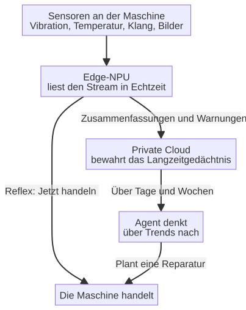

# Kapitel 12 --- Telemetrie als Nervensystem der Fabrik

## Das Blut der neuen Maschine

Wir haben über die denkende Maschine gesprochen, über die Cloud, die ihr Geheimnis bewahrt, und über den Agenten, der einst über alles verfügen wird, was die Maschine produziert. Doch zwischen der Maschine und dem Agenten --- zwischen dem Sensor an der Spindel und dem Geist im Büro --- muss ein *Strom* sein. Es muss ein kontinuierlicher Informationsfluss geben, der in Echtzeit den Bericht über das überträgt, was die Maschine tut und wie sie sich fühlt. Dieser Strom heißt **Telemetrie**, und er ist das Blut der neuen Fabrik. Ohne sie würde die denkende Maschine im Vakuum denken; die Cloud, die ihr Geheimnis bewahrt, hätte nichts zu bewahren; der Agent, der schließen würde, hätte nichts, über das er schließen könnte. Die Telemetrie ist es, was die Fabrik zu einem lebendigen Wesen macht statt zu einer Ansammlung von totalem Metall.

Lassen Sie uns die Telemetrie richtig verstehen, weil das Wort heutzutage frei herumgeworfen wird und weil ihr Verständnis wesentlich ist für das Verständnis der ganzen Kette. Telemetrie ist einfach *Daten, die am einen Ort gemessen und automatisch und kontinuierlich am anderen Ort berichtet werden.* Das Wort stammt vom Griechischen *tele*, "fern," und *metron*, "Messen" --- das Messen ferner Dinge. Sie entstand im Cockpit eines Flugzeugs, wo Messgeräte den Zustand der Motoren zum Piloten in Echtzeit übermittelten, und sie wanderte von dort in die Informatik, wo sie die automatische Sammlung und Übertragung von Betriebsdaten zu bedeuten begann.

Es lohnt sich, auf diesen Ursprung einzugehen, denn das Wort trägt seine Bedeutung in seinem Knochen. Telemetrie wurde nämlich tatsächlich aus *Angst* geboren --- der Angst des Astronauten oder Piloten, der einer Maschine vollständig vertrauen muss, deren Lebenssupport von Daten abhängt, die er nicht mit seinen eigenen Augen sehen kann. Die Raketen des frühen Raumfahrtprogramms, insbesondere das Apollo-Programm, gehörten zu den ersten Großanwendern der Telemetrie, weil eine Rakete das ultimative Beispiel für eine Maschine ist, deren innerer Zustand --- Temperatur, Druck, Kraftstofffluss --- nicht direkt beobachtet werden kann, sobald sie den Boden verlassen hat. Der einzige Weg, zu wissen, was sie tat, war, sie *am einen Ort zu messen und fortlaufend am anderen zu berichten.* Die Fabrik der sechsten Revolution steht vor einer identischen, wenn auch leiseren Abhängigkeit: wir können nicht *sehen*, mit unseren eigenen Augen, ob eine Spindel dem Versagen nahe ist; wir können nur ihren Zustand messen und berichten. Die Metapher ist nicht dekorativ; sie ist strukturell. Auch die Fabrik muss ihre Telemetrie vertrauen.

## Was die Maschine berichtet

Auf einer Fabrikhalle ist die Telemetrie, die eine moderne Maschine produzieren kann, in der Tat erstaunlich reich --- viel reicher als die Handvoll Zahlen, die ein alter SPS jem würde berichten. Eine Maschine, die mit der intelligenten Karte der vorherigen Kapitel ausgestattet ist, kann fortlaufend berichten:

- **Vibration und Beschleunigung** in mehreren Richtungen, die die Gesundheit von Lagern, Spindeln und beweglichen Teilen offenbaren. Ein Lager, das sich abzulösen beginnt, versagt nicht mit einem Aufschrei; es versagt mit einer *Frequenz*, einer kleinen periodischen Störung im Vibrationsignal, die ein menschliches Ohr nie bemerken würde, die aber ein Sensor vollständig aufzeichnet.
- **Temperatur** an mehreren Punkten, die vor Überhitzung, Reibung oder Umweltveränderungen warnt.
- **Elektrischer Strom und Spannung**, die die Last eines Motors offenbaren und, subtil, die Qualität des Schnitts oder des Pressens. Ein Schneidwerkzeug, das stumpf wird, zieht, fast unmerklich, mehr Strom; die Telemetrie *sieht* den Verschleiß, bevor das Teil verschrottet wird.
- **Ton**, durch ein Mikrofon, das Veränderungen im Klang einer Maschine offenbart, die dem Versagen vorausgehen. Dies ist das Gebiet der *akustischen Emission*: die hochfrequenten "Stöhne", die eine Maschine macht, wenn sich ein Riss ausbreitet, unhörbar für einen Arbeiter, aber unmissverständlich für ein Mikrofon, das auf die richtige Frequenzbande abgestimmt ist.
- **Bilder**, durch eine Kamera, die --- wie wir im vorherigen Teil sahen --- die Qualität und Position jedes Teils berichten.
- **Position, Geschwindigkeit und Kraft**, für jede Maschine, die sich bewegt, die offenbart, ob sie innerhalb ihres beabsichtigten Arbeitsbereichs arbeitet.
- **Flüssigkeit und Ölverschleiß**, die den Verschleiß interner Komponenten offenbaren, wenn mikroskopische Partikel durch ein Schmiermittel getragen werden, jedes Partikel ein kleines Archiv dessen, was die Maschine getan hat.

Jeder dieser Ströme ist für sich allein eine Zahl, die sich über die Zeit verändert. Zusammen sind sie eine *Geschichte*: die fortlaufende Erzählung vom Zustand der Maschine. Und hier tritt die Intelligenz der sechsten Revolution ein, nicht in der *Sammlung* der Telemetrie --- dieser Teil ist mechanisch und billig --- sondern in ihrem *Lesen*. Die NPU auf der Maschine liest den Strom nicht als Liste von Zahlen, sondern als *Gesundheitssignal*, und erkennt den Moment, in dem sich die Geschichte von "gut" zu "Warnung" verändert. Die Cloud empfängt den Strom und bewahrt ihn, konsistent und durchsuchbar, ohne ihn je zu lesen. Der Agent schließt über den Strom und entscheidet, was damit zu tun ist.

## Die Kosten und die Allgegenwart des Sensings

Es gibt eine wirtschaftliche Tatsache, die die sechste Revolution ermöglicht, und es lohnt sich, sie zu benennen, weil Revolutionen nur möglich sind, wenn die notwendigen Komponenten billig geworden sind. Der Sensor --- der Beschleunigungsmesser, die Thermokopie, das Mikrofon --- hat sich über die letzten zwei Jahrzehnte erstaunlich billig. Ein moderner MEMS-Beschleunigungsmesser, groß genug, um auf einer Fingerspitze zu sitzen, kostet im Volumen Pfennige; ein Mikrofon für akustische Emission ist ebenfalls billig; eine Kamera für Maschinenvision ist derselben Logik zufolge gewöhnlich. Dies ist dieselbe Geschichte, die das Smartphone möglich machte und die die Cloud möglich machte: die Komponenten, die fortlaufendes Sensing erschwinglich machen, sind im Preis gefallen, schneller als jemand vorhergesagt hat, und die Fabrik hat diese Billigkeit schlicht geerbt.

Deshalb ist die Sammlung der Telemetrie, wie wir sagten, "mechanisch und billig." Der schwere Teil --- der Teil, der wirklich schwer ist --- ist nie das *Messen*; es ist das *Lesen*. Hundert Sensoren an einer Maschine sind wertlos, es sei denn, etwas kann dem Strom, den sie erzeugen, einen Sinn abgewinnen. Die sechste Revolution gewinnt nicht, indem sie mehr Sensoren hinzufügt; sie gewinnt, indem sie mehr *Aufmerksamkeit* zu den Daten hinzufügt, die die Sensoren bereits erzeugen. Die Billigkeit des Sensing ist eine Gegebenheit; die Intelligenz des Lesens ist die ganze Aufgabe.

## Die Echtzeitanforderung

Die vorherigen Kapitel haben etabliert, dass die Maschine lokal und in Echtzeit wahrnehmen und handeln *muss*, weil eine Rundreise zur Cloud zu langsam ist und Privatsphäre leakt. Telemetrie muss daher auf zwei Ebenen verstanden werden, und es hilft, sie getrennt zu halten.

Am **Rand** --- auf der Maschine selbst --- wird die dringendste Telemetrie lokal und sofort verarbeitet. Das Vibrationsignal, das sagt "ein Lager ist dem Versagen nahe", wird am Ort gelesen, von der NPU, weil die Entscheidung, die es unterstützt, in Mikrosekunden getroffen werden muss. Hier ist Telemetrie ein Reflex.

Am **Wolken** --- der privaten, zero-knowledge Cloud, die innerhalb der Mauern gehalten wird --- wird die Telemetrie gesammelt, gespeichert und im Laufe der Zeit durchsuchbar gemacht. Hier ist sie kein Reflex, sondern eine *Erinnerung*: das fortlaufende Archiv des Lebens der Maschine, über das der Agent über Tage, Wochen und Monate schließen kann. Hier ist der Wert nicht Geschwindigkeit, sondern *Geschichte*: die Fähigkeit, im Rückblick zu sehen, wie eine Maschine gealtert ist, ob sich ein Muster von Ausfällen abzeichnet, wie zwei Maschinen an zwei Linien sich vergleichen.

Die zwei Ebenen stehen nicht im Konflikt. Der Rand verarbeitet, was *jetzt* entschieden werden muss; die Cloud erinnert sich an, was *über die Zeit* verstanden werden muss. Beide sind Telemetrie. Beide speisen die sechste Revolution. Der Rand ist der Reflex; die Cloud ist die Erinnerung. Der Agent ist der Geist, der beide liest.

## Die Lehre von Apollo 13

Das Wort "Telemetrie" wurde, wie wir sagten, im Cockpit und im Kontrollraum geboren, und die berühmteste Lehre in seiner Macht kam im April 1970, wenn das Apollo-13-Raumschiff eine Explosion in einem Sauerstofftank auf dem Weg zum Mond erlitt. Die Geschichte ist gut bekannt, aber sie wird gewöhnlich als eine Geschichte von Mut und Improvisation erzählt. Es lohnt sich, sie für einen Moment als eine Geschichte über *Telemetrie* zu erzählen, weil das es war, das den Mut und die Improvisation ermöglichte.

Sobald das Raumschiff die Erde verlassen hatte, konnte die Besatzung den Schaden nicht *mit ihren eigenen Augen sehen*; sie konnte ihn nur durch die Instrumente und die Ablesungen sehen, die fortlaufend zum Mission Control in Houston übermittelt wurden. Wenn die Explosion geschah, sagte die Telemetrie den Flugkontrolleuren, was sie vom Boden aus nie hätten sehen können: welche Systeme versagten, wie schnell der Sauerstoff entwich, was mit der Temperatur und dem Druck in den Tanks geschah. Es war die Telemetrie --- der fortlaufende, ehrliche Bericht über den inneren Zustand der Maschine --- der den Kontrolleuren erlaubte, innerhalb von Minuten zu verstehen, dass die Mission nicht auf dem Mond landen konnte und dass die echte Aufgabe darin bestand, die Besatzung nach Hause zu bringen.

Und hier ist der Teil, der für die Fabrik zählt. Die Kontrolleure lasen die Telemetrie nicht bloß; sie *schlossen* über sie, und sie schlossen mit den Ingenieuren, die die Maschine bauten, bis sie den rohen Zahlenstrom in einen Plan verwandeln konnten. Der berühmte improvisierte Kohlendioxid-Filter --- im Weltraum aus Klebeband, Pappe und einer Plastiktüte gebaut --- war die *Aktion* am fernen Ende der Telemetrie: die Daten machten das Problem sichtbar, das Schließen verwandelte das Problem in einen Plan, und der Plan wurde zu einer Tat. Gemessen am einen Ort (das Raumschiff), fortlaufend berichtet am anderen (Houston), von einem Dritten (das Flugteam) geschlossen und schließlich ausgeführt --- dies ist die ganze Kette der sechsten Revolution, in einer einzigen, verzweifelten Woche 1970 zusammengedrängt.

Die Fabrik hat keine Astronauten und keinen Mond, aber sie hat, in Miniatur, dieselbe Abhängigkeit. Der Ingenieur, der das Lager, das sich abnutzt, nicht *sehen* kann, kann nur *messen* und den Bericht lesen. Der Unterschied ist, dass die sechste Revolution das Schließen *näher* an die Daten bringt --- auf den Chip, in die Cloud innerhalb der Mauern --- sodass der Plan und die Tat nicht auf ein vollgestelltes Zimmer von Kontrolleuren warten müssen, und die Maschine kann, in den neuesten Systemen, auf ihre eigene Telemetrie ohne einen Menschen in der Schleife handeln. Apollo 13 ist der Aherr der denkenden Maschine; es ist nur, dass die Maschine gelernt hat, ihre eigene Mission Control zu sein.

## Das Volumenproblem

Es gibt eine praktische Schwierigkeit, die die romantische Beschreibung der Telemetrie zu verbergen neigt, und es lohnt sich, ehrlich damit umzugehen: die Daten, die eine moderne Maschine produziert, sind *enorm*. Ein einzelner Vibrationsensor, der viele Male pro Sekunde abtastet, produziert Millionen von Ablesungen an einem Tag. Multiplizieren Sie das mit einer dozen Sensoren an einer Maschine, hundert Maschinen an einer Linie, und einer Flotte von Anlagen, und der Strom wird zu einer Flut --- Terabytes am Tag, in einem großen Betrieb. Keine Cloud, wie privat auch, kann einfach *alles für immer behalten*; und kein Mensch, wie fleißig auch, kann eine Flut lesen.

Deshalb ist die Telemetrie der sechsten Revolution nicht eine Größe von Daten an einer Geschwindigkeit, sondern ein *zwei-Ebenen*-Design, und es lohnt sich, es klar zu zeichnen:

Am **Rand** liest die Maschine ihren eigenen Strom in voller Auflösung, weil der Reflex sofort sein muss und das Rohsignal in all seinen Details untersucht werden muss. Am **Wolken** sendet die Maschine *Zusammenfassungen* --- herabgetastete Archive, extrahierte Merkmale, Warnungen und das gelegentliche Vollauflösungs-Fenster um ein Ereignis herum --- sodass das lange Archiv behalten wird, ohne jedes Byte zu behalten. Der Rand liest die Flut; die Cloud bewahrt die Geschichte; der Agent schließt über die Geschichte. So kann eine Fabrik alles beobachten, ohne darin zu ertrinken: die Rohdaten werden dort verbraucht, wo sie produziert werden, und nur ihre *Bedeutung* wird weitergeleitet, verschlüsselt, zur privaten Cloud.

Dieses Design hat einen zweiten, leiseren Vorteil, und es lohnt sich, ihn zu benennen. Das Volumenproblem ist auch ein *Privatsphären*-Problem: wenn alles zur Cloud geschickt würde, würde alles im Risiko sein. Indem die Maschine am Rand zusammenfasst, sendet sie das *Minimum*, das nötig ist --- die Warnung, der Trend, das extrahierte Merkmal --- und bewahrt die tiefe, rohe, intime Daten ihrer eigenen Operation lokal. Die Telemetrie, die reist, ist daher nicht bloß verschlüsselt; sie ist *reduziert*. Die Fabrik teilt die Geschichte, nicht die Rohbeichte. Und das, in einer Welt, die gelernt hat, der Cloud misstrauisch zu sein, ist genau die richtige Form von Vertrauen.

## Der Strom als gemeinsame Wahrheit

Es gibt eine weitere Qualität, die diesen Strom besonders macht, und sie hängt direkt mit der privaten Cloud des vorherigen Kapitels zusammen. In der alten Fabrik war Telemetrie gewöhnlich *lokal*: sie wurde auf der Maschine angezeigt oder in einer Datei in einem Raum protokolliert, nur sichtbar für jenen, der zufällig dort war. Die sechste Revolution macht Telemetrie *geteilt* --- fortlaufend synchronisiert, in Echtzeit, über das ganze Unternehmen hinweg, zu jeder Maschine, jedem Büro und jedem Agenten, der ein Recht darauf hat. Dies ist es, was eine private Cloud erreicht: ein lebendiges Exemplar der Telemetrie der Fabrik, immer konsistent, immer verfügbar, niemals außerhalb der Kontrolle des Unternehmens.

Es gibt eine Phrase aus der Datenbankwelt, die genau diese Qualität beschreibt, und es lohnt sich, sie zu entlehnen, weil sie eine schwer erarbeitete Lehre benennt. Sie heißt **starke Konsistenz**: die Garantie, dass jeder Leser, zu jedem Moment, dieselbe *kopie* der Daten sieht --- dass es nicht eine Version am einen Ort und eine andere Version am anderen Ort gibt, die langsam auseinanderdriften. In der alten Fabrik konnten zwei Techniker auf zwei verschiedene Maschinen sehen und zu zwei verschiedenen Schlüssen gelangen, weil ihre Telemetrie nicht geteilt war. Die sechste Revolution hebt diese Möglichkeit auf: mit einer privaten, stark konsistenten Cloud sehen der Sensor an der Spindel, das Modell in der Cloud und der Agent im Büro alle auf --- und handeln auf --- dieselbe *lebendige* Wahrheit. Es gibt keinen anderen Weg, eine Fabrik zu führen, die sicher sein muss; man kann nicht einer Sache sicher sein, die auf jeder Maschine, die sie beobachtet, anders ist.

Diese geteilte, Echtzeit-Telemetrie ist das verbindende Gewebe der ganzen Kette. Sie ist es, was den Sensor an der Spindel, das Modell in der privaten Cloud und den Agenten im Büro alle auf denselben *lebendigen* Wahrheit schauen und darauf handeln lässt. Sie ist das Blut, das von der Maschine fließt, durch die Cloud, zum Büro und wieder zurück. Und nun, da wir etabliert haben, was dieses Blut ist und wie es fließt, können wir uns zur letzten Frage der ganzen Kette wenden: *wer liest es, und wie?* Denn das Blut muss, wie in jedem lebendigen Körper, von einem Geist gelesen werden. Dieser Geist ist das Thema des nächsten Teils dieses Buches, und hier nimmt die Geschichte ihre überraschendste Wendung, weil der Geist, der die Telemetrie liest, in den neuesten Systemen gar kein Mensch ist.
