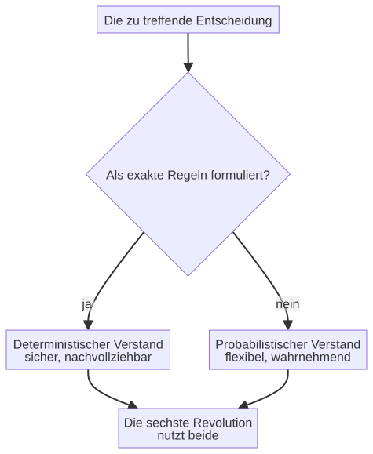

# Kapitel 13 --- Zwei Arten von Verstand

## Die Wahl, Die Niemand Fragt

Es gibt eine Entscheidung, die fast jeder, der die sechte Revolution aufbaut, trifft, ohne sie jemals wahrzunehmen, und sie ist die wichtigste Entscheidung in der ganzen Geschichte. Sie lautet nicht „Sollen wir KI verwenden?" Sie lautet: „Welche *Art* von KI?" Und es ist eine Wahl zwischen zwei grundverschiedenen Geisteshaltungen der Intelligenz, zwei Arten von Verstand, die sich über fast nichts einigen außer ihren äußeren Ergebnissen.

Um die Wahl zu verstehen, betrachten wir das denkbar einfachste Beispiel: eine Maschine, die entscheiden muss, ob ein Teil, das sie überprüft, gut oder fehlerhaft ist. Es gibt zwei Wege, diese Entscheidung zu treffen, und sie stammen aus zwei verschiedenen Welten.

## Die erste Art von Verstand: Die ratende Art

Die erste Art von Verstand ist die, die Sie bereits getroffen haben, im Sensor der Spindel. Es ist der Verstand des *probabilistischen* Modells --- des neuronalen Netzes, das gelernt hat, aus Tausenden von Beispielen die *wahrscheinlichste* Antwort zu *raten*. Dies ist der Verstand der Ära des Deep Learnings: Es werden viele Beispiele von guten und fehlerhaften Teilen zugeführt, und es passt sich bis zu dem Moment an, in dem seine Raten der Realität entsprechen. Wenn ein neues Teil einfällt, wendet es keine Regel an; es liefert eine *wahrscheinliche Antwort*, gewichtet nach allem, was es gesehen hat.

Diese ratende Art ist ein Wunder der modernen Zeit, und sie ist erstaunlich gut in den Aufgaben, für die sie ausgebildet wurde. Sie kann einen Kratzer erkennen, einen Ausfall vorhersagen, einen Barcode in der Dunkelheit lesen. Sie ist dort überlegen, wo sich die Regeln nicht ausdrücklich niederschreiben lassen, die richtige Antwort aber *gezeigt* werden kann --- in der Wahrnehmung, im Mustererkennung, bei der Verarbeitung unordentlicher, realer Daten. Deshalb hat das Deep Learning die Bilderkennung, die Übersetzung und die Sprache in einem einzigen Durchgang erobert: In all diesen Fällen können Sie die Regeln nicht niederschreiben, aber Sie können eine Million Beispiele zeigen.

Doch die ratende Art hat einen Charakter, den wir sorgfältig benennen müssen, denn dieser Charakter ist der ganze Unterschied in der sechten Revolution. Sie ist **probabilistisch**. Sie gibt ihre beste Schätzung ab, aber bis zu diesem Punkt hat sie Ihnen ein Urteil gegeben. Sie kann sich irren, selbst wenn sie selbstsicher klingt. Sie trägt in sich, durch ihre eigene Natur, ein *ermessens*Element: Die Trainingsdaten enthalten Voreingenommenheiten, und die Inferenz ist eine gelernte Näherung, keine Gewissheit. Für das Erkennen eines Kratzers auf einer Flasche ist ein Urteil vollkommen ausreichend. Für die Entscheidung darüber, ob ein Bremssystem im Auto sicher ist, ist ein Urteil nicht nur unzureichend; es ist untragbar.

## Die zweite Art von Verstand: Die rechnende Art

Es gibt eine zweite Art von Verstand, und sie ist mehr als ein halbes Jahrhundert älter als die erste. Es ist der Verstand der *deterministischen* Berechnung. Sie rät nicht; sie *rechnet*. Sie lernt nicht aus Beispielen; sie wendet feste Regeln auf gegebene Eingaben an und liefert, jedes einzelne Mal, *die gleiche Antwort mit mathematischer Gewissheit*. Dies ist der Verstand des Compilers, der Verstand, der Ihren Quellcode genau einmal, jedes Mal, für immer in Maschinenanweisungen umwandelt, ohne jedes Ermessen und ohne jede Voreingenommenheit, ohne Abweichung und ohne Schätzung.

Sie haben diesen Verstand ebenfalls getroffen, obwohl Sie ihn vielleicht nicht „Intelligenz" genannt haben. Wenn Sie ein Programm kompilieren, wendet der Compiler feste Regeln auf Ihren Code an und liefert ein feste Ergebnis. Es kann nicht „falsch" sein, wie es ein ratendes Modell sein kann; es kann nur korrekt oder inkorrekt sein, und seine Korrektheit ist beweisbar. Es hat keine Meinungen. Es hat keinen schlechten Tag. Bei derselben Eingabe liefert es dieselbe Ausgabe, mit derselben Gewissheit wie zwei plus zwei, die vier ergeben. Dies ist nicht der Verstand, der ein Gesicht erkennt oder einen Satz übersetzt --- das ist für ihn unmöglich. Aber er ist der Verstand, der *garantiert*, und diese Garantie ist Gold wert genau in jenen Stellen, wo ein Urteil gefährlich wäre.

## Die Linie zwischen ihnen

Die zwei Arten von Verstand sind keine Rivalen im üblichen Sinne; sie sind *ergänzend*, jeder dort stark, wo das andere schwach ist. Die ratende Art ist flexibel, kreativ und unverzichtbar für Wahrnehmung und Sprache, aber sie ist nicht sicher. Die rechnende Art ist vollkommen sicher, aber sie ist nicht flexibel --- sie tut nur, was ihre Regeln vorschreiben, und ihre Regeln sind, durch ihre Konstruktion, vollständig und eindeutig.

Die entscheidende Frage ist diese: **Welcher Verstand soll die Entscheidungen lenken, die am meisten zählen?** Wo das Ergebnis eine Klassifikation oder ein Urteil ist --- ein Kratzer oder eine glatte Oberfläche --- ist die ratende Art nicht nur ausreichend; sie ist die einzige, die funktioniert. Aber wo das Ergebnis *sicher* sein muss --- wo ein falsches Urteil jemanden verletzt, Geld verliert oder Vertrauen bricht --- ist die rechnende Art die einzige, die sicher ist.

Um zu verstehen, warum die rechnende Art sicher ist, hilft es, genau zu sehen, was „sicher" hier bedeutet, denn das Wort leistet eine ganze Menge. Ein deterministisches System ist eines, dessen Ausgabe *vollständig* durch seine Eingabe und seine Regeln bestimmt ist, ohne Raum für Zufall, ohne einen Zufall, der dem Prozess eingepflanzt ist, und --- entscheidend --- ohne *gegnerischen* Raum für Manöver. Eine ratende Art kann dagegen vom Kurs abgebracht werden durch Eingaben, die ähnlich, aber nicht identisch sind --- ein Phänomen, das die Welt des Machine Learnings *gegnerische Beispiele* nennt: eine winzige, nicht wahrnehmbare Veränderung einer Eingabe, die ein selbstsicher Urteil in einen selbstsichen Irrtum umkippen kann. Die rechnende Art hat keine solche Schwäche, weil ihre Regeln fest und vollständig sind; es gibt keine Lücke, durch die eine Eingabe fallen könnte. Dies ist, mehr als jeder abstrkte Gedanke über „Gewissheit", der Grund, warum die rechnende Art die einzige ist, der man mit den Entscheidungen vertrauen kann, die als korrekt bekannt sein müssen.

## Die zwei Stämme der KI

Die zwei Arten von Verstand sind keine Metapher, die für dieses Buch erfunden wurde; sie sind die zwei großen Stämme der künstlichen Intelligenz, und die Geschichte ihrer Rivalität ist eine der lehrreichsten Geschichten im ganzen Feld. Es lohnt sich, sie kurz zu erzählen, denn sie erklärt, warum die sechte Revolution nun das tun kann, was kein Stamm allein konnte.

Der erste Stamm ist die **symbolische** Schule, manchmal genannt „gute alte KI." Ihr Glaube war, dass Intelligenz die Manipulation von Symbolen nach ausdrücklichen Regeln ist --- dass, wenn man genug Logik niederschreiben könnte, man sich das Denken selbst einfangen könnte. Ihre große Leistung war das *Expertensystem*: ein Programm, das das Wissen eines menschlichen Spezialisten als eine Menge von Wenn-Dann-Regeln kodiert. In den 1970er und 1980er Jahren wurden Expertensysteme gebaut für die Medizin (MYCIN, zur Diagnose von Infektionen), für die Chemie (DENDRAL, zur Identifizierung von Molekülen) und für die Wirtschaft (XCON, zur Konfiguration von Computerbestellungen), und für eine Zeit waren sie die kommerziell erfolgreichste Form der KI, die je gebaut wurde. Sie waren, im Wesentlichen, die rechnende Art: deterministisch, regelbasiert, prüfbar und sicher innerhalb ihres Bereichs. Ihre Schwäche war ebenso klar --- sie waren *zerbrechlich*. Sie funktionierten innerhalb der engen Menge von Regeln, die ihnen gegeben wurde, und sie versagten außerhalb davon schlecht, weil die reale Welt voller Fälle ist, für die niemand eine Regel geschrieben hat. Wenn der Markt für Expertensysteme Ende der 1980er Jahre zusammenbrach, nahm es den Ruf des ersten Stammes mit sich.

Der zweite Stamm ist die **connectionistische** Schule --- die neuronalen Netze. Ihr Glaube war fast das Gegenteil: dass Intelligenz keine Menge geschriebener Regeln ist, sondern ein *Muster, das aus Beispielen gelernt* wurde, ein Netz einfacher Einheiten, das sich bis zum Moment der Anpassung selbst justiert, bis es die Welt trifft. Die Idee ist älter als die meisten Menschen denken: Frank Rosenblatt baute den *Perceptron* im Jahr 1958, eine einfache Lernmaschine, und sie wurde mit enormem Optimismus begrüßt. Aber der Perceptron hatte Grenzen, und ein berühmtes Buch von Marvin Minsky und Seymour Papert aus dem Jahr 1969 machte sie so effektiv sichtbar, dass die Forschung an neuronalen Netzen für mehr als ein Jahrzehnt zur Ruhe ging --- der „KI-Winter" des connectionistischen Stammes. Es dauerte bis zu den 1980er Jahren, bis die *Backpropagation* neuronalen Netzen einen Weg gab, tiefe Strukturen zu lernen, und bis 2012, bis die Kombination aus großen Daten und schnellen Chips (der AlexNet-Moment, den wir in der Zeitleine getroffen haben) sie plötzlich, spektakulär gut machte. Dieser zweite Stamm ist die ratende Art: flexibel, wahrnehmend und probabilistisch.

Jahrzehntelang kämpften die zwei Stämme, und jeder wies den anderen ab. Die Symbolisten sagten, die connectionistischen hätten keine Theorie und keine Garantien; die connectionistischen sagten, die Symbolisten könnten nie mit der Unordentlichkeit der realen Welt umgehen. Jeder lag richtig bezüglich der Schwäche des anderen und blind bezüglich seiner eigenen. Die leise Einsicht der sechten Revolution --- die eine, die dieses Kapitel zu vermitteln hat --- ist, dass der Kampf immer ein Fehler war. Die zwei Stämme sind keine Rivalen um denselben Thron; sie sind zwei *verschiedene Werkzeuge für zwei verschiedene Aufgaben*, und die Fabrik, die denkt, braucht beide.

Das Diagramm ist das ganze Argument in einem Bild. Wenn die Entscheidung als genaue Regeln niederschreiben lässt sich --- wenn die Spezifikation vollständig ist und die Eingabe gut definiert ist --- ist der deterministische Verstand das richtige Werkzeug, und er ist *überlegen*, weil er sicher ist. Wenn die Entscheidung nicht als Regeln niederschreiben lässt sich, aber nur *durch Beispiele gezeigt* werden kann --- Anerkennung, Sprache, Vorhersage --- ist der probabilistische Verstand das einzige Werkzeug, das funktioniert. Die weise Fabrik wählt keinen Stamm; sie fragt jeden einzelnen, welcher Stammes-Werkzeug passt, und verwendet das eine. Das ist die sechte Revolution, und es ist die Lösung eines fünfzigjährigen Streits.

## Die kontroverse Position

Hier nehmen die Projekte hinter diesem Buch eine eigenständige und, einige würden sagen, kontroverse Stellung ein. Sie argumentieren, dass viel mehr der Entscheidungen der Fabrik als die meisten Ingeniebe zugeben können --- und sollten --- durch den *deterministischen* Verstand gemacht werden, durch feste Regeln und genaue Spezifikationen, statt durch den ratenden Verstand. Sie argumentieren, dass eine ganze Menge von dem, was wir beiläufig „KI" nennen, in der Tat vollkommen gut bedient wird von deterministischer Berechnung, und dass das Ergreifen eines probabilistischen Modells, wo Gewissheit möglich ist, nicht nur unnötig, sondern *gefährlich* ist.

Dies ist keine Ludditen-Ablehnung des Machine Learnings. Es ist, ganz im Gegenteil, ein Glaube, dass der sichere Verstand überall verwendet werden sollte, wo er verwendet werden kann, so dass der unsichere Verstand --- sparsam --- für die Aufgaben zurückgehalten wird, wo er allein erfolgreich ist. Um diese Position vollständig zu verstehen, müssen wir uns das Projekt ansehen, das sie am vollständigsten verkörpert, eine Technologie, die ein kompiliertes Programm in eine Spezifikation umwandelt, die ohne jegliches Raten ausgeführt werden kann. Das ist das Thema des nächsten Kapitels.

## Was eine Garantie tatsächlich kauft

Es lohnt sich, konkret zu fragen, was die Garantie des deterministischen Verstands *wert* ist --- denn „Gewissheit" kann sich wie ein Wort des Philosophen anhören, bis Sie sehen, was passiert, wenn sie fehlt. Die Geschichte des Rechnens hat einige ernsthafte Lehren, und zwei von ihnen lohnt es zu erzählen, weil sie zeigen, in Blut und Geld, warum die sechte Revolution sich nicht auf Schätzungen stützen kann, wo Gewissheit erforderlich ist.

Die erste ist die **Therac-25**, eine rechnergesteuerte Strahlentherapie-Maschine, die in den 1980er Jahren verwendet wurde. Sie wurde entworfen, um präzise Dosen von Strahlung an Krebspatienten abzugeben, und sie verließ sich auf Software, um den Strahlenstrahl zu steuern. Eine Reihe von Programmierfehlern --- subtil, ineinandergreifende Bugs, die Art, die kein einzelner Test gefangen hätte --- ließ die Maschine unter bestimmten Abfolgen von Operator-Eingaben massive Überdosen abgeben. Mehrere Patienten wurden getötet oder schwer verletzt. Die Software der Maschine war, in einem Sinne, „deterministisch" --- sie tat genau das, wofür sie geschrieben wurde --- aber sie war *nicht verifiziert*, und ihre Determinismus lieferte das falsche Ergebnis mit perfekter Gewissheit. Die Lehre ist nicht, dass Determinismus schlecht ist; es ist, dass Determinismus ohne Verifizierung nur eine zuverlässige Art ist, falsch zu sein.

Die zweite ist die **Ariane 5**-Rakete, die auf ihrer Jungfernflug im Jahr 1996 explodierte, weniger als eine Minute nach dem Start. Die Ursache war ein Software-Überlauf: ein Wert, der in der kleineren Ariane 4 vollkommen sicher gewesen war, überschritt den Bereich einer 16-Bit-Variablen auf der leistungsfähigeren Ariane 5, und der daraus resultierende Fehler stürzte das Leitsystem ab. Der Code war, wiederum, deterministisch; er tat genau das, wofür er geschrieben wurde. Aber er wurde für eine andere Maschine geschrieben, und niemand hatte verifiziert, dass die Annahmen noch galten. Die Rakete versagte nicht wegen eines zufälligen Fehlers; sie versagte, weil ein deterministisches System, außerhalb seines verifizierten Bereichs angewandt, *sicherlich* falsch ist.

Diese Geschichten sind der Grund, warum die Zertifizierungsbereiche --- Luftfahrt, Medizin, Atomkraft --- „es funktioniert in der Demonstration" nicht akzeptieren. Sie verlangen *Beweis*: dass das Verhalten der Software gegen ihre Spezifikation verifiziert wurde, dass jede Annahme dokumentiert ist, und dass die ganze Kette geprüft werden kann. Dies ist die Disziplin, die die Luftfahrtindustrie **DO-178C** nennt --- ein Standard, der regelt, wie flugzeugsoftware entwickelt und verifiziert wird, und der unter anderem verlangt, dass die Anforderungen bis hinab zum Code und zurück nachverfolgbar sind. Es ist ein Standard, der auf einer einzigen Überzeugung aufgebaut ist: ein System, das Menschen durch die Luft trägt, muss *bekannt* sein, korrekt zu sein, nicht bloß *wahrscheinlich*, korrekt zu sein.

Dies ist genau das, was der deterministische Verstand, richtig verwendet, liefern kann --- und was der ratende Verstand nicht kann. Ein deterministisches System, gebaut aus einer verifizierten Spezifikation, kann Schritt für Schritt vom Quellcode zur Entscheidung nachverfolgt werden, und die ganze Kette kann geprüft werden. Ein probabilistisches Modell kann getestet werden, und es kann gezeigt werden, dass es auf einer Testmenge genau ist, aber es kann *nicht beweisbar* korrekt sein, weil sein Verhalten, durch seine Konstruktion, eine gelernte Näherung ist. Wo die Kosten eines falschen Ergebnisses in Leben oder in Vermögen gemessen wird, ist der Unterschied zwischen „getestet" und „beweisbar" der Unterschied zwischen einem Produkt und einer Haftung. Die Garantie ist kein Luxus; sie ist die Lizenz zu operieren.

## Warum die rechnende Art beweisbar ist

Es gibt noch eine weitere Sache, die die rechnende Art ihres Platzes in der sechten Revolution wert macht, und es ist eine Sache, die der ratende Verstand nie liefern kann: ein *Beweis*. Wenn ein deterministisches System etwas entscheidet, ist es möglich --- im Prinzip, und oft in der Praxis --- zu *beweisen*, rigoros und vollständig, dass die Entscheidung korrekt ist. Dies ist das Versprechen der Disziplin, die *formale Verifizierung* genannt wird: die Maschine wendet feste Regeln auf eine feste Spezifikation an, und die ganze Kette des Denkens kann von einer Maschine geprüft werden, mit derselben Gewissheit wie ein mathematischer Beweis. Kein Urteil kann beweisbar sein; ein Beweis kann.

Dies ist genau die Qualität, die die Zertifizierungsbereiche verlangen --- die Bereiche, die wir in den folgenden Kapiteln treffen werden, wo eine Entscheidung, die sicher sein muss, auch *gezeigt* werden muss, sicher zu sein. Ein probabilistisches Modell kann Ihnen sagen, dass es 99,9 % selbstsicher ist; es kann Ihnen nicht *warum* sagen, und es kann nicht beweisen, dass die restlichen 0,1 % nicht zuschlagen werden. Ein deterministisches System kann beides. Die rechnende Art ist, in dieser strengsten Bedeutung des Wortes, der einzige Verstand, der vor einem Prüfer stehen kann --- vor einem ISO-Gutachter, einem SOC-2-Prüfer, einem HIPAA-Prüfer --- und Schritt für Schritt demonstrieren kann, dass seine Entscheidung korrekt ist. Das ist keine technische Neugier; es ist das Ganze der Garantie.
