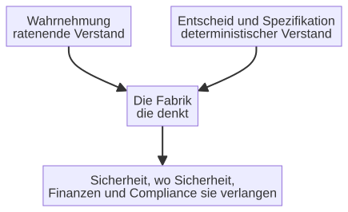

# Kapitel 15 --- Wenn Sicherheit zählt

## Die Orte, wo eine Schätzung ein Verbrechen ist

Wir haben nun die beiden Arten von Geist kennengelernt --- den schätzenden Geist, der flexibel ist, in nichts aber sicher, und den rechnenden Geist, der sicher ist, aber nicht improvisiert. Wir haben gesehen, dass der schätzende Geist ein Wunder für die Wahrnehmung und die Sprache ist, und dass der rechnende Geist die einzige sichere Wahl dort ist, wo eine Entscheidung *bekannt* sein muss, korrekt zu sein. Die Frage, die dieses Kapitel beantwortet, ist einfach und entscheidend: **Wo, in einer Fabrik, die denkt, muss die Entscheidung sicher sein?**

Die Antwort lautet „mehr Orte, als man denken möchte", und gerade die Konzentration dieser Orte macht die sechste Revolution von früheren unterscheidbar. Lassen Sie mich die Bereiche benennen, denn in jedem von ihnen ist eine probabilistische Schätzung nicht nur unzureichend, sondern gefährlich, und in jedem von ihnen ist der deterministische Geist --- der Geist, der seine Entscheidung *beweisen* kann --- die einzige akzeptable.

## Der Bereich der Sicherheit

Betrachten Sie das Industriesteuerungssystem, das einen Roboterarm steuert, der neben einem Menschen arbeitet. Wenn die Sicherheitsentscheidung dieses Arms von einem schätzenden Modell getroffen wird, dann gibt es, lauernd im Modell, eine kleine, aber von Null verschiedene Wahrscheinlichkeit, dass es eine Fabeurteilung trifft --- dass es an einem Morgen mit ungewöhnlichem Licht oder einer ungewöhnlichen Körperhaltung „sicher" entscheidet, wenn die Realität „Gefahr" ist, und ein Mensch verletzt wird. Diese Wahrscheinlichkeit muss nicht groß sein; sie muss nur größer als Null sein, und selbst eine winzige Wahrscheinlichkeit wird, über Millionen von Entscheidungen in einer ganzen Fabrik angewandt, zu einem echten Risiko.

In sicherheitskritischen Systemen ist eine von Null verschiedene Wahrscheinlichkeit einer katastrophalen Schätzung nicht akzeptabel. Die Entscheidung muss *sicher* sein: entweder sicher oder gefährlich, beweisbar, jedes einzelne Mal. Deshalb ist der deterministische Geist --- der Geist, der mit festen Regeln rechnet und eine garantierte Antwort produziert --- der einzige, dem die Sicherheit anvertraut werden kann. Es ist dieselbe Logik, die die Luftfahrtindustrie regiert, wo das Verhalten eines Systems einer Behörde gegenüber beweisbar sein muss, die es zertifiziert, bevor ein einziger Passagier an Bord zugelassen wird. Sicherheit ist in diesen Bereichen kein Luxus; sie ist der Eintrittspreis.

Die Welt der Zertifizierung benennt diese Anforderung präzise, und die Namen sind es wert, bekannt zu sein. Funktionale Sicherheit --- die Sicherheit eines Systems *als Folge seines korrekten Verhaltens* --- wird in der Industrie von Normen wie **ISO 26262** (Kfz) und **IEC 62443** (Industeurungs- und Automatisierung) geregelt, die vor allem verlangen, dass das eines Systems *vorhersagbar, überprüfbar und beweisbar* ist. Ein probabilistisches Modell kann dies nicht erfüllen: sein Verhalten ist von Natur aus nicht vollständig vorhersagbar, und es kann als korrekt bewiesen werden. Ein deterministisches System kann das. Dies ist keine Frage des Geschmacks; es ist die Bedingung, unter der ein sicherheitskritisches System überhaupt zu operieren darf.

## Der Bereich der Finanzen

Der zweite Bereich ist der finanzielle und der bürokratische. Eine Fabrik ist nicht nur ein Ort, an dem Dinge hergestellt werden; sie ist auch ein Ort, der fakturiert, der Konten abstimmt, der Steuerbehörden berichtet, der Verträge verarbeitet. In jedem dieser Fälle ist eine Schätzung nicht nur unzureichend, sondern *Haftung*. Eine Rechnung mit einer falschen Zahl ist nicht „wahrscheinlich richtig"; sie ist falsch, und sie muss korrigiert werden, und sie kann Bußgelder nach sich ziehen. Eine Vertragsklausel, die falsch ausgelegt wird, ist nicht „wahrscheinlich korrekt"; sie ist ein Streitfall, ein Verlust, eine Klage.

Auch hier ist der deterministische Geist die sichere Wahl, und hier tritt er in einer besonders interessanten Form auf. Weil die Regeln der Buchführung, der Besteuerung, der Vertragsrecht --- im Gegensatz zu den Regeln des Sehens oder der Sprache --- *hergeschrieben und explizit* sind, können sie codiert und deterministisch ausgeführt werden. Eine Entscheidung, die festen, überprüfbaren Regeln folgt, ist keine Schätzung; sie ist eine Berechnung, die geprüft, reproduziert und als korrekt bewiesen werden kann. Dies ist genau der deterministische Ansatz, den das Labor hinter diesem Buch auf die Büroseite der Fabrik anwendet, und es ist es, was einen Agenten mit dem Geld und den Worten vertrauenswürdig macht, die ein Unternehmen nicht sich leisten kann, falsch zu behandeln. Der Finanzbereich ist in dieser Hinsicht das natürliche Zuhause des rechnenden Geistes: Die Regeln sind bereits geschrieben, so dass die Aufgabe nicht darin besteht, sie zu *lernen*, sondern sie exakt zu *applieren*.

## Der Bereich der Compliance

Der dritte Bereich ist der regulatorische --- die Welt der Normen, Zertifizierungen und Prüfungen. ISO-Normen, SOC 2, HIPAA und ihre industriellen Verwandten fragen nicht „war deine Entscheidung wahrscheinlich korrekt?" Sie fragen „kannst du *beweisen*, dass deine Entscheidung korrekt ist, jedes Mal, und sie zu ihrer Quelle zurückverfolgen?" Ein probabilistisches Modell kann keine dieser Fragen beantworten, denn ein Modell, das schätzt, hat keinen beweisbaren Verlauf. Ein deterministisches System kann alle beantworten, denn seine Entscheidung wird aus einer verifizierten Spezifikation durch feste Regeln abgeleitet, und der ganze Verlauf --- vom Quellcode bis zur Entscheidung --- ist transparent und reproduzierbar.

Für eine Fabrik in einem regulierten Sektor --- medizinisch, finanziell, Luftfahrt, Energie --- ist Compliance kein Formular, das auszufüllen ist; es ist eine Existenzbedingung. Und die einzige Art von Intelligenz, die einer Compliance-Behörde genügen kann, ist eine, deren Verhalten deterministisch, verfolgbar und beweisbar ist. Deshalb ist der deterministische Geist in diesen Sektoren keine technische Kuriosität, sondern eine *Anforderung*.

## Der überprüfbare Verlauf

Es gibt noch eine weitere Sache, die eine Compliance-Behörde tatsächlich sucht, und sie ist es wert, benannt zu werden, denn sie ist die konkrete, physische Sache hinter dem abstrakten Wort „Sicherheit". Ein Prüfer fragt nicht „ist dein System wahrscheinlich korrekt?"; sie bitten, *den Verlauf zu sehen*. Sie möchten beobachten, wie eine einzelne Entscheidung rückwärts läuft, von der Antwort bis zurück zu ihrem Ursprung, und sie möchten sehen, dass in jedem Schritt der Schritt *bestimmt* war --- fest, reproduzierbar und frei von Ermessen.

Dies ist genau der Verlauf, den der deterministische Geist produzieren kann, und er ist der Verlauf, den das vorherige Kapitel beschrieb. Er läuft, ununterbrochen, vom Quellcode zur Entscheidung: der Quellcode produziert die Assembly durch *Kompilierung* (ein deterministischer Prozess), und die Assembly treibt die Entscheidung an --- sei es eine Benutzeroberfläche, eine generierte API oder ein berechnetes Urteil --- durch *feste algorithmische Transformation*. Jedes Element kann zu seinem Ursprung zurückverfolgt werden, und jeder Schritt kann reproduziert werden. Diese Korrespondenz zwischen Spezifikation und Implementierung ist, in der Welt der Zertifizierung, das Ganze der Anforderung. Wenn die Frontend von einem verifizierten Backend durch deterministische Regeln abgeleitet wird, ist die Korrespondenz zwischen dem, was spezifiziert wurde, und dem, was gebaut wurde, *inhärent und beweisbar* --- keine Hoffnung, kein Testergebnis, sondern eine logische Notwendigkeit. Das ist es, was ein SOC-2-Prüfer oder ein HIPAA-Prüfer sucht: nicht das Vertrauen eines Modells, sondern die *Verfolgbarkeit* eines Modells.

## Der vierte Bereich: Der Körper selbst

Es gibt einen vierten Bereich, und er ist der, in dem die Einsatzhöhe von allen am höchsten ist: der menschliche Körper. Die moderne Medizin läuft von Software, deren Verhalten *sicher* sein muss. Eine Infusionspumpe, die ein Medikament mit einer präzise geregelten Rate verabreicht; ein Herzschrittmacher, der ein Herz taktet; eine Insulinpumpe, die Moment für Moment entscheidet, wie viel eines Hormons freizusetzen ist; eine Strahltherapie-Maschine, die einen Strahl zielt. In jedem dieser Fälle ist eine probabilistische Schätzung keine kleine Unvollkommenheit; sie ist eine direkte Bedrohung eines menschlichen Lebens.

Betrachten Sie das künstliche Bauchspeicheldrüse --- ein System, das den Blutzucker einer Person kontinuierlich misst und automatisch entscheidet, wie viel Insulin zu verabreichen ist. Es ist eine schöne Idee, und es ist bereits real, aber es ist auch ein System, in dem eine falsche Entscheidung, innerhalb von Minuten, eine Person in ein Koma versetzen kann. Die Entscheidungen, die es trifft, müssen *sicher* in ihrer Arithmetik sein, selbst wenn das *Fühlen* probabilistisch ist (der Sensor ist eine gelernte Näherung, und er kann falsch sein). Die Kunst eines solchen Systems ist genau die Kunst der sechsten Revolution: den schätzenden Geist zu *wahrnehmen* (den Sensor lesen), und den deterministischen Geist zu *entscheiden* (die Dosierung durch feste, verifizierte Regeln zu berechnen, die nie falsch sein können). Die beiden Geiste, jeder auf seinem Platz, schützen den Körper, dem sie vertrauen.

Deshalb wird die Welt der Medizinprodukte von Normen geregelt, die so streng sind wie alle in der Technik, und weshalb ein Produkt, das „die meiste Zeit funktioniert", überhaupt kein Produkt ist. Der Regisseur fragt nicht, ob die Maschine *wahrscheinlich* sicher ist; sie fragt, ob die Maschine *bekannt* ist, sicher zu sein, über jeden Eingang, den sie je erhalten könnte. Das ist das Heimatgebiet des deterministischen Geistes, und deshalb ist der Körper in der sechsten Revolution einer der Orte, wo Sicherheit nicht verhandelbar ist.

## Eine kurze Geschichte der technischen Sicherheit

Die Forderung nach Sicherheit in der Technik ist älter als das Rechnen, und ihre Geschichte ist eine der lehrreichsten in der ganzen Technologie. Bevor jemand eine Zeile Software schrieb, lernten Ingenieure --- oft durch Katastrophen --- dass ein System, das Menschen durch die Luft fliegt, oder eine Brücke trägt, oder eine nukleare Reaktion enthält, nicht auf „es scheint zu funktionieren" gebaut werden kann.

Die Gebrüder Wright, zu Beginn des 20. Jahrhunderts, sind ein kleines, aber aussagekräftiges Beispiel: Sie bauten nicht nur eine Flugmaschine; sie bauten einen *Windkanal*, um die Kräfte auf ihren Flügeln präzise und wiederholt zu messen, so dass ihr Design auf Messung statt Hoffnung ruhte. Aus dieser Kultur wuchs die Disziplin der Luftfahrt-Sicherheit, die sich nach einer Reihe schrecklicher Unfälle im zwanzigsten Jahrhundert in eine Reihe von Normen verhärtete, die nichts voraussetzen und verlangen, dass alles *bewiesen* wird. Das ist die Abstammungslinie von DO-178C, der Norm, die wir im vorherigen Kapitel kennengelernt haben, und der ganzen Kultur der Verifikation, die den Flug bis heute regiert.

Das Rechnen erbte diese Kultur und kam ihr in den ersten Jahrzehnten nicht gleich. Die frühen Jahrzehnte der Software waren eine lange Lektion über die Kosten von *unverifiziertem* Determinismus --- Systeme, die genau taten, was sie programmiert waren, und genau falsch waren. Aus diesen Lehren wuchs das Feld der **formalen Methoden**: die Verwendung mathematischer Beweise, um zu zeigen, dass das Verhalten eines Programms seiner Spezifikation in jedem möglichen Fall entspricht. Formale Methoden sind schwer, und sie werden nicht überall verwendet, aber sie existieren, und sie sind der Grund, warum die Flugsteuerungssoftware eines modernen Flugzeugs zertifiziert werden kann, und ein modernes Zahlungssystem mit einer Milliarde von Transaktionen vertraut werden kann.

Die Lehre dieser Geschichte für die sechte Revolution ist, dass Sicherheit kein *Geschenk* der Technik ist; sie ist eine *Disziplin*, die gewählt werden muss. Ein deterministisches System ist nicht automatisch ein *korrektes* System --- die Therac-25 und die Ariane 5 waren beide deterministisch, und beide waren katastrophal falsch. Sicherheit verlangt, dass der Determinismus *verifiziert* wird: dass die Regeln geprüft, die Annahmen untersucht, die ganze Kette bewiesen wird. Wenn die sechte Revolution sagt, eine Entscheidung muss sicher sein, dann meint sie genau dies --- nicht bloß „die Maschine wird jedes Mal dasselbe tun", sondern „die Maschine wurde gezeigt, dass sie das *richtige* Ding jedes Mal tut." Das ist eine höhere Hürde, und es ist die Hürde, die die Bereiche Sicherheit, Finanzen, Compliance und Medizin alle verlangen.

## Die kombinierte Intelligenz

Es ist wichtig, ein weiteres Mal zu betonen, dass dieses Kapitel nicht für den *Eratz* des schätzenden Geistes argumentiert. Der schätzende Geist bleibt unersetzlich für Wahrnehmung, Vorhersage und Sprache --- die Aufgaben, wo die richtige Antwort gezeigt, aber nicht geschrieben werden kann. Die Fabrik, die denkt, muss daher *beide* Geiste mitführen und jeden dort einsetzen, wo es sicher ist, dies zu tun:

Die Sensorschicht --- die Kamera, die einen Kratzer sieht, der Vibrationssensor, der einen Ausfall vorherzusagen --- ist der schätzende Geist, und sie ist perfekt für ihre Aufgabe. Aber die Schicht, die *entscheidet*, was mit der Wahrnehmung zu tun ist, die die Entscheidung verifiziert, die sie als korrekt beweist und zum Ursprung zurückverfolgt, ist der deterministische Geist. Die beiden werden kombiniert, jeder auf seinem richtigen Platz, und es ist diese Kombination, die die Fabrik in den Orten vertrauenswürdig macht, wo Vertrauen nicht verhandelbar ist.

## Die ehrliche Linie

Lassen Sie uns die Linie ehrlich ziehen, denn Ehrlichkeit ist die ganze Tugend des deterministischen Geistes. Der deterministische Geist ist überall überlegen, wo die Spezifikation *vollständig* ist und die Regeln *bekannt* sind: wo Sie die Entscheidung in feste Regeln kompilieren kann, oder sie aus einer kompilierten Spezifikation durch exakte Transformation ableiten kann. In diesen Orten ist er nicht bloß sicher; er ist die beste Wahl, weil er sicher, verfolgbar und beweisbar ist. Der schätzende Geist ist überall überlegen, wo die Welt chaotisch ist und die richtige Antwort nur *aus Beispielen gelernt* werden kann: Anerkennung, Übersetzung, Vorhersage. In diesen Orten könnte kein deterministisches System funktionieren, und der schätzende Geist ist die einzige Option.

Die Fabrik, die denkt, wähnt nicht zwischen Sicherheit und Flexibilität; sie *kombiniert* sie. Sie schätzt, wo das Schätzen der einzige Weg ist zu wissen, und sie berechnet, wo die Berechnung sicher sein kann. Und es ist weise, zu wissen, bevor wir zum Büro weitergehen, das beide Geiste arbeiten wird, genau wo die Linie gezogen ist --- denn eine Fabrik, die bei den Dingen, die sicher sein müssen, schätzt, ist eine Fabrik, die auf Sand baut, egal wie intelligent ihre Maschinen sind.
