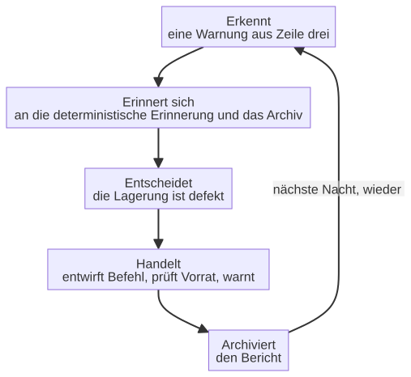

# Kapitel 16 --- Das Büro in der Nacht

## Die Lichter ausgehen

Es gibt eine besondere Art von Stille, die sich nachts über ein Büro legt, sobald die letzte Person ihre letzten Schlüssel mitgenommen hat und der Sicherheitswächter seine Runde abgeschlossen hat. Die Computer bleiben an; die Server summen; die Kaffeemaschine, die wegen des Teekessels, der es nie gibt, abgesteckt ist, bewahrt ihre kleine Wärme. Und in diesem Stillen geschieht etwas, das vor einem Jahrzehnt unmöglich gewesen wäre und das für die meisten Menschen, die tagsüber in Büros arbeiten, auch heute noch unsichtbar ist. Die Arbeit hört nicht auf. Sie wird schlicht nicht mehr von einer Person verrichtet.

Dies ist die Vision, die dieses Kapitel einführt, und es lohnt sich, sie klar zu benennen, bevor wir in die Mechanik einsteigen, denn sie ist die Krönung der ganzen Kette, die wir zusammengebaut haben. Die Intelligenz, die auf der Maschine lebt (Teil II), die Privatsphäre, die die Daten innerhalb der Mauern hält (Teil III) und die Sicherheit, die die Entscheidungen regiert, die sicher sein müssen (Teil IV) --- all dies trifft hier zusammen, im Büro, um eine einzelne, auffällige Möglichkeit real werden zu lassen: ein Büro, das nach dem Lichterausgehen weiterarbeitet, betrieben von einem Agenten, der das Unternehmen so gut kennt wie jeder Angestellte und der niemals schläft, niemals müde wird und niemals Ihre Daten weitergibt.

## Der Unterschied zwischen einem Werkzeug und einem Angestellten

Vor dem Agenten hatte das Büro bereits eine ganze Menge an Werkzeugen. Es gab Tabellenkalkulationen und Textverarbeitung, E-Mail-Clients und Datenbanken und --- zunehmend --- Skripte, die kleine, spezifische Aufgaben automatisierten. Ein Makro konnte einen Bericht formatieren. Ein Skript konnte eine Datei von einem Ordner in einen anderen verschieben. Das sind *Werkzeuge*, und sie sind nützlich, aber es sind Werkzeuge im engen Sinne: sie tun genau das, was man ihnen sagt, bei einem Dokument oder einer Datei, und nichts weiter. Sie haben keine Erinnerung an das Unternehmen, kein Verständnis für das, was die Arbeit *bedeutet*, keine Fähigkeit zu beurteilen, wann eine Aufgabe erledigt ist, oder sich an einen unerwarteten Fall anzupassen.

Der Agent ist der Art nach anders, und der Unterschied ist benennenswert. Ein Agent ist kein Werkzeug, das eine einzige Sache tut; er ist ein *Arbeiter*, dem ein *Ziel* gegeben wird --- "bereite den Monatsbericht vor", "stimme diese Rechnungen ab", "warne den Manager, dass das Lager auf Linie drei ausfällt" --- und der eigenständig die Abfolge von Schritten ermittelt, die nötig sind, um das Ziel zu erreichen, wobei er die ihm gegebenen Werkzeuge verwendet, seine eigene Arbeit dabei überprüft und sich anpasst, wenn etwas nicht wie geplant verläuft. Das ist das definierende Merkmal einer sogenannten *agentischen* System: sie führt nicht bloß einen Befehl aus; sie *verfolgt ein Ziel mit einem Grad an Autonomie*, plant, handelt, beobachtet das Ergebnis und passt sich an.

Und entscheidend ist, dass der Agent hinter diesem Buch kein generischer, von der Stange gefertigter Chatbot ist, der Fragen in einem Fenster beantwortet. Es ist ein selbstgehostetes System, das das Wissen *Ihres* Unternehmens --- die Dokumente, die Systeme, die Geschichte --- auf *Ihrer* Hardware laufen lässt und dieses Wissen vollständig auf Ihrer Seite der Mauer hält. Es ist, in jeder Hinsicht, ein Angelter, der in Ihrem Gebäude lebt und niemals Ihre Anlagen verlässt.

## Warum das Büro die letzte Grenze ist

Sie möchten sich fragen, warum wir in einem Buch über Maschinen und Wolken ein Kapitel im Büro verbringen. Die Antwort ist, dass das Büro der *letzte Glied* in der Kette ist, und es ist zugleich --- vielleicht überraschend --- der Ort, an dem die Revolution am meisten und am deutlichsten benötigt wird. Seit Jahrzehnten verwandelte die industrielle Revolution die *Fabrikflche*: die physische Arbeit der Herstellung von Dingen. Aber das *Büro* --- die Arbeit der Koordination, Dokumentation, Berechnung und Kommunikation --- blieb fast vollständig den Menschen überlassen. der Buchhalter zählt weiter; der Angestellte ordnet weiter; der Manager verfasst weiter; der Einkaufsleiter mailt weiter an Lieferanten. Diese Büroarbeit ist enorm, sich wiederholend und zunehmend datenreich, und sie hatte bis jetzt keine Automatisierung, die über ein paar Makros hinausreichte.

Die sechste Revolution erreicht sie. Sie erreicht sie nicht mit einem generischen Chatbot, sondern mit einem Agenten, der *in der Fabrik verankert* ist --- der die Telemetrie, die von den Maschinen kommt, die Daten, die in der privaten Wolke sicher aufgehoben sind, und die Entscheidungen, die sicher sein müssen, liest --- und der *die Arbeit vollendet, die diese Dinge verlangen*. Der Agent ist der Punkt, an dem die Intelligenz der Fabrik zur Produktivität des Büro wird. Die Maschine nimmt wahr; die Wolke bewahrt das Geheimnis; der Agent entscheidet und handelt. Und die Arbeit, auf die er handelt, ist oft Büroarbeit: die Buchführung, die Rechtliches, der Einkauf, der Bericht, der Kundenservice.

## Eine Neugier: die Fabriken, die bereits im Dunkeln weiterarbeiten

Bevor wir tiefer in das Büro in der Nacht hinabsteigen, lohnt es sich zu wissen, dass der Ausdruck nicht völlig neu in der Industrie ist. Es gibt, in der modernen Fertigung, einen gut etablierten Ausdruck für eine Anlage, die die Nacht hindurch ohne einen einzigen Menschen darin läuft --- eine *Lights-Out*-Fabrik. Das Wort stammt aus der wörtlichsten aller Umstände: In einigen dieser Anlagen ist die Luft so rein, und der Prozess so versiegelt, dass das Leuchten der Lichter eine Verschwendung wäre; die Maschinen brauchen nicht zu sehen, und so brauchen sie das Licht nicht, und so brauchen sie die Menschen nicht, die sonst das Licht brauchen würden, um bei Licht zu sehen. Die Halbleiterindustrie errichtete insbesondere ganze Reinräume, die ohne Menschen laufen, weil ein Mensch in einem Reinraum selbst eine Quelle der Verunreinigung ist --- Hautzellen, Fasern, die leise Störung eines ausgeatmeten Atems. So lernte die Fabrik schon vor Jahrzehnten, im Dunkeln und in Stille zu arbeiten und ihre Ausgabe nicht in den Schichtwechseln ihres Personals zu messen, sondern im fortlaufenden Durchlauf der Einheiten von einer Linie.

Dies ist eine Neugier, die wir uns bewahren sollten, weil sie uns zugleich zwei Dinge leistet. Das erste ist, zu zeigen, dass "das Büro in der Nacht" kein Traum der Zukunft ist, sondern die logische Erweiterung einer Sache, die auf der Fabrikflche bereits existiert: ein System, das weiter produziert, während die Menschen nach Hause gehen. Das zweite ist, einen Unterschied zu machen, den das Büro nun für sich selbst zu lernen hat. Eine *Lights-Out*-Fabrik arbeitet nachts, weil ihre Arbeit physisch, versiegelt und messbar ist --- die Maschinen brauchen nicht die privaten Verträge eines Unternehmens zu lesen oder die ängstliche E-Mail eines Kunden zu beantworten. Das Büro weiß noch nicht, wie es dunkel werden soll, weil seine Arbeit nicht versiegelt ist: sie ist voll von Kontext, von Geschichte, von den genauen und nicht wiederholbaren Fakten eines bestimmten Unternehmens. Genau das verändert der Agent. Das Büro kann endlich dunkel werden, weil der Agent der erste Arbeiter ist, der nicht das Zimmer sehen muss, um die Arbeit zu tun --- er braucht nur das eigene Wissen des Unternehmens, sicher aufgehoben, und ein Ziel, das es wert, verfolgt zu werden.

## Das Weißkragenmeer

Es gibt eine Tatsache, die das Büro in der Nacht so groß fühlen lässt, wie es wirklich ist, und sie ist eine Tatsache über *Skala*, nicht nur über Technologie. Die Arbeit, die in einem Büro geschieht --- die Koordination, die Dokumentation, die Berechnung, die Kommunikation --- ist, in den Volkswirtschaften, die es aufgebaut haben, enorm größer als die Arbeit der Fabrikflche, und sie ist unaufhörlich gewachsen. Das sehr Wort für den Büroangestellten ist vergleichsweise jung: "White-Collar" wurde 1899 vom amerikanischen Journalisten und Autor William H. White geprägt, um den Angestellten und den Verkäufer zu unterscheiden, die drinnen in Hemd und Krawatte arbeiteten, vom "Blue-Collar"-Arbeiter des Ladens und des Feldes, der in Overall arbeitete. In den hundertzwanzig Jahren seit dieser Erfindung ist die Weißkragenbelegschaft um viele Größenordnungen gewachsen. Wo eine Fabrik 1920 vielleicht hundert Männer an den Maschinen und eine Handvoll Angelter an den Schreibtischen beschäftigt hätte, beschäftigt eine Fabrik heute vielleicht hundert Männer an den Maschinen und ein paar hundert Angestellte, Rechner, Ordner, Planer und Korrespondenten an ihren Schreibtischen --- und die Zahl der letzteren steigt weiter, selbst während die ersteren mechanisiert werden.

Dies ist die große Ironie der Produktivitätsgeschichte des zwanzigsten Jahrhunderts: als die Maschinen die *physische* Arbeit übernahmen, wuchs die *dokumentarische* Arbeit eher, als dass sie schrumpfte. Das Büro schrumpfte nicht, um den Raum auszufüllen, den die Maschinen freigelassen hatten; es überlief. Das Kontobuch des Buchhalters, einst in einem einzigen gebundenen Buch geführt, umfasst heute Systeme und Aufsichtsbehörden und Steuergesetzbücher; das Ordnen des Angestellten, einst eine Sache von Tinte und Index, umfasst heute Dokumente und Versionen und die genauen Worte einer vor drei Monaten geführten Unterhaltung; die Verfassung des Managers, einst ein Brief, umfasst heute Berichte und Angebote und die präzise Compliance-Sprache einer Dutzend von Rechtsgebieten. Das ist Arbeit von enormem, sich wiederholendem, zunehmend datenreichem Charakter --- und für die meisten ihrer Geschichte hatte sie keine Automatisierung, die über ein paar Makros hinausreichte. Die sechste Revolution erreicht sie, weil der Agent der erste Arbeiter ist, der dieses ganze Meer der Dokumentation so lesen kann wie ein erfahrener Angelter, ohne müde zu werden, ohne weiterzugeben und ohne ein einziges Wort davon zu vergessen.

## Das Büro in der Nacht, Schritt für Schritt

Um zu sehen, dass dies nicht bloß eine Vision, sondern eine Abfolge ist --- eine echte Sache, die in echter Reihenfolge geschieht --- hilft es, die eigene Nacht des Agenten als kleine Abfolge zu beobachten, so dass der Umriss der Arbeit deutlich wird. Was der Agent in der Nacht tut, ist keine einzelne Handlung, sondern eine Kette, und die Kette ist dieselbe, die die Maschinen regiert: es nimmt wahr, es erinnert, es entscheidet, es handelt, es ordnet.

Dies ist das Büro in der Nacht, in fünf Schritten gezeichnet. Es ist keine Wissenschaftsfiktion. Es ist die natürliche Vollendung der Kette --- und der Agent, der diese Arbeit verrichtet, mit seinem eigenständigen Gedächtnis und seinem Sandkasten, ist das Thema des nächsten Kapitels. Aber bevor wir in dessen Details hinabsteigen, sollten wir die Form der ganzen Kette verstehen, die Weise, in der die Maschine, die Wolke, der Agent und das Büro sich zu einem fortlaufenden Kreislauf verbinden. Diese Form --- der "Industry 7.0"-Graph --- ist das Thema des Kapitels nach dem nächsten. Für jetzt sei das Büro in der Nacht eine Vorausnahme dessen, was kommt.

## Ein reales Beispiel: die Nachtschicht, die nie endet

Um dies konkret zu machen, beobachten wir ein bestimmtes Büro in der Nacht --- nicht ein Fabrikbüro, sondern das Buchhaltungsbüro eines mittelgroßen Herstellers, die Art von Büro, die in fast jedem Ort mit einer Fabrik existiert, und die immer, bis jetzt, der Ort war, an dem sich die Arbeit des Tages leise in den nächsten Tag ergoss. Seit Jahren kam die Buchhalterin der Spätschicht um sechs Abends an, und sie tat, was das Büro am Ende eines Tages tut: sie schloss die Bücher über die Aufträge des Tages, sie stimmte die Rechnungen ab, die gegen die Sendungen ausgestellt waren, die das Lager verlassen hatten, und sie entwarf den Bericht, den der Manager um neun morgens lesen würde. Es war echte Arbeit, sorgfältige Arbeit, und sie war vollständig manuell. Wenn eine Sendung zurückgegeben worden war oder eine Rechnung nicht zu ihrem Auftrag passte, hielt sie an und verfolgte die Diskrepanz von Hand --- per Telefon, per E-Mail, per Neulesen der Papierarbeit. Die Arbeit hörte nicht auf, wenn sie ging; sie wartete schlicht darauf, dass sie zurückkehrte.

Jetzt arbeitet dasselbe Büro in der Nacht, und es arbeitet ohne sie. Der Agent nimmt den Faden genau auf, wie ein erfahrener Angelter es tun würde. Er entwirft den Abschlussbericht des Tages in der eigenen Sprache und Stil des Unternehmens, und wo ein Mensch eine fehlende Zahl geraten hätte, *holt er* den genauen relevanten Kontext --- die Rechnung, die Sendung, die Rückgabe --- aus dem eigenen Archiv des Unternehmens und seiner privaten Wolke, genau und ohne sie neu abzuleiten. Wo ein Mensch ein einzelnes Tabellenkalkulationsblatt von Hand gemacht hätte, kann der Agent dieselbe Tabellenkalkulationsbibliothek ansteuern, die ein erfahrener Angelter verwenden würde, und das Arbeitsblatt mit den Daten, den Stilen und dem Diagramm auf einer einzigen A4-Seite aufbauen und die fertige Datei ausliefern. Und wo die Spätsicht-Buchhalterin einst eine Diskrepanz bis zehn abends am Telefon verfolgte, prüft der Agent das Lager auf das Ersatzteil oder die fehlende Zahl nicht durch eine starre Abfrage, sondern in der Weise, wie ein erfahrener Angelter es tun würde --- liest den Inventarbestand, passt sich an das unerwartete an und warnt den Manager in ruhigen, einfachen Worten. Er tut all dies ohne einen Menschen im Gebäude, using Wissen, das das Unternehmen nie verließ, und er tut es mit derselben Zuverlässigkeit, die die Maschinen regiert. Am nächsten Morgen kommt die Buchhalterin um neun; sie *tut* die Arbeit nicht; sie *prüft* die Arbeit des Agenten und unterzeichnet, was korrekt ist. Das ist die Nachtschicht, die nie endet, und sie ist keine Wissenschaftsfiktion.

## Die eigenen Grenzen des Agenten

Es wäre unehrlich, den Büroagenten als unbegrenzten Arbeiter darzustellen, und Ehrlichkeit ist hier wertvoller als Begeisterung, weil die Grenzen genau das sind, was den Agenten vertrauenswürdig macht. Der Agent hinter diesem Buch ist ein mächtiger Arbeiter, aber er ist ein *begrenzter*, und die Grenzen sind bewusst.

Die erste Grenze ist der Sandkasten. Die Handlungen des Agenten laufen durch einen in die Architektur eingebauten, eingeschränkten Umfang, so dass ein Werkzeugaufruf nicht außerhalb seines zugewiesenen Geltungsbereichs treten kann; Dateiaktionen sind reversibel, dank Versionierung; und dem Agenten wird durch Konzeption keine Code-Ausführungsfähigkeit gegeben, gerade damit er keinen Code erstellen oder ausführen kann. Das ist eine Grenze, die ein nachlässiger Anbieter ein fehlendes Merkmal nennen würde, und ein sorgfältiger den Grund, warum der Agent überhaupt echte Geschäftsarbeit übergeben werden kann.

Die zweite Grenze ist das Wissen. Der Agent kennt nur, was ihm gegeben wurde --- die Dokumente des Unternehmens, seine Geschichte, sein Archiv --- und er ist nur so gut wie dieses Material. Ein Unternehmen mit einem unordentlichem Archiv speist eine unordentliche Erinnerung; ein Unternehmen mit einem klaren Archiv speist eine klare. Der Agent ist ein Spiegel der eigenen Ordnung des Unternehmens, dauerhaft und abrufbar gemacht, und er kann nicht wissen, was niemand ihm gesagt hat.

Die dritte Grenze ist das Urteil. Der Agent schlägt vor; er *antwortet* nicht. Er kann den Bericht entwerfen, den Bestand prüfen und den Manager warnen, aber er kann nicht die Verantwortung für das Ergebnis übernehmen --- das, wie der nächste Teil des Buches betonen wird, bleibt menschlich. Der Agent ist der Arbeiter, der das Tun tut; der Mensch ist der, der unterzeichnet. Und diese Aufteilung ist keine Schwäche des Agenten; sie ist die Form des Vertrauens.

## Warum das Büro zuletzt mechanisiert wurde

Es gibt eine Frage, die es wert ist, klar zu beantworten, weil sie die Vision klarer macht: warum war, wenn die Fabrikflche über hundertfünfzig Jahren mechanisiert wurde, das Büro so spät zur Revolution? Die Antwort ist, dass das Büro keine Werkzeuge fehlten; es fehlte *Kontext*. Jahrzehntelang war das Büro, wenn überhaupt, gründlicher instrumentiert als die Fabrikflche --- Tabellenkalkulationen, Textverarbeitung, Datenbanken, E-Mail-Systeme, Unternehmenssysteme, die die Konten an den Einkauf an das Lager banden. Was es nie hatte, war ein Arbeiter, der diese Werkzeuge tatsächlich *benutzen* konnte, wie es eine erfahrene Person tut: Kontext lesen, Geschichte erinnern, beurteilen, wann eine Aufgabe erledigt ist, und sich an den unerwarteten Fall anpassen. Ein Makro kann einen Bericht formatieren; ein Skript kann eine Datei von einem Ordner in einen anderen verschieben; ein Unternehmenssystem kann eine Rechnung berechnen. Aber keines von ihnen kann *das Unternehmen kennen* --- die Kunden, der Stil, die Geschichte, die unausgesprochenen Regeln, wie dieses bestimmte Unternehmen seine Arbeit tut. keines von ihnen kann beurteilen, dass eine bestimmte Rechnung falsch ist, oder dass ein bestimmter Kunde eine Ausnahme verdient, oder dass ein bestimmter Bericht in einer bestimmten Weise geschrieben werden sollte.

Genau das verändert der Agent, und deshalb war das Büro die letzte Grenze. Die Maschine wurde zuerst mechanisiert, weil ihre Arbeit *physisch, versiegelt und messbar* ist --- eine Spindel dreht sich entweder oder sie tuts nicht, und die Sensoren, die sie beobachten, brauchen das Unternehmen nicht zu verstehen. Das Büro wurde zuletzt mechanisiert, weil seine Arbeit *kontextuell, historisch und nicht wiederholbar* ist --- es hängt vom Wissen über dieses Unternehmen, seine Kunden, seine Dokumente und seine Geschichte ab, und keine noch so große Makro-Schreiberei konnte dieses Wissen liefern. Die sechste Revolution erreicht das zuletzt, nicht weil die Werkzeuge endlich ankamen, sondern weil der *Arbeiter* endlich ankam: ein Agent, der das Unternehmen kennt, auf Ihrer Hardware läuft und niemals Ihre Daten weitergibt. Und sobald dieser Arbeiter existiert, hört das Büro in der Nacht auf, ein Traum zu sein, und wird, ganz einfach, ein Büro, das arbeitet.
