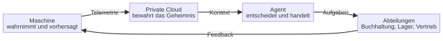

# Kapitel 18 --- Die Kette: Maschine, Cloud und Abteilung

## Zurücktreten, um die Form zu sehen

Wir haben nun stück für stück durch jede Komponente der sechsten industriellen Revolution gegangen. Wir haben die Maschine getroffen, die auf einem Chip denkt, die Cloud, die ihr Geheimnis hütet, und den Agenten, der Ihr Geschäft kennt und nie vergisst. Einzelne sind jeweils beeindruckend. Doch der Grund, warum dieser Moment --- diese sechste Revolution --- wirklich von jeder vorangegangenen Revolution unterscheidet, ist, dass die Komponenten nicht bloß *vorhanden* sind; sie sind *verbunden*, zu einem durchgängigen Kreislauf, in dem die Ausgabe des einen zur Eingabe des nächsten wird und der letzte Kreislauf wieder zum ersten zurückkehrt. Dieses Kapitel ist der Schritt zurück, der es Ihnen ermöglicht, die ganze Form auf einen Blick zu sehen, denn das Sehen der Form ist der Unterschied zwischen einem Haufen Teile und einer einzigen Maschine.

Der Kreislauf hat vier Stufen, und es lohnt sich, sie gemeinsam im Kopf zu behalten, bevor wir jede einzeln ausführen:

Die Maschine nimmt ihre Welt wahr und erzeugt Telemetrie. Die private Cloud empfängt diese Telemetrie und bewahrt sie sicher, konsistent und durchsuchbar auf. Der Agent ruft den präzisen, relevanten Kontext aus der Cloud und aus Ihrem Wissensbestand ab, entscheidet, was zu tun ist, und handelt. Seine Handlung ist die Automatisierung der Arbeit einer Abteilung --- der Buchhaltung, des Lagers, des Vertriebs, des Supports. Und die Arbeit der Abteilung erzeugt wiederum neue Anforderungen und neue Handlungen, die zurück in die Maschine und die Cloud fließen. Der Kreislauf ist geschlossen. Die Fabrik ist in der vollsten Bedeutung des Wortes *selbstkoordinierend*.

## Eine Neugier: Das Wort für einen Kreislauf

Es lohnt sich, an diesem Kapitel über einen Kreislauf kurz innezuhalten und eine einfache Frage zu stellen --- was meinen wir eigentlich, wenn wir diese Form einen \"Kreislauf\" nennen, und woher kommt das Wort? Der Begriff, der die Idee, die wir verwenden, am präzisesten benennt, ist **Cybernetik**, 1948 vom amerikanischen Mathematiker Norbert Wiener geprägt, als er ein Buch dieses Namens veröffentlichte. Das Wort ist älter als die Disziplin; es stammt unverändert aus dem antiken Griechisch *kubernan* --- ein Schiff steuern, das Ruder halten. Ein *Kubernetes* war der Steermann, derjenige, der ein Schiff auf seiner Kurve hielt, indem er fortlaufend den Unterschied zwischen dem Ort, an dem das Schiff war, und dem Ort, an den es führen sollte, las und diesen Unterschied korrigierte, während sich das Meer veränderte. Dies ist genau das, was unser Kreislauf tut: Es liest fortlaufend den Unterschied zwischen dem Zustand der Fabrik und dem Zustand, in den die Fabrik geführt werden soll, und korrigiert diesen Unterschied --- durch die Maschine, durch die Cloud, durch den Agenten, durch die Abteilungen --- solange der Kreislauf geschlossen ist.

Das Wort trägt leise eine ganze Kontrollphilosophie mit sich. Vor der Cybernetik dachte die Technik überwiegend in Maschinen, die schlicht *taten*, was man ihnen sagte, einmal. Die Cybernetik lehrte ein gesamtes Feld, stattdessen in Maschinen zu denken, die *beobachten, vergleichen und anpassen* --- der Servo, der Thermostat, der Regler an einer Dampfmaschine, der menschliche Fahrer, der das Auto in seiner Spur hält, indem er fortlaufend auf die Straße blickt und das Rad um einen Millimeter dreht. Der Kreislauf der sechsten Revolution gehört im Geist dieser Tradition an. Die Fabrik, die denkt, ist eine Fabrik, die *sich selbst steuert*, und das Wort dafür ist das Wort, das wir durchweg verwendet haben, ob wir es wussten oder nicht.

## Das Büro, das bereits verbunden wurde

Vor der sechsten Revolution gab es reale, dokumentierte Versuche, genau das zu tun, was dieser Kreislauf tut --- die Maschinen einer Fabrik mit dem Büro zu verbinden, das es betreibt --- und es ist ehrlich, sie zu benennen, denn sie zeigen zugleich, wie weit der Markt bereits gekommen ist und wie weit er noch zu gehen hat. Die Abstammung beginnt überraschend mit der Materialbuchhaltung. In den 1950er und 60er Jahren gab ein Mann namens Joseph Orlicky, der sich mit Bestandsführung befasste, dem Begriff **MRP** --- Material Requirements Planning --- durch die Berechnung, aus einer Stückliste und einem Zeitplan der herzustellenden Waren exakt, welche Materialien benötigt wurden und wann. In den 70er Jahren wuchs dies zu **MRP II**, Manufacturing Resource Planning, das den Zeitplan der Fabrik, ihre Bestände und ihre Kostenberechnung unter eine integrierte Rechnung zusammenführte. Und in den 80er und 90er Jahren weitete sich die Idee über die Fabrikmauern hinaus zum **ERP** --- Enterprise Resource Planning --- den großen integrierten Systemen, die versuchen, ein ganzes Unternehmen, von seinen Aufträgen bis zu seiner Gehaltsabrechnung, als einen einzigen, konsistenten Zahlenkreislauf zu führen.

Dies ist der Vorgänger, den wir benennen müssen, denn die sechste Revolution ist, in einem Sinne, der *nächste* Schritt am selben Weg. ERP war eine Revolution für sich selbst --- es war die erste Software, die weit genug ging, ein Unternehmen als einen durchgängigen System zu betrachten statt als Sammlung von Schreibtischen. Doch es hatte eine strukturelle Grenze, die die sechste Revolution überwindet, und die Grenze lohnt es zu benennen, denn sie ist die Grenze, die die interne Cloud notwendig macht. Das klassische ERP verband das *Büro* mit sich selbst: die Buchhaltung mit der Beschaffung mit dem Lager. Was es nicht verband und nicht verbinden konnte, war die *Maschine* --- die physische Realität der Fabrikfläche, gesehen durch einen Chip auf einer Spindel, in Echtzeit. Es war ein Bürosystem, das nach innen blickte, auf Papierkram; die sechste Revolution ist ein Bürosystem, das *nach außen* blickt, auf die Maschine, und dann wieder nach innen, in einem Kreislauf. Die Kette, die wir gezogen haben, ist die Verbindung jener zwei Abstammungen: die integrierte Rechnung des ERP, endlich verbunden mit der lebendigen Wahrnehmung der Maschine und dem privaten Gedächtnis der Cloud.

## Die Richtung des Kreislaufs

Lassen wir die Reihenfolge dieser Stufen nicht vorübergehen, denn die Reihenfolge ist bedeutsam. Der Kreislauf beginnt am *physischen* --- der Maschine, die wahrnimmt --- weil die sechste Revolution grundlegend darum geht, Intelligenz in die physische Welt des Herstellens zu bringen, nicht bloß in die Welt von Papier und Daten. Die Intelligenz schwebt nicht frei; sie ist *verankert* am realen Zustand der Fabrik. Sie fließt dann *nach innen* --- zur privaten Cloud, die sie sicher aufbewahrt --- und dann *nach oben* --- zum Agenten, der davon ausgeht, und zu den Abteilungen, die darauf handeln. Dies ist die Richtung des Wertes: von der physischen Realität der Maschine, durch das sichere Gedächtnis der Cloud, zur Urteilskraft des Agenten, zur Handlung des Büros.

Beachten Sie auch, dass dies bewusst das *Gegenteil* des alten Modells ist. Im alten Modell lebte die Intelligenz in einem Raum voller Computer, und die Maschinen auf der Fläche waren dumme Aktor-Sklaven; die Intelligenz kam *herab* auf die Fläche, schlecht, als Satz von Regeln. In der sechsten Revolution ist die Intelligenz *in die Maschine eingebaut*, und sie fließt *heraus* --- durch eine Cloud, die das Unternehmen kontrolliert, durch einen Agenten, der das Geschäft kennt --- um die Arbeit zu automatisieren, die bis jetzt gänzlich menschlich war. Die Richtung ist umgekehrt, und mit ihr die ganze Volkswirtschaft der Fabrik.

## Das Schlüsselwort: Die interne Cloud

Es gibt einen Ausdruck im Diagramm, der wiederholt werden verdient, denn er ist der Ausdruck, der den ganzen Kreislauf politisch und technisch möglich macht: die **interne**, private Cloud. Jeder frühere Versuch, die Maschinen einer Fabrik mit ihrem Büro zu verbinden, ging durch eine *öffentliche* Cloud --- die riesigen, zentralisierten Datenzentren, die datagate als lesbar oder zum Lesen gezwungen nachweisen konnte. Das ist ein Deal, den kein Unternehmen, das seine Zukunft schätzt, eingehen kann, denn die Telemetrie, die von der Maschine fließt, ist genau das Bild der Zukunft des Unternehmens, sichtbar gemacht. Eine öffentliche Cloud würde dieses empfindlichste Vermögensstück in die Daten eines anderen verwandeln.

Die interne, private, zero-knowledge Cloud --- die Cloud innerhalb der Mauern --- ist es, was es erlaubt, den Kreislauf ohne Verrat zu schließen. Sie empfängt die Telemetrie der Maschine, bewahrt sie konsistent und durchsuchbar über das Unternehmen hinweg, und sie lässt den Agenten den exakt relevanten Kontext abrufen --- und in all dem lernt sie nie die Inhalte, weil das Unternehmen den Schlüssel behält. Der Kreislauf kann daher fortlaufend, sicher und privat laufen, und das ist die einzige Art von Kreislauf, mit der ein Unternehmen seine eigene Zukunft vertrauen kann. Dies ist das Thema von Teil III, hier wiederholt, weil es der Grund ist, warum der Kreislauf überhaupt möglich ist.

## Der Kreislauf, gemessen an Daten

Um den Kreislauf konkret zu machen, hilft es, genau zu sehen, was durch ihn fließt, denn ein Kreislauf ist keine Abstraktion --- er ist ein Strom spezifischer Dinge, die sich in einer spezifischen Richtung, an einem spezifischen Tempo bewegen. Am unteren Ende des Kreislaufs nimmt die Maschine wahr, und was sie *nach oben* sendet, ist Telemetrie: die Messungen ihrer Sensoren, in Echtzeit, verschlüsselt während ihrer Reise, und im privaten Cloud sicher aufbewahrt. Dies ist Daten über den physischen Zustand der Fabrik --- die Temperatur einer Spindel, die Vibration eines Motors, die Energie, die eine Maschine verbraucht --- gesammelt, nicht um die Maschine zu beobachten, sondern um sie *vorherzusagen*. Aus der Cloud fließt *nach oben* keine Rohdaten, sondern Kontext: der Agent ertrinkt nicht in einem Strom von Zahlen; er ruft den präzisen, relevanten Kontext aus der Cloud und aus dem eigenen Wissensbestand des Unternehmens ab, und er entscheidet, was er mit diesem Kontext tun wird. Und seine Entscheidung fließt *nach oben*, erneut, als Handlung --- eine automatisierte Aufgabe oder eine Vorschrift --- zur Abteilung, die darauf handelt.

Beobachten Sie nun, wie der Kreislauf sich schließt, und achten Sie darauf, was *zurück* fließt. Die Handlung der Abteilung --- ein Auftrag erteilt, eine Abrechnung ausgeglichen, ein Lieferantenwarnung --- erzeugt neue Anforderungen und neue Handlungen, und jene fließen *herab* zur Maschine und zur Cloud und informieren den nächsten Zyklus der Wahrnehmung, den nächsten Zyklus des Gedächtnisses, den nächsten Zyklus von Entscheidung und Handlung. Der Kreislauf ist keine Pipeline, die Daten in einer Richtung transportiert und dann aufhört; er ist ein geschlossenes System, in dem die Ausgabe jeder Stufe zur Eingabe der nächsten wird, fortlaufend, ohne dass ein Mensch jedes Arbeitsstück von Hand vom einen Schreibtisch zum nächsten weitergibt. Dies bedeutet \"selbstkoordinierend\", konkret: nicht eine Maschine, der *vorgegeben wird*, was zu tun ist, sondern ein System, dessen eigene Ausgabe seine eigene nächste Eingabe antreibt, ewig, solange der Kreislauf geschlossen ist.

## Warum der Kreislauf keine Pyramide ist

Es gibt eine subtile, aber wichtige Unterscheidung, die es wert ist, gezogen zu werden, denn sie ist die Unterscheidung zwischen einer Maschine, die bloß *ausführt*, und einer Maschine, die *selbstkoordiniert*. Eine Pyramide ist eine Hierarchie: Befehle fließen von oben herab, und Berichte fließen von unten herauf, aber nichts am unteren Ende ändert, was am oberen Ende ist --- die Hierarchie ist *stabil* in dem Sinne, dass das obere Ende immer entscheidet und das untere Ende immer gehorcht. Ein Kreislauf ist hingegen nicht auf diese Weise stabil; er ist *dynamisch*: die Ausgabe des unteren Endes fließt zurück in das obere Ende und ändert, was das obere Ende als nächstes entscheidet. Dies ist der Unterschied zwischen einer Fabrik, die *befohlen* wird, und einer Fabrik, die *selbstkoordiniert*.

Dies ist es, warum der Kreislauf so viel bedeutet, und warum er das Herz des Kapitels ist. Die sechs früheren Revolutionen machten die Maschine leistungsfähiger, dann vernetzter, dann computerisierter, doch an keinem Punkt *koordinierte* die Maschine sich selbst; an keinem Punkt trieb ihre eigene Ausgabe ihre eigene nächste Eingabe fortlaufend an, ohne einen Menschen im Kreislauf. Die sechste Revolution ist die erste, die dies tut.

## Die Latenz des Kreislaufs

Es gibt eine Eigenschaft des Kreislaufs, die leicht übersehen wird und die in der Praxis entscheidet, ob er funktioniert: seine *Geschwindigkeit*, und die Tatsache, dass verschiedene Teile von ihm an unterschiedlichen Tempoi laufen müssen. Ein einzelner Kreislauf, der versuchte, alles am Tempo des langsamsten Teils laufen zu lassen, wäre nutzlos; ein Kreislauf, der versuchte, alles am Tempo des schnellsten Teils laufen zu lassen, wäre unsicher. Die sechste Revolution funktioniert, weil sie jede Entscheidung ihrem eigenen Zeitmaß anpasst.

Am **Rand** läuft der Kreislauf in Mikrosekunden. Die Maschine, die ihre eigene Vibration wahrnimmt und darauf handelt --- ein Motor blockiert, ein Weg angepasst, ein Teil ausgeschieden --- muss in der Zeit entscheiden, die es dauert, die physische Aufgabe abzuschließen, oft thousandths of a second. Dies ist das Zeitmaß des Reflexes, und deshalb muss die Intelligenz auf der Maschine leben, auf dem Chip, und nicht in einem Raum.

In der **Cloud** läuft der Kreislauf in Sekunden und Minuten. Die Telemetrie wird zusammengefasst und gesendet, die private Cloud speichert sie und macht sie durchsuchbar, und der Agent ruft den präzisen Kontext ab und denkt über ihn nach. Dies ist das Zeitmaß des Gedächtnisses und der Urteilskraft --- schnell genug, um einen Trend zu fangen, langsam genug, um zu denken --- und deshalb existiert die private Cloud als separate Schicht, mit ihrem eigenen Rhythmus.

Im **Büro** läuft der Kreislauf in Stunden und Tagen. Der Agent entwirft den Instandhaltungsauftrag, das Lager bestellt das Teil, die Buchhaltung gleicht die Abrechnung aus, der Kunde wird über das Lieferdatum informiert. Dies ist das Zeitmaß der Arbeit, die ein Mensch über einen Tag hinweg getan hätte, jetzt über Nacht erledigt, und deshalb ist die Büromaschinierung die Spitze des Kreislaufs und nicht sein unteres Ende.

Die Kunst der sechsten Revolution ist es, in technischer Hinsicht, die *Entscheidung am Zeitmaß zu messen*. Eine Sicherheitsentscheidung, die in einer Millisekunde getroffen werden muss, kann nicht auf die Cloud warten; eine strategische Entscheidung, die ein Jahr Geschichte abwägen sollte, kann nicht am Rand getroffen werden. Der Kreislauf funktioniert, weil jede Schicht am Tempo läuft, das ihre eigene Frage verlangt --- Reflex, Gedächtnis, Arbeit --- und weil die Schichten verbunden sind, sodass ein schneller Reflex und ein langsames Urteil dennoch Teil desselben Ganzen sein können.

## Der Kreislauf ist die Revolution

Lassen wir dieses Kapitel mit der Idee schließen, die es mit dem ganzen Buch verbindet, denn sie ist die Idee, zu der das Buch gebaut ist, um zu vermitteln. Die sechste industrielle Revolution ist nicht die Maschine, oder die Cloud, oder der Agent, oder die Automatisierung der Abteilungen. Es ist der *Kreislauf* --- der durchgängige, selbstkoordinierende Fluss von der Maschine, durch die private Cloud, durch den Agenten, zu den Abteilungen, und wieder zurück. Es ist der Moment, in dem die Fabrik sich zu einem einzigen, selbstkoordinierenden System statt zu einer Sammlung von intelligenten Maschinen und intelligenten Büros, die sich nur zufällig nahe beieinander befinden, wird.

Und es gibt eine menschliche Dimension des Kreislaufs, die wir noch nicht benannt haben, weil sie die wichtigste ist. Der Kreislauf, den wir gezogen haben, ist ein Kreislauf von *Maschinen und Agenten*. Aber er ist kein Kreislauf, der den Menschen *ersetzt*; er ist ein Kreislauf, der den Menschen *verlagert* und ihn vom letzten Glied der Kette zum Architekten und Dirigenten des Ganzen befördert. Die Maschine nimmt wahr; der Agent entscheidet; der Mensch *hält die Autorität zu vetoieren, zu beurteilen, ob die Entscheidung das Handeln wert ist, und Verantwortung für das Ergebnis zu übernehmen*. Der Kreislauf ist nicht frei von Menschen; er ist menschenbefördert. Diese Beförderung --- dieser Wechsel vom letzten Glied zum Dirigenten --- ist der menschliche Inhalt der sechsten Revolution, und sie ist das Thema des nächsten Teils dieses Buches.

Lassen wir den Kreislauf für jetzt stehen: die Maschine, die Cloud, der Agent und die Abteilung, verbunden zu einem durchgängigen, selbstkoordinierenden System. Das nächste Kapitel wird die Abteilung öffnen und zeigen, was die Automatisierung tatsächlich mit der Buchhaltung, dem Lager, dem Vertrieb und dem Support tut. Und das Kapitel danach wird dem ganzen Kreislauf seinen Namen und seine Form geben, den \"Industry 7.0\"-Graph.
