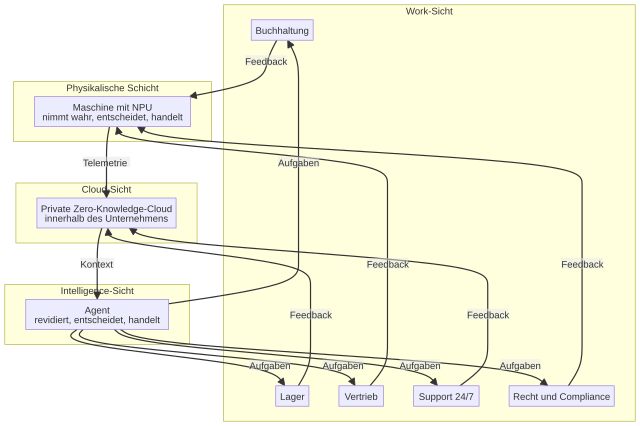

# Kapitel 20 --- Der Graph, der alles verbindet

## Der Name des Ganzen

Wir haben alle Komponenten der sechsten Revolution nacheinander durchlaufen. Es ist Zeit, dem Ganzen seinen Namen zu geben und es so zu zeigen, wie es wirklich ist: nicht als Linie, sondern als *Graph* --- eine Menge von Verbindungen, in der jeder Knoten jeden anderen nährt, in einem fortlaufenden, selbstkoordinierenden Ganzen. Dies ist der **Industry 7.0**-Graph, und er ist die Gestalt der Zukunft, die dieses Buch von der ersten Seite an beschreibt. Die Zahl "7.0" ist nicht beliebig. Die früheren Revolutionen machten die Maschine leistungsfähiger, dann vernetzter, dann computerisierter. Die siebte ist es in dem von diesem Buch gewählten Rahmen, in dem die Maschinen selbst zu *Peripheriegeräten einer internen KI* werden, und die KI --- agentisch, mit einer privaten Cloud verbunden, das Unternehmen kennend --- das Ganze des Unternehmens automatisiert, von der Maschine bis zur jeder Abteilung.

Lassen Sie uns den Graphen sorgfältig zeichnen, denn der Graph ist das Wesen des Arguments, und ihn als Ganzes zu sehen, ist der Unterschied zwischen dem Verstehen der sechsten Revolution und dem bloßen Bewundertsein von ihren Teilen.

## Der Graph

## Eine Neugier: Die sieben Brücken, und der erste Graph

Bevor wir den Graphen lesen, ist es wert zu wissen, dass das Wort "Graph" in diesem Sinne --- eine Menge von Punkten, die durch Linien verbunden sind --- einen überraschenden und recht verspielten Ursprung hat, denn die Mathematik der Graphen begann nicht mit der Technik, sondern mit einem Rätsel. In der preußischen Stadt Königsberg des achtzehnten Jahrhunderts (heute Kaliningrad, am Fluss Pregel) gab es einen Fluss mit zwei Inseln und sieben Brücken, die die beiden Ufer und die beiden Inseln verbanden. Die Stadtbewohner vergnachten sich mit einer Frage: Man könnte einen Spaziergang tun, der jede der sieben Brücken genau einmal überquert und zum Ausgangspunkt zurückkehrt? Im Jahr 1736 entschied der Schweizer Mathematiker **Leonhard Euler** die Frage --- und entschied sie im Negativen, mit einem Beweis, so sauber, dass er noch heute gelehrt wird. Aber es war mehr als eine Lösung zu einem Gesellschaftsspiel: Um es zu beantworten, musste Euler die Landmassen als *Punkte* und die Brücken als *Linien* denken und sie nicht nach ihrer Länge oder ihrem Material messen, sondern rein nach *ihrer Verbindung*. Dabei erfand er, was wir heute Graphentheorie nennen, und er gab uns das sehr Vokabular von "Knoten" und "Kanten", das wir verwenden, um die Industry 7.0-Fabrik zu beschreiben.

Dies ist eine Neugier, die es sich zu halten lohnt, denn Eulers Einsicht ist genau die Einsicht, auf der unser Graph beruht. Der Industry 7.0-Graph ist nicht maßstabsgetreu gezeichnet; es spielt keine Rolle, wie "lang" die Verbindung zwischen der Maschine und der Cloud ist, oder wie "breit" der Lagerknoten ist. Was zählt, wie Euler zeigte, ist rein *die Verbindung der Knoten* --- welcher Knoten nährt welchen, in welcher Reihenfolge, und wie das Ganze sich in eine Schleife schließt. Die Maschine nährt die Cloud; die Cloud nährt den Agenten; der Agent nährt die Abteilungen; die Abteilungen nähren zurück. Das ist das gesamte Argument, auf Verbindungen reduziert. Die Kraft des Graphen liegt nicht in den Knoten, sondern in den *Kanten*, und nicht einmal bloß in den Kanten --- sie liegt in der Tatsache, dass die Kanten endlich *zurücklaufen*.

## Lesen des Graphen

Lassen Sie uns den Graphen von unten nach oben lesen und dann sehen, wie er zurückläuft.

Am **unteren** Ende ist die physische Schicht: die Maschine, ausgerüstet mit ihrem intelligenten Chip, der Einplatinencomputer mit dem NPU, der wahrnimmt, entscheidet und auf einer einzigen lüfterlosen, billigen Platine handelt. Dies ist die Schicht, die wir in Teil II kennenlernten --- die Maschine, die aufwachte. Sie ist der Anker des ganzen Graphen, denn sie ist der Punkt, an dem die Intelligenz auf die physische Welt der Fertigung trifft.

Aus der Maschine heraus fließt ein Strom von **Telemetrie**, in Echtzeit verschlüsselt. Dieser Strom geht nicht zu einer öffentlichen Cloud; er geht, auf der nächsten Ebene, zu der **privaten, vertrauenslosen, nullwissenden Cloud, die innerhalb des Unternehmens gehalten wird** --- die Cloud von Teil III, die die Daten empfängt und hält, ohne je fähig zu sein, sie zu lesen, weil das Unternehmen den Schlüssel hält. Dies ist der Speicher des Systems, konsistent und durchsuchbar über das ganze Unternehmen hinweg, und sicher vor jeder dritten Partei.

Aus dieser Cloud ruft der Agent --- der **agentische KI** von Teil V --- den genauen, relevanten Kontext ab, sowohl aus der Cloud als auch aus dem eigenen Wissensbestand des Unternehmens. Der Agent entscheidet, was zu tun ist, und handelt. Und seine Handlung ist die **Automatisierung der Abteilungen**: Buchführung, Lager, Vertrieb, Marketing, Kundensupport, Rechtliches und Compliance. Diese sind die Knoten am oberen Ende des Graphen --- die Arbeit, die die sechste Revolution endlich automatisiert, das Büro, das weiterarbeitet, nachdem die Lichter ausgegangen sind.

## Die Rücklaufschleife

Jetzt der entscheidende Teil, der Teil, der ihn zu einem *Graphen* macht und nicht bloß zu einer Pyramide. Die Automatisierung der Abteilungen endet die Geschichte nicht; sie *nährt sie zurück*. Die Buchführung, die eine Rechnung abstimmt, erzeugt eine neue Anforderung. Das Lager, das ein Ersatzteil bestellt, erzeugt neues Telemetrie. Der Vertrieb, der einen Markt analysiert, erzeugt einen neuen Plan. Und all diese Anforderungen, Rückmeldungen und neuen Daten fließen *herab* zur Maschine und zur Cloud, und informieren den nächsten Zyus der Wahrnehmung, den nächsten Zyklus der Erinnerung, den nächsten Zyklus der Entscheidung und Handlung. Der Graph ist geschlossen. Das System ist selbstkoordinierend.

Dies ist das "7.0" im Industry 7.0: nicht eine neue Art von Maschine, sondern eine neue *Architektur*, in der die Maschinen zu Peripheriegeräten einer internen KI werden, und die KI --- agentisch, mit einer privaten Cloud verbunden, das Unternehmen kennend --- das Ganze des Unternehmens automatisiert, in einer fortlaufenden Schleife. Die Maschine denkt; die Cloud erinnert sich; der Agent entscheidet; das Büro handelt; und die Handlung läuft zurück, um den nächsten Gedanken zu informieren. Das Ganze ist größer als die Summe seiner Teile, weil das Ganze eine *Schleife* ist, und eine Schleife bewahrt ihre eigene Dynamik.

## Die zwei Arten von Intelligenz im Graphen

Ein letztes Lesen des Graphen, denn es verbindet sich zurück zu Teil IV. Der Graph enthält beide Arten von Intelligenz, die wir kennenlernten --- den ratenden Geist und den deterministischen Geist --- und er platziert jeden dort, wo er sicher ist: das **Wahrnehmen** am unteren Ende (die Maschine, die wahrnimmt) ist der ratende Geist, perfekt für die Wahrnehmung; die **Entscheidung und Spezifikation** im Agenten und der Cloud ist der deterministische Geist, sicher und nachvollziehbar. Der Graph ist nicht eine einzelne Intelligenz; er ist eine *Kombination*, jeder Geist an seinem richtigen Platz, und es ist diese Kombination, die das Ganze an den Stellen vertrauenswürdig macht, wo Vertrauen nicht verhandelbar ist.

## Das Ganze in einem Atemzug

Es hilft, auf einem Graphen, ihn als eine einzelne Bewegung zu lesen, so dass die Gestalt nicht bloß gesehen, sondern verfolgt wird. Lassen uns das Ganze in einem Atemzug lesen, von der Maschine zum Büro und zurück. Am unteren Ende trägt eine Spindel auf einer Fabrikboden einen Chip, der ihre Welt wahrnimmt --- die Temperatur ihrer Lagerung, die Vibration ihres Motors --- und vorherzusagen, dass die Lagerung ausfallen wird. Diese Vorhersage fließt, verschlüsselt, zu einer privaten, vertrauenslosen, nullwissenden Cloud, die innerhalb des Unternehmens gehalten wird, die empfängt und hält, ohne je fähig zu sein, sie zu lesen, weil das Unternehmen den Schlüssel hält. Aus dieser Cloud ruft ein Agent den genauen, relevanten Kontext ab --- die Geschichte der Maschine, die Wartungsnotizen des Unternehmens, die deterministischen Entscheidungen, die sicher sein müssen --- und es entscheidet, dass die Lagerung wirklich ausfällt, und erteilt eine Bestellung für das Ersatzteil. Die Bestellung fließt zum Lager, das nun automatisch weiß, und zur Buchführung, die die Rechnung abstimmt, und zum Vertrieb und Support, die das Lieferdatum wissen. Und all das --- die Bestellung, die Rechnung, die Lieferung --- fließt *herab* zur Maschine und zur Cloud, und informiert den nächsten Zyklus der Wahrnehmung, den nächsten Zyklus der Erinnerung, den nächsten Zyklus der Entscheidung und Handlung. Der Graph ist geschlossen. Das System ist selbstkoordinierend. Das Ganze ist größer als die Sum seiner Teile, weil das Ganze eine *Schleife* ist.

## Warum 7.0 und nicht 6.0

Es ist wert, klar zu beantworten, die Frage, die der Kapitelname aufwirft: Warum "7.0", und nicht eine Zahl näher am Rest der Geschichte? Die Antwort ist, dass die Zahl eine *Architektur* benennt, nicht eine Maschine. Die früheren Revolutionen machten die Maschine leistungsfähiger, dann vernetzter, dann computerisierter --- und jeder dieser Schritte hätte als "6.0" oder "6.1" gezählt werden können, weil sie dieselbe Revolution waren, einfach stärker und schneller werdend. Die siebte ist es in dem von diesem Buch gewählten Rahmen eine *andere Art von Ding*: Es ist die Revolution, in der die Maschinen selbst zu *Peripheriegeräten einer internen KI* werden, und die KI --- agentisch, mit einer privaten Cloud verbunden, das Unternehmen kennend --- das Ganze des Unternehmens automatisiert, von der Maschine bis zur jeder Abteilung. Es ist nicht so, dass die Maschinen leistungsfähiger wurden; es ist, dass sie *etwas Neues* wurden --- Peripheriegeräten einer KI, die denkt, verbindet und kennt. Das ist eine neue Architektur, und sie verdient eine neue Zahl. Das "7.0" ist nicht beliebig; es markiert den Moment, da die Fabhör aufhörte, eine Ansammlung von intelligenten Maschinen zu sein, die zufällig nebeneinander sitzen, und wurde zu einem einzelnen, selbstkoordinierenden System.

## Warum eine Schleife, und nicht eine Kette

Das Wichtigste am Graphen ist nicht, dass er vier Schichten hat, sondern dass er *schließt*. Und es ist wert zu verstehen, warum der Abschluss so viel bedeutet, denn die alte Fabrik war auch eine Art Graph --- eine *Kette* --- und der Unterschied zwischen einer Kette und einer Schleife ist der Unterschied zwischen einer Fabrik, die nur gesagt bekommen kann, was zu tun ist, und einer Fabrik, die über das nachdenken kann, was sie tut.

Die alte Fabrik war eine Kette: Rohstoff trat an einem Ende ein, und ein fertiges Produkt kam am anderen Ende heraus, und jeder Schritt war ein Glied, das die Arbeit zum nächsten weitergab. Eulers Fließband, das wir in der Zeitleiste kennenlernten, war der reinsteste Ausdruck der Kette --- eine lineare Sequenz kleiner, wiederholbarer Schritte, jeder der nächste nährend, keiner von ihnen zurückblickend. Die Kette war brillant effizient bei einer Sache: *dasselbe zu tun, schneller*. Aber sie hatte eine strukturelle Schwäche, die keine Menge von Effizienz heilen konnte. Sie konnte nicht *lernen*, weil nichts in einer Kette je zurückfloss. Die Ausgabe verließ die Fabrik, und die Fabrik hörte nie, was mit ihr geschah. Ein Fehler, der von einem Kunden drei Wochen später entdeckt wurde, konnte die Maschine, die ihn machte, nicht informieren, weil die Kette keine Kante hatte, die rückwärts lief.

Der Industry 7.0-Graph hat diese Kante durchaus. Die Abteilungen nähren zurück zur Maschine und zur Cloud, und diese Rückmeldung verändert den nächsten Zyklus. Ein Fehler, der von einem Kunden entdeckt wurde, wird durch den Agenten zu einer neuen Anforderung, die zur Maschine erreicht; ein Muster in den Wartungsprotokollen wird durch dieselbe Schleife zu einer neuen Vorhersage, die eine zukünftige Störung verhindert. Der Graph *lernt von seiner eigenen Ausgabe*, und eine Kette hätte nie können. Dies ist, warum die Schleife, und nicht bloß die Schichten, das Wesen der siebten Generation ist: Es ist die Struktur, die der Fabrik erlaubt, sich selbst denken zu hören.

## Die Zerbrechlichkeit einer Kette, die Widerstandsfähigkeit einer Schleife

Es gibt einen zweiten, leiseren Grund, warum die Schleife die Kette schlägt, und er betrifft, was geschieht, wenn etwas schiefgeht. Eine Kette ist *an ihrem schwächsten Glied zerbrechlich*: Wenn ein einzelner Schritt in der linearen Sequenz ausfällt, hält das ganze Produkt an, weil es keinen anderen Weg von Rohstoff zu einem fertigen Gut gibt. Dies ist, warum ein Fließband vollständig zum Stillstand kommt, wenn eine Station klemmt --- die Kette hat keinen Umweg, keine Redundanz, keine alternative Route.

Eine Schleife ist widerstandsfähiger, aus demselben Grund, aus dem Eulers Brücken interessant sind: Was zählt, ist *die Verbindung der Teile*. Weil der Industry 7.0-Graph mehrere Kanten hat --- die Abteilungen nähren sowohl die Maschine als auch die Cloud, die Maschine nährt die Cloud und empfängt von ihr --- hält ein Ausfall an einem Punkt nicht notwendig das ganze System an. Der Agent kann an einer ausgefallenen Abteilung vorbeirouten; die Cloud kann eine Maschine bedienen, deren Nachbar ausgefallen ist; die Maschine kann lokal handeln, selbst wenn die Cloud kurzzeitig nicht erreichbar ist. Der Graph ist nicht *immun* gegen Ausfall, aber er ist *verteilt* dagegen, in der Weise, in der ein Netzwerk widerstandsfähiger ist als eine einzelne Straße. Dies ist ebenfalls Eulers Vermächtnis: Die Gestalt der Verbindungen entscheidet das Verhalten des Ganzen, und ein Graph mit vielen Kanten ist nicht bloß leistungsfähiger als eine Kette --- er ist dauerhafter.

## Der Name des Labors

Es wäre ehrlich, nicht die Arbeit hinter diesem Graphen zu benennen. Das ganze Netz --- die Maschine, die denkt, die private Cloud, die agentische KI, das automatisierte Büro --- wird von einem kleinen Forschungslabor gebaut, veröffentlicht und verfeinert, **AI Technology Graphene-Lab**, deren Projekte Sie throughout dieses Buch kennenlernten: die Einplatinenintelligenz, die vertrauenslose und nullwissende CloudServer, die deterministische KI von UISupportBlazor, und der agentische AgentBridge, der Ihr Unternehmen kennt und nie vergisst. Dieser Graph ist ihre Vorstellung der Fabrik der siebten Generation, und es ist die Vorstellung, die dieses Buch von seiner ersten Seite an beschreibt. Der nächste Teil des Buches wendet sich dem menschlichen Gesicht dieses Graphen zu --- der Arbeiter, der nicht ersetzt, sondern befördert wird, und der Arbeiter, der, in einem neuen und wörtlichen Sinne, endlich auf den Boden tritt. Für jetzt, lassen Sie den Graphen stehen: Maschine, Cloud, Agent und Abteilung, verbunden zu einem einzelnen, selbstkoordinierenden Ganzen.
