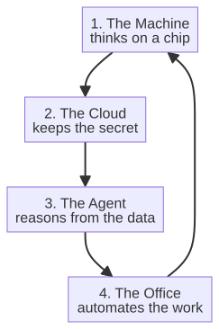

# Chapter 1 --- The Revolutions That Made the Earth

## The Fires

Every revolution of industry began with a fire. Not metaphorically; the first of them burned real coal, and the others followed a similar logic of controlled combustion. The industrial revolution is, at its base, a story about humans learning to concentrate energy and direct it where they choose. Before that concentration, work spread thinly across human and muscle, the patience of weather, and the limited endurance of draft animals. The wealth of a nation was, quite literally, the sum of its backs and its breezes. The revolution happened the moment a species discovered that it could store energy --- in the compressed steam of a boiler, later in the burned oil of an engine, later in the diverted river of an electric grid --- and thereby step outside the daily limits of fat and wind.

The classic account teaches four revolutions. The first was steam and machinery, from about 1760 to 1830. The second was electricity and the assembly line, from about 1870 to 1914. The third was computing and the internet, from about 1960 to the early 2000s. We are, this book proposes, standing in the fifth --- call it automation and intelligence --- though the popular number for it is six, because some narrators split the electricity-and-computing wave into two. The numbering does not matter; the character of each wave matters, and I will come to that character shortly. For now, notice only that each revolution did something the previous one could not do at all, and did it faster.

## The Fires That Changed Everything

To feel the weight of the first revolution, it helps to stand, for a moment, inside a mine before the steam engine. In the early eighteenth century, mines grew deeper as surface coal ran out, and deep mines had a problem that no amount of horsepower on the surface could solve: water kept coming in. A mine that goes down eventually reaches the water table, and once water arrives, the mine is useless unless the water can be raised out by hand or by animals turning a wheel in shifts. The mines were limited not by how hard humans could dig, but by how much water could be carried out before the digger drowned.

Thomas Savery, in 1712, and then Thomas Newcomet, in 1712, built steam engines --- crude, wasteful, and monumental --- whose sole purpose was to pump water out of mines. It is easy to underestimate these engines, which burned coal to boil a boiler, which pushed a piston, which raised water, and which did almost nothing else. But consider the logic: a machine that burned coal to free more coal. It was a single appetite, mechanically satisfied, but it established the first commandment of the industrial revolution --- *store energy in steam, then release it on demand.* And once that commandment was established, the rest of the story followed almost inevitably.

The steam engine did not remain a water pump for long. James Watt, working in Scotland in the 1760s and 1770s, made it useful for far more than pumping, by separating the condenser from the cylinder and by turning rotary motion out of the piston's up and down. With Watt's improvement, the steam engine could spin, and with spinning it could drive everything. It could spin a thousand spindles where a thousand men could spin ten. It could turn the great mill-shafts of new factories. The engine had an enormously powerful body, but --- and here is the point I will keep returning to --- still no mind. It could multiply force, but it had no opinion about which spindles to spin, no memory of yesterday's demand, no plan for tomorrow's repair. It was an enormously powerful body with the mind of a very patient rock.

## The Partnership That Made It Real

There is a curiosity worth recording here, because it quietly answers the question "why did it take so long?" Watt's separate condenser was a miracle of physics, but a miracle of physics is not a revolution until someone is willing to build it. Watt himself was a poor businessman, and his engine, in its earliest form, barely worked and barely sold. What turned the engine into an industry was not a further insight of physics but a further insight of *manufacturing*: the partnership between Watt and Matthew Boulton, whose Soho foundry in Birmingham could actually cast and machine the heavy, leak-prone iron that a steam engine demands. Watt supplied the idea and the patent; Boulton supplied the capital, the workshop, and the stubbornness to keep building engines that kept breaking until they worked. The firm of Watt and Boulton ran the steam-engine business for decades at a loss before it paid, precisely because the thing was so hard to make.

The lesson is useful for later, when we meet the sixth revolution: an idea is never the bottleneck. The bottleneck is always the *body* --- the ability to build the thing, to trust the thing, to scale the thing. Steam had the mindless body problem solved by 1800. The intelligence revolution has its own body problem still being solved, and it is worth remembering whose job it was to solve the first one.

## The Revolution Shrank the Continent

The steam engine did not stop at the factory. Once the principle was established --- store energy in steam, release it on demand, and turn it to whatever you choose --- the very same engine that drained the mines was soon asked to do something no surface machine had ever attempted: move. Richard Trevithick ran the first full-scale railway steam locomotive in 1802, and George Stephenson, with his *Rocket*, won the Rainhill Trials of 1829. In October of that year the *Rocket* pulled a train up the Liverpool to Manchester line, and in September 1830 that line opened as the world's first fully steam-powered interurban railway for passengers. This is one of those facts that is only understandable if you feel its weight. Before a locomotive, a nation was a collection of towns that could not reach each other faster than horses could trot --- days between cities that lie a hundred miles apart, goods that rotted on the road, an economy that could not be national because a country is, geographically, simply too big to move through quickly.

Steam shrank the continent. The railway made a single national economy possible for the first time, by turning distance into a number measured in minutes rather than days. It is a small, strange fact that the same principle that drained a mine --- concentrated energy released on demand --- is also what made the modern world *near*. Distance died, and with it the isolation that had defined human life for ten thousand years. Every industrial revolution concentrated a different resource: steam concentrated force, electricity concentrated a current, and computing concentrated information. Steam, at least, also concentrated *place*, folding the continent so that two cities a day's horse-ride apart were now an afternoon's train ride.

## The Human Thread

What the four previous revolutions had in common --- and this is the thread this book will pull on until the very end --- is that they all made the human the last link in the chain. The steam engine was operated by a human. The assembly line was paced by a human. The computer was fed by a human, and its results were read by a human. In every case the machine could multiply force, rhythm, and memory, but it could not, on its own, close the loop between noticing a thing in the world and doing something about it. The human stood at the end of every process, the final judge and the final hand. The machine thought --- in the narrow sense that a machine of that era could think --- but the human acted.

And that was fine, and it was prosperous, for a long time. The previous revolutions raised human life so dramatically --- life expectancy doubled, output per worker multiplied, goods that once belonged only to kings became cheap enough for everyone --- that no one paused to ask whether the last link might also be automatable. It simply seemed obvious that the human at the end of the chain was the point of the chain, the reason the energy was being concentrated in the first place.

There is a small, useful anecdote here. When the mechanical loom spread across England in the early nineteenth century, the workers who wove cloth by hand did not merely protest; they destroyed the looms. They were the Luddites --- often misremembered as anti-technology reactionaries, when in fact many of them were skilled craftsmen watching their craft, and their livelihood, disappear overnight. The Luddites were wrong about the future, but they were not wrong that a future was coming that would not need them. Their anger was not foolish; it was simply premature. Every industrial revolution has produced Luddites whose anger was logical in the moment and wrong in the long run. The sixth revolution is producing them now, and its Luddites worry about something newer still: not the loss of their muscles, but the loss of their minds.

## The Revolution Made a Class

There is one more thing that each revolution made, and it is easy to miss between the engines and the code. A revolution does not merely change machines; it changes *people* into new kinds of people, and it rearranges the map to hold them. The industrial revolution did not just build factories --- it created two new classes, the owners of the factories and the people who worked in them, and it moved them out of the village and into the town. Before steam, work was spread thinly across the countryside: a weaver at a loom in a cottage, a farmer on his field, a smith in his shop. Steam, and the machines it drove, demanded *concentration*. People had to gather where the machinery was, and so the factory town --- and later the great industrial city --- grew up almost overnight around the mill that gave them their work and their name. This is why the modern city, with its railways, its sewers, its crowds and its smoke, is itself a product of the first revolution, not merely a background to it.

It is worth holding this in the mind, because the sixth revolution is doing the same thing to a different kind of work. It is gathering the workers --- not to a mill, but to a *system* --- and it is creating new kinds of people who did not exist a decade ago: the data engineer, the agent-supervisor, the one who keeps the machine honest. The machines change; the people change with them; and the map changes to hold them. Every industrial revolution, in the end, is a story about a new kind of human being, made possible by a new kind of machine.

> **A curiosity.** The word for the new working class is not accidental. Before the factories, most people farmed, or traded, or served. The *proletariat* --- from the Latin *plebs*, the common people --- and the very idea of "a worker" as a distinct social category, are products of this moment. Even the language of the age had to be invented to describe it: the factory whistle, the working day, the shift, the strike. A revolution does not only change what people do; it changes the words it needs to talk about what they do. The sixth revolution is already inventing its own vocabulary --- the prompt, the agent, the guardrail, the context window --- and in a decade we will not remember a day without them.

## The Break

The fifth and sixth revolutions are different because they aim at that final link. They do not ask to multiply a human's muscle, or rhythm, or memory. They ask to multiply a human's judgment and to carry that judgment all the way out into the world, into the action, without stopping at a human who decides. The machine will notice the fault, reason about it, decide the right response, speak to the cloud, dispatch the response through an office, and in the newest factories even walk to the fault in a metal body and fix it. The loop closes. The human is no longer the final link; the human is the architect of a system that can finish what it started.

This is why the numbering --- fifth or sixth --- feels so different from the others. The earlier revolutions extended what a human could do. This one extends what a human can decide and then see through, without intervening hands. It is the difference between a tool that makes a worker faster and a system that makes a worker a conductor.

## A Small Map of the Road Ahead

Before we travel, it helps to know the territory. The chain that makes the sixth revolution possible has four components, and they appear in this book in the order they must be assembled:

The first link, the machine that thinks, is the subject of Part II. The second, the private cloud, is Part III. The third and fourth, the reasoning agent and the automated office, are Part V. Between them sits Part IV, which asks the single most important question of the whole story: not how to build intelligence, but which kind of intelligence a factory can trust with its own safety. We will return to that, and it is worth knowing now that the answer is what makes this revolution --- and this book --- unlike anything that came before.

## The Numbering Question

It is worth pausing on the number, because readers will encounter it and it is honest to address it. The popular term for the current wave is the "sixth industrial revolution," but historians of technology disagree, and the disagreement is itself informative. Some narrators count five revolutions, ending with automation; others split the digital wave and count six; a few count only three or four and fold everything into "the digital revolution." The number you choose says more about your method than about the world.

There is, however, one framing that is useful for this book, and it goes like this. Each revolution can be characterized by the dominant resource it harnessed: the first harnessed steam (stored thermal energy), the second electricity (stored electrical energy flowing through wires), the third computing and the internet (stored and transmitted information), and the fourth (in this framing) automation and robotics (machines that act without continuous human direction). The fifth, in the framing this book adopts, is intelligence --- machines that perceive, decide, and coordinate; the sixth is the *integration* of that intelligence into a self-coordinating whole, the Industry 7.0 factory we will meet in Part V. Under this reading, the sixth revolution is not merely "more intelligence"; it is the moment intelligence stops being a feature of individual machines and becomes the connective tissue of an entire enterprise. That is the distinction this book will defend from the first page to the last.

## Why History Matters to a Reader

You may wonder, fairly, why a book about the future of industrial automation spends a chapter looking backward. The answer is that history is not a luxury here; it is a decision tool. Every generation of AI has promised more than it delivered, and knowing the pattern makes you harder to fool. When a vendor tells you their product will "transform your factory with AI," the word "transform" has been used for two hundred years, and each earlier use referred to a revolution that was real but narrower than the marketing suggested. The person who understands the pattern is better equipped to separate the genuine revolution from the rebranded hype.

Moreover, the failures repeat with new vocabulary. Each time AI stalled, it stalled for a nameable reason: not enough data, not enough computing power, or a problem harder than it looked. Those same three reasons still decide whether your own adoption project works. The person who has seen the pattern once will see it again; the person who has only heard the latest hype will be surprised the second time. This book will arm you with the pattern, so that when the sixth revolution's promises are made, you can judge them against the revolutions that came before.

It helps to have one concrete case in mind, because "the failures repeat" is easier to remember when you can name the last time it happened. The twentieth century had its own artificial-intelligence winters. In the late 1960s, a handful of the most prominent computer scientists of the era announced, with real authority, that a general-purpose thinking machine was "within reach" within a generation; when the machines did not arrive --- because the memory was too small, the compute too weak, and the problems too unstructured for the algorithms available --- a disillusionment followed. A 1973 report in Britain concluded that the field had over-promised, and research funding dried up for years. Then, as the hardware and the algorithms and the data eventually caught up, the field returned, louder than before, to its original promise. The pattern is not that the scientists were fools; it is that they were *early*, and early is indistinguishable from wrong until the third of the three missing ingredients --- compute, data, or a suitable algorithm --- finally appears. The person who has watched one winter learns to ask a single, calm question of any new promise: *what is the missing ingredient that will make this possible, and how long until it is no longer missing?* That question is the whole of this chapter.

Let us now compress the whole arc into a compact timeline, so that the pace at which each revolution arrived is visible, and so that the distinctive slowness of the intelligence revolution --- and its sudden, recent acceleration --- can be seen in one glance. That is the subject of the next chapter.

