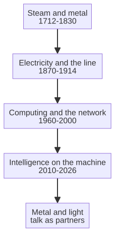

# Chapter 3 --- A Brief Timeline of Metal and Light

## The Idea

If you want to understand the sixth revolution you need a sense of the long arc, compressed. The story of industry is, in its essence, a story about two materials. The first is *metal*: the machinery that concentrates force. The second is *light*: the signals, the electricity, and finally the photons and electron pulses that carry information. For most of the arc, metal ruled and light was merely its servant --- a whistle, a flag, a relay. The last thirty years, light has become a master in its own right, and the two have finally begun to converse. This chapter is the timeline of that conversation, told in the handful of moments that actually changed the direction of the road.

## The Timeline

**1712 --- The pumping engine.** Thomas Savery, then Thomas Newcomet, built steam engines that pumped water from mines. The machines were hopeless at anything else; they burned coal to boil a boiler, which sucked water out of a mine, which let the mine go deeper, which let out more coal. It was a machine in service of a single appetite. But it established the pattern: *store energy in steam, then release it on demand.* This is the first of the industrial commandments.

**1785 --- The power loom.** Edmund Cartwright turned steam into a *process*, not merely a pump. The loom spun thread continuously, mechanically, and the craft of hand-spinning began its long death. Metal was no longer merely moving things; it was *transforming* them.

**1804 --- The concept of the stored program (accidentally).** In 1804, Joseph Marie Jacquard's loom accepted punch cards that dictated a pattern. The cards did not produce cloth; they *described* the cloth, and the loom obeyed the description. Change the cards and the product changes. This is the ancestor of software, built by a weaver, a hundred and fifty years before anyone had the word "computer." Metal learned to follow instructions.

**1822 --- The machine that was meant to think (and never quite did).** The English mathematician Charles Babbage designed the Analytical Engine, a mechanical calculator with punch-card input that could, in principle, compute *anything computable* --- not because a wire was rearranged, but because a list of instructions, a *program*, was fed in. He had, in effect, invented the general-purpose computer a century before the electronics to build it, and he simply lacked the money and the machinery to make one. His machine was a ghost --- a design, a dream, a failure to materialise --- yet it proved that a machine could be *programmed* rather than *wired*, and programming would later mean that a single machine could be reconfigured, endlessly, to do almost anything. Babbage is the ancestor of the stored program, and of the idea that a machine need not be built for a single appetite but could be given any task by changing only its instructions.

**1831 --- Faraday and the electric generator.** Michael Faraday discovered that moving a magnet produced electricity, and the whole world tilted. For the first time, energy could be *created* on demand, anywhere, and moved along wires. This is the moment *light* --- the signal of electron flow --- entered the story as force. Electricity was the first information-carrying force that humans could control at speed.

**1844 --- The telegraph.** The American painter turned scientist Samuel Morse sent the first electric message over a wire in 1844, from Washington to Baltimore, and the words --- often quoted as "What hath God wrought" --- were not, in themselves, remarkable. What was remarkable is that they *traveled on electricity rather than on a horse*, arriving hours before a rider could. For the first time, information could outrun the physical object that carried it, moving at the speed of the current. The telegraph turned the nation, and then the world, into a place where a message could arrive before a man could walk with it. This is the seed of every signal, every control line, every network --- and every cloud that would ever exist --- that has since followed, and it is the moment *light* (the signal of electron flow) first began to carry meaning across distance at speed.

**1876 --- The telephone.** Alexander Graham Bell turned sound into an electron signal, and information began its long journey free of the physical object it carried. A word could now travel faster than a horse. This is the seed of every communication, every control signal, every cloud that would ever exist.

**1896 --- The assembly line (in embryo, and then in full bloom).** Frederick Winslow Taylor measured work into seconds. Henry Ford, in 1913, made the moving line, cutting the time to build a car from twelve hours to ninety minutes. The human was integrated into the rhythm; the machine set the tempo.

**1936 --- The idea of the universal machine.** Alan Turing, a young mathematician in Britain, published a paper describing a machine that could compute *anything computable* by following a stored list of rules. It was pure light --- pure information --- with no metal in it at all beyond the abstraction. Turing proved that a machine could be *programmed* rather than *wired*, and programming would later mean that a single machine could be rewired, endlessly, to do anything.

**1947 --- The transistor.** The invention of the transistor at Bell Labs replaced hot vacuum tubes with a small piece of etched semiconductor, and it is easy to understate this. The transistor was small, cheap, and could switch a signal a million times a second without warming up. Every piece of modern intelligence --- in a phone, in a car, in a factory sensor --- rests on this small silvery switch. It is the atom of the information age.

**1957 --- The first signal in space.** When the Soviet Union put Sputnik 1 into orbit, it sent back the first electronic signal from beyond the atmosphere, and the world realised, in a single cold night, that information could now leave the earth entirely. The race that Sputnik sparked --- the space race --- was, beneath the flags and the rockets, a *computing* race: a race to store, process, and transmit information faster and more reliably than the other side. Sputnik is often remembered as a moment in politics or physics; it was, more quietly, a moment in the authority of light. It confirmed, for governments and for industry alike, that the information side of the story --- the signal, the current, the stored program --- was now strong enough to reach the stars, and the spending and the engineering that followed poured the concrete for the entire information revolution.

**1969 --- The first message.** A network called ARPANET sent its first packet in 1969, a small, unreliable, and momentous first step toward what would become the internet. Before ARPANET, computers stood alone; after it, they could, haltingly, *speak* to one another. The message itself is almost forgotten (it garbled after three letters), but the principle was not: machines could share information through a distributed network, resilient enough to survive the loss of any single node. This is the ancestor of the modern internet, and of the cloud --- not the *public* cloud that watches, but the *network* that would eventually host the private clouds of this book. It is the moment light became not merely a signal but a *conversation*, and the moment the machine began, quietly, to speak to other machines.

**1971 --- The microprocessor.** Intel put a whole central processing unit on a single chip. The computer was no longer a room; it was a coin. This is what eventually made possible the sensor on the spindle, and it is worth remembering that the sensor's entire brain is a descendant of that coin.

**1977 --- The personal computer reaches the desk.** A general-purpose machine that anyone could keep on a desk and program for their own tasks finally reached the office, and then the home. Before this, the powerful computer was a roomful of machines and a roomful of specialists; after this, the capacity to calculate, to store, and to script was within reach of any individual worker. The personal computer was the bridge between the monstrous machine of the 1960s and the intimate device of the 2000s, and it is worth remembering that it was *cheap* --- cheap enough for an office, then a home, and eventually a machine on a factory floor. It carried the same principle as the microprocessor: the brain of a whole computer, small enough and cheap enough to sit on a spindle.

**1991 --- The World Wide Web.** Tim Berners-Lee made information freely and easily shareable. The internet became the nervous system of the modern economy, and the cloud that would eventually host it began, quietly, to be thought of as a *place* --- a building with no doors, kept somewhere, that you could reach.

**2006 --- The cloud becomes a utility.** When Amazon launched its web services in 2006, computing stopped being a machine you owned and became a service you paid for by the hour. This sounds like a small change, but it is the one that made the cloud --- public and, later, private --- economically possible at every scale. Before it, a company that wanted more compute had to buy more machines; after it, a company could rent it, by the hour, for the price of a coffee. The cloud stopped being a *building to maintain* and became a *tap to turn on*, and that is exactly the quality that the sixth revolution needs on the factory floor: intelligence you can turn on, by the hour, without buying the whole apparatus.

**2007 --- The device in your pocket.** When the first modern smartphone arrived, it carried, in a single hand-sized slab, the general-purpose computer of the desk, the camera of perception, the network of the cloud, and --- quietly, almost invisibly --- a dedicated processor for running learned models. For the first time, a machine could *learn to see and to decide* on a battery, in your pocket, without asking a data centre a question. This is the seed of the on-machine intelligence that the sixth revolution will build upon: not a machine that talks to the cloud, but a machine that *thinks for itself*, locally, in microseconds, for free of bandwidth. The smartphone proved, at commercial scale, that the whole chain --- perceive, decide, act --- could live on a small chip.

**2012 --- The deep learning breakthrough.** A network called AlexNet won a major image-recognition contest by a wide margin, proving that a machine could *learn to see* from examples rather than be told the rules. This is the moment the machine gained, in a practical way, something we might call *perception*.

**2016 --- The NPU arrives in your pocket.** Apple, then Qualcomm and others, began embedding dedicated neural processors --- NPUs --- on their mobile chips. For the first time, a machine could run a learned model of the world *locally*, without asking the cloud, in microseconds, without spending the battery on a round trip. This is the seed of the on-machine intelligence that the sixth revolution will be built upon.

**2017 --- The idea that pays attention.** A paper titled "Attention Is All You Need" introduced the transformer, an architecture that let a model weigh the importance of every piece of information against every other, rather than processing it one word or one reading at a time. This single idea became the backbone of every large language model and every modern agent that would follow; it is the mechanism that lets a program read a whole document --- or read a whole machine's telemetry --- and know, at once, what matters. Without the transformer, the agent of this book would not exist; with it, the machine could finally reason over long, rich streams of information rather than a thin trickle of commands. It is the mind that the on-machine chip would soon house.

**2022--2026 --- The conversation of machines.** Large language models, cheap powerful edge chips, and private clouds converged. Machines that perceive, reason, and speak began to connect --- not to a public cloud that watches them, but to a private cloud inside the company, driven by agents that finish the work. The arc closes, and the machine that dreamed in the prologue becomes possible.

## The Conversation of Metal and Light

If you look at the timeline as a whole, one shape emerges. For roughly two hundred and fifty years, the story was almost entirely *metal*: machines that moved, pressed, spun, and cut. The information side --- the light --- was a servant of control: a whistle, a signal, a relay. Then, in the last half-century, light caught up. The transistor, the microprocessor, the network, the neural network --- these gave the light a *mind* of its own. And now, in the sixth revolution, metal and light are no longer master and servant. They are *partners*, and the partnership is called the factory that thinks. You can read the whole arc in a single glance:

For two centuries metal ruled and light was merely its servant; then light, given a mind of its own by the transistor, the microprocessor, the network, and the neural network, began to converse with metal. In the sixth revolution the two are no longer master and servant but partners, and the partnership is the factory that thinks.

## The Timeline Teaches a Lesson

If you look at the timeline as a whole, beyond the individual dates, one shape emerges that is more interesting than any single event: the *pace* itself is accelerating. For roughly two hundred and fifty years, the story moved slowly, and each revolution waited for the previous one to be fully built before the next could begin. Steam was born in mines, matured on railways and in factories, and only then --- only after the machinery, the workers, the laws, and the cities had all settled --- did electricity arrive. Electricity, in turn, filled the world with wires and machines before computing could take hold. The revolutions stacked up slowly, one generation at a time.

Then something changed. In the last hundred years, the pace of the story broke its old rhythm. The transistor followed the vacuum tube by a few decades; the microprocessor followed the transistor by a few more; the network followed the microprocessor almost at a run; the neural network followed the network in a matter of years; and the machine that could perceive, decide, and speak followed the neural network in a single, breathtaking decade. The intervals kept shrinking. The information side of the story is not merely catching up to metal; it is *outrunning* itself, building the next generation of the previous generation faster than any previous revolution ever moved.

This is the distinctive feature of the sixth revolution, and it is why the timeline, taken as a whole, is more frightening and more hopeful than any single entry. The earlier revolutions were slow because each had to build its body from scratch --- stone, iron, copper, glass --- and bodies take time to make. The information revolution's body is made of information, and information can be copied, improved, and redeployed at the speed of light. It is a small, vertiginous fact that the whole arc, from the pumping engine to the on-machine agent, reads less like a series of separate events and more like a single process that has, in the last few years, finally reached the speed of its own nature. That is the moment the machine that dreamed in the prologue becomes possible, and the moment the conversation of metal and light becomes the factory that thinks.

There is one more lesson in the timeline, and it is quietly reassuring. Every single one of the entries from 1936 onward --- Turing's universal machine, the transistor, the microprocessor, the network, the neural network, the transformer, the NPU --- was a piece of *light*, not metal. The two-hundred-and-fifty-year span of the timeline was almost entirely metal; the last hundred years, the entire movement of the road has been carried by light. The metal of the factory is not being replaced by the light; it is being *completed* by it, given a nerve system, a reflex, a mind. The timeline does not end with the machine thinking on a chip. It *is* that machine, arriving --- slowly, then suddenly --- at the end of its own long construction. The chip on the spindle is the moment that partnership became physical and cheap. That is the subject of the next part of this book.

## The Next Step

The chip on the spindle is not a small card bolted to a machine; it is the moment the whole timeline --- from the pumping engine to the transformer --- finally reaches down and lands on the factory floor. Every component of the sixth revolution has now been assembled in this chapter's timeline: the machine that thinks (the NPU), the cloud that keeps the secret (the private cloud), the agent that reasons (the large language model), and the office that automates (the deterministic front-end). What remains is to see how they are fastened together onto a single spindle, and what a factory looks like once it can perceive, decide, and act for itself. The machine has dreamed; it is time to let it wake.

That is the subject of the next chapter --- the single-board computer based on an ARM processor with a built-in neural processor, and the way it lets a machine touch the field directly, without a round trip to anywhere else.

