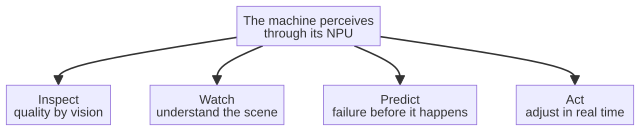

# Chapter 6 --- Intelligence on the Shop Floor

## The Four Jobs

When a small intelligent chip is placed inside a machine, it is given, in effect, four human-ish jobs that were never before possible without a roomful of specialists and a slow round trip to a cloud. These four jobs --- **inspect, watch, predict, and act** --- are the whole vocabulary of on-machine intelligence, and once you have them you can see them everywhere.

Let us take them one by one, because each is already doing real work in real factories, and each is a small miracle of the kind this book is about.

## 1. Inspect --- the Eye That Never Blinks

The most mature of the four jobs is automated visual inspection. A factory that makes anything has, traditionally, had to inspect its products, and traditionally that meant either a human eye tiring after the twentieth part, or a fixed camera with rigid rules that could not adapt. The NPU changes both.

Imagine a camera looking down a conveyor carrying machined engine blocks. A human inspector, by the end of a shift, has missed defects that were right in front of them, because humans tire, because humans look away, because a defect they have seen a thousand times blurs into the background. The intelligent camera does none of these things. It has learned, from thousands of examples of good and bad parts, what a defect *looks like*, and it classifies each part in milliseconds --- not with rigid rules but with the flexible judgment of a learned model. It does not tire. It does not look away. It runs entirely on the machine, on the floor, so the images never leave the building and the inspection never waits on the cloud.

This is "automated quality inspection," and it is the quiet workhorse of the machine-that-thinks revolution. It appears in welds, in castings, in printed circuits, in the labels on a bottle. Wherever a product must be judged against a standard that a human can articulate but a computer cannot easily code by hand, a learned model on a local chip beats both the tired human and the rigid rule-based camera.

## 2. Watch --- the Mind Behind the Surveillance Camera

The second job is intelligent surveillance, which is where the camera stops merely *recording* and begins to *understand*. A traditional CCTV system records what happens and nothing more; the footage is useful only after the fact, to a detective looking for a license plate. An intelligent system, fed to a local NPU, understands the scene as it happens: it recognizes that a person has entered a zone they are not allowed to enter, that a safety barrier has been crossed, that a fire has started before there is smoke, that a forklift is moving too fast toward a pedestrian.

The essential point --- and the reason this belongs to the sixth revolution rather than to the ordinary third --- is that the understanding happens *locally*. The cameras can alert a guard, halt a machine, or sound a warning in real time, without sending a live feed of the factory floor to any external service. In an age where a live video feed of a factory is exactly the kind of sensitive data that should never leave the building, local understanding is not merely convenient; it is the only responsible choice.

## 3. Predict --- the Machine That Knows It Is About to Fail

The third job is predictive maintenance, and it is perhaps the most beautiful of the four. A machine emits signals continuously --- the vibration of its bearings, the temperature of its motor, the shape of the current it draws, the sound it makes. These are the machine's *health signals*, and they have always been there, waiting to be read. The NPU reads them, not as raw numbers but as a *story*.

The model has learned, from a long history of a particular machine's signals, the sound of that machine at work and the sound of a machine in distress. It recognizes, days or hours before a failure, the subtle shift that says *I am beginning to complain*. It then does not merely raise an alarm; it reasons about the future. It can tell the maintenance team, well in advance and with real lead time, that a specific bearing will likely fail on a specific line, and it can coordinate the repair *before* the failure --- before the line stops, before a customer is delayed, before a replacement part must be shipped by overnight courier.

This is the difference between fixing a thing when it is broken and fixing it when it is *telling you* it is about to break. It is the difference between an expensive, unplanned emergency and a cheap, scheduled intervention. It is, in short, the money that the machine-that-thinks pays back to the factory, continuously, in quiet installments.

## 4. Act --- the Machine That Does Something

The fourth job is the one that turns intelligence into *agency*: the machine that uses what it perceives, predicts, and watches to actually *do* something. An arm adjusts its path because a camera saw the part was off. A robot hand loosens its grip because a sensor felt the fragility of the object. A control loop tightens or loosens itself in response to the changing conditions of the cut. This is the boundary between a machine that merely *reports* and a machine that *acts*, and it is where the on-machine intelligence becomes genuinely revolutionary.

The reason the local NPU makes possible --- indeed, makes *necessary* --- this fourth job is speed. To act on the world in real time, the decision must be made locally, on the machine, in microseconds. A round trip to the cloud would be far too slow; by the time the answer came back, the moment for action would be gone. The NPU, on the machine, is what allows perception to become action fast enough to matter.

## 5. The Loop That Closes on Itself

The four jobs do not sit side by side; they form a loop that closes on itself, and drawing that loop makes the whole chapter clearer than any list of four could. The machine inspects the world, watches for what is changing, predicts what will change next, and acts --- and by acting, it changes the very world it is inspecting, so the loop begins again a moment later. On the factory floor this loop does not turn once a day; it turns thousands of times a second, in the time it takes to make a single part.

This is the vocabulary of the whole chapter in one glance: perceive, then watch, then predict, then act, and again. Each step feeds the next, and the arrow from *Act* back to *Inspect* is the point --- the machine is not reading a fixed instruction list; it is continuously re-reading the world it has just changed. A reflex, once more, stays within the body; this loop stays within the machine.

## The Eye That Learned

It is worth pausing on the first job, because automated visual inspection is the one that has traveled the longest road, and because it teaches the whole lesson in miniature. For most of the twentieth century, inspecting a part by camera meant writing rules --- measure this length, check that corner is square, flag the color outside this range. Such *rule-based* machine vision is still widely used and is excellent for a fixed, well-defined task. But rules are brittle: change the lighting, shift the part half a millimeter, and the rules either fail or must be rewritten by hand, over and over, by a specialist who is paid a great deal of money to do exactly that.

The learned model changes this from a chore into a gift, and it does so in a way that mirrors how a human inspector actually sees. Instead of handing the camera a checklist of rigid measurements, you hand it a large set of examples --- photographs of good parts, photographs of defective ones --- and let it discover, by itself, the features that separate the two. It may find a hairline crack that no rule-writer ever thought to specify, because a rule can only say what a human remembered to write, while a model sees what is actually there. This is why, on real inspection tasks, the learned model on a local NPU has come to beat both the tired human eye and the rigid rule-based camera alike: it does not tire, it does not look away, and it has seen more defects than any single inspector ever will. The history of the field --- from the first rule-based vision systems of the 1970s to the learned models of today --- is the history of an industry learning to stop instructing the camera and simply showing it the world.

## A Line in Practice

It helps to see the four jobs together in one real setting, so the abstract vocabulary becomes a factory you can picture. Imagine a small line that machines precision metal parts for the automotive industry: a CNC machine-tool cuts each part, a robotic arm moves it to a washing station, then to an inspection camera, then to a packaging station, and a conveyor carries the finished parts away. Fit a cheap intelligent card to this line and the four jobs come alive together.

The camera *inspects* each freshly cut part --- not with rigid rules but with a learned model that knows what a good part looks like and flags the ones that are out of tolerance. The arm *watches* its own motion through the current it draws and the smoothness of its path; if it feels a jar that says a guide is wearing, the card notes it. A vibration sensor on the tool-spindle *predicts*: over weeks the card learns the sound of a healthy cutter and flags, days before it breaks, the faint shift that means a tool is about to chip --- far sooner than the part would show the defect to the camera. And the card *acts*: it re-routes the arm around the suspect station, slows the line, and messages the maintenance team with the exact tool to replace and the part currently on it, so the change happens during a scheduled break rather than mid-run. Four jobs, one card, one line, no round trip to any cloud. That is on-machine intelligence at work, in the ordinary miracle of an ordinary factory.

## When the Machine Is Wrong

There is an honest chapter to write here too, because a machine that perceives is a machine that can be wrong, and the field must deal with that rather than pretend it away. A learned model is trained on examples, and so it can only be as good as the data it has seen. If the examples are thin, biased, or unrepresentative, the model will make confident mistakes --- misjudge a defect that was never in its training, or flag a perfectly good part as bad. This is not a flaw to be eliminated; it is a condition to be managed. The practice that manages it is straightforward: feed the model good, representative, up-to-date examples; watch how it performs on the actual floor; and retrain it when the world changes --- a new part, a new lighting, a new supplier. It is the same discipline any honest engineer applies to any honest instrument: no measurement is infallible, but a well-maintained one is trustworthy, and a poorly maintained one is not.

The human role, therefore, does not disappear when the machine perceives; it changes. The operator no longer inspects every twentieth part by eye; instead the operator, with the maintenance team, curates the examples, watches the machine's judgments over time, and remains the final authority where the stakes are high --- where a wrong flag means a recalled shipment, or a missed one means a failed part goes out to a customer. The intelligent camera on the floor does not replace the human; it raises the human to a higher task, from turning a dial every twentieth part to keeping the machine's eye healthy. That is the honest and the better news of the whole chapter: on-machine intelligence does not remove the human from the shop floor; it lifts the human's job up a rung, from repetition to supervision.

## The Cost of a Missed Part

There is one more reason the four jobs matter, and it is the reason the factory owner actually cares: the economics of a missed part. A defect that escapes inspection is rarely free. It costs the rejected part, yes, but also the part it damages downstream, the downtime it causes, the customer it loses, and the recall --- sometimes the recall --- that a single unseen flaw can set in motion. On a fast line, a missed defect does not remain a small cost; it compounds, and by the end of the shift it can amount to a crisis. This is the arithmetic that the intelligent camera changes from a liability into an asset.

The economics fall out naturally. A human inspector, tiring after the twentieth part, might catch nine defects out of ten, letting the tenth slip past --- and the tenth is the one that reaches a customer. A rule-based camera, brittle to lighting and to the half-millimeter shift of a part, may miss the ones that move. The learned model on a local NPU misses almost nothing, because it does not tire, it does not look away, and it has been shown more examples than any human could survey in a lifetime. The result is not a marginal improvement but a different kind of economics: where a human or a rigid camera lets a small fraction of defects through --- a fraction that, at high line speed, is a flood --- the intelligent camera lets almost none through, and the savings are therefore large, and continuous, and quiet. This is the money the machine-that-thanks pays back to the factory, in quiet installments, for years. And it is not the money of a miracle; it is the money of a machine that simply does, better than any human or any rule, the four jobs it was built to do.

## The Single Thread

Inspect. Watch. Predict. Act. These four jobs are the whole of on-machine intelligence, and they all share one essential quality: they happen *on the machine*, locally, instantly, privately. That is the thread that ties this chapter to every other chapter in Part II. The intelligence is not a guest in a room; it is a resident of the field, on the spindle, touching the field directly. And once the machine can see, watch, predict, and act for itself, a question naturally follows: *what are we replacing to make this possible?* The answer, surprisingly, is one of the most durable and trusted pieces of hardware in the modern factory. That is the subject of the next chapter.

