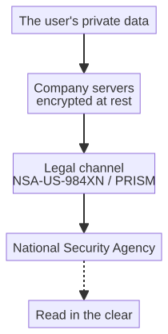

# Chapter 10 --- When the Cloud Stole Your Company

## The Morning the World Changed

On the sixth of June, two thousand and thirteen, two newspapers --- *The Guardian* and *The Washington Post* --- published, on the same day, a story that would quietly and permanently change how the world thought about data. For years, an American agency called the National Security Agency had been running a program to collect vast quantities of private communication, and the newly published documents revealed not only that the program existed but that the great technology companies had *participated* in it, handing over the data of their users to the agency. The program had a name: **PRISM**.

A man had brought the stories to light. His name was Edward Snowden, an American contractor who, the previous month, had flown to Hong Kong with documents that would change everything. The newspapers that published his share of the story, *The Guardian* and *The Washington Post*, would later share the 2014 Pulitzer Prize for Public Service. It is worth remembering that moment not because it is distant, but because it is the moment the modern cloud --- the cloud this book will ultimately connect the factory to --- first became, for most people, a place one should be *cautious* about.

The day the story broke, the reaction was not the cold, analytical response of engineers but the warmer, sharper reaction of people who feel they have been betrayed. A service that you *chose* to use --- a service you trusted precisely because it was convenient --- had, without your knowledge and without your consent, handed your private messages to a government. The sense of betrayal is the point: we do not mind that a state *could* read our mail; we mind that it did, quietly, through the very companies we trusted to protect it. And this distinction --- the difference between a *capability* and a *betrayal* --- is the whole moral weight of datagate, and it is also the whole moral weight of the chapter that follows.

## The Italian Name

In the English-speaking world the scandal is known under several names: PRISM, the NSA, the surveillance state. In the Italian press, where the story was followed with particular intensity, it has a name of its own: **datagate** --- a suffix that borrows the "-gate" invented by Watergate to mark any scandal involving an abuse of power. The Italian press reached for that suffix because the story was, at its core, a story about power abused: the power of a state to read what private people assumed would remain private.

The technical name for the program is PRISM, with the NSA designation **US-984XN**. It did not appear overnight. Its legal basis was consolidated in **Section 702 of the FISA Amendments Act of 2008** --- later reauthorized, in 2012 and again in 2024 --- and it ran, according to the released documents, since about 2007. So when we say the scandal broke in 2013, we mean that it broke *then* for the public; the machinery had been operating, for years, entirely out of sight.

## The Mechanism of the Betrayal

What the released documents did most effectively was to show not *that* the companies participated, but *how*. The mechanism was, in its way, banal, and its banality is why it matters. PRISM did not require the NSA to break into the companies' systems --- that is the cinema of espionage, not its practice. Instead, each company maintained, by law, a direct channel through which it could be *requested* --- and, in most cases, *compelled* --- to hand over the data of a given user. The company, rather than being broken into, became a *gatekeeper*: a point through which the data of all its users could, on demand, be poured out to the agency.

This is a subtle but crucial distinction, and it is worth holding it carefully, because it changes the way we think about responsibility. A company whose systems are *hacked* is a victim. A company that maintains a door through which the state may enter --- a door that the law compels it to keep open --- is, to use an uncomfortable word, a *partner*. The released documents suggested, for most of the companies on the list, the latter: not a forced hand, but a willing one, or at least a cooperative one, up to the point the law required more. The precise balance of compulsion and cooperation varied from company to company and over the years; the released record does not settle it, and I will not pretend that it does.

The company that kept the door open was not reading your messages and handing them over by hand. It was maintaining, at the architecture level, a point at which your data *could be taken*. The betrayal was not personal; it was *structural*. It was baked into the design of the service, into the terms of service you accepted without reading, into the legal framework that made resistance impossible without resistance to the law itself. And this is the detail that the factory owner must internalize, because the sixth revolution will face an identical structural choice.

The diagram above is a simplified picture of the mechanism: your data, held by a company behind its own walls, passed through a *legal channel* to the agency, which could read it in the clear. The key word is *channel* --- the company did not lose control of the data to a thief; it voluntarily maintained an entrance through which the state could walk. That is the difference between a burglary and a conspiracy, and datagate was, at bottom, a conspiracy built into the architecture of the modern cloud.

## The List of Participants

The most striking detail in the released documents was a list. It named, with the year they joined, the great technology companies that had agreed --- under legal compulsion or, as the record suggests, in willing cooperation --- to hand the NSA access to their users' data. The list reads like a who's-who of the digital age:

  Company                 Year they joined PRISM
  ----------------------- ------------------------
  Microsoft               2007
  Yahoo                   2008
  Google                  2009
  Facebook (today Meta)   2009
  Paltalk                 2009
  YouTube                 2010
  AOL                     2011
  Skype                   2011
  Apple                   2012

Nine of the most familiar names in technology, dated, as if on an inventory. This is the detail that made the story stick in the public mind: not the abstract idea of surveillance, but a *list*, alphabetical and complete, of the companies that would not stand between their users and the state. It is easy to dismiss this as politics, and much of the coverage of datagate was indeed political. But there is a lesson here for the factory owner and the business, and it is this: **when you send your data to a public cloud, you are, in exactly the same way, giving some third party access to it --- whether that third party is a state, a hacker, or a company selling attention.** The mechanism of betrayal is the same. The only question is whom you have handed the keys to.

## The Personal Cost

It is worth pausing on the human detail, because statistics of millions blur the horror, and because the released documents named, in time, specific people who were caught in the machine. The most frequently cited example is that of a German citizen, reported by *The Guardian* in 2014, whose name appeared on a Central Intelligence Agency watchlist almost entirely because of the things he *liked* on Facebook --- a handful of interests that, to a foreign intelligence service, were enough to warrant attention. He had done nothing illegal; he had simply *liked* a few pages, and a database, built to collect the communications of everyone, had swept him up among everyone. There was, in the reporting, no indication that he had ever been threatened --- only that he had been *seen*, automatically, by a machine that did not care whether he was guilty.

## The Reaction and the Remorse

It is worth pausing on the reaction, because it shows how the public finally understood the danger --- belatedly, but undeniably. The first and most influential response came not from the affected users but from the founders of the companies themselves. In 2013, Bill Gates wrote a widely read open letter in which he argued, with quiet urgency, that encryption must be preserved and that the United States was "heading in the wrong direction" on surveillance; that the remedy was not to trust the state more, but to *trust it less* by making data unreadable even to its holder. That year, the founders of ten of the most influential technology companies --- Google, Apple, Microsoft, and others --- publicly signed a letter, addressed to the President of the United States, arguing for the preservation of strong encryption; it was, in effect, an industry acknowledging, together, that datagate had shown the old assumption to be wrong.

The industry, slowly, began to take their side: end-to-end encryption spread from messaging apps to cloud storage, precisely because the lesson of datagate was that a company that can read your data can also be *compelled* to read your data. This is the crucial turn, and it is the hinge on which the rest of this book swings. The public realized, in the aftermath of datagate, that the true guarantee of privacy was not the *good faith* of the cloud operator but its *inability to read*. A vault that is kept by an honest guard is still vulnerable --- the guard can be bribed, fired, or subpoenaed. A vault whose lock no one but you holds is not. This insight --- that security must be a property of the *architecture* and not of the *operator's character* --- is the entire premise of the trustless, zero-knowledge cloud that this scandal forced into existence.

## The Number That Was Never Settled

One number the released documents could never settle was the sheer quantity of collected data. Different estimates ranged wildly, from roughly fifty thousand documents to as many as a million and a half. The range is not a defect in the reporting; it is itself the point. Even the *lowest* estimate is large enough to matter, and the fact that no one could agree on the *total* is precisely the evidence of how much was being taken. The data of a company --- its production figures, its supplier contracts, its customer lists, its plans --- could, in principle, be among those millions of collected bytes, and no one could tell you which, or whether it had ever been read.

The unsettled number is, in fact, a gift to the careful reader, because it teaches a general rule that I will carry through this book: **when you cannot name how much data was taken, you cannot trust that any of your data was spared.** A company that collects "everything, undifferentiated" collects *you* among the everything, and the only way to be sure you are not collected is to make your data such that it cannot be read even if taken. That is the promise of the cloud kept inside the walls.

## What a Company Can Do

The lesson of datagate is not merely cautionary; it is *actionable*, and it is worth stating plainly what a company --- any company, of any size --- can do to avoid the mistake the scandal exposed. The principles are few, and none of them is exotic.

The first is to *keep the key*. Any data worth protecting should be encrypted with a key that the company itself holds, so that even the system that stores and moves the data cannot read it. This is the single most important move, and it is the one that turns "we trust our cloud provider" into "we do not have to trust our cloud provider."

The second is to *keep the cloud inside*. Where the data is the picture of the company's future --- its production, its suppliers, its customers --- the cloud that holds it should be under the company's own control, not a giant public data center owned by a handful of firms. A private, zero-knowledge cloud is not a luxury for the paranoid; it is the ordinary prudence of a business that has learned what a public cloud can be compelled to do.

The third is to *send only what is needed*. The volume problem of the previous chapter is also a privacy problem: by reducing the data at the edge, the company sends summaries and alerts rather than the raw confession of its operations, and keeps the deep, intimate detail local. The least data that travels is the least data at risk.

These three moves do not require a specialist staff or a data-center budget; they require a decision, made once, to treat the company's data as its own. And that decision is, in the end, the same decision the sixth revolution asks of every factory: to keep the intelligence, and the data, and the key, on your side of the wall.

## The Lesson for the Factory

Why does a scandal about spies matter to a factory that is building an intelligent machine? Because the sixth revolution has a tendency to send a great deal of that factory's data *outward*. A machine that perceives, predicts, and reports will produce telemetry --- production rates, component images, supplier information, operational patterns --- and that telemetry has to go *somewhere*. For most of the cloud era, "somewhere" meant the public cloud: the giant data centers owned by a handful of companies, the very companies on that list.

Datagate was the moment the public understood, in the way that a scandal always produces, that a public cloud is not a vault. It is someone else's computer, and the operator of that computer can be compelled --- or can be willing --- to read whatever you store there. The factory that sends its precious telemetry to a public cloud is, in exactly the same way as the users on that list, giving a third party access to its most sensitive information. It is a lesson the sixth revolution cannot afford to ignore, because a factory's data is, quite literally, its future made visible. The next chapter is about the answer that this scandal forced into existence: the cloud that keeps its secret, the cloud kept *inside* the walls.

