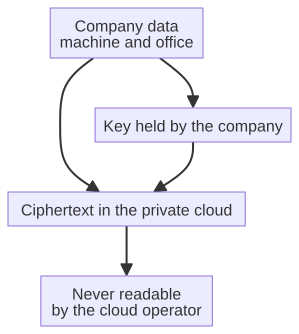

# Chapter 11 --- The Cloud Within the Walls

## The Contradiction

By the middle of the 2010s, a contradiction had settled over the use of the cloud, and it was a contradiction that any thoughtful engineer could feel but nobody had yet solved. On one hand, the cloud was undeniably useful --- it offered storage, compute, and connectivity at a scale no single company could match, and it let machines and offices talk to one another across distance. On the other hand, the scandal of datagate had made it equally clear that a public cloud was a place you could *trust no one* --- the operator could be compelled or could be willing to read whatever you stored there, and once your data left your building you no longer controlled it.

So the question became sharp and unavoidable. Is there a cloud that keeps the *utility* of the cloud --- the storage, the sync, the ability for machines and offices to share one living copy of the truth --- while keeping the *secret* that the public cloud gave away? Can a company have a cloud that is genuinely its own, so that its data never leaves the building, and never, even under compulsion, is read by a third party?

The answer, as the projects behind this book came to build it, is yes --- but only if you are willing to give the cloud two new properties that the old cloud never had: it must be **trustless**, and it must be **zero-knowledge**. Let us take those two words seriously, because they are the whole innovation.

## The Trustless Cloud

"Trustless" is a phrase that comes from the world of cryptography and distributed systems, and it sounds like a strange thing to want of something as helpful as a cloud. We usually *trust* the services we use; that is why we use them. To call a cloud "trustless" is to say that you do *not* have to trust its operator to handle your data correctly. You do not have to trust that it will not leak your data, that it will not be bribed, that it will not be compelled to hand over your files and read them. In a trustless cloud, the system's architecture --- not the operator's good intentions --- is what keeps your data safe.

The way this is achieved is by ensuring that the data is *encrypted* with keys that only your company holds, and that the cloud can process, store, and sync the data *without ever being able to see it in the clear*. The cloud moves your data around, keeps it consistent, makes it available to your machines and your office --- but it never possesses the power to *read* it, because it does not hold the key. It is like a courier that can deliver a locked safe but cannot open it. The courier is useful and reliable, and it is entirely unable to betray you. That is the trustless cloud: useful, and unable to betray.

## The Crucial Distinction

There is one detail that almost everyone misunderstands, and it is worth taking it slowly, because it is the whole point. The public cloud --- the giant, centralized, commercial cloud of the 2010s --- *does* encrypt your data. It encrypts it while it travels across the network (encryption in transit), and it encrypts it while it sleeps on disk (encryption at rest). So the naive objection, "just encrypt it," does nothing to solve the problem, because the public cloud already does encrypt it.

The distinction that matters is this: in the public cloud, the *operator holds the keys*. The encryption is the operator's own; it is applied for the operator's own reasons --- to satisfy a regulation, to limit liability, to protect against external thieves. But the operator can, at any time, unlock your data, read it, hand it over. Encryption at rest is a *convenience* to the operator, not a *guarantee* to you. If the operator is compelled, or is willing, it can simply apply its key, and your data --- in the clear, readable, yours no longer --- is handed to whoever asked.

The trustless, zero-knowledge cloud changes *who holds the key*. In that cloud, the key is not the operator's; it is *yours*, and it never leaves your building. The data is encrypted before it is sent, with a key the operator does not possess, so that even the encryption at rest on the operator's disk is meaningless to them. They can store your locked safe, move it, keep copies of it, sync it across their servers --- but they cannot open it, because they never had the key. The encryption is no longer the operator's convenience; it is *your* guarantee, applied at a level the operator cannot undo. This is the difference between a vault that is guarded by the operator's honest guard and a vault that is unopenable by design. The former is datagate; the latter is the cloud within the walls.

## The Zero-Knowledge Cloud

"Zero-knowledge" is a phrase from a branch of cryptography that sounds almost paradoxal, and it is worth taking it slowly. In cryptography, a "zero-knowledge proof" is a way for one party to prove to another that a statement is true --- *without revealing any information beyond the truth of the statement itself.* The classic example is a cave with a secret word locked behind a door. A person who knows the word can prove, repeatedly, that they know it --- walking in one door and out the other --- without ever *saying* the word. They prove knowledge without conveying knowledge. Hence "zero-knowledge": the proof conveys nothing beyond the fact that the proof succeeded.

Applied to the cloud, zero-knowledge means the cloud can verify and process your data without ever learning the data itself. The machine encrypts its telemetry before it sends it, keeps the key, and the cloud --- even the cloud that stores and syncs it --- cannot read it. The cloud operates on ciphertext, on the locked safe, never on the contents. When the data is needed in the office, it is decrypted there, by your company, with your key. The cloud is, in the most literal sense, *blind* to your data's contents. It is a keeper that can guard a vault but never see inside it.

To make this concrete for the factory: the sensor on the spindle does not send a floating-point number to the cloud; it sends a *ciphertext*, the product of encrypting that number with a key the cloud does not hold. The cloud stores that ciphertext, keeps it consistent across its servers, makes it available to the office --- all while being unable to learn whether the number was 42 or 42,000, whether the bearing was healthy or failing. It is, in the strictest sense of the word, *information-blind*. It can see that data is moving; it cannot see what the data *is*. That is the whole of the zero-knowledge promise, and it is enough to make the public-cloud betrayal we met in the previous chapter impossible.

## The CloudServer

The project that embodies this idea --- the cloud kept inside the company, trustless and zero-knowledge --- is called **CloudServer**, one of the projects published by the lab behind this book. Where the public cloud centralizes data in a handful of giant data centers that can be read (or compelled to read), a private, zero-knowledge cloud like CloudServer *decentralizes* trust: the data never leaves the company's control, because the company never gives away the key. The cloud is inside the walls, or at least inside the company's authority, and it is useless to a spy, a hacker, or a court order, because there is nothing to read.

This is not a hypothetical. The architecture exists, it is published, and it is being built to solve exactly the problem that datagate made unavoidable. The factory that perceives, predicts, and reports --- the factory of the previous chapters --- produces data that is, by any reasonable standard, its most sensitive asset. Production schedules, supplier contracts, component designs, operational patterns: this is the picture of the company's future, made visible. It is precisely this data that the sixth revolution must keep *inside the walls*, and a private, trustless, zero-knowledge cloud is the only kind of cloud that can hold it without betraying it.

The way CloudServer carries this out is instructive, and it is worth following the data through it once, because the mechanism is the whole argument. The machine, or the office application, holds the key. It encrypts its data *before* it leaves the building. It then sends only *ciphertext* --- the locked safe --- to the CloudServer. The server stores, syncs, and serves that ciphertext to every authorized machine and office, all without ever holding the key that could unlock it. When a machine needs the data, the server returns the ciphertext; the machine --- not the server --- decrypts it, locally, with the key it kept. The server is a silent, blind courier for the data of the whole company, able to move it and keep it but never to read it. That is the entire innovation, and it is what makes the cloud within the walls *trustless* in the truest sense.

The diagram above is, I hope, a faithful picture of the mechanism: the key stays inside the building, the data travels and is stored only as ciphertext, and the only place at which the data ever becomes readable is *within the company's own walls*, on a machine that keeps the key. The CloudServer is present at every step except the last and the first; it is the carrier, not the reader. This is the cloud that datagate made necessary, and it is what lets the factory's most precious telemetry travel at last, safely, to the place where it will be reasoned about.

## What the Key Actually Costs

It is worth pausing on a practical objection, because it is the one that arises first in any real company: if the cloud cannot read the data, how can it do anything useful with it? The worry is understandable, and it is worth answering plainly, because the answer is also the reason the zero-knowledge cloud is not merely a curiosity but a working design.

The cloud's job, in this architecture, is not to *reason*. It is to *carry and keep*: to store the data reliably, to synchronize it across every machine and every office, to make it available the instant it is asked for, to survive the failure of a disk or a server, and to do so at the scale of a whole enterprise. None of these jobs requires reading the data. A courier does not need to read a letter to deliver it on time; a warehouse does not need to understand a crate to store it safely. The cloud is the courier and the warehouse of the sixth revolution, and its competence --- reliability, availability, synchronization --- is entirely compatible with its blindness.

The *reasoning*, meanwhile, happens where the key is: on the machine that holds it (the edge, which we have already met) and in the office that holds it (the agent, which we will meet in Part V). Those are the places where the ciphertext becomes readable, because those are the places where the key lives. So the zero-knowledge cloud is not a limitation imposed on the design; it is a *division of labor*. The cloud does what a cloud is good at --- moving and keeping --- without ever needing to understand. The machines and the agents do what intelligence is good at --- reading and deciding --- without ever letting the data out of their own hands. The two halves of the work are cleanly separated, and the separation is precisely what makes the whole thing safe.

There is a small irony here, and it is worth naming. The public cloud sold itself on the promise of *integration* --- "put everything in one place, and we will make it all work together." The private, zero-knowledge cloud inverts the promise: it puts everything in one place, but deliberately keeps the place *blind*, and lets each holder of a key do its own reasoning. The old cloud's integration was convenient and unsafe; the new cloud's separation is less convenient and vastly safer. For the factory, the trade is obviously worth making, because the data being moved is the picture of the company's future, and no convenience is worth handing that picture to a stranger.

## A Short History of Keeping a Secret

The idea that a message can travel while remaining unreadable is as old as writing itself, and the history of that idea is the intellectual ancestry of the zero-knowledge cloud. It is worth a short detour, because it lets the reader see that the modern cloud is not a sudden invention but the latest turn in a very long conversation.

Julius Caesar, in the first century BC, is said to have protected his military dispatches by shifting each letter of the alphabet a fixed number of places --- the "Caesar cipher," in which *A* becomes *D*, *B* becomes *E*, and so on. It was, by modern standards, laughably weak; but it established the essential move: *a message and its meaning can be separated*, so that the carrier of the message cannot read it. For two thousand years, every advance in cryptography was, at heart, a refinement of that one move.

In the sixteenth century the Vigenère cipher used a *keyword* to vary the shift, which made the message far harder to break, and for a time it was believed --- wrongly, as it turned out --- to be unbreakable. The belief lasted until the nineteenth century, when Charles Babbage (the same man who designed the Analytical Engine we met in the timeline) is said to have cracked it. The lesson was already the modern lesson: a cipher is only as strong as the *secret at its center* --- the key --- and no amount of cleverness in the mechanism can compensate for a weak key.

The twentieth century turned cryptography into a matter of life and death. The German Enigma machine, used in the Second World War, enciphered military communications with a rotor system of bewildering complexity; the British codebreakers at Bletchley Park, among them Alan Turing, broke it and, in doing so, may have shortened the war by years. Enigma was a *shared-secret* system: the sender and the receiver both knew the daily settings (the key), and the security rested on keeping that key secret. When the key leaked, the cipher fell.

Then, in 1976, two researchers --- Whitfield Diffie and Martin Hellman --- published an idea that changed the shape of the field: *public-key cryptography*. It allowed two parties who had never met, and who shared no secret in advance, to establish a secure channel --- because each party had a *public* key (which anyone could see) and a *private* key (which only they held). The public key could encrypt; only the private key could decrypt. This was the moment cryptography stopped requiring a pre-shared secret, and it is the direct ancestor of the trustless cloud, in which the company holds a key that no operator ever needs to know.

The zero-knowledge proof, which we met earlier in this chapter, is a still more recent and still more startling turn: a way to prove a statement is true *without revealing anything else*. Taken together --- public-key cryptography, which lets strangers establish a secret; and zero-knowledge proofs, which let a party prove without revealing --- these ideas are the intellectual foundation on which the cloud within the walls is built. The CloudServer is not magic; it is the latest, most practical application of a conversation that began with Caesar's shifting alphabet and has been running, without interruption, for two thousand years. When the factory's telemetry travels as unreadable ciphertext, it is riding on that long history, and it is in good company.

## The Return of the Local Cloud

It is worth noticing the strange circularity of the story. The earliest clouds --- before the era of the giant, centralized, commercial cloud --- were, in a sense, *local*. They lived in the data centers of the companies that used them, behind their own walls, controlled by their own IT teams. The commercial cloud of the 2010s promised to be better, cheaper, and more powerful, and most people believed it. Datagate was the moment the belief cracked. And now, paradoxically, the sixth revolution is pulling the cloud *back* --- back inside the walls, back under the company's control, back to a place that can be trusted because it is structurally incapable of betrayal.

This is not a simple return to the past; it is a return *refined by a scandal*. The local cloud of the 1990s was local because the technology to do anything else was not yet available --- because the network was slow, expensive, and unreliable, and because "the cloud" was simply shorthand for "the big computer at the office." The local cloud of the sixth revolution is local *by design and by principle*: it is local because the company has decided, after datagate, that its data is too precious to ever be at the mercy of an operator. The two are not the same cloud. The first was local out of necessity; the second is local out of conviction.

The cloud within the walls is not the cloud of the past; it is the cloud of the future, refined by a scandal into something that keeps its promise without needing to be trusted. It is the second link in the chain of the sixth revolution, and it is what allows the machine's telemetry to travel at last, safely, to the place where it will be reasoned about. That reasoning is the subject of the next chapter --- but first, let us attend to the blood that must flow through this private cloud: the telemetry itself, the live stream of data that is the factory's continuous report on its own state.

