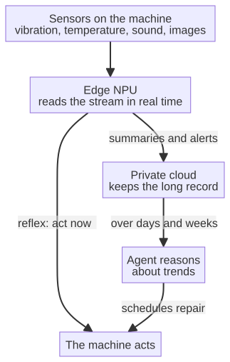

# Chapter 12 --- Telemetry as the Nervous System of the Factory

## The Blood of the New Machine

We have spoken of the machine that thinks, of the cloud that keeps its secret, and of the agent that will one day reason about everything the machine produces. But between the machine and the agent --- between the sensor on the spindle and the mind in the office --- there must be a *stream*. There must be a continuous flow of information that carries, in real time, the report of what the machine is doing and how it is feeling. This stream is called **telemetry**, and it is the blood of the new factory. Without it, the machine that thinks would think in a vacuum; the cloud that keeps its secret would have nothing to keep; the agent that would reason would have nothing to reason about. Telemetry is what makes the factory a living thing rather than a collection of inert metal.

Let us understand telemetry properly, because the word is thrown around loosely these days, and because understanding it is essential to understanding the whole chain. Telemetry is simply *data that is measured at one place and reported, automatically and continuously, to another place.* The word comes from the Greek *tele*, "far," and *metron*, "measure" --- the measurement of far things. It was born in the cockpit of an aircraft, where gauges reported the state of the engines to the pilot in real time, and it traveled from there into computing, where it came to mean the automatic collection and transmission of operational data.

It is worth pausing on that origin, because the word carries its meaning in its bone. Telemetry was, in fact, born out of *fear* --- the fear of the astronaut or the pilot who must trust, completely, a machine whose life-support depends on data he cannot see with his own eyes. The rockets of the early space program, the Apollo program in particular, were among the first large-scale users of telemetry, because a rocket is the ultimate example of a machine whose internal state --- temperature, pressure, fuel flow --- cannot be observed directly once it has left the ground. The only way to know what it was doing was to *measure it at one place and report it, continuously, to another.* The factory of the sixth revolution faces an identical, if quieter, dependence: we cannot *see*, with our own eyes, whether a spindle is about to fail; we can only measure its state and report it. The metaphor is not decorative; it is structural. The factory, too, must trust its telemetry.

## What the Machine Reports

On a factory floor, the telemetry a modern machine can produce is, in fact, remarkably rich --- far richer than the handful of numbers an old PLC would ever report. A machine equipped with the intelligent card of the previous chapters can report, continuously:

- **Vibration and acceleration**, in multiple directions, revealing the health of bearings, spindles, and moving parts. A bearing that is beginning to spall does not fail with a shout; it fails with a *frequency*, a small periodic disturbance in the vibration signal that a human ear would never notice but that a sensor records in full.
- **Temperature**, at several points, warning of overheating, friction, or environmental change.
- **Electrical current and voltage**, revealing the load on a motor and, subtly, the quality of the cut or the press. A cutting tool that is becoming dull draws, almost imperceptibly, more current; the telemetry *sees* the wear before the part is scrapped.
- **Sound**, through a microphone, revealing changes in a machine's timbre that precede failure. This is the domain of *acoustic emission*: the high-frequency "groans" a machine makes as a crack grows, inaudible to a worker but unmistakable to a microphone tuned to the right band.
- **Images**, through a camera, reporting --- as we saw in the previous part --- the quality and position of each part.
- **Position, speed, and force**, for any machine that moves, revealing whether it is operating within its intended envelope.
- **Fluid and oil debris**, revealing the wear of internal components as microscopic particles are carried through a lubricant, each particle a small record of what the machine has been doing.

Each of these streams, on its own, is a number changing over time. Together, they are a *story*: the continuous narrative of the machine's state. And this is where the intelligence of the sixth revolution enters, not in the *collection* of the telemetry --- that part is mechanical and cheap --- but in its *reading*. The NPU on the machine reads the stream not as a list of numbers but as a *health signal*, recognizing the moment the story changes from "well" to "warning." The cloud receives the stream and keeps it, consistent and searchable, without ever reading it. The agent reasons over the stream and decides what to do about it.

## The Cost and the Ubiquity of Sensing

There is one economic fact that makes the sixth revolution possible, and it is worth naming, because revolutions are only possible when the necessary components have become cheap. The sensor --- the accelerometer, the thermocouple, the microphone --- has, over the last two decades, become astonishingly inexpensive. A modern MEMS accelerometer, small enough to sit on a fingertip, costs pennies in volume; a microphone for acoustic emission is likewise cheap; a camera for machine vision is, by the same logic, ordinary. This is the same story that made the smartphone possible and that made the cloud possible: the components that make continuous sensing affordable have fallen in price faster than anyone predicted, and the factory has simply inherited that cheapness.

This is why the collection of telemetry is, as we said, "mechanical and cheap." The hard part --- the part that is genuinely hard --- is never the *measuring*; it is the *reading*. A hundred sensors on a machine are worthless unless something can make sense of the stream they produce. The sixth revolution does not win by adding more sensors; it wins by adding more *attention* to the data the sensors already produce. The cheapness of sensing is a given; the intelligence of reading is the whole task.

## The Real-Time Requirement

The previous chapters established that the machine must perceive and act *locally*, in real time, because a round trip to the cloud is too slow and leaks privacy. Telemetry must therefore be understood on two levels, and it helps to keep them separate.

On the **edge** --- on the machine itself --- the most urgent telemetry is processed locally and instantly. The vibration signal that says "a bearing is about to fail" is read on the spot, by the NPU, because the decision it supports must be made in microseconds. Here telemetry is a reflex.

On the **cloud** --- the private, zero-knowledge cloud kept inside the walls --- the telemetry is collected, stored, and made searchable over time. Here it is not a reflex but a *memory*: the continuous record of the machine's life, which the agent can reason about over days, weeks, and months. Here the value is not speed but *history*: the ability to see, in retrospect, how a machine has aged, whether a pattern of failures is emerging, how two machines on two lines compare.

The two levels are not in conflict. The edge processes what must be decided *now*; the cloud remembers what must be understood *over time*. Both are telemetry. Both feed the sixth revolution. The edge is the reflex; the cloud is the memory. The agent is the mind that reads both.

## The Lesson of Apollo 13

The word "telemetry" was, as we said, born in the cockpit and the control room, and the most famous lesson in its power came in April 1970, when the Apollo 13 spacecraft suffered an explosion in an oxygen tank on its way to the Moon. The story is well known, but it is usually told as a story of courage and improvisation. It is worth telling, for a moment, as a story about *telemetry*, because that is what made the courage and the improvisation possible.

Once the spacecraft had left the Earth, the crew could not *see* the damage with their own eyes; they could only see it through the instruments and the readings that were reported, continuously, to Mission Control in Houston. When the explosion happened, the telemetry told the flight controllers what they could never have seen from the ground: which systems were failing, how fast the oxygen was venting, what the temperature and pressure in the tanks were doing. It was the telemetry --- the continuous, honest report of the machine's internal state --- that let the controllers understand, within minutes, that the mission could not land on the Moon and that the real task had become bringing the crew home.

And here is the part that matters for the factory. The controllers did not merely *read* the telemetry; they *reasoned* over it, and they reasoned with the engineers who built the machine, until they could turn the raw stream of numbers into a plan. The famous improvised carbon-dioxide filter --- built, in space, from duct tape, cardboard, and a plastic bag --- was the *action* at the far end of telemetry: the data made the problem visible, the reasoning turned the problem into a plan, and the plan became an act. Measured at one place (the spacecraft), reported continuously to another (Houston), reasoned over by a third (the flight team), and finally acted upon --- this is the whole chain of the sixth revolution, compressed into a single, desperate week in 1970.

The factory has no astronauts and no Moon, but it has, in miniature, the same dependence. The engineer who cannot *see* the bearing wearing out can only *measure* it and read the report. The difference is that the sixth revolution puts the reasoning *closer* to the data --- on the chip, in the cloud inside the walls --- so that the plan and the act do not have to wait for a roomful of controllers, and the machine can, in the newest systems, act on its own telemetry without a human in the loop at all. Apollo 13 is the ancestor of the machine that thinks; it is simply that the machine has learned to be its own Mission Control.

## The Volume Problem

There is a practical difficulty that the romantic description of telemetry tends to hide, and it is worth confronting honestly: the data a modern machine produces is *enormous*. A single vibration sensor, sampling many times a second, produces millions of readings in a day. Multiply that by a dozen sensors on a machine, a hundred machines on a line, and a fleet of plants, and the stream becomes a flood --- terabytes a day, in a large operation. No cloud, however private, can simply *keep everything forever*; and no human, however diligent, can read a flood.

This is why the sixth revolution's telemetry is not one size of data at one speed, but a *two-level* design, and it is worth drawing it plainly:

At the **edge**, the machine reads its own stream at full resolution, because the reflex must be instant and the raw signal must be examined in all its detail. At the **cloud**, the machine sends *summaries* --- downsampled histories, extracted features, alerts, and the occasional full-resolution window around an event --- so that the long record is kept without keeping every byte. The edge reads the flood; the cloud keeps the story; the agent reasons over the story. This is how a factory can watch everything without drowning in it: the raw data is consumed where it is produced, and only its *meaning* is sent onward, encrypted, to the private cloud.

This design has a second, quieter benefit, and it is worth naming. The volume problem is also a *privacy* problem: if everything were shipped to the cloud, everything would be at risk. By summarizing at the edge, the machine sends the *minimum* that is needed --- the alert, the trend, the extracted feature --- and keeps the deep, raw, intimate data of its own operation local. The telemetry that travels is therefore not merely encrypted; it is *reduced*. The factory shares the story, not the raw confession. And that, in a world that has learned to distrust the cloud, is exactly the right shape of trust.

## The Stream as a Shared Truth

There is one more quality that makes this stream special, and it ties directly to the private cloud of the previous chapter. In the old factory, telemetry was usually *local*: it was displayed on the machine, or logged to a file in a room, visible only to whoever happened to be there. The sixth revolution makes telemetry *shared* --- continuously synchronized, in real time, across the whole company, to every machine, office, and agent that has a right to it. This is what a private cloud achieves: one living copy of the factory's telemetry, always consistent, always available, never leaving the company's control.

There is a phrase from the database world that describes precisely this quality, and it is worth borrowing, because it names a hard-won lesson. It is called **strong consistency**: the guarantee that every reader, at every moment, sees the *same* copy of the data --- that there is not a version on one machine and a different version on another, drifting slowly apart. In the old factory, two technicians could look at two different machines and reach two different conclusions, because their telemetry was not shared. The sixth revolution removes that possibility: with a private, strongly consistent cloud, the sensor on the spindle, the model in the cloud, and the agent in the office are all looking at --- and acting on --- the *same* living truth. There is no other way to run a factory that must be certain; you cannot be certain of a thing that is different on every machine that observes it.

This shared, real-time telemetry is the connective tissue of the whole chain. It is what lets the sensor on the spindle, the model in the private cloud, and the agent in the office all be looking at --- and acting on --- the *same* living truth. It is the blood that flows from the machine, through the cloud, to the office, and back again. And now, having established what this blood is and how it flows, we can turn to the final question of the whole chain: *who reads it, and how?* For the blood, as in any living body, must be read by a mind. That mind is the subject of the next part of this book, and it is where the story takes its most surprising turn, because the mind that reads the telemetry is not, in the newest systems, a human at all.

