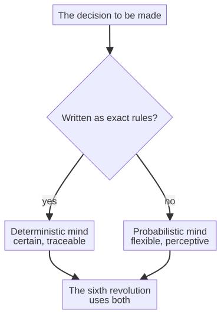

# Chapter 13 --- Two Kinds of Mind

## The Choice That No One Asks For

There is a decision that nearly everyone building the sixth revolution makes without ever noticing it, and it is the most important decision in the whole story. It is not "should we use AI?" It is "which *kind* of AI?" And it is a choice between two fundamentally different philosophies of intelligence, two kinds of mind, that agree on almost nothing except their outward results.

To understand the choice, consider the simplest possible example: a machine that must decide whether a part it is inspecting is good or defective. There are two ways to make that decision, and they come from two different worlds.

## The First Mind: The Guessing Mind

The first kind of mind is the one you have already met, in the sensor on the spindle. It is the mind of the *probabilistic* model --- the neural network that has learned, from thousands of examples, to *guess* the most likely answer. This is the intelligence of the deep-learning era: it is fed many examples of good and defective parts, and it adjusts itself until its guesses match reality. When a new part arrives, it does not apply a rule; it produces a *probable answer*, weighted by everything it has seen.

This guessing mind is a miracle of the modern age, and it is astonishingly good at the tasks it was trained for. It can recognize a scratch, predict a failure, read a barcode in the dark. It excels where the rules cannot be written down explicitly but the right answer can be *shown* --- in perception, in pattern recognition, in the handling of messy, real-world data. This is why deep learning conquered image recognition, translation, and language in a single sweep: in all of these, you cannot write the rules, but you can show a million examples.

But the guessing mind has a character that we must name carefully, because that character is the whole difference in the sixth revolution. It is **probabilistic**. It gives its best guess, but it has given you, up to this point, a guess. It can be wrong, even when it sounds confident. It carries within it, by its very nature, a *discretionary element*: the training data contains biases, and the inference is a learned approximation, not a certainty. For recognizing a scratch on a bottle, a guess is perfectly fine. For deciding whether a braking system in a car is safe, a guess is not merely insufficient; it is unacceptable.

## The Second Mind: The Calculating Mind

There is a second kind of mind, and it is older than the first by more than half a century. It is the mind of the *deterministic* calculation. It does not guess; it *computes*. It does not learn from examples; it applies fixed rules to given inputs and produces, every single time, *the same answer with mathematical certainty*. This is the mind of the compiler, the mind that turns your source code into machine instructions exactly once, every time, forever, with no discretion and no bias, no drift and no guess.

You have met this mind too, though you may not have called it "intelligence." When you compile a program, the compiler applies fixed rules to your code and produces a fixed result. It cannot be "wrong" in the way a guessing model can; it can only be correct or incorrect, and its correctness is provable. It does not have opinions. It does not have a bad day. Given the same input, it gives the same output, with the same certainty as two plus two making four. This is not the mind that recognizes a face or translates a sentence --- those are impossible for it. But it is the mind that *guarantees*, and that guarantee is worth its weight in gold in exactly those places where a guess would be dangerous.

## The Line Between Them

The two minds are not rivals in the usual sense; they are *complementary*, each strong where the other is weak. The guessing mind is flexible, creative, and indispensable for perception and language, but it is not certain. The calculating mind is perfectly certain, but it is not flexible --- it does only what its rules dictate, and its rules are, by construction, complete and unambiguous.

The decisive question is this: **which mind should drive the decisions that matter most?** Where the outcome is a classification or a guess --- a scratch or a smooth surface --- the guessing mind is not merely adequate; it is the only one that works. But where the outcome must be *certain* --- where a wrong guess injures someone, loses money, or breaks trust --- the calculating mind is the only one that is safe.

To understand why the calculating mind is safe, it helps to see precisely what "certain" means here, because the word is doing a great deal of work. A deterministic system is one whose output is *fully determined* by its input and its rules, with no room for chance, no randomness baked into the process, and --- crucially --- no *adversarial* room for maneuver. A guessing mind, by contrast, can be led off course by inputs that are similar but not identical --- a phenomenon that the machine-learning world calls *adversarial examples*: a tiny, imperceptible change to an input that can flip a confident guess into a confident error. The calculating mind has no such weakness, because its rules are fixed and complete; there is no gap for an input to fall through. This, more than any abstract talk of "certainty," is why the calculating mind is the only one that can be trusted with the decisions that must be known to be correct.

## The Two Tribes of AI

The two kinds of mind are not a metaphor invented for this book; they are the two great tribes of artificial intelligence, and the history of their rivalry is one of the most instructive stories in the whole field. It is worth telling, briefly, because it explains why the sixth revolution can now do what neither tribe could do alone.

The first tribe is the **symbolic** school, sometimes called "good old-fashioned AI." Its belief was that intelligence is the manipulation of symbols according to explicit rules --- that if you could write down enough logic, you could capture thought itself. Its great achievement was the *expert system*: a program that encoded the knowledge of a human specialist as a set of if-then rules. In the 1970s and 1980s, expert systems were built for medicine (MYCIN, for diagnosing infections), for chemistry (DENDRAL, for identifying molecules), and for business (XCON, for configuring computer orders), and for a time they were the most commercially successful form of AI ever built. They were, in essence, the calculating mind: deterministic, rule-based, auditable, and certain within their domain. Their weakness was equally clear --- they were *brittle*. They worked inside the narrow set of rules they were given, and they failed badly outside it, because the real world is full of cases no one wrote a rule for. When the expert-system market collapsed in the late 1980s, it took the first tribe's reputation with it.

The second tribe is the **connectionist** school --- the neural networks. Its belief was almost the opposite: that intelligence is not a set of written rules but a *pattern learned from examples*, a network of simple units that adjusts itself until it matches the world. The idea is older than most people think: Frank Rosenblatt built the *perceptron* in 1958, a simple learning machine, and it was greeted with enormous optimism. But the perceptron had limits, and a famous 1969 book by Marvin Minsky and Seymour Papert exposed them so effectively that neural-network research went quiet for more than a decade --- the "AI winter" of the connectionist tribe. It took until the 1980s for *backpropagation* to give neural networks a way to learn deep structures, and until 2012 for the combination of big data and fast chips (the AlexNet moment we met in the timeline) to make them suddenly, spectacularly good. That second tribe is the guessing mind: flexible, perceptive, and probabilistic.

For decades the two tribes fought, and each dismissed the other. The symbolists said the connectionists had no theory and no guarantees; the connectionists said the symbolists could never handle the messiness of the real world. Each was right about the other's weakness and blind to its own. The sixth revolution's quiet insight --- the one this chapter is built to convey --- is that the fight was always a mistake. The two tribes are not rivals for the same throne; they are two *different tools for two different jobs*, and the factory that thinks needs both.

The diagram is the whole argument in one picture. When the decision can be written as exact rules --- when the specification is complete and the input is well-defined --- the deterministic mind is the right tool, and it is *superior*, because it is certain. When the decision cannot be written as rules, but can only be *shown* through examples --- recognition, language, prediction --- the probabilistic mind is the only tool that works. The wise factory does not pick a tribe; it asks, of each decision, which tribe's tool fits, and uses that one. That is the sixth revolution, and it is the resolution of a fifty-year argument.

## The Controversial Position

It is here that the projects behind this book take a distinctive and, some would say, controversial stand. They argue that far more of the factory's decisions than most engineers admit can --- and should --- be made by the *deterministic* mind, by fixed rules and exact specifications, rather than by the guessing mind. They argue that a great deal of what we casually call "AI" is, in fact, perfectly well served by deterministic calculation, and that reaching for a probabilistic model where certainty is possible is not merely unnecessary but *dangerous*.

This is not a Luddite rejection of machine learning. It is, quite the opposite, a belief that the certain mind should be used wherever it can be, so that the uncertain mind is reserved --- sparingly --- for the tasks where it alone succeeds. To understand this position fully, we must look at the project that embodies it most completely, a technology that turns a compiled program into a specification that can be executed without any guesswork at all. That is the subject of the next chapter.

## What a Guarantee Actually Buys

It is worth asking, concretely, what the deterministic mind's guarantee is *worth* --- because "certainty" can sound like a philosopher's word until you see what happens when it is absent. The history of computing has some sobering lessons, and two of them are worth telling, because they show, in blood and money, why the sixth revolution cannot rest on guesses where certainty is required.

The first is the **Therac-25**, a computer-controlled radiation-therapy machine used in the 1980s. It was designed to deliver precise doses of radiation to cancer patients, and it relied on software to control the beam. A series of programming errors --- subtle, interacting bugs, the kind that no single test would have caught --- allowed the machine, under certain sequences of operator input, to deliver massive overdoses. Several patients were killed or severely injured. The machine's software was, in a sense, "deterministic" --- it did exactly what it was written to do --- but it was *not verified*, and its determinism delivered the wrong result with perfect certainty. The lesson is not that determinism is bad; it is that determinism without verification is merely a reliable way to be wrong.

The second is the **Ariane 5** rocket, which exploded on its maiden flight in 1996, less than a minute after launch. The cause was a software overflow: a value that had been perfectly safe in the smaller Ariane 4 exceeded the range of a 16-bit variable on the more powerful Ariane 5, and the resulting error crashed the guidance system. The code was, again, deterministic; it did exactly what it had been written to do. But it had been written for a different machine, and no one had verified that the assumptions still held. The rocket did not fail because of a random glitch; it failed because a deterministic system, applied outside its verified domain, is *certainly* wrong.

These stories are the reason the certification domains --- aviation, medicine, nuclear power --- do not accept "it works in the demo." They demand *proof*: that the software's behavior has been verified against its specification, that every assumption is documented, and that the whole chain can be audited. This is the discipline the aviation industry calls **DO-178C** --- a standard that governs how airborne software is developed and verified, and that requires, among other things, that the requirements be traceable all the way down to the code and back. It is a standard built on a single conviction: a system that flies people through the air must be *known* to be correct, not merely *likely* to be.

This is precisely what the deterministic mind, properly used, can deliver --- and what the guessing mind cannot. A deterministic system built from a verified specification can be traced, step by step, from source to decision, and the whole chain can be checked. A probabilistic model can be tested, and it can be shown to be accurate on a test set, but it cannot be *proven* correct, because its behavior is, by construction, a learned approximation. Where the cost of a wrong answer is measured in lives or in fortunes, the difference between "tested" and "proven" is the difference between a product and a liability. The guarantee is not a luxury; it is the license to operate.

## Why the Calculating Mind Can Be Proven

There is one more thing that makes the calculating mind worth its place in the sixth revolution, and it is a thing that the guessing mind can never provide: a *proof*. When a deterministic system decides something, it is possible --- in principle, and often in practice --- to *prove*, rigorously and completely, that the decision is correct. This is the promise of the discipline known as *formal verification*: the machine applies fixed rules to a fixed specification, and the whole chain of reasoning can be checked by a machine, with the same certainty as a mathematical proof. No guess can be proven; a proof can.

This is precisely the quality that the certification domains require --- the domains we will meet in the following chapters, where a decision that must be certain also has to be *shown* to be certain. A probabilistic model can tell you it is 99.9% confident; it cannot tell you *why*, and it cannot prove the remaining 0.1% will not bite. A deterministic system can do both. The calculating mind is, in this strictest sense of the word, the only mind that can stand before an auditor --- before an ISO assessor, a SOC 2 examiner, a HIPAA reviewer --- and demonstrate, step by step, that its decision is correct. That is not a technical curiosity; it is the whole of the guarantee.

