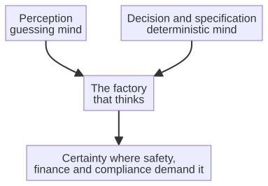

# Chapter 15 --- When Certainty Matters

## The Places Where a Guess Is a Crime

We have now met the two kinds of mind --- the guessing mind that is flexible but certain in nothing, and the calculating mind that is certain but does not improvise. We have seen that the guessing mind is a miracle for perception and language, and that the calculating mind is the only safe choice where a decision must be *known* to be correct. The question this chapter answers is simple and decisive: **where, in a factory that thinks, must the decision be certain?**

The answer is "more places than you might think," and it is precisely the concentration of these places that makes the sixth revolution distinct from earlier ones. Let me name the domains, because in each of them a probabilistic guess is not merely inadequate but dangerous, and in each of them the deterministic mind --- the mind that can *prove* its decision --- is the only acceptable one.

## The Domain of Safety

Consider the industrial control system that governs a robotic arm working beside a human. If that arm's safety decision is made by a guessing model, then there is, lurking in the model, a small but nonzero probability that it will misjudge --- that on a morning with unusual light, or an unusual posture, it will decide "safe" when the reality is "danger," and a human will be injured. That probability need not be large; it need only be greater than zero, and even a tiny probability, applied across millions of decisions across a whole factory, becomes a real risk.

In safety-critical systems, a nonzero probability of a catastrophic guess is not acceptable. The decision must be *certain*: either safe or unsafe, provably, every single time. This is why the deterministic mind --- the mind that computes with fixed rules and produces a guaranteed answer --- is the only one that can be entrusted with safety. It is the same logic that governs the aviation industry, where a system's behavior must be provable to an authority who will certify it before a single passenger is allowed aboard. Certainty is not a luxury in these domains; it is the price of admission.

The certification world names this requirement precisely, and the names are worth knowing. Functional safety --- the safety of a system *as a consequence of its correct behavior* --- is governed, in industry, by standards such as **ISO 26262** (automotive) and **IEC 62443** (industrial control and automation), which demand, above all, that a system's behavior be *predictable, verifiable, and provable*. A probabilistic model cannot satisfy these: its behavior is, by nature, not fully predictable, and it cannot be proven correct. A deterministic system can. This is not a matter of taste; it is the condition under which a safety-critical system is permitted to operate at all.

## The Domain of Finance

The second domain is the financial and the bureaucratic. A factory is not only a place where things are made; it is also a place that invoices, that reconciles accounts, that reports to tax authorities, that processes contracts. In each of these, a guess is not merely inadequate but *liability*. An invoice with a wrong figure is not "probably right"; it is wrong, and it must be corrected, and it may carry penalties. A contract clause interpreted incorrectly is not "probably correct"; it is a dispute, a loss, a lawsuit.

Here too the deterministic mind is the safe choice, and here it appears in a particularly interesting form. Because the rules of accounting, of taxation, of contract law, are --- unlike the rules of vision or language --- *written down and explicit*, they can be encoded and executed deterministically. A decision that follows fixed, verifiable rules is not a guess; it is a calculation that can be audited, reproduced, and proven correct. This is exactly the deterministic approach that the lab behind this book applies to the office side of the factory, and it is what makes an agent trustworthy with the money and the words that a company cannot afford to get wrong. The financial domain is, in this respect, the natural home of the calculating mind: the rules are already written, so the task is not to *learn* them but to *apply* them exactly.

## The Domain of Compliance

The third domain is the regulatory --- the world of standards, certifications, and audits. ISO standards, SOC 2, HIPAA, and their industrial cousins do not ask "was your decision probably correct?" They ask "can you *prove* that your decision is correct, every time, and trace it back to its source?" A probabilistic model can answer none of these questions, because a model that guesses has no provable trace. A deterministic system can answer all of them, because its decision is derived from a verified specification through fixed rules, and the whole trail --- from the source code to the decision --- is transparent and reproducible.

For a factory in a regulated sector --- medical, financial, aerospace, energy --- compliance is not a form to be filled in; it is a condition of existence. And the only kind of intelligence that can satisfy a compliance authority is one whose behavior is deterministic, traceable, and provable. This is why the deterministic mind is not a technical curiosity in these sectors but a *requirement*.

## The Auditable Trail

There is one more thing that a compliance authority actually looks for, and it is worth naming, because it is the concrete, physical thing behind the abstract word "certainty." An auditor does not ask "is your system probably correct?"; they ask to *see the trail*. They want to watch a single decision run backward, from the answer all the way back to its origin, and they want to see, at every step, that the step was *determined* --- fixed, reproducible, and free of discretion.

This is precisely the trail that the deterministic mind can produce, and it is the trail described by the previous chapter. It runs, unbroken, from source code to decision: the source code produces the assembly through *compilation* (a deterministic process), and the assembly drives the decision --- whether it is a user interface, a generated API, or a computed verdict --- through *fixed algorithmic transformation*. Every element can be traced to its origin, and every step can be reproduced. This correspondence between specification and implementation is, in the certification world, the whole of the requirement. When the front-end is derived from a verified backend through deterministic rules, the correspondence between what was specified and what was built is *inherent and provable* --- not a hope, not a test result, but a logical necessity. That is what a SOC 2 examiner or a HIPAA reviewer is looking for: not a model's confidence, but a model's *traceability*.

## The Fourth Domain: The Body Itself

There is a fourth domain, and it is the one where the stakes are highest of all: the human body. Modern medicine runs on software whose behavior must be *certain*. An infusion pump that delivers a drug at a precisely controlled rate; a pacemaker that paces a heart; an insulin pump that decides, moment by moment, how much of a hormone to release; a radiotherapy machine that aims a beam. In each of these, a probabilistic guess is not a small imperfection; it is a direct threat to a human life.

Consider the artificial pancreas --- a system that reads a person's blood sugar continuously and decides, automatically, how much insulin to deliver. It is a beautiful idea, and it is already real, but it is also a system in which a wrong decision can, within minutes, put a person into a coma. The decisions it makes must be *certain* in their arithmetic, even as the *sensing* is probabilistic (the sensor is a learned approximation, and it can be wrong). The art of such a system is precisely the art of the sixth revolution: use the guessing mind to *perceive* (read the sensor), and the deterministic mind to *decide* (compute the dose by fixed, verified rules that can never be wrong). The two minds, each in its place, protect the body that trusts them.

This is why the medical-device world is governed by standards as strict as any in engineering, and why a device that "works most of the time" is not a device at all. The regulator does not ask whether the machine is *likely* to be safe; it asks whether the machine is *known* to be safe, across every input it could ever receive. That is the deterministic mind's home ground, and it is why, in the sixth revolution, the body is one of the places where certainty is not negotiable.

## A Short History of Engineering Certainty

The demand for certainty in engineering is older than computing, and its history is one of the most instructive in the whole of technology. Before anyone wrote a line of software, engineers were learning --- often through catastrophe --- that a system which flies people through the air, or holds up a bridge, or contains a nuclear reaction, cannot be built on "it seems to work."

The Wright brothers, in the early 1900s, are a small but telling example: they did not merely build a flying machine; they built a *wind tunnel* to measure, precisely and repeatedly, the forces on their wings, so that their design rested on measurement rather than hope. Out of that culture grew the discipline of aviation safety, which, after a series of terrible accidents in the twentieth century, hardened into a set of standards that assume nothing and require everything to be *proven*. That is the lineage of DO-178C, the standard we met in the previous chapter, and of the entire culture of verification that governs flight to this day.

Computing inherited this culture and, at first, did not live up to it. The early decades of software were a long lesson in the cost of *unverified* determinism --- systems that did exactly what they were programmed to do, and were exactly wrong. Out of those lessons grew the field of **formal methods**: the use of mathematical proof to show that a program's behavior matches its specification, in every possible case. Formal methods are hard, and they are not used everywhere, but they exist, and they are the reason a modern aircraft's flight-control software can be certified, and a modern payment system can be trusted with a billion transactions.

The lesson of this history, for the sixth revolution, is that certainty is not a *gift* of technology; it is a *discipline* that must be chosen. A deterministic system is not automatically a *correct* system --- the Therac-25 and the Ariane 5 were both deterministic, and both were catastrophically wrong. Certainty requires that the determinism be *verified*: that the rules be checked, the assumptions examined, the whole chain proven. When the sixth revolution says a decision must be certain, it means precisely this --- not merely "the machine will do the same thing every time," but "the machine has been shown to do the *right* thing every time." That is a higher bar, and it is the bar that the domains of safety, finance, compliance, and medicine all demand.

## The Combined Intelligence

It is important, once more, to insist that this chapter does not argue for the *replacement* of the guessing mind. The guessing mind remains indispensable for perception, prediction, and language --- the tasks where the right answer can be shown but not written. The factory that thinks must therefore carry *both* minds, and deploy each where it is safe to do so:

The sensing layer --- the camera that sees a scratch, the vibration sensor that predicts a failure --- is the guessing mind, and it is perfect for its task. But the layer that *decides* what to do about the sensing, that verifies the decision, that proves it correct and traces it to source, is the deterministic mind. The two are combined, each in its proper place, and it is this combination that makes the factory trustworthy in the places where trust is non-negotiable.

## The Honest Line

Let us draw the line honestly, because honesty is the whole virtue of the deterministic mind. The deterministic mind is superior wherever the specification is *complete* and the rules are *known*: where you can compile the decision into fixed rules, or derive it from a compiled specification through exact transformation. In these places, it is not merely safe; it is the best choice, because it is certain, traceable, and provable. The guessing mind is superior wherever the world is messy and the right answer can only be *learned from examples*: recognition, translation, prediction. In these places, no deterministic system could work, and the guessing mind is the only option.

The factory that thinks does not choose between certainty and flexibility; it *combines* them. It guesses where guessing is the only way to know, and it calculates where calculation can be certain. And it is wise to know, before we move on to the office that will put both minds to work, exactly where the line is drawn --- because a factory that guesses at the things that must be certain is a factory building on sand, no matter how intelligent its machines.

