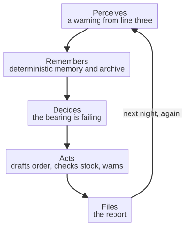

# Chapter 16 --- The Office at Midnight

## The Lights Go Out

There is a particular kind of quiet that falls over an office at night, once the last person has taken the last of their keys and the security guard has completed his circuit. The computers stay on; the servers hum; the coffee machine, unplugged for the sake of the kettle that never is, keeps its small warmth. And in this quiet, something happens that would have been impossible a decade ago, and that is still invisible to most people who work in offices by day. The work does not stop. It simply stops being done by a person.

This is the vision that this chapter introduces, and it is worth stating plainly before we get into the mechanics, because it is the culmination of the whole chain we have been assembling. The intelligence that lives on the machine (Part II), the privacy that keeps the data inside the walls (Part III), and the certainty that governs the decisions that must be certain (Part IV) --- all of these come together here, in the office, to make a single, striking possibility real: an office that keeps working after the lights go out, run by an agent that knows the business as well as any employee, and that never sleeps, never tires, and never leaks your data.

## The Difference Between a Tool and an Employee

Before the agent, the office already had a great many tools. There were spreadsheets and word processors, email clients and databases, and --- increasingly --- scripts that automated small, specific tasks. A macro could format a report. A script could move a file from one folder to another. These are *tools*, and they are useful, but they are tools in the narrow sense: they do exactly what they are told, to a document or a file, and nothing more. They have no memory of the business, no understanding of what the work *means*, no ability to judge when a task is done or to adapt to an unexpected case.

The agent is different in kind, and the difference is worth naming. An agent is not a tool that does one thing; it is a *worker* that is given a *goal* --- "prepare the monthly report," "reconcile these invoices," "warn the manager that the bearing on line three is failing" --- and that figures out, on its own, the sequence of steps needed to reach the goal, using the tools it has been given, checking its own work as it goes, and adapting when something does not go as planned. This is the defining feature of what is called an *agentic* system: it does not merely execute a command; it *pursues an objective with a degree of autonomy*, planning, acting, observing the result, and adjusting.

And crucially, the agent behind this book is not a generic, off-the-shelf chatbot that answers questions in a window. It is a self-hosted system that runs *your* business's knowledge --- the documents, the systems, the history --- on *your* hardware, keeping that knowledge entirely on your side of the wall. It is, in the fullest sense, an employee who lives in your building and never leaves your premises.

## Why the Office Is the Final Frontier

You may wonder why, in a book about machines and clouds, we are spending a chapter on the office. The answer is that the office is the *final link* in the chain, and it is also --- perhaps surprisingly --- the place where the revolution is most, and most visibly, needed. For decades, the industrial revolution transformed the *factory floor*: the physical work of making things. But the *office* --- the work of coordinating, documenting, computing, and communicating --- was left almost entirely to humans. The accountant still tallies; the clerk still files; the manager still composes; the procurement officer still emails suppliers. This office work is enormous, repetitive, and increasingly data-rich, and it has, until now, had no automation that reaches beyond a few macros.

The sixth revolution reaches it. It reaches it not with a generic chatbot, but with an agent that is *anchored* to the factory --- that reads the telemetry coming from the machines, the data kept safe in the private cloud, and the decisions that must be certain --- and that *finishes the work that those things demand*. The agent is the point at which the factory's intelligence becomes an office's productivity. The machine perceives; the cloud keeps the secret; the agent decides and acts. And the work it acts on is, often, office work: the accounting, the legal, the procurement, the reporting, the customer service.

## A Curiosity: The Factories That Already Keep Working in the Dark

Before we descend further into the office at midnight, it is worth knowing that the phrase is not entirely new to industry. There is, in modern manufacturing, a well-established term for a plant that runs through the night without a single human in it --- a *lights-out* factory. The word comes from the most literal of circumstances: in some of these plants the air is so pure, and the process so sealed, that keeping the lights on would be a waste; the machines do not need to see, and so they do not need the light, and so they do not need the people who would otherwise need the light to see by. The semiconductor industry, in particular, built entire clean rooms that run without people, because a human in a clean room is itself a source of contamination --- skin cells, fibers, the quiet disturbance of a breathed breath. So the factory learned, decades ago, to work in the dark and in silence, and to measure its output not in the shift changes of its staff but in the continuous flow of units off a line.

This is a curiosity worth holding, because it does two things for us at once. The first is to show that "the office at midnight" is not a dream of the future but the logical extension of something that already exists on the factory floor: a system that keeps producing while the people go home. The second is to make a distinction that the office must now learn to make for itself. A *lights-out factory* works at night because its work is physical, sealed, and measurable --- the machines do not need to read a company's private contracts or answer a customer's anxious email. The office does not yet know how to go dark, because its work is not sealed: it is full of context, of history, of the exact and unrepeatable facts of a particular business. That is precisely what the agent changes. The office can go dark at last, because the agent is the first worker who does not need to see the room to do the work --- it needs only the company's own knowledge, kept safe, and a goal worth pursuing.

## The Sea of White-Collar Work

There is one fact that makes the office at midnight feel as large as it really is, and it is a fact about *scale*, not merely about technology. The work that happens in an office --- the coordinating, the documenting, the computing, the communicating --- is, in the economies that have built it, enormously larger than the work of the factory floor, and it has grown without cease. The very word for the office worker is comparatively young: "white-collar" was coined in 1899 by the American journalist and author William H. White, to distinguish the clerk and the salesman, who worked indoors in a shirt and tie, from the "blue-collar" worker of the shop and the field, who worked in coveralls. In the hundred and twenty years since that word was invented, the white-collar workforce has grown by many orders of magnitude. Where a factory in 1920 might have employed a hundred men at the machines and a handful of clerks at the desks, a factory today might employ a hundred men at the machines and a few hundred clerks, calculators, filers, schedulers, and correspondents at their desks --- and the number of the latter keeps rising even as the former is mechanized.

This is the great irony of the twentieth century's productivity story: as the machines took over the *physical* work, the *documentary* work grew rather than shrank. The office did not shrink to fill the space the machines left; it overflowed. The accountant's ledger, once kept in a single bound book, now spans systems and regulators and tax codes; the clerk's filing, once a matter of ink and index, now spans documents and versions and the exact words of a conversation held three months ago; the manager's composition, once a letter, now spans reports and quotes and the precise compliance language of a dozen jurisdictions. This is work of enormous, repetitive, increasingly data-rich character --- and for most of its history it has had no automation that reaches beyond a few macros. The sixth revolution reaches it, because the agent is the first worker who can read that whole sea of documentation the way an experienced clerk would, without tiring, without leaking, and without forgetting a single word of it.

## The Office at Midnight, Step by Step

To see that this is not merely a vision but a sequence --- a real thing that happens in real order --- it helps to watch the agent's own night, drawn as a small flow, so that the outline of the work is clear. What the agent does at midnight is not a single action but a chain, and the chain is the same one that governs the machine: it perceives, it remembers, it decides, it acts, it files.

This is the office at midnight, drawn in five steps. It is not science fiction. It is the natural completion of the chain --- and the agent that performs this work, with its proprietary memory and its sandbox, is the subject of the next chapter. But before we descend into its details, we should understand the shape of the whole chain, the way the machine, the cloud, the agent, and the office connect into one continuous loop. That shape --- the "Industry 7.0" graph --- is the subject of the chapter after next. For now, let the office at midnight stand as a preview of what is coming.

## A Real Example: The Night Shift That Never Ends

To make this concrete, let us watch a specific office at midnight --- not a factory office, but the accounting office of a mid-sized manufacturer, the kind of office that exists in almost every town with a factory, and that has always, until now, been the place where the day's work quietly bled into the next day. For years, the accountant on the late shift arrived at six in the evening, and she did what the office does at the end of a day: she closed the books on the day's orders, she reconciled the invoices that had been issued against the shipments that had left the warehouse, and she drafted the report that the manager would read at nine in the morning. It was real work, careful work, and it was, entirely, manual. If a shipment had been returned, or an invoice did not match its order, she stopped and chased the discrepancy by hand --- by phone, by email, by re-reading the paperwork. The work did not stop when she left; it simply waited for her to return.

Now the same office works at midnight, and it works without her. The agent takes up the thread exactly as an experienced clerk would. It drafts the day's closing report in the company's own language and style, and where a human would have guessed at a missing figure, it *retrieves* the precise relevant context --- the invoice, the shipment, the return --- from the company's own archive and its private cloud, exactly and without re-deriving it. Where a human would have made one spreadsheet by hand, the agent can drive the same spreadsheet library a skilled clerk would use, building the workbook with the data, the styles, and the chart on a single A4 page, and delivering the finished file. And where the late-shift accountant once chased a discrepancy by phone until ten at night, the agent checks the warehouse for the spare part or the missing figure not by a rigid query, but the way an experienced clerk would --- reading the inventory, adapting to the unexpected, and warning the manager in calm, plain words. It does all of this without a human in the building, using knowledge that never left the company, and it does so with the same reliability that governs the machine. The next morning, the accountant arrives at nine; she does not *do* the work; she *reviews* the agent's work, and signs what is correct. That is the night shift that never ends, and it is not science fiction.

## The Agent's Own Limits

It would be dishonest to paint the office agent as an unlimited worker, and honesty here is more valuable than enthusiasm, because the limits are exactly what make the agent safe to trust. The agent behind this book is a powerful worker, but it is a *bounded* one, and the boundaries are deliberate.

The first limit is the sandbox. The agent's actions pass through a constrained perimeter built into the architecture, so that a tool call cannot step outside its assigned scope; file actions are reversible, thanks to versioning; and the agent is given, by design, no code-execution capabilities, precisely so that it cannot create or run code. This is a limit that a careless vendor might call a missing feature, and a careful one calls the reason the agent can be handed real business work at all.

The second limit is knowledge. The agent knows only what it has been given --- the company's documents, its history, its archive --- and it is only as good as that material. A business with a disorganized archive feeds a disorganized memory; a business with a clear archive feeds a clear one. The agent is a mirror of the company's own orderliness, made permanent and retrievable, and it cannot know what no one has told it.

The third limit is judgment. The agent proposes; it does not *answer*. It can draft the report, check the stock, and warn the manager, but it cannot take responsibility for the outcome --- that, as the next part of the book will insist, remains human. The agent is the worker who does the doing; the human is the one who signs. And that division is not a weakness of the agent; it is the shape of trust.

## Why the Office Was the Last to Be Mechanized

There is one question worth answering plainly, because it makes the vision clearer: why, if the factory floor was mechanized over a hundred and fifty years, was the office so late to the revolution? The answer is that the office did not lack tools; it lacked *context*. For decades the office was, if anything, more thoroughly instrumented than the factory floor --- spreadsheets, word processors, databases, email systems, enterprise systems that tied the accounts to the purchasing to the warehouse. What it never had was a worker that could actually *use* those tools the way a skilled person does: reading context, remembering history, judging when a task is done, and adapting to the unexpected case. A macro can format a report; a script can move a file from one folder to another; an enterprise system can compute an invoice. But none of them can *know the business* --- the clients, the style, the history, the unspoken rules of how this particular company does its work. None of them can judge that a particular invoice is wrong, or that a particular customer deserves an exception, or that a particular report should be written in a particular way.

This is precisely what the agent changes, and it is why the office was the last frontier. The machine was mechanized first because its work is *physical, sealed, and measurable* --- a spindle either spins or it does not, and the sensors that watch it do not need to understand the company. The office was mechanized last because its work is *contextual, historical, and unrepeatable* --- it depends on knowing this company, its clients, its documents, and its history, and no amount of macro-writing could supply that knowledge. The sixth revolution reaches the office at last not because the tools finally arrived, but because the *worker* finally arrived: an agent that knows the business, runs on your hardware, and never leaks your data. And once that worker exists, the office at midnight stops being a dream and becomes, quite simply, an office that works.

