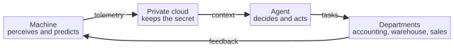

# Chapter 18 --- The Chain: Machine, Cloud, and Department

## Stepping Back to See the Shape

We have now walked, piece by piece, through every component of the sixth industrial revolution. We have met the machine that thinks on a chip, the cloud that keeps its secret, and the agent that knows your business and never forgets. Individually, each is impressive. But the reason this moment --- this sixth revolution --- is genuinely distinct from every revolution before it is that the components are not merely *present*; they are *connected*, into one continuous loop in which the output of one becomes the input of the next, and the last loops back to the first. This chapter is the step back that lets you see the whole shape at once, because seeing the shape is the difference between a pile of parts and a single machine.

The loop has four stages, and it is worth holding them in mind together before we expand each:

The machine perceives its world and produces telemetry. The private cloud receives that telemetry and keeps it safe, consistent, and searchable. The agent retrieves the precise relevant context from the cloud and from your knowledge base, decides what to do, and acts. Its action is the automation of a department's work --- the accounting, the warehouse, the sales, the support. And the department's work, in turn, generates new requirements and new actions that feed back into the machine and the cloud. The loop is closed. The factory is, in the fullest sense of the word, *self-coordinating*.

## A Curiosity: The Word for a Loop

It is worth pausing, on this chapter about a loop, to ask a simple question --- what do we actually mean when we call this shape a "loop," and where does the word come from? The term that most precisely names the idea we are using is **cybernetics**, coined in 1948 by the American mathematician Norbert Wiener when he published a book of that name. The word is older than the discipline; it comes, unchanged, from the ancient Greek *kubernan* --- to steer a ship, to hold the helm. A *kubernetes* was the steerman, the one who kept a vessel on its course by reading, constantly, the difference between where the ship was and where it meant to be, and by correcting that difference as the sea changed. This is, exactly, what our loop does: it reads, continuously, the difference between the state of the factory and the state the factory wants to be in, and it corrects that difference --- through the machine, through the cloud, through the agent, through the departments --- as long as the loop is closed.

The word carries, quietly, a whole philosophy of control. Before cybernetics, engineering mostly thought of machines as things that simply *did* what they were told, once. Cybernetics taught an entire field to think instead of machines that *watch, compare, and adjust* --- the servo, the thermostat, the governor on a steam engine, the human driver who keeps the car in its lane by constantly glancing at the road and turning the wheel by a millimeter. The loop of the sixth revolution belongs, in spirit, to that tradition. The factory that thinks is a factory that *steers itself*, and the word for that is the word we have been using all along, whether we knew it or not.

## The Office That Was Already Being Connected

Before the sixth revolution, there were real, documented attempts to do exactly what this loop does --- to connect the machines of a factory to the office that runs it --- and it is honest to name them, because they show both how far the market had come and how far it still had to go. The lineage begins, surprisingly, with the accounting of materials. In the 1950s and 60s, a man named Joseph Orlicky, working on inventory control, gave rise to **MRP** --- Material Requirements Planning --- a way of computing, from a bill of materials and a schedule of what was to be built, exactly what materials were needed and when. In the 70s this grew into **MRP II**, Manufacturing Resource Planning, which brought the factory's scheduling, its inventory, and its costing under one integrated computation. And in the 80s and 90s the idea expanded beyond the factory walls into **ERP** --- Enterprise Resource Planning --- the great integrated systems that try to run a whole company, from its orders to its payroll, as a single, consistent set of numbers.

This is the predecessor we must name, because the sixth revolution is, in a sense, the *next* step along the same road. ERP was a revolution in its own right --- it was the first software ambitious enough to treat a company as one continuous system rather than a collection of desks. But it had a structural limit that the sixth revolution overcomes, and the limit is worth stating, because it is the limit that makes the internal cloud necessary. The classic ERP connected the *office* to itself: the accounts to the purchasing to the warehouse. What it did not connect, and could not connect, was the *machine* --- the physical reality of the factory floor, seen through a chip on a spindle, in real time. It was an office system looking inward, at paperwork; the sixth revolution is an office system looking *outward*, at the machine, and then back inward again, in a loop. The chain we have drawn is the marriage of those two lineages: the integrated computation of ERP, finally joined to the live perception of the machine and the private memory of the cloud.

## The Direction of the Loop

Let us not gloss over the order of these stages, because the order is meaningful. The loop begins at the *physical* --- the machine that perceives --- because the sixth revolution is fundamentally about bringing intelligence into the physical world of making things, not merely about the world of paper and data. The intelligence does not float free; it is *anchored* to the real state of the factory. It then flows *inward* --- to the private cloud, which keeps it safe --- and then *upward* --- to the agent, which reasons from it, and to the departments, which act on it. This is the direction of value: from the physical reality of the machine, through the safe memory of the cloud, to the judgment of the agent, to the action of the office.

Notice also that this is deliberately the *opposite* of the old model. In the old model, intelligence lived in a roomful of computers, and the machines on the floor were dumb actuator-slaves; intelligence came *down* to the floor, poorly, as a set of rules. In the sixth revolution, intelligence is *built into* the machine, and it flows *out* --- through a cloud the company controls, through an agent that knows the business --- to automate the work that was, until now, entirely human. The direction is reversed, and with it the whole economics of the factory.

## The Key Word: The Internal Cloud

There is one phrase in the diagram that deserves to be repeated, because it is the phrase that makes the whole loop politically and technically possible: the **internal**, private cloud. Every earlier attempt to connect a factory's machines to its office went through a *public* cloud --- the giant, centralized data centers that datagate proved could be read, or compelled to read, by a third party. That is a deal no company that values its future can make, because the telemetry flowing from the machine is precisely the picture of the company's future, made visible. A public cloud would turn that most sensitive asset into someone else's data.

The internal, private, zero-knowledge cloud --- the cloud kept inside the walls --- is what allows the loop to close without betrayal. It receives the machine's telemetry, it keeps it consistent and searchable across the company, and it lets the agent retrieve the exact relevant context --- and in all of this it never learns the contents, because the company keeps the key. The loop can therefore run continuously, securely, and privately, and that is the only kind of loop a company can trust with its own future. This is the theme of Part III, repeated here because it is the reason the loop is even possible.

## The Loop, Measured in Data

To make the loop concrete, it helps to see exactly what flows through it, because a loop is not an abstraction --- it is a stream of specific things, moving in a specific direction, at a specific rate. At the bottom of the loop, the machine perceives, and what it sends *up* is telemetry: the readings of its sensors, in real time, encrypted as they travel, and kept safe in the private cloud. This is data about the physical state of the factory --- the temperature of a spindle, the vibration of a motor, the energy a machine consumes --- gathered not to watch the machine but to *predict* it. From the cloud, what flows *upward* is not raw data but context: the agent does not drown in a stream of numbers; it retrieves the precise, relevant context from the cloud and from the company's own knowledge base, and it decides what to do with that context. And its decision flows *upward* once more, as an action --- an automated task or a specification --- to the department, which acts on it.

Now watch the loop close, and notice what flows *back*. The department's action --- an order placed, an invoice reconciled, a supplier warned --- generates new requirements and new actions, and those feed back *down* to the machine and the cloud, informing the next cycle of perception, the next cycle of memory, the next cycle of decision and action. The loop is not a pipeline that carries data in one direction and stops; it is a closed system in which the output of every stage becomes the input of the next, continuously, without a human passing each piece of work by hand from one desk to the next. This is what "self-coordinating" means, concretely: not a machine that is *told* what to do, but a system whose own output drives its own next input, forever, as long as the loop is closed.

## Why the Loop Is Not a Pyramid

There is a subtle but important distinction worth drawing, because it is the distinction between a machine that merely *executes* and a machine that *self-coordinates*. A pyramid is a hierarchy: orders flow down from the top, and reports flow up from the bottom, but nothing at the bottom changes what is at the top --- the hierarchy is *stable* in the sense that the top always decides and the bottom always obeys. A loop, by contrast, is not stable in that way; it is *dynamic*: the output of the bottom feeds back into the top and changes what the top decides next. This is the difference between a factory that is *commanded* and a factory that is *self-coordinating*.

This is why the loop matters so much, and why it is the heart of the chapter. The six earlier revolutions made the machine more powerful, then more connected, then more computerized, but at no point did the machine *co-ordinate itself*: at no point did its own output drive its own next input, continuously, without a human in the loop. The sixth revolution is the first that does.

## The Latency of the Loop

There is one property of the loop that is easy to overlook and that decides, in practice, whether it works: its *speed*, and the fact that different parts of it must run at different speeds. A single loop that tried to run everything at the speed of the slowest part would be useless; a loop that tried to run everything at the speed of the fastest part would be unsafe. The sixth revolution works because it matches each decision to its own timescale.

At the **edge**, the loop runs in microseconds. The machine that perceives its own vibration and acts on it --- halting a motor, adjusting a path, rejecting a part --- must decide in the time it takes to complete the physical task, often thousandths of a second. This is the timescale of the reflex, and it is why the intelligence must live on the machine, on the chip, and not in a room.

In the **cloud**, the loop runs in seconds and minutes. The telemetry is summarized and sent, the private cloud stores it and makes it searchable, and the agent retrieves the precise context and reasons about it. This is the timescale of memory and judgment --- fast enough to catch a trend, slow enough to think --- and it is why the private cloud exists as a separate layer, with its own rhythm.

In the **office**, the loop runs in hours and days. The agent drafts the maintenance order, the warehouse orders the part, the accounting reconciles the invoice, the customer is told the delivery date. This is the timescale of the work that a human would have done over a day, now finished overnight, and it is why the office automation is the top of the loop and not its bottom.

The art of the sixth revolution, in engineering terms, is to *match the decision to the timescale*. A safety decision that must be made in a millisecond cannot wait for the cloud; a strategic decision that should weigh a year of history cannot be made on the edge. The loop works because each layer runs at the speed its own question demands --- reflex, memory, work --- and because the layers are connected, so that a fast reflex and a slow judgment can still be part of the same whole.

## The Loop Is the Revolution

Let us close this chapter with the idea that ties it to the whole book, because it is the idea the book is built to convey. The sixth industrial revolution is not the machine, or the cloud, or the agent, or the automation of the departments. It is the *loop* --- the continuous, self-coordinating flow from the machine, through the private cloud, through the agent, to the departments, and back again. It is the moment the factory becomes a single, self-coordinating system rather than a collection of smart machines and smart offices that happen to sit near one another.

And there is a human dimension to the loop that we have not yet named, because it is the most important one. The loop we have drawn is a loop of *machines and agents*. But it is not a loop that *replaces* the human; it is a loop that *relocates* the human, promoting them from the final link in the chain to the architect and conductor of the whole. The machine perceives; the agent decides; the human *holds the authority to veto, to judge whether the decision is worth acting on, and to take responsibility for the outcome*. The loop is not human-free; it is human-elevated. That elevation --- that move from the last link to the conductor --- is the human content of the sixth revolution, and it is the subject of the next part of this book.

For now, let the loop stand: the machine, the cloud, the agent, and the department, connected into one continuous, self-coordinating system. The next chapter will open the department and show what the automation actually does to the accounting, the warehouse, the sales, and the support. And the chapter after that will give the whole loop its name and its shape, the "Industry 7.0" graph.

