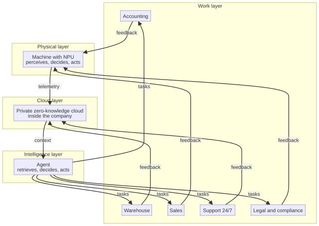

# Chapter 20 --- The Graph That Connects Everything

## The Name of the Whole

We have walked through every component of the sixth revolution in turn. It is time to give the whole its name, and to show it as it truly is: not a line, but a *graph* --- a set of connections in which every node feeds every other, in a continuous, self-coordinating whole. This is the **Industry 7.0** graph, and it is the shape of the future that this book has been describing from the first page. The number "7.0" is not arbitrary. The earlier revolutions made the machine more powerful, then more connected, then more computerized. The seventh, in the framing this book adopts, is the one in which the machines themselves become *peripherals of an internal AI*, and the AI --- agentic, connected to a private cloud --- automates the whole of the enterprise, from the machine to every department.

Let us draw the graph, carefully, because the graph is the essence of the argument and seeing it as a whole is the difference between understanding the sixth revolution and merely being impressed by its parts.

## The Graph

## A Curiosity: The Seven Bridges, and the First Graph

Before we read the graph, it is worth knowing that the word "graph", in this sense --- a set of points joined by lines --- has a surprising and rather playful origin, because the mathematics of graphs began not with engineering but with a puzzle. In the eighteenth-century Prussian city of Königsberg (today Kaliningrad, on the river Pregel), there was a river with two islands and seven bridges connecting the two banks and the two islands. The townsfolk amused themselves with a question: could one take a walk that crossed each of the seven bridges exactly once and return to the starting point? In 1736, the Swiss mathematician **Leonhard Euler** settled the question --- and he settled it in the negative, with a proof so clean that it is still taught today. But it was more than a solution to a parlor game: to answer it, Euler had to think of the landmasses as *points* and the bridges as *lines*, and to measure them not by their length or their material but purely by *how they were connected*. In doing so, he invented what we now call graph theory, and he gave us the very vocabulary of "nodes" and "edges" that we are using to describe the Industry 7.0 factory.

This is a curiosity worth holding, because Euler's insight is exactly the insight our graph depends on. The Industry 7.0 graph is not drawn to scale; it does not matter how "long" the connection between the machine and the cloud is, or how "wide" the warehouse node is. What matters, as Euler showed, is purely *how the nodes are connected* --- which node feeds which, in what order, and how the whole closes into a loop. The machine feeds the cloud; the cloud feeds the agent; the agent feeds the departments; the departments feed back. That is the entire argument, reduced to connections. The power of the graph is not in the nodes but in the *edges*, and not merely in the edges either --- it is in the fact that the edges, at last, *loop back*.

## Reading the Graph

Let us read the graph from the bottom up, and then see how it loops back.

At the **bottom** is the physical layer: the machine equipped with its intelligent chip, the single-board computer with the NPU that perceives, decides, and acts on one fanless, cheap board. This is the layer we met in Part II --- the machine that woke up. It is the anchor of the whole graph, because it is the point at which intelligence meets the physical world of making things.

Flowing upward from the machine is a stream of **telemetry**, encrypted in real time. This stream does not go to a public cloud; it goes, at the next level, to the **private, trustless, zero-knowledge cloud kept inside the company** --- the cloud of Part III, which receives and keeps the data without ever being able to read it, because the company holds the key. This is the memory of the system, consistent and searchable across the whole company, and safe from every third party.

From that cloud, the agent --- the **agentic AI** of Part V --- retrieves the precise, relevant context, both from the cloud and from the company's own knowledge base. The agent decides what to do and acts. And its action is the **automation of the departments**: accounting, warehouse, sales, marketing, customer support, legal, and compliance. These are the nodes at the top of the graph --- the work that the sixth revolution finally automates, the office that keeps working after the lights go out.

## The Loop Back

Now the crucial part, the part that makes it a *graph* and not merely a pyramid. The automation of the departments does not end the story; it *feeds it back*. The accounting that reconciles an invoice generates a new requirement. The warehouse that orders a spare part generates new telemetry. The sales that analyzes a market generates a new plan. And all of these requirements, feedbacks, and new data flow *back down* to the machine and the cloud, informing the next cycle of perception, the next cycle of memory, the next cycle of decision and action. The graph is closed. The system is self-coordinating.

This is the "7.0" in Industry 7.0: not a new kind of machine, but a new *architecture* in which the machines become peripherals of an internal AI, and the AI --- agentic, connected to a private cloud, knowing the business --- automates the whole enterprise, in a continuous loop. The machine thinks; the cloud remembers; the agent decides; the office acts; and the act loops back to inform the next thought. The whole is greater than the sum of its parts, because the whole is a *loop*, and a loop keeps its own momentum.

## The Two Kinds of Intelligence in the Graph

One last reading of the graph, because it ties back to Part IV. The graph contains both kinds of intelligence we have met --- the guessing mind and the deterministic mind --- and it places each where it is safe: the **sensing** at the bottom (the machine that perceives) is the guessing mind, perfect for perception; the **decision and specification** in the agent and the cloud is the deterministic mind, certain and traceable. The graph is not a single intelligence; it is a *combination*, each mind in its proper place, and it is this combination that makes the whole trustworthy in the places where trust is non-negotiable.

## The Whole in One Breath

It helps, on a graph, to read it as a single movement, so that the shape is not merely seen but followed. Let us read the whole thing, from the machine to the office and back, in one breath. At the bottom, a spindle on a factory floor carries a chip that perceives its world --- the temperature of its bearing, the vibration of its motor --- and predicts, from that perception, that the bearing will fail. That prediction flows, encrypted, to a private, trustless, zero-knowledge cloud kept inside the company, which receives and keeps it without ever being able to read it, because the company holds the key. From that cloud, an agent retrieves the precise, relevant context --- the machine's history, the company's maintenance notes, the deterministic decisions that must be certain --- and it decides that the bearing is genuinely failing, and places an order for the spare. The order flows to the warehouse, which now knows, automatically, and to accounting, which reconciles the invoice, and to sales and support, which know the delivery date. And all of that --- the order, the invoice, the delivery --- flows *back* down to the machine and the cloud, informing the next cycle of perception, the next cycle of memory, the next cycle of decision and action. The graph is closed. The system is self-coordinating. The whole is greater than the sum of its parts, because the whole is a *loop*.

## Why 7.0 and Not 6.0

It is worth answering, plainly, the question the chapter name raises: why "7.0", and not a number closer to the rest of the story? The answer is that the number names an *architecture*, not a machine. The earlier revolutions made the machine more powerful, then more connected, then more computerized --- and each of those steps could have been counted as "6.0" or "6.1", because they were the same revolution, simply getting stronger and faster. The seventh, in the framing this book adopts, is a *different kind of thing*: it is the revolution in which the machines themselves become *peripherals of an internal AI*, and the AI --- agentic, connected to a private cloud, knowing the business --- automates the whole of the enterprise, from the machine to every department. It is not that the machines became more powerful; it is that they became *something new* --- peripherals of an AI that thinks, connects, and knows. That is a new architecture, and it earns a new number. The "7.0" is not arbitrary; it marks the moment the factory stopped being a collection of smart machines that happen to sit near one another, and became a single, self-coordinating system.

## Why a Loop, and Not a Chain

The most important thing about the graph is not that it has four layers, but that it *closes*. And it is worth understanding why the closure matters so much, because the old factory was also a kind of graph --- a *chain* --- and the difference between a chain and a loop is the difference between a factory that can only be told what to do and a factory that can think about what it is doing.

The old factory was a chain: raw material entered at one end, and a finished product came out the other, and every step was a link that passed the work along to the next. Taylor's assembly line, which we met in the timeline, was the purest expression of the chain --- a linear sequence of small, repeatable steps, each one feeding the next, none of them looking back. The chain was brilliantly efficient at one thing: *doing the same thing, faster*. But it had a structural weakness that no amount of efficiency could cure. It could not *learn*, because nothing in a chain ever fed back. The output left the factory, and the factory never heard what happened to it. A defect discovered by a customer three weeks later could not inform the machine that made it, because the chain had no edge running backward.

The Industry 7.0 graph does have that edge. The departments feed back to the machine and the cloud, and that feedback changes the next cycle. A defect discovered by a customer becomes, through the agent, a new requirement that reaches the machine; a pattern in the maintenance logs becomes, through the same loop, a new prediction that prevents a future failure. The graph *learns from its own output*, and a chain never could. This is why the loop, and not merely the layers, is the essence of the seventh generation: it is the structure that lets the factory hear itself think.

## The Fragility of a Chain, the Resilience of a Loop

There is a second, quieter reason the loop beats the chain, and it is about what happens when something goes wrong. A chain is *fragile at its weakest link*: if any single step in the linear sequence fails, the whole product stops, because there is no other path from raw material to finished good. This is why an assembly line halts entirely when one station jams --- the chain has no detour, no redundancy, no alternative route.

A loop is more resilient, for the same reason Euler's bridges are interesting: what matters is *how the parts are connected*. Because the Industry 7.0 graph has multiple edges --- the departments feed both the machine and the cloud, the machine feeds the cloud and receives from it --- a failure at one point does not necessarily stop the whole system. The agent can route around a failed department; the cloud can serve a machine whose neighbour is down; the machine can act locally even when the cloud is briefly unreachable. The graph is not *immune* to failure, but it is *distributed* against it, in the way that a network is more resilient than a single road. This, too, is Euler's legacy: the shape of the connections decides the behaviour of the whole, and a graph with many edges is not merely more powerful than a chain --- it is more durable.

## The Name of the Lab

It would be honest not to name the work behind this graph. The whole chain --- the machine that thinks, the private cloud, the agentic AI, the automated office --- is being built, published, and refined by a small research lab, **AI Technology Graphene-Lab**, whose projects you have met throughout this book: the single-board intelligence, the trustless and zero-knowledge CloudServer, the deterministic AI of UISupportBlazor, and the agentic AgentBridge that knows your business and never forgets. This graph is their vision of the factory of the seventh generation, and it is the vision this book has been describing from its first page. The next part of the book turns to the human face of this graph --- the worker who is not replaced but promoted, and the worker who, in a new and literal sense, finally walks onto the floor. For now, let the graph stand: machine, cloud, agent, and department, connected into one self-coordinating whole.

