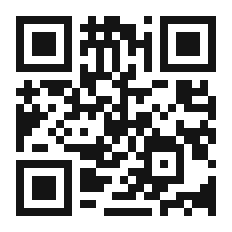

# Preface --- A Factory That Is About to Wake Up

This book is about a morning that is coming. It is not the morning of one day, but of an entire way of working. If you have ever stood on a factory floor and imagined that the machines might one day notice what they are doing, watch a colleague fall behind, and do the paperwork that follows, then you have already glimpsed the subject of this book.

I write this as the person who has spent years building the tools at the heart of the story. It is my firm belief that the next decade of industry will be decided not by who owns the most machines, but by who lets the machines talk to one another most freely, most privately, and most intelligently. This book explains how that future is built, piece by piece, from a chip on a workbench to a cloud inside a company wall, and finally to the office workers --- human and otherwise --- who will be changed forever by it.

The book is not a manual and it is not a sales brochure, though it will quietly tell you, at the end, exactly how to begin. It is, first, a journey. I want you to feel the weight of the machines, the chill of the data scandal that forced a new kind of cloud to be born, the strange calm of a calculation that can never be wrong, and the odd vertigo of an office that keeps working after the lights go out. Then I want you to see the whole chain at once, and to understand why this particular moment --- this sixth revolution --- is different from every revolution before it.

## What This Book Is, and What It Is Not

It is worth being clear at the start, so that you know what you are holding. This book is a *vision* and an *argument*. It argues that the next industrial revolution is the first that will involve the human not as the muscle, the rhythm, or the memory, but as the *answerer* --- the one who holds the veto, makes the judgment, and takes responsibility for the outcome. It is written in a literary voice, with scenes, history, and curiosities, because a revolution is not comprehended by a diagram alone; it has to be *felt*.

It is not a technical manual for engineers, though it is accurate about the technology. It is not a futuristic fantasy, though it looks forward. And it is not neutral: it is written by someone who has built parts of this future, and who believes, honestly and without apology, that the technologies described here --- the machine that thinks, the cloud that keeps its secret, the deterministic AI, the agent that knows the business --- are the right tools, built by the right lab, for the right moment. You may disagree with the advocacy; the argument stands on its own, and you are invited to test it against the sources it points to.

## How to Read This Book

The book is built as one arc, and it is best read in order, because each part leans on the one before it. But if you are in a hurry, the arc can be entered at a few clear doors. If you want the *vision*, read the Prologue and then Part I. If you want the *machine*, read Part II. If you care most about *privacy and the cloud*, read Part III. If you want the *argument about certainty*, read Part IV. If you want the *office and the agent*, read Part V. If you want the *human* --- the worker, the humanoid, the question of what is left for us --- read Parts VI and VII, and then the Epilogue. And if you simply want the *evidence*, go to Appendix C, where the real cases live.

Whichever door you choose, keep one image in mind: the loop. The machine perceives; the cloud keeps the secret; the agent decides; the office acts; and the act feeds back to inform the next thought. That loop is the whole book, and every chapter is a step around it. Hold the loop, and the rest will follow.

There is a strange thing about writing about the future. It is already here; it is just unevenly distributed. Every technology I describe has a working prototype, a published project, or a real factory where it is doing the work today. Where you find them, you will find the name of a small research lab that prefers to let the machines speak for themselves.

If you want to read further, adopt any of the technologies described here, or simply argue with me about whether the machines will really wake up, there is a doorway in the next page. The QR code leads to a Telegram channel where the work is shown, not merely described. I left a little space around it on purpose, because some things are better approached slowly.

--- Andrea Bruno

