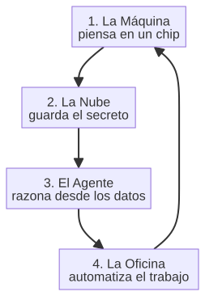

# Capítulo 1 --- Las revoluciones que formaron la tierra

## Los incendios

Toda revolución industrial comenzó con un incendio. No metafóricamente; la primera de ellas quemó carbón real, y las demás siguieron una lógica similar de combustión controlada. La revolución industrial es, en su base, una historia sobre humanos aprendiendo a concentrar energía y dirigirla adonde eligen. Antes de esa concentración, el trabajo se extendía tenuemente entre el humano y el músculo, la paciencia del clima, y la limitada resistencia de los animales de tiro. La riqueza de una nación era, literalmente, la suma de sus lomos y sus brisas. La revolución ocurrió en el momento en que una especie descubrió que podía almacenar energía --- en el vapor comprimido de una caldera, más tarde en el aceite quemado de un motor, más tarde en el río desviado de una red eléctrica --- y de ese modo salirse de los límites diarios de la grasa y el viento.

El relato clásico enseña cuatro revoluciones. La primera fue el vapor y la maquinaria, de unos 1760 a 1830. La segunda fue la electricidad y la línea de montaje, de unos 1870 a 1914. La tercera fue el cálculo y el internet, de unos 1960 hasta principios de los 2000. Nosotros, propone este libro, estamos de pie en la quinta --- llámela automatización e inteligencia --- aunque el número popular para ella es el seis, porque algunos narradores dividen la ola de la electricidad-y-cómputo en dos. La numeración no importa; importa el carácter de cada ola, y llegaré a ese carácter en breve. Por ahora, sólo fíjate en que cada revolución hizo algo que la anterior no podía hacer en absoluto, y lo hizo más rápido.

## Los incendios que lo cambiaron todo

Para sentir el peso de la primera revolución, ayuda pararse, por un momento, dentro de una mina antes del motor de vapor. A principios del siglo XVIII, las minas se volvían más profundas a medida que el carbón superficial se agotaba, y las minas profundas tenían un problema que ninguna cantidad de caballos de fuerza en la superficie podía resolver: el agua seguía entrando. Una mina que desciende eventualmente alcanza la tabla de agua, y una vez que el agua llega, la mina es inútil a menos que el agua pueda ser extraída a mano o por animales girando una rueda por turnos. Las minas se veían limitadas no por cuán duro podía cavar el humano, sino por cuánta agua podía sacarse antes de que el cavador se ahogara.

Thomas Savery, en 1712, y luego Thomas Newcomen, en 1712, construyeron motores de vapor --- toscos, derrochadores y monumentales --- cuyo único propósito era bombear agua fuera de las minas. Es fácil subestimar estos motores, que quemaban carbón para hervir una caldera, que empujaban un pistón, que elevaban agua, y que hacían casi otra cosa. Pero considera la lógica: una máquina que quemaba carbón para liberar más carbón. Era un único apetito, mecánicamente satisfecho, pero establecía la primera mandamiento de la revolución industrial --- *almacenar energía en el vapor, luego liberarla bajo demanda.* Y una vez que esa mandación se estableció, el resto de la historia siguió casi inevitablemente.

El motor de vapor no permaneció una bomba de agua por mucho tiempo. James Watt, trabajando en Escocia en los años 1760 y 1770, lo volvió útil para mucho más que bombear, al separar el condensador del cilindro y al convertir el movimiento rotatorio fuera del arriba-y-abajo del pistón. Con la mejora de Watt, el motor de vapor podía girar, y con el girar podía impulsar todo. Podía girar mil husos donde mil hombres podrían girar diez. Podía girar los grandes ejes de los molinos de las nuevas fábricas. El motor tenía un cuerpo enormemente potente, pero --- y aquí está el punto al que volveré una y otra vez --- todavía sin mente. Podía multiplicar la fuerza, pero no tenía opinión sobre qué husos girar, sin memoria de la demanda de ayer, sin plan para la reparación de mañana. Era un cuerpo enormemente potente con la mente de una roca muy paciente.

## La asociación que lo hizo real

Hay una curiosidad digna de registrar aquí, porque responde en silencio a la pregunta "¿por qué tardó tanto?" El condensador separado de Watt era un milagro de la física, pero un milagro de la física no es una revolución hasta que alguien está dispuesto a construirla. El propio Watt era un mal empresario, y su motor, en su forma más temprana, apenas funcionaba y apenas se vendía. Lo que volvió el motor en una industria no fue un mayor insight de la física sino un mayor insight de la *manufactura*: la asociación entre Watt y Matthew Boulton, cuya fundición Soho en Birmingham podía realmente fundir y mecanizar el hierro pesado y propenso a fugas que un motor de vapor exige. Watt proveía la idea y la patente; Boulton proveía el capital, el taller, y la terquedad para seguir construyendo motores que seguían rompiéndose hasta que funcionaban. La firma de Watt y Boulton dirigió el negocio del motor de vapor durante décadas con pérdidas antes de que rentara, precisamente porque la cosa era tan difícil de fabricar.

La lección es útil para más tarde, cuando conozcamos la sexta revolución: una idea nunca es el cuello de botella. El cuello de botella es siempre el *cuerpo* --- la capacidad de construir la cosa, de confiar en la cosa, de escalar la cosa. El vapor tenía el problema del cuerpo sin mente resuelto para 1800. La revolución de la inteligencia tiene su propio problema de cuerpo que aún se está resolviendo, y vale la pena recordar de quién era el trabajo de resolver el primero.

## La revolución encogió el continente

El motor de vapor no se detuvo en la fábrica. Una vez establecido el principio --- almacenar energía en el vapor, liberarla bajo demanda, y usarla para lo que elijas --- el mismo motor que drenaba las minas pronto se pidió que hiciera algo que ninguna máquina superficial había intentado jamás: moverse. Richard Trevithick corrió la primera locomotiva de vapor ferroviaria a escala completa en 1802, y George Stephenson, con su *Rocket*, ganó los Ensayos Rainhill de 1829. En octubre de ese año la *Rocket* tiró de un tren por la línea Liverpool a Manchester, y en septiembre de 1830 esa línea se abrió como el primer ferrocarril interurbano de pasajeros completamente movido por vapor del mundo. Este es uno de esos datos que sólo se entienden si sientes su peso. Antes de una locomotiva, una nación era una colección de pueblos que no podía alcanzarse uno al otro más rápido de lo que los caballos podrían trotear --- días entre ciudades que se encuentran a cien millas de distancia, bienes que se pudren en el camino, una economía que no podía ser nacional porque un país es, geográficamente, simplemente demasiado grande para atravesarlo rápidamente.

El vapor encogió el continente. El ferrocarril hizo posible por primera vez una sola economía nacional, al convertir la distancia en un número medido en minutos en vez de días. Es un dato pequeño y extraño que el mismo principio que drenaba una mina --- energía concentrada liberada bajo demanda --- sea también lo que hizo al mundo moderno *cercano*. La distancia murió, y con ella el aislamiento que había definido la vida humana durante diez mil años. Cada revolución industrial concentró un recurso distinto: el vapor concentró la fuerza, la electricidad concentró una corriente, y el cálculo concentró la información. El vapor, al menos, también concentró *el lugar*, doblando el continente de modo que dos ciudades a un día de cabalgata de distancia eran ahora una tarde de viaje en tren.

## El hilo humano

Lo que las cuatro revoluciones previas tenían en común --- y este es el hilo que este libro tirará hasta el mismo final --- es que todas hicieron del humano el último eslabón de la cadena. El motor de vapor era operado por un humano. La línea de montaje era compasada por un humano. La computadora era alimentada por un humano, y sus resultados leídos por un humano. En cada caso la máquina podía multiplicar la fuerza, el ritmo, y la memoria, pero no podía, por sí sola, cerrar el ciclo entre notar una cosa en el mundo y hacer algo al respecto. El humano se paraba al final de cada proceso, el juez final y la mano final. La máquina pensaba --- en el sentido estrecho en que una máquina de esa época podía pensar --- pero el humano actuaba.

Y eso estaba bien, y fue próspero, por mucho tiempo. Las revoluciones previas elevaron la vida humana tan dramáticamente --- la esperanza de vida se duplicó, la salida por trabajador se multiplicó, los bienes que una vez sólo pertenecían a los reyes se volvieron lo suficientemente baratos para todos --- que nadie se detuvo a preguntar si el último eslabón también podía ser automatizable. Simplemente parecía obvio que el humano al final de la cadena era el punto de la cadena, la razón por la que la energía se estaba concentrando en primer lugar.

Hay un pequeño anecdota útil aquí. Cuando el telar mecánico se extendió por Inglaterra a principios del siglo XIX, los trabajadores que tejían tela a mano no sólo protestaron; destruyeron los telares. Eran los luditas --- a menudo recordados erróneamente como reaccionarios anti-tecnología, cuando en realidad muchos de ellos eran artesanos expertos viendo desaparecer su oficio, y su sustento, en una noche. Los luditas estaban equivocados sobre el futuro, pero no estaban equivocados en que un futuro se acercaba que no los necesitaría. Su ira no era tonta; era simplemente prematura. Cada revolución industrial ha producido luditas cuya ira era lógica en el momento y equivocada a largo plazo. La sexta revolución los está produciendo ahora, y sus ludites se preocupan por algo aún más nuevo: no la pérdida de sus músculos, sino la pérdida de sus mentes.

## La revolución hizo una clase

Hay una cosa más que cada revolución hizo, y es fácil de pasar entre los motores y el código. Una revolución no sólo cambia máquinas; cambia *a las personas* en nuevos tipos de personas, y reorganiza el mapa para contenerlas. La revolución industrial no sólo construyó fábricas --- creó dos nuevas clases, los dueños de las fábricas y las personas que trabajaban en ellas, y las sacó de la aldea y las metió en la ciudad. Antes del vapor, el trabajo se extendía tenuemente por el campo: un tejedor en un telar en una cabaña, un agricultor en su campo, un herrero en su taller. El vapor, y las máquinas que impulsaba, exigían *concentración*. Las personas tenían que reunirse adonde estaba la maquinaria, y así la ciudad de molino --- y luego la gran ciudad industrial --- creció casi en una noche alrededor del molino que les daba su trabajo y su nombre. Es por eso que la ciudad moderna, con sus ferrocarriles, sus alcantarillas, sus multitudes y su humo, es en sí misma un producto de la primera revolución, no sólo un trasfondo de ella.

Vale la pena contener esto en la mente, porque la sexta revolución está haciendo lo mismo con un tipo diferente de trabajo. Está reuniendo a los trabajadores --- no a un molino, sino a un *sistema* --- y está creando nuevos tipos de personas que no existían hace una década: el ingeniero de datos, el supervisor de agentes, el que mantiene a la máquina honesta. Las máquinas cambian; las personas cambian con ellas; y el mapa cambia para contenerlas. Cada revolución industrial, al final, es una historia sobre un nuevo tipo de ser humano, hecho posible por un nuevo tipo de máquina.

> **Una curiosidad.** La palabra para la nueva clase trabajadora no es accidental. Antes de las fábricas, la mayoría de la gente cultivaba, o comerciaba, o servía. El *proletariado* --- del latín *plebs*, el pueblo común --- y la misma idea de "un trabajador" como categoría social distinta, son productos de este momento. Incluso el lenguaje de la época tuvo que ser inventado para describirla: el silbato de la fábrica, el día laboral, el turno, la huelga. Una revolución no sólo cambia lo que las personas hacen; cambia las palabras que necesita para hablar sobre lo que hacen. La sexta revolución ya está inventando su propio vocabulario --- el aviso, el agente, la barrera de contención, la ventana de contexto --- y en una década no recordaremos un día sin ellas.

## La ruptura

La quinta y la sexta revolución son diferentes porque apuntan a ese último eslabón. No piden multiplicar el músculo de un humano, o su ritmo, o su memoria. Piden multiplicar el juicio de un humano y llevar ese juicio hasta el final hacia el mundo, hacia la acción, sin detenerse en un humano que decide. La máquina notará la falla, razonará sobre ella, decidirá la respuesta correcta, hablará con la nube, despachará la respuesta a través de una oficina, y en las fábricas más nuevas incluso caminará hacia la falla en un cuerpo metálico y la reparará. El ciclo se cierra. El humano ya no es el último eslabón; el humano es el arquitecto de un sistema que puede terminar lo que empezó.

Es por eso que la numeración --- quinta o sexta --- se siente tan diferente de las demás. Las revoluciones anteriores extendieron lo que un humano podía hacer. Esta extiende lo que un humano puede decidir y luego llevar hasta el final, sin manos intervinientes. Es la diferencia entre una herramienta que hace a un trabajador más rápido y un sistema que hace a un trabajador un conductor.

## Un pequeño mapa del camino por delante

Antes de viajar, ayuda conocer el territorio. La cadena que hace posible la sexta revolución tiene cuatro componentes, y aparecen en este libro en el orden en que deben ensamblarse:

El primer eslabón, la máquina que piensa, es el tema de la Parte II. La segunda, la nube privada, es la Parte III. La tercera y cuarta, el agente de razonamiento y la oficina automatizada, son la Parte V. Entre ellas se asienta la Parte IV, que pregunta la pregunta más importante de toda la historia: no cómo construir inteligencia, sino qué tipo de inteligencia una fábrica puede confiar con su propia seguridad. Volveremos a eso, y vale la pena saberlo ahora que la respuesta es lo que hace a esta revolución --- y a este libro --- distinta de todo lo que vino antes.

## La pregunta de la numeración

Vale la pena detenerse en el número, porque los lectores lo encontrarán y es honesto abordarlo. El término popular para la ola actual es la "sexta revolución industrial," pero los historiadores de la tecnología discrepan, y la discrepancia es en sí misma informativa. Algunos narradores cuentan cinco revoluciones, terminando con la automatización; otros dividen la ola digital y cuentan seis; unos pocos cuentan sólo tres o cuatro y doblan todo en "la revolución digital." El número que elijas dice más sobre tu método que sobre el mundo.

Hay, sin embargo, un marco que es útil para este libro, y va así. Cada revolución puede caracterizarse por el recurso dominante que domó: la primera domó el vapor (energía térmica almacenada), la segunda la electricidad (energía eléctrica almacenada fluyendo por los cables), la tercera el cómputo y el internet (información almacenada y transmitida), y la cuarta (en este marco) la automatización y la robótica (máquinas que actúan sin dirección humana continua). La quinta, en el marco que adopta este libro, es la inteligencia --- máquinas que perciben, deciden, y coordinan; la sexta es la *integración* de esa inteligencia en un todo auto-coordinado, la fábrica de la Industria 7.0 que conoceremos en la Parte V. Bajo esta lectura, la sexta revolución no sólo es "más inteligencia"; es el momento en que la inteligencia deja de ser una característica de las máquinas individuales y se convierte en el tejido conectivo de toda una empresa. Esa es la distinción que este libro defenderá desde la primera página hasta la última.

## Por qué importa la historia a un lector

Quizá te preguntes, justamente, por qué un libro sobre el futuro de la automatización industrial dedica un capítulo a mirar hacia atrás. La respuesta es que la historia no es un lujo aquí; es una herramienta de decisión. Cada generación de IA ha prometido más de lo que entregó, y conocer el patrón te hace más difícil de engañar. Cuando un proveedor te dice que su producto "transformará tu fábrica con IA", la palabra "transformar" se ha usado durante doscientos años, y cada uso anterior se refería a una revolución que era real pero más estrecha de lo que el marketing sugería. La persona que entiende el patrón está mejor equipada para separar la revolución genuina del hype rebautizado.

Además, los fracasos se repiten con nuevo vocabulario. Cada vez que IA se estancó, se estancó por una razón nombrable: no suficientes datos, no suficiente poder de cómputo, o un problema más difícil de lo que parecía. Esos mismos tres razones todavía deciden si tu propio proyecto de adaptación funciona. La persona que ha visto el patrón una vez lo verá de nuevo; la persona que sólo ha oído el último hype se sorprenderá la segunda vez. Este libro te armará con el patrón, de modo que cuando se hagan las promesas de la sexta revolución, puedas juzgarlas contra las revoluciones que vinieron antes.

Ayuda tener un caso concreto en la mente, porque "los fracasos se repiten" es más fácil de recordar cuando puedes nombrar la última vez que pasó. El siglo XX tuvo sus propios inviernos de inteligencia artificial. A finales de los años 1960, un puñado de los científicos de cómputo más prominentes de la época anunciaron, con real autoridad, que una máquina de pensar de propósito general estaba "al alcance" dentro de una generación; cuando las máquinas no llegaron --- porque la memoria era demasiado pequeña, el cómputo demasiado débil, y los problemas demasiado no estructurados para los algoritmos disponibles --- siguió una desilusión. Un reporte de 1973 en Inglaterra concluyó que el campo había prometido de más, y la financiación de investigación se secó durante años. Luego, a medida que el hardware y los algoritmos y los datos eventualmente alcanzaron, el campo regresó, más fuerte que antes, a su promesa original. El patrón no es que los científicos eran tontos; es que eran *tempranos*, y temprano es indistinguible de equivocado hasta que el tercero de los tres ingredientes faltantes --- cómputo, datos, o un algoritmo adecuado --- finalmente aparece. La persona que ha observado un invierno aprende a hacer una sola pregunta tranquila a cualquier nueva promesa: *cuál es el ingrediente faltante que hará esto posible, y cuánto tiempo hasta que ya no falte?* Esa pregunta es toda esta capítulo.

Demémonos ahora comprimir toda la arco en una línea de tiempo compacta, de modo que el paso a cada revolución llegó sea visible, y de modo que la lentitud distintiva de la revolución de la inteligencia --- y su aceleración súbita y reciente --- puedan verse en una sola mirada. Ese es el tema del siguiente capítulo.
