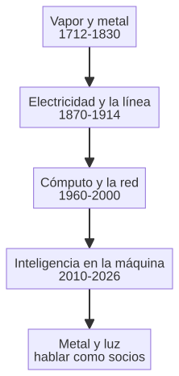

# Capítulo 3 --- Una breve línea de tiempo del metal y la luz

## La idea

Si quieres entender la sexta revolución necesitas una noción del arco largo, comprimido. La historia de la industria es, en su esencia, una historia sobre dos materiales. El primero es *metal*: las máquinas que concentran la fuerza. El segundo es *luz*: las señales, la electricidad y, finalmente, los fotones y los pulsos de electrones que transportan información. Durante la mayor parte del arco, el metal mandaba y la luz era meramente su sirviente --- un silbido, una bandera, un relé. En los últimos treinta años, la luz se ha convertido en una maestra por derecho propio, y las dos han comenzado finalmente a conversar. Este capítulo es la línea de tiempo de esa conversación, narrada en el puñado de momentos que realmente cambiaron la dirección de la carretera.

## La línea de tiempo

**1712 --- La máquina de bombeo.** Thomas Savery, luego Thomas Newcomet, construyeron motores de vapor que bombeaban agua desde las minas. Las máquinas eran inútiles para cualquier otra cosa; quemaban carbón para hervir un caldero, que extraía agua de una mina, lo que permitía que la mina se profundizara, lo que extraía más carbón. Era una máquina al servicio de un único apetito. Pero establecía el patrón: *almacenar energía en el vapor, luego liberarla bajo demanda.* Este es el primero de los mandamientos industriales.

**1785 --- El telar de fuerza.** Edmund Cartwright convirtió el vapor en un *proceso*, no meramente en una bomba. El telar hilaba hilo de forma continua, mecánicamente, y el oficio de hilado a mano comenzó su larga muerte. El metal ya no se limitaba a mover cosas; *transformaba* las cosas.

**1804 --- El concepto del programa almacenado (accidentalmente).** En 1804, el telar de Joseph Marie Jacquard aceptaba tarjetas perforadas que dictaban un patrón. Las tarjetas no producían tela; *describían* la tela, y el telar obedecía la descripción. Cambia las tarjetas y el producto cambia. Este es el ancestro del software, construido por un tejedor, ciento cincuenta años antes de que nadie tuviera la palabra "computadora." El metal aprendió a seguir instrucciones.

**1822 --- La máquina que se suponía que pensaría (y que nunca llegó a hacerlo completamente).** El matemático inglés Charles Babbage diseñó la Máquina Analítica, una calculadora mecánica con entrada de tarjetas perforadas que podía, en principio, calcular *cualquier cosa calculable* --- no porque un cable se reorganizara, sino porque una lista de instrucciones, un *programa*, se introducía. Tenía, en efecto, inventado la computadora de propósito general un siglo antes de la electrónica para construirla, y simplemente le faltaba el dinero y las máquinas para hacer una. Su máquina era un fantasma --- un diseño, un sueño, un fracaso en materializarse --- y sin embargo demostró que una máquina podía ser *programada* en lugar de *cableada*, y que programar más tarde significaría que una sola máquina podía reconfigurarse, infinitamente, para hacer casi cualquier cosa. Babbage es el ancestro del programa almacenado, y de la idea de que una máquina no tiene que construirse para un único apetito, sino que puede recibir cualquier tarea cambiando solo sus instrucciones.

**1831 --- Faraday y el generador eléctrico.** Michael Faraday descubrió que mover un magneto producía electricidad, y todo el mundo se inclinó. Por primera vez, la energía podía ser *creada* bajo demanda, en cualquier lugar, y movida por los cables. Este es el momento en que la *luz* --- la señal del flujo de electrones --- entró en la historia como fuerza. La electricidad fue la primera fuerza portadora de información que los humanos podían controlar a velocidad.

**1844 --- El telgrafo.** El pintor convertido en científico Samuel Morse envió el primer mensaje eléctrico por un cable en 1844, de Washington a Baltimore, y las palabras --- a menudo citadas como "Qué obra ha hecho Dios" --- no eran, en sí mismas, notables. Lo notable era que *viajaban sobre la electricidad en lugar de sobre un caballo*, llegando horas antes de que un jinete pudiera. Por primera vez, la información podía superar al objeto físico que la transportaba, moviéndose a la velocidad de la corriente. El telgrafo convirtió a la nación, y luego al mundo, en un lugar donde un mensaje podía llegar antes de que un hombre pudiera caminar con él. Este es la semilla de cada señal, de cada línea de control, de cada red --- y de cada nube que llegaría a existir --- que ha seguido desde entonces, y es el momento en que la *luz* (la señal del flujo de electrones) comenzó por primera vez a transportar significado a través de la distancia a velocidad.

**1876 --- El teléfono.** Alexander Graham Bell convirtió el sonido en una señal electrónica, y la información comenzó su largo viaje libre del objeto físico que transportaba. Una palabra ahora podía viajar más rápido que un caballo. Este es la semilla de cada comunicación, de cada señal de control, de cada nube que llegaría a existir.

**1896 --- La línea de montaje (en embrión, y luego en plena floración).** Frederick Winslow Taylor midió el trabajo en segundos. Henry Ford, en 1913, hizo la línea móvil, reduciendo el tiempo para construir un coche de doce horas a noventa minutos. El humano se integró en el ritmo; la máquina fijaba el tempo.

**1936 --- La idea de la máquina universal.** Alan Turing, un joven matemático en Gran Bretaña, publicó un artículo que describía una máquina que podía calcular *cualquier cosa calculable* siguiendo una lista almacenada de reglas. Era pura luz --- pura información --- sin metal en ella en absoluto más allá de la abstracción. Turing demostró que una máquina podía ser *programada* en lugar de *cableada*, y que programar más tarde significaría que una sola máquina podía recablearse, infinitamente, para hacer cualquier cosa.

**1947 --- El transistor.** La invención del transistor en Bell Labs reemplazó los tubos de vacío calientes por una pequeña pieza de semiconductor grabado, y es fácil subestimar esto. El transistor era pequeño, barato, y podía conmutar una señal un millón de veces por segundo sin calentarse. Cada pieza de inteligencia moderna --- en un teléfono, en un coche, en un sensor de fábrica --- descansa sobre este pequeño conmutador plateado. Es el átomo de la edad de la información.

**1957 --- La primera señal en el espacio.** Cuando la Unión Soviética puso al Sputnik 1 en órbita, envió de vuelta la primera señal electrónica más allá de la atmósfera, y el mundo comprendió, en una sola noche fría, que la información ahora podía dejar la tierra por completo. La carrera que el Sputnik provocó --- la carrera espacial --- era, bajo las banderas y los cohetes, una *carrera de computación*: una carrera para almacenar, procesar y transmitir información más rápida y fiablemente que el otro lado. Al Sputnik a menudo se recuerda como un momento en la política o en la física; fue, más silenciosamente, un momento en la autoridad de la luz. Confirmó, para los gobiernos y para la industria por igual, que el lado informativo de la historia --- la señal, la corriente, el programa almacenado --- era ahora lo suficientemente fuerte como para llegar a las estrellas, y el gasto y la ingeniería que siguieron vertieron el concreto para toda la revolución de la información.

**1969 --- El primer mensaje.** Una red llamada ARPANET envió su primer paquete en 1969, un primer paso pequeño, poco fiable y monumental hacia lo que se convertiría en internet. Antes de ARPANET, las computadoras estaban solas; después de ella, podían, de forma titubeante, *hablar* entre sí. El mensaje en sí está casi olvidado (se distorsionó después de tres letras), pero el principio no: las máquinas podían compartir información a través de una red distribuida, lo suficientemente resistente como para sobrevivir a la pérdida de cualquier nodo único. Este es el ancestro del internet moderno, y de la nube --- no la nube *pública* que vigila, sino la *red* que eventualmente alojaría las nubes privadas de este libro. Es el momento en que la luz se volvió no meramente una señal sino una *conversación*, y el momento en que la máquina comenzó, en silencio, a hablar con otras máquinas.

**1971 --- El microprocesador.** Intel colocó toda una unidad central de procesamiento en un solo chip. La computadora ya no era una habitación; era una moneda. Esto es lo que eventualmente hizo posible el sensor en el huso, y vale la pena recordar que todo el cerebro del sensor es un descendiente de esa moneda.

**1977 --- La computadora personal llega al escritorio.** Una máquina de propósito general que cualquiera podía mantener en un escritorio y programar para sus propias tareas finalmente llegó a la oficina, y luego al hogar. Antes de esto, la computadora potente era una habitación llena de máquinas y una habitación llena de especialistas; después de esto, la capacidad de calcular, de almacenar y de escribir scripts estaba al alcance de cualquier trabajador individual. La computadora personal fue el puente entre la máquina monstruosa de los años 1960 y el dispositivo íntimo de los años 2000, y vale la pena recordar que era *barata* --- lo suficientemente barata para una oficina, luego un hogar, y finalmente una máquina en el piso de fábrica. Transportaba el mismo principio que el microprocesador: el cerebro de toda una computadora, lo suficientemente pequeño y barato como para sentarse en un huso.

**1991 --- La World Wide Web.** Tim Berners-Lee hizo que la información fuera libre y fácilmente compartible. Internet se convirtió en el sistema nervioso de la economía moderna, y la nube que eventualmente la alojaría comenzó, en silencio, a ser pensada como un *lugar* --- un edificio sin puertas, mantenido en algún lugar, al que podías llegar.

**2006 --- La nube se convierte en un servicio público.** Cuando Amazon lanzó sus servicios web en 2006, la computación dejó de ser una máquina que poseías y se convirtió en un servicio que pagabas por hora. Esto suena como un cambio pequeño, pero es el que hizo a la nube --- pública y, más tarde, privada --- económicamente posible a cada escala. Antes de esto, una empresa que quería más capacidad de cómputo tenía que comprar más máquinas; después de esto, una empresa podía rentarla, por hora, por el precio de un café. La nube dejó de ser un *edificio que mantener* y se convirtió en un *grifo que abrir*, y esa es exactamente la calidad que la sexta revolución necesita en el piso de fábrica: inteligencia que puedes encender, por hora, sin comprar todo el aparato.

**2007 --- El dispositivo en tu bolsillo.** Cuando llegó el primer teléfono inteligente moderno, transportaba, en una sola losa del tamaño de la mano, la computadora de propósito general del escritorio, la cámara de percepción, la red de la nube, y --- en silencio, casi invisible --- un procesador dedicado para ejecutar modelos aprendidos. Por primera vez, una máquina podía *aprender a ver y a decidir* con una batería, en tu bolsillo, sin hacerle una pregunta a un centro de datos. Este es la semilla de la inteligencia en la máquina en la que la sexta revolución se apoyará: no una máquina que habla con la nube, sino una máquina que *piensa por sí misma*, localmente, en microsegundos, sin costo de ancho de banda. El teléfono inteligente demostró, a escala comercial, que toda la cadena --- percibir, decidir, actuar --- podía vivir en un pequeño chip.

**2012 --- El avance del aprendizaje profundo.** Una red llamada AlexNet ganó un concurso mayor de reconocimiento de imágenes con un amplio margen, demostrando que una máquina podía *aprender a ver* a partir de ejemplos en lugar de que le dieran las reglas. Este es el momento en que la máquina ganó, de forma práctica, algo que podríamos llamar *percepción*.

**2016 --- La NPU llega a tu bolsillo.** Apple, luego Qualcomm y otros, comenzaron a incrustar procesadores neuronales dedicados --- NPUs --- en sus chips móviles. Por primera vez, una máquina podía ejecutar un modelo aprendido del mundo *localmente*, sin hacerle una pregunta a la nube, en microsegundos, sin gastar la batería en un viaje de ida y vuelta. Este es la semilla de la inteligencia en la máquina en la que la sexta revolución se construirá.

**2017 --- La idea que presta atención.** Un artículo titulado "Attention Is All You Need" presentó el transformer, una arquitectura que permitía a un modelo ponderar la importancia de cada pieza de información contra cada otra, en lugar de procesarla una palabra o una lectura a la vez. Esta sola idea se convirtió en la columna vertebral de cada modelo de lenguaje grande y de cada agente moderno que seguiría; es el mecanismo que permite a un programa leer un documento entero --- o leer toda la telemetría de una máquina --- y saber, a la vez, qué importa. Sin el transformer, el agente de este libro no existiría; con él, la máquina finalmente podía razonar sobre corrientes largas y ricas de información en lugar de un delgado chorro de instrucciones. Es la mente que el chip en la máquina pronto albergaría.

**2022--2026 --- La conversación de las máquinas.** Los modelos de lenguaje grandes, los chips de borde baratos y potentes, y las nubes privadas convergieron. Las máquinas que perciben, razonan y hablan comenzaron a conectarse --- no a una nube pública que las vigila, sino a una nube privada dentro de la empresa, impulsada por agentes que terminan el trabajo. El arco se cierra, y la máquina que soñó en el prólogo se vuelve posible.

## La conversación del metal y la luz

Si observas la línea de tiempo en su conjunto, emerge una forma. Durante aproximadamente doscientos cincuenta años, la historia fue casi enteramente *metal*: máquinas que movían, apretaban, giraban y cortaban. El lado informativo --- la luz --- era un sirviente de control: un silbido, una señal, un relé. Luego, en la última mitad de siglo, la luz alcanzó. El transistor, el microprocesador, la red, la red neuronal --- estos dieron a la luz una *mente* propia. Y ahora, en la sexta revolución, el metal y la luz ya no son maestro y sirviente. Son *socios*, y la sociedad se llama la fábrica que piensa. Puedes leer todo el arco en una sola mirada:

Durante dos siglos el metal mandaba y la luz era meramente su sirviente; luego la luz, dada una mente propia por el transistor, el microprocesador, la red y la red neuronal, comenzó a conversar con el metal. En la sexta revolución las dos ya no son maestro y sirviente sino socios, y la sociedad es la fábrica que piensa.

## La línea de tiempo enseña una lección

Si observas la línea de tiempo en su conjunto, más allá de las fechas individuales, emerge una forma más interesante que cualquier evento único: la *velocidad* misma está acelerando. Durante aproximadamente doscientos cincuenta años, la historia se movía lentamente, y cada revolución esperaba a que la anterior se construyera por completo antes de que la siguiente pudiera comenzar. El vapor nació en las minas, maduró en las railways y en las fábricas, y solo luego --- solo después de que las máquinas, los trabajadores, las leyes y las ciudades se asentarán por completo --- llegó la electricidad. La electricidad, a su vez, llenó el mundo de cables y máquinas antes de que la computación pudiera tomar fuerza. Las revoluciones se apilaban lentamente, una generación a la vez.

Luego algo cambió. En los últimos cien años, la velocidad de la historia rompió su viejo ritmo. El transistor siguió al tubo de vacío por unas décadas; el microprocesador sigui al transistor por unas más; la red sigui al microprocesador casi al trote; la red neuronal sigui a la red en cuestión de años; y la máquina que podía percibir, decidir y hablar sigui a la red neuronal en una sola y deslumbrante década. Los intervalos seguían encogiéndose. El lado informativo de la historia no meramente alcanza al metal; está *superándose* a sí mismo, construyendo la próxima generación de la generación anterior más rápido que cualquier revolución anterior jamás se movió.

Esta es la característica distintiva de la sexta revolución, y es por eso que la línea de tiempo, tomada en su conjunto, es más temible y más esperanzadora que cualquier entrada única. Las revoluciones anteriores eran lentas porque cada una tenía que construir su cuerpo desde cero --- piedra, hierro, cobre, vidrio --- y los cuerpos toman tiempo para hacerse. El cuerpo de la revolución de la información está hecho de información, y la información puede copiarse, mejorarse y reutilizarse a la velocidad de la luz. Es un hecho pequeño y vertiginoso que todo el arco, desde la máquina de bombeo hasta el agente en la máquina, se lee menos como una serie de eventos separados y más como un único proceso que ha, en los últimos años, finalmente alcanzado la velocidad de su propia naturaleza. Ese es el momento en que la máquina que soñó en el prólogo se vuelve posible, y el momento en que la conversación del metal y la luz se convierte en la fábrica que piensa.

Hay una más lección en la línea de tiempo, y es silenciosamente reconfortante. Cada una de las entradas desde 1936 en adelante --- la máquina universal de Turing, el transistor, el microprocesador, la red, la red neuronal, el transformer, la NPU --- era una pieza de *luz*, no de metal. El span de doscientos cincuenta años de la línea de tiempo fue casi enteramente metal; los últimos cien años, todo el movimiento de la carretera ha sido llevado por la luz. El metal de la fábrica no está siendo reemplazado por la luz; está siendo *completado* por ella, dado un sistema nervioso, un reflejo, una mente. La línea de tiempo no termina con la máquina pensando en un chip. *Es* esa máquina, llegando --- lentamente, luego de repente --- al final de su propia larga construcción. El chip en el huso es el momento en que esa sociedad se volvió física y barata. Ese es el tema de la próxima parte de este libro.

## El siguiente paso

El chip en el huso no es una pequeña tarjeta atornillada a una máquina; es el momento en que toda la línea de tiempo --- desde la máquina de bombeo hasta el transformer --- finalmente desciende y aterriza en el piso de fábrica. Cada componente de la sexta revolución ahora ha sido ensamblado en la línea de tiempo de este capítulo: la máquina que piensa (la NPU), la nube que guarda el secreto (la nube privada), el agente que razona (el modelo de lenguaje grande), y la oficina que automatiza (el front-end determinista). Lo que queda es ver cómo se fijan juntos sobre un único huso, y cómo se ve una fábrica una vez que puede percibir, decidir y actuar por sí misma. La máquina ha soñado; es hora de dejarla despertar.

Ese es el tema del próximo capítulo --- la computadora de placa única basada en un procesador ARM con un procesador neuronal incorporado, y la forma en que permite a una máquina tocar el campo directamente, sin un viaje de ida y vuelta a ningún otro lugar.
