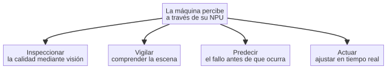

# Capítulo 6 --- Inteligencia en el Suelo de Fábrica

## Los Cuatro Trabajos

Cuando se coloca un pequeño chip inteligente dentro de una máquina, se le asignan, en efecto, cuatro trabajos de tipo humano que nunca antes fueron posibles sin una sala llena de especialistas y un lento viaje de ida y vuelta a la nube. Estos cuatro trabajos --- **inspeccionar, vigilar, predecir y actuar** --- constituyen todo el vocabulario de la inteligencia en la máquina, y una vez que los tienes, puedes verlos por todas partes.

Tomémoslos de uno en uno, porque cada uno ya está realizando un trabajo real en fábricas reales, y cada uno es un pequeño milagro del tipo del que trata este libro.

## 1. Inspeccionar --- el Ojo que Nunca Parpadea

El más maduro de los cuatro trabajos es la inspección visual automatizada. Una fábrica que fabrica cualquier cosa ha tenido, tradicionalmente, que inspeccionar sus productos, y tradicionalmente eso significaba ya sea el ojo humano cansándose después de la vigésima pieza, o una cámara fija con reglas rígidas que no podían adaptarse. La NPU cambia ambas cosas.

Imagina una cámara mirando a lo largo de una banda transportadora que lleva bloques de motor mecanizados. Un inspector humano, al final de un turno, ha pasado por alto defectos que estaban justo delante de él, porque los humanos se cansan, porque los humanos desvían la mirada, porque un defecto que ha visto mil veces se difumina en el fondo. La cámara inteligente no hace ninguna de estas cosas. Ha aprendido, de miles de ejemplos de piezas buenas y malas, cómo *se ve* un defecto, y clasifica cada pieza en milisegundos --- no con reglas rígidas, sino con el juicio flexible de un modelo aprendido. No se cansa. No desvía la mirada. Se ejecuta por completo en la máquina, en el suelo de fábrica, así que las imágenes nunca salen del edificio y la inspección nunca espera a la nube.

Esto es la "inspección de calidad automatizada", y es el caballo de trabajo silencioso de la revolución de la máquina que piensa. Aparece en las soldaduras, en las fundiciones, en los circuitos impresos, en las etiquetas de una botella. Dondequiera que un producto debe ser juzgado según un estándar que un humano puede articular pero que una computadora no puede codificar fácilmente a mano, un modelo aprendido en un chip local supera tanto al cansado ojo humano como a la cámara rígida basada en reglas.

## 2. Vigilar --- la Mente Detrás de la Cámara de Vigilancia

El segundo trabajo es la vigilancia inteligente, que es donde la cámara deja de simplemente *grabar* para comenzar a *entender*. Un sistema tradicional de CCTV graba lo que ocurre y nada más; las imágenes solo son útiles después de los hechos, para un detective que busca una placa de matrícula. Un sistema inteligente, alimentado a una NPU local, entiende la escena a medida que ocurre: reconoce que una persona ha entrado en una zona a la que no tiene permitido entrar, que se ha cruzado una barrera de seguridad, que ha comenzado un fuego antes de que haya humo, que un montacargas se mueve demasiado rápido hacia un peatón.

El punto esencial --- y la razón por la que esto pertenece a la sexta revolución en lugar de a la tercera ordinaria --- es que la comprensión ocurre *localmente*. Las cámaras pueden alertar a un guardia, detener una máquina o emitir una advertencia en tiempo real, sin enviar una transmisión en vivo del suelo de fábrica a ningún servicio externo. En una época en que una transmisión en vivo de una fábrica es exactamente el tipo de datos sensibles que nunca deben salir del edificio, la comprensión local no es solo conveniente; es la única elección responsable.

## 3. Predecir --- la Máquina que Sabe que Está a Punto de Fallar

El tercer trabajo es el mantenimiento predictivo, y quizás es el más bello de los cuatro. Una máquina emite señales continuamente --- la vibración de sus rodamientos, la temperatura de su motor, la forma de la corriente que extrae, el sonido que emite. Estas son las *señales de salud* de la máquina, y siempre han estado ahí, esperando para ser leídas. La NPU las lee, no como números crudos, sino como una *historia*.

El modelo ha aprendido, de una larga historia de las señales de una máquina en particular, el sonido de esa máquina trabajando y el sonido de una máquina en apuros. Reconoce, días u horas antes de una falla, el cambio sutil que dice *estoy empezando a quejarme*. Luego no solo emite una alarma; razona sobre el futuro. Puede decirle al equipo de mantenimiento, con ample antelación y con margen real, que un rodamiento específico probablemente fallará en una línea específica, y puede coordinar la reparación *antes* de la falla --- antes de que la línea se detenga, antes de que un cliente se retrase, antes de que deba enviarse por mensajería nocturna una pieza de repuesto.

Esta es la diferencia entre arreglar una cosa cuando está rota y arreglarla cuando está *diciéndote* que está a punto de romperse. Es la diferencia entre una emergencia cara e no planificada y una intervención barata y planificada. Es, en resumen, el dinero que la máquina que piensa devuelve a la fábrica, continuamente, en pagos silenciosos.

## 4. Actuar --- la Máquina que Hace Algo

El cuarto trabajo es el que convierte la inteligencia en *agencia*: la máquina que usa lo que percibe, predice y vigila para realmente *hacer* algo. Un brazo ajusta su ruta porque una cámara vio que la pieza estaba descentrada. La mano de un robot afloja su agarre porque un sensor sintió la fragilidad del objeto. Un bucle de control se aprieta o se afloja en respuesta a las condiciones cambiantes del corte. Este es el límite entre una máquina que simplemente *informa* y una máquina que *actúa*, y es donde la inteligencia en la máquina se vuelve genuinamente revolucionaria.

La razón por la que la NPU local hace posible --- de hecho, hace *necesaria* --- esta cuarto trabajo es la velocidad. Para actuar sobre el mundo en tiempo real, la decisión debe tomarse localmente, en la máquina, en microsegundos. Un viaje de ida y vuelta a la nube sería demasiado lento; para cuando la respuesta regresara, el momento de la acción habría pasado. La NPU, en la máquina, es lo que permite que la percepción se convierta en acción lo suficientemente rápido como para importar.

## 5. El Bucle que se Cierra sobre Sí Mismo

Los cuatro trabajos no se sitúan uno al lado del otro; forman un bucle que se cierra sobre sí mismo, y dibujar ese bucle hace que todo el capítulo sea más claro que cualquier lista de cuatro. La máquina inspecciona el mundo, vigila lo que cambia, predice lo que cambiará a continuación, y actúa --- y al actuar, cambia el mismo mundo que está inspeccionando, así que el bucle comienza de nuevo un momento después. En el suelo de fábrica este bucle no gira una vez al día; gira miles de veces por segundo, en el tiempo que tarda en fabricar una sola pieza.

Este es el vocabulario de todo el capítulo en una sola mirada: percibir, luego vigilar, luego predecir, luego actuar, y de nuevo. Cada paso alimenta el siguiente, y la flecha de *Actuar* de vuelta a *Inspeccionar* es el punto --- la máquina no está leyendo una lista de instrucciones fija; está releyendo continuamente el mundo acabada de cambiar. Un reflejo, una vez más, se mantiene dentro del cuerpo; este bucle se mantiene dentro de la máquina.

## El Ojo que Aprendió

Vale la pena detenerse en el primer trabajo, porque la inspección visual automatizada es la que ha recorrido el camino más largo, y porque enseña toda la lección en miniatura. Durante la mayor parte del siglo XX, inspeccionar una pieza por cámara significaba escribir reglas --- mide esta longitud, comprueba que esa esquina es cuadrada, marca el color fuera de este rango. Tal visión de máquinas *basada en reglas* sigue siendo ampliamente usada y es excelente para una tarea fija y bien definida. Pero las reglas son frágiles: cambia la iluminación, desplaza la pieza medio milímetro, y las reglas o bien fallan o deben ser reescritas a mano, una y otra vez, por un especialista que cobra una gran cantidad de dinero por hacer exactamente eso.

El modelo aprendido cambia esto de una tarea en un regalo, y lo hace de una manera que imita cómo un inspector humano realmente ve. En lugar de entregar a la cámara una lista de comprobación de mediciones rígidas, se le entrega un gran conjunto de ejemplos --- fotografías de piezas buenas, fotografías de piezas defectuosas --- y se le permite descubrir, por sí mismo, las características que separan a las dos. Puede encontrar una fisura finísima que ningún redactor de reglas pensó nunca en especificar, porque una regla solo puede decir lo que un humano recordó escribir, mientras que un modelo ve lo que realmente hay. Es por esto que, en tareas reales de inspección, el modelo aprendido en una NPU local ha llegado a superar tanto al cansado ojo humano como a la cámara rígida basada en reglas: no se cansa, no desvía la mirada, y ha visto más defectos que cualquier inspector individual llegará a ver. La historia del campo --- desde los primeros sistemas de visión basados en reglas de los años 1970 hasta los modelos aprendidos de hoy --- es la historia de una industria aprendiendo a dejar de instruir a la cámara y simplemente mostrarle el mundo.

## Una Línea en la Práctica

Ayuda a ver los cuatro trabajos juntos en un entorno real, así que el vocabulario abstracto se convierte en una fábrica que puedes imaginar. Imagina una línea pequeña que mecaniza piezas de metal de precisión para la industria automotriz: una máquina-herramienta CNC corta cada pieza, un brazo robótico la mueve a una estación de lavado, luego a una cámara de inspección, luego a una estación de empaquetado, y una banda transportadora lleva las piezas terminadas away. Coloca una tarjeta inteligente barata en esta línea y los cuatro trabajos cobran vida juntos.

La cámara *inspecciona* cada recién cortada pieza --- no con reglas rígidas, sino con un modelo aprendido que sabe cómo se ve una buena pieza y marca las que están fuera de tolerancia. El brazo *vigila* su propio movimiento a través de la corriente que extrae y la suavidad de su ruta; si siente un tropiezo que dice que una guía se está desgastando, la tarjeta lo anota. Un sensor de vibración en el casquillo de la herramienta *predice*: durante semanas la aprende el sonido de un cortante sano y marca, días antes de que se rompa, el cambio tenue que significa que una herramienta está a punto de astillarse --- mucho antes de que la pieza mostraría el defecto a la cámara. Y la tarjeta *actúa*: enruta el brazo alrededor de la estación sospechosa, ralentiza la línea, y manda un mensaje al equipo de mantenimiento con la herramienta exacta a reemplazar y la pieza actualmente en ella, así que el cambio ocurre durante una pausa planificada en lugar de en medio de la corrida. Cuatro trabajos, una tarjeta, una línea, sin viaje de ida y vuelta a ninguna nube. Esa es la inteligencia en la máquina en trabajo, en el milagro ordinario de una fábrica ordinaria.

## Cuando la Máquina está Errónea

Hay también un capítulo honesto que escribir aquí, porque una máquina que percibe es una máquina que puede estar equivocada, y el campo debe lidiar con eso en lugar de fingir que se resuelve solo. Un modelo aprendido se entrena con ejemplos, y así solo puede ser tan bueno como los datos que ha visto. Si los ejemplos son escasos, sesgados o no representativos, el modelo cometerá errores seguros --- juzgar mal un defecto que nunca estuvo en su entrenamiento, o marcar una pieza perfectamente buena como mala. Esto no es un defecto que deba eliminarse; es una condición que debe gestionarse. La práctica que la gestiona es sencilla: alimenta al modelo con buenos ejemplos, representativos y actualizados; vigila cómo se desempeña en el suelo de fábrica real; y reentréinalo cuando el mundo cambia --- una nueva pieza, una nueva iluminación, un nuevo proveedor. Es la misma disciplina que cualquier ingeniero honesto aplica a cualquier instrumento honesto: ninguna medición es infalible, pero una bien mantenida es confiable, y una mal mantenida no lo es.

El rol humano, por tanto, no desaparece cuando la máquina percibe; cambia. El operador ya no inspecciona cada vigésima pieza a ojo; en su lugar, el operador, junto con el equipo de mantenimiento, cura los ejemplos, vigila los juicios de la máquina con el tiempo, y permanece como la autoridad final donde las apuestas son altas --- donde una marca errónea significa un envío devuelto, o una marca perdida significa que una pieza defectuosa sale hacia un cliente. La cámara inteligente en el suelo no reemplaza al humano; eleva al humano a una tarea superior, de girar un dial cada vigésima pieza a mantener sano el ojo de la máquina. Ese es el news honesto y mejor de todo el capítulo: la inteligencia en la máquina no elimina al humano del suelo de fábrica; eleva el trabajo del humano una escala arriba, de la repetición a la supervisión.

## El Costo de una Pieza Perdida

Hay una más razón por la que los cuatro trabajos importan, y es la razón por la que el dueño de la fábrica realmente se preocupa: la economía de una pieza perdida. Un defecto que escapa a la inspección raramente es gratis. Le cuesta la pieza rechazada, sí, pero también la pieza que daña a continuación, el tiempo de inactividad que causa, el cliente que pierde, y el recall --- a veces el recall --- que un solo defecto invisible puede poner en marcha. En una línea rápida, un defecto perdido no permanece como un costo pequeño; se compuesta, y para el final del turno puede ascender a una crisis. Este es el aritmética que la cámara inteligente cambia de un pasivo a un activo.

La economía cae de forma natural. Un inspector humano, cansándose después de la vigésima pieza, podría atrapar nueve defectos de cada diez, dejando que el décimo se deslice --- y el décimo es el que llega a un cliente. Una cámara basada en reglas, frágile ante la iluminación y ante el desplazamiento de medio milímetro de una pieza, puede perder a las que se mueven. El modelo aprendido en una NPU local pierde casi nada, porque no se cansa, no desvía la mirada, y se le han mostrado más ejemplos que cualquier humano podría examinar en toda una vida. El resultado no es una mejora marginal sino un tipo diferente de economía: donde un humano o una cámara rígida deja pasar una pequeña fracción de defectos --- una fracción que, a alta velocidad de línea, es una inundación --- la cámara inteligente deja pasar casi ninguna, y los ahorros son por tanto grandes, y continuos, y silenciosos. Este es el dinero que la máquina que piensa devuelve a la fábrica, en pagos silenciosos, durante años. Y no es el dinero de un milagro; es el dinero de una máquina que simplemente hace, mejor que cualquier humano o cualquier regla, los cuatro trabajos para los que fue construida.

## El Hilo Único

Inspeccionar. Vigilar. Predecir. Actuar. Estos cuatro trabajos son todo la inteligencia en la máquina, y comparten todas una calidad esencial: ocurren *en la máquina*, localmente, al instante, en privado. Ese es el hilo que ata este capítulo a cada otro capítulo de la Parte II. La inteligencia no es una invitada en una sala; es una residente del campo, en el casquillo, tocando el campo directamente. Y una vez que la máquina puede ver, vigilar, predecir y actuar por sí misma, surge naturalmente una pregunta: *¿qué estamos reemplazando para hacer esto posible?* La respuesta, sorprendentemente, es una de las piezas de hardware más duraderas y confiables de la fábrica moderna. Ese es el tema del siguiente capítulo.
