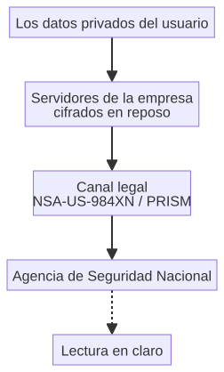

# Capítulo 10 --- Cuando la nube robó tu empresa

## La mañana en que el mundo cambió

El seis de junio de dos mil trece, dos periódicos --- *The Guardian* y *The Washington Post* --- publicaron, el mismo día, una historia que cambiaría silenciosa y permanentemente la forma en que el mundo pensaba en los datos. Durante años, una agencia estadounidense llamada la National Security Agency había estado ejecutando un programa para recolectar grandes cantidades de comunicación privada, y los documentos recién publicados revelaban no solo que el programa existía, sino que las grandes empresas tecnológicas *participaban* en él, entregando los datos de sus usuarios a la agencia. El programa tenía un nombre: **PRISM**.

Un hombre había dado a luz las historias. Su nombre era Edward Snowden, un contratista estadounidense que, el mes anterior, había volado a Hong Kong con documentos que lo cambiarían todo. Los periódicos que publicaron su parte de la historia, *The Guardian* y *The Washington Post*, más tarde compartirían el Premio Pulitzer de Servicio Público de 2014. Vale la pena recordar ese momento no porque esté lejos, sino porque es el momento en que la nube moderna --- la nube a la que este libro finalmente conectará la fábrica --- se volvió, para la mayoría de las personas, un lugar sobre el que se debe ser *cautelos*.

El día en que la historia estalló, la reacción no fue la fría y analítica de los ingenieros, sino la más cálida y aguda de quienes sienten que han sido traicionados. Un servicio que *elegiste* usar --- un servicio en el que confiabas precisamente porque era conveniente --- había entregado, sin tu conocimiento y sin tu consentimiento, tus mensajes privados a un gobierno. El sentido de traición es el punto: no nos importa que un estado *pueda* leer nuestra correspondencia; nos importa que lo hiciera, en silencio, a través de las mismas empresas en las que confiábamos para protegerla. Y esta distinción --- la diferencia entre una *capacidad* y una *traición* --- es todo el peso moral del datagate, y también es todo el peso moral del capítulo que sigue.

## El nombre italiano

En el mundo de habla inglesa el escándalo se conoce bajo varios nombres: PRISM, la NSA, el estado de vigilancia. En la prensa italiana, donde la historia se siguió con intensidad particular, tiene un nombre propio: **datagate** --- un sufijo que toma prestado el "-gate" inventado por Watergate para marcar cualquier escándalo que involucre un abuso de poder. La prensa italiana recurrió a ese sufijo porque la historia era, en su núcleo, una historia sobre poder abusado: el poder de un estado para leer aquello que la gente privada asumía que permanecería privada.

El nombre técnico del programa es PRISM, con la designación de la NSA **US-984XN**. No apareció de un día para otro. Su base legal se consolidó en la **Sección 702 de la Ley de Enmiendas de FISA de 2008** --- más tarde reautorizada, en 2012 y de nuevo en 2024 --- y se ejecutó, según los documentos liberados, desde alrededor de 2007. Así que cuando decimos que el escándalo estalló en 2013, queremos decir que estalló *entonces* para el público; la maquinaria había estado operando, durante años, completamente fuera de la vista.

## El mecanismo de la traición

Lo que los documentos liberados hicieron más efectivamente fue mostrar no *que* las empresas participaban, sino *cómo*. El mecanismo era, a su manera, banal, y es su banalidad lo que le da importancia. PRISM no requería que la NSA irrumpiera en los sistemas de las empresas --- ese es el cine de espionaje, no su práctica. En cambio, cada empresa mantenía, por ley, un canal directo a través del cual podía ser *solicitada* --- y, en la mayoría de los casos, *obligada* --- a entregar los datos de un usuario dado. La empresa, en lugar de ser irrumpida, se convirtió en una *guardiana*: un punto a través del cual los datos de todos sus usuarios podían, a demanda, ser vertidos hacia la agencia.

Esta es una distinción sutil pero crucial, y vale la pena sostenerla cuidadosamente, porque cambia la forma en que pensamos sobre la responsabilidad. Una empresa cuyos sistemas son *hackeados* es una víctima. Una empresa que mantiene una puerta a través de la cual el estado puede entrar --- una puerta que la ley la obliga a mantener abierta --- es, usando una palabra incómoda, una *soci*. Los documentos liberados sugerían, para la mayoría de las empresas en la lista, lo segundo: no una mano forzada, sino una mano dispuesta, o al menos cooperativa, hasta el punto en que la ley requería más. El balance preciso entre obligación y cooperación variaba de empresa a empresa y con los años; el registro liberado no lo resuelve, y no pretenderé que lo hace.

La empresa que mantuvo la puerta abierta no estaba leyendo tus mensajes y entregándolos a mano. Estaba manteniendo, a nivel de arquitectura, un punto en el que tus datos *podían ser tomados*. La traición no era personal; era *estructural*. Estaba horneada en el diseño del servicio, en los términos de servicio que aceptaste sin leer, en el marco legal que hacía imposible la resistencia sin resistencia a la ley misma. Y este es el detalle que el dueño de la fábrica debe internalizar, porque la sexta revolución enfrentará una elección estructural idéntica.

El diagrama de arriba es una imagen simplificada del mecanismo: tus datos, retenidos por una empresa tras sus propias murallas, pasaban a través de un *canal legal* hacia la agencia, que podía leerlos en claro. La palabra clave es *canal* --- la empresa no perdió el control de los datos ante un ladrón; mantuvo voluntariamente una entrada a través de la cual el estado podía caminar. Esa es la diferencia entre un allanamiento y una conspiración, y datagate era, en el fondo, una conspiración integrada en la arquitectura de la nube moderna.

## La lista de participantes

El detalle más llamativo en los documentos liberados era una lista. Nombraba, con el año en que se unieron, a las grandes empresas tecnológicas que habían aceptado --- bajo obligación legal o, como sugiere el registro, en cooperación dispuesta --- dar a la NSA acceso a los datos de sus usuarios. La lista se lee como un qui-qui de la era digital:

  Empresa                       Año en que se unió a PRISM
  ----------------------------- --------------------------
  Microsoft                     2007
  Yahoo                         2008
  Google                        2009
  Facebook (hoy Meta)           2009
  Paltalk                       2009
  YouTube                       2010
  AOL                           2011
  Skype                         2011
  Apple                         2012

Nueve de los nombres más familiares en tecnología, fechados, como si estuvieran en un inventario. Este es el detalle que hizo que la historia se fijara en la mente pública: no la idea abstracta de vigilancia, sino una *lista*, alfabética y completa, de las empresas que no se interpondrían entre sus usuarios y el estado. Es fácil descartar esto como política, y gran parte de la cobertura de datagate fue efectivamente política. Pero hay una lección aquí para el dueño de la fábrica y para el negocio, y es esta: **cuando envías tus datos a una nube pública, estás, de la misma manera exacta, dando acceso a un tercero --- ya que ese tercero sea un estado, un hacker, o una empresa que vende atención.** El mecanismo de la traición es el mismo. La única pregunta es a quién has entregado las llaves.

## El costo personal

Vale la pena detenerse en el detalle humano, porque las estadísticas de millones difuminan el horror, y porque los documentos liberados nombraron, con el tiempo, a personas específicas que quedaron atrapadas en la máquina. El ejemplo más citado es el de un ciudadano alemán, reportado por *The Guardian* en 2014, cuyo nombre aparecía en una lista de seguimiento de la Central Intelligence Agency casi enteramente por las cosas que *le gustaban* en Facebook --- un puñado de intereses que, para un servicio de inteligencia extranjero, eran suficientes para merecer atención. No había hecho nada ilegal; simplemente *había dado me gusta* a algunas páginas, y una base de datos, construida para recolectar las comunicaciones de todos, lo había barrido junto con todos. No había, en el reporte, indicación alguna de que hubiera sido alguna vez amenazado --- solo que había sido *visto*, automáticamente, por una máquina que no se preocupaba por si era culpable.

## La reacción y el remordimiento

Vale la pena detenerse en la reacción, porque muestra cómo el público finalmente entendió el peligro --- tarde, pero innegablemente. La primera y más influyente respuesta no vino de los usuarios afectados, sino de los fundadores de las empresas mismas. En 2013, Bill Gates escribió una carta abierta muy leída en la que argumentaba, con urgencia tranquila, que la encriptación debía preservarse y que los Estados Unidos "iba en dirección equivocada" en lo que a vigilancia se refería; que el remedio no era confiar más en el estado, sino *confiar menos* en él haciendo los datos ilegibles incluso para su poseedor. Ese año, los fundadores de diez de las empresas tecnológicas más influyentes --- Google, Apple, Microsoft, y otras --- firmaron públicamente una carta, dirigida al Presidente de los Estados Unidos, argumentando por la preservación de una encriptación fuerte; fue, en efecto, una industria reconociendo, junta, que datagate había mostrado que la supposición antigua era incorrecta.

La industria, lentamente, comenzó a tomar su lado: la encriptación de extremo a extremo se extendió desde las aplicaciones de mensajería hasta el almacenamiento en la nube, precisamente porque la lección de datagate era que una empresa que puede leer tus datos también puede ser *obligada* a leer tus datos. Este es el giro crucial, y es la bisagra sobre la que gira el resto de este libro. El público realizó, en las postreras de datagate, que la verdadera garantía de la privacidad no era la *buena fe* del operador de la nube sino su *incapacidad para leer*. Una bóveda mantenida por un guardia honesto sigue siendo vulnerable --- el guardia puede ser sobornado, despedido, o citado. Una bó cuya cerradura nadie más que tú posee no lo es. Este insight --- que la seguridad debe ser una propiedad de la *arquitectura* y no del *carácter del operador* --- es toda la premisa de la nube sin confianza y de conocimiento cero que este escándalo forzó a existir.

## El número que nunca se resolvió

Un número que los documentos liberados nunca pudieron resolver era la cantidad absoluta de datos recolectados. Las diferentes estimaciones variaban ampliamente, desde aproximadamente cincuenta mil documentos hasta hasta un millón y medio. El rango no es un defecto en el reporte; es en sí mismo el punto. Incluso la estimación *más baja* es lo suficientemente grande como para importar, y el hecho de que nadie pudiera ponerse de acuerdo sobre el *total* es precisamente la evidencia de cuánto se estaba tomando. Los datos de una empresa --- sus cifras de producción, sus contratos de proveedores, sus listas de clientes, sus planes --- podrían, en principio, estar entre esos millones de bytes recolectados, y nadie podría decirte cuál, o si alguna vez fue leída.

El número sin resolver es, de hecho, un regalo para el lector cuidadoso, porque enseña una regla general que llevaré a través de este libro: **cuando no puedes nombrar cuánto datos fueron tomados, no puedes confiar en que ninguno de tus datos fue preservado.** Una empresa que recolecta "todo, sin diferenciar" recolecta *a ti* entre todo, y la única forma de estar seguro de que no eres recolectado es hacer que tus datos sean tales que no puedan ser leídos incluso si son tomados. Ese es la promesa de la nube mantenida dentro de las murallas.

## Lo que una empresa puede hacer

La lección de datagate no es meramente cautelosa; es *accionable*, y vale la pena declarar con claridad lo que una empresa --- cualquier empresa, de cualquier tamaño --- puede hacer para evitar el error que el escándalo expuso. Los principios son pocos, y ninguno de ellos es exótico.

El primero es *mantener la llave*. Cualquier dato que valga la pena proteger debe ser encriptado con una llave que la empresa misma posee, de modo que incluso el sistema que almacena y mueve los datos no pueda leerlo. Este es el movimiento más importante de todos, y es el que convierte "confiamos en nuestro proveedor de nube" en "no tenemos que confiar en nuestro proveedor de nube."

El segundo es *mantener la nube dentro*. Donde los datos son la imagen del futuro de la empresa --- su producción, sus proveedores, sus clientes --- la nube que los contiene debe estar bajo el control propio de la empresa, no un gigante centro de datos público propiedad de un puñado de firmas. Una nube privada de conocimiento cero no es un lujo para el paranoico; es la prudencia ordinaria de un negocio que ha aprendido lo que una nube pública puede ser obligada a hacer.

El tercero es *enviar solo lo necesario*. El problema del volumen del capítulo anterior es también un problema de privacidad: al reducir los datos en el borde, la empresa envía resúmenes y alertas en lugar de la confesión cruda de sus operaciones, y mantiene el detalle profundo e íntimo local. La mínima cantidad de datos que viaja es la mínima cantidad de datos en riesgo.

Estos tres movimientos no requieren un personal especializado ni un presupuesto de centro de datos; requieren una decisión, tomada una vez, de tratar los datos de la empresa como propios. Y esa decisión es, al final, la misma decisión que la sexta revolución le pide a cada fábrica: mantener la inteligencia, y los datos, y la llave, de tu lado de la muralla.

## La lección para la fábrica

¿Por qué un escándalo sobre espías importa a una fábrica que está construyendo una máquina inteligente? Porque la sexta revolución tiene la tendencia a enviar gran parte de los datos de esa fábrica *hacia afuera*. Una máquina que percibe, predice y reportará producirá telemetría --- tasas de producción, imágenes de componentes, información de proveedores, patrones operativos --- y esa telemetría tiene que ir *algún lugar*. Para la mayor parte de la era de la nube, "algún lugar" significaba la nube pública: los gigantes centros de datos propiedad de un puñado de empresas, las mismas empresas en esa lista.

Datagate fue el momento en que el público entendió, de la forma en que un escándalo siempre produce, que una nube pública no es una bóveda. Es la computadora de otra persona, y el operador de esa computadora puede ser obligado --- o puede ser dispuesto --- a leer cualquier cosa que almacenes allí. La fábrica que envía su telemetría preciosa a una nube pública está, de la misma manera exacta que los usuarios en esa lista, dando acceso a un tercero a su información más sensible. Es una lección que la sexta revolución no puede permitirse ignorar, porque los datos de una fábrica son, literalmente, su futuro hecho visible. El próximo capítulo es sobre la respuesta que este escándalo forzó a existir: la nube que mantiene su secreto, la nube mantenida *dentro* de las murallas.
