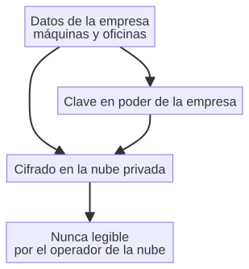

# Capítulo 11 --- La nube dentro de los muros

## La contradicción

A mediados de la década de 2010, se había asentado una contradicción sobre el uso de la nube, y era una contradicción que cualquier ingeniero reflexivo podía percibir pero que nadie había resuelto todavía. Por un lado, la nube era innegablemente útil: ofrecía almacenamiento, capacidad de cómputo y conectividad a una escala que ninguna empresa individual podía igualar, y permitía que las máquinas y las oficinas se comunicaran entre sí a través de la distancia. Por otro lado, el escándalo del datagate había hecho igualmente evidente que una nube pública era un lugar donde *no se podía confiar en nadie*: el operador podía ser obligado o estaba dispuesto a leer lo que tú almacenabas allí, y una vez que tus datos salían de tu edificio, ya no los controlabas.

Así que la pregunta se volvió aguda e ineludible. ¿Existe una nube que conserve la *utilidad* de la nube —el almacenamiento, la sincronización, la capacidad de que las máquinas y las oficinas compartan una sola copia viva de la verdad— mientras conserva el *secreto* que la nube pública entregaba? ¿Puede una empresa tener una nube que sea genuinamente su propia, de modo que sus datos nunca salgan del edificio y nunca, incluso bajo coacción, sean leídos por un tercero?

La respuesta, tal como los proyectos tras este libro llegaron a construirla, es sí —pero solo si estás dispuesto a dotar a la nube de dos nuevas propiedades que la vieja nube nunca tuvo: debe ser **sin confianza** (*trustless*), y debe ser **de conocimiento nullo** (*zero-knowledge*). Tomemos en serio esas dos palabras, porque en ellas reside toda la innovación.

## La nube sin confianza

"Sin confianza" (*trustless*) es una frase que proviene del mundo de la criptografía y los sistemas distribuidos, y suena como una cosa extraña que desear de algo tan útil como una nube. Usualmente *confiamos* en los servicios que usamos; por eso mismo los usamos. Decir que una nube es "sin confianza" es afirmar que *no* tienes que confiar en su operador para que maneje tus datos correctamente. No tienes que confiar en que no filtrará tus datos, en que no será sobornado, en que no será obligado a entregarte tus archivos y leerlos. En una nube sin confianza, es la arquitectura del sistema —no las buenas intenciones del operador— lo que mantiene tus datos a salvo.

La forma en que se logra esto es asegurando que los datos estén *cifrados* con claves que solo tu empresa posee, y que la nube pueda procesar, almacenar y sincronizar los datos *sin poder verlos nunca en claro*. La nube mueve tus datos, los mantiene consistentes, los hace disponibles para tus máquinas y tu oficina —pero nunca posee el poder de *leerlos*, porque no posee la clave. Es como un mensajero que puede entregar una caja fuerte cerrada pero que no puede abrirla. El mensajero es útil y confiable, y es completamente incapaz de traicionarte. Esa es la nube sin confianza: útil, e incapaz de traicionarte.

## La distinción crucial

Hay un detalle que casi todos malinterpretan, y vale la pena abordarlo lentamente, porque es todo el punto. La nube pública —la nube comercial, gigante y centralizada de la década de 2010— *sí* cifra tus datos. La cifra mientras viaja por la red (cifrado en tránsito), y la cifra mientras duerme en el disco (cifrado en reposo). Así que la objeción ingenua, "solo crífrala", no resuelve nada el problema, porque la nube pública ya la cifra.

La distinción que importa es esta: en la nube pública, *el operador posee las claves*. El cifrado es propio del operador; se aplica por motivos propios del operador —para satisfacer una regulación, para limitar la responsabilidad, para protegerse contra ladros externos. Pero el operador puede, en cualquier momento, descifrar tus datos, leerlos, entregarlos. El cifrado en reposo es una *conveniencia* para el operador, no una *garantía* para ti. Si el operador es obligado, o está dispuesto, simplemente puede aplicar su clave, y tus datos —en claro, legibles, ya no tuyos— se entregan a quienquiera que los pidió.

La nube sin confianza y de conocimiento nullo cambia *quien posee la clave*. En esa nube, la clave no es del operador; es *tuya*, y nunca sale de tu edificio. Los datos se cifran antes de ser enviados, con una clave que el operador no posee, de modo que incluso el cifrado en reposo en el disco del operador es insignificante para ellos. Pueden almacenar tu caja fuerte cerrada, moverla, mantener copias de ella, sincronizarla a través de sus servidores —pero no pueden abrirla, porque nunca tuvieron la clave. El cifrado ya no es la conveniencia del operador; es *tu* garantía, aplicada a un nivel que el operador no puede deshacer. Esta es la diferencia entre una bóveda custodiada por el guardián honesto del operador y una bóveda de apertura imposible por diseño. La primera es el datagate; la segunda es la nube dentro de los muros.

## La nube de conocimiento nullo

"De conocimiento nullo" (*zero-knowledge*) es una frase de una rama de la criptografía que suena casi paradójica, y vale la pena abordarla lentamente. En la criptografía, una "prueba de conocimiento nullo" es una forma en que una parte puede demostrar a otra que una afirmación es verdadera —*sin revelar ninguna información más allá de la verdad de la afirmación misma.* El ejemplo clásico es una cueva con una palabra secreta cerrada tras una puerta. Una persona que conoce la palabra puede demostrar, repetidamente, que la conoce —entrando por una puerta y saliendo por la otra— sin nunca *decir* la palabra. Demuestran conocimiento sin transmitir conocimiento. De ahí "de conocimiento nullo": la prueba no transmite nada más allá del hecho de que la prueba tuvo éxito.

Aplicada a la nube, la nube de conocimiento nullo significa que la nube puede verificar y procesar tus datos sin nunca conocer los datos mismos. La máquina cifra sus telemetrías antes de enviarlas, conserva la clave, y la nube —incluso la nube que las almacena y sincroniza— no puede leerlas. La nube opera sobre el cifrado, sobre la caja fuerte cerrada, nunca sobre el contenido. Cuando los datos se necesitan en la oficina, se descifran allí, por tu empresa, con tu clave. La nube es, en el sentido más literal, *ciega* ante el contenido de tus datos. Es un guardián que puede custodiar una bóveda pero nunca ver en su interior.

Para hacerlo concreto para la fábrica: el sensor sobre el husillo no envía un número de punto flotante a la nube; envía un *cifrado*, el producto de cifrar ese número con una clave que la nube no posee. La nube almacena ese cifrado, lo mantiene consistente a través de sus servidores, lo hace disponible para la oficina —todo mientras es incapaz de saber si el número era 42 o 42.000, si el rodamiento estaba sano o fallando. Es, en el sentido más estricto de la palabra, *ciega a la información*. Puede ver que los datos se mueven; no puede ver qué *es* los datos. Ese es todo la promesa de conocimiento nullo, y es suficiente para hacer imposible la traición de la nube pública que encontramos en el capítulo anterior.

## El CloudServer

El proyecto que encarna esta idea —la nube mantenida dentro de la empresa, sin confianza y de conocimiento nullo— se llama **CloudServer**, uno de los proyectos publicados por el laboratorio tras este libro. Donde la nube pública centraliza los datos en un puñado de gigantescos centros de datos que pueden ser leídos (o obligados a leer), una nube privada y de conocimiento nullo como CloudServer *descentraliza* la confianza: los datos nunca salen del control de la empresa, porque la empresa nunca entrega la clave. La nube está dentro de los muros, o al menos dentro de la autoridad de la empresa, y es inútil para un espía, un hacker, o una orden judicial, porque no hay nada que leer.

Esto no es una hipótesis. La arquitectura existe, está publicada, y se está construyendo para resolver exactamente el problema que el datagate hizo ineludible. La fábrica que percibe, predice y reporta —la fábrica de los capítulos anteriores— produce datos que, por cualquier estándar razonable, son su activo más sensible. Los horarios de producción, los contratos de proveedores, los diseños de componentes, los patrones operativos: esta es la imagen del futuro de la empresa, hecha visible. Es precisamente este datos el que la sexta revolución debe mantener *dentro de los muros*, y una nube privada, sin confianza y de conocimiento nullo es el único tipo de nube que puede contenerlo sin traicionarlo.

La forma en que CloudServer lleva a cabo esto es instructiva, y vale la pena seguir los datos a través de ella una vez, porque el mecanismo es todo el argumento. La máquina, o la aplicación de oficina, posee la clave. Cifra sus datos *antes* de salir del edificio. Luego envía solo *cifrado* —la caja fuerte cerrada— al CloudServer. El servidor almacena, sincroniza y sirve ese cifrado a cada máquina y oficina autorizadas, todo sin nunca poseer la clave que podría descifrarla. Cuando una máquina necesita los datos, el servidor devuelve el cifrado; la máquina —no el servidor— la descifra, localmente, con la clave que conservó. El servidor es un mensajero silencioso y ciego para los datos de toda la empresa, capaz de moverla y mantenerla pero nunca de leerla. Ese es toda la innovación, y es lo que hace que la nube dentro de los muros sea *sin confianza* en el sentido más verdadero.

El diagrama de arriba es, espero, una imagen fiel del mecanismo: la clave se mantiene dentro del edificio, los datos viajan y se almacenan solo como cifrado, y el único lugar en que los datos llegan a ser legibles es *dentro de los propios muros de la empresa*, en una máquina que conserva la clave. El CloudServer está presente en cada paso salvo el último y el primero; es el portador, no el lector. Esta es la nube que el datagate hizo necesaria, y es lo que permite que la telemetría más preciosa de la fábrica viaje por fin, a salvo, hasta el lugar donde será objeto de razonamiento.

## Lo que la clave realmente cuesta

Vale la pena detenerse en una objeción práctica, porque es la que surge primero en cualquier empresa real: si la nube no puede leer los datos, ¿cómo puede hacer algo útil con ellos? La preocupación es comprensible, y vale la pena responderla claramente, porque la respuesta es también la razón por la que la nube de conocimiento nullo no es meramente una curiosidad sino un diseño funcional.

La labor de la nube, en esta arquitectura, no es *razonar*. Es *transportar y conservar*: almacenar los datos de forma fiable, sincronizarlos a través de cada máquina y cada oficina, hacerlos disponibles al instante en que se solicitan, sobrevivir al fallo de un disco o un servidor, y hacerlo a la escala de toda una empresa. Ninguno de estos trabajos requiere leer los datos. Un mensajero no necesita leer una carta para entregarla a tiempo; un almacén no necesita entender una caja para almacenarla de forma segura. La nube es el mensajero y el almacén de la sexta revolución, y su competencia —fiabilidad, disponibilidad, sincronización— es completamente compatible con su ceguera.

El *razonamiento*, mientras tanto, ocurre donde está la clave: en la máquina que la posee (el borde, que ya hemos conocido) y en la oficina que la posee (el agente, que conoceremos en la Parte V). Esos son los lugares en que el cifrado llega a ser legible, porque esos son los lugares en que la clave vive. Así que la nube de conocimiento nullo no es una limitación impuesta al diseño; es una *división del trabajo*. La nube hace lo que una nube hace bien —mover y conservar— sin nunca necesitar entender. Las máquinas y los agentes hacen lo que la inteligencia hace bien —leer y decidir— sin nunca dejar salir los datos de sus propias manos. Las dos mitades del trabajo están claramente separadas, y la separación es precisamente lo que hace que todo el conjunto sea seguro.

Hay una pequeña ironía aquí, y vale la pena nombrarla. La nube pública se vendió con la promesa de la *integración* —"pon todo en un solo lugar, y nosotros lo haremos funcionar todo junto." La nube privada y de conocimiento nullo invierte la promesa: pone todo en un solo lugar, pero deliberadamente mantiene el lugar *ciego*, y deja que cada poseedor de una clave haga su propio razonamiento. La integración de la vieja nube era conveniente y insegura; la separación de la nueva nube es menos conveniente y vastamente más segura. Para la fábrica, el intercambio es obviamente vale la pena hacer, porque los datos que se mueven son la imagen del futuro de la empresa, y ninguna conveniencia vale la pena entregar esa imagen a un extraño.

## Una breve historia de guardar un secreto

La idea de que un mensaje puede viajar mientras permanece ilegible es tan antigua como la escritura misma, y la historia de esa idea es la ascendencia intelectual de la nube de conocimiento nullo. Vale la pena una breve desviación, porque permite al lector ver que la nube moderna no es una invención súbita sino la última vuelta en una conversación muy larga.

Julius César, en el siglo I a.C., se dice que protegió sus despachos militares desplazando cada letra del alfabeto un número fijo de lugares —el "cifrado César", en el que *A* se convierte en *D*, *B* se convierte en *E*, y así sucesivamente. Era, por estándares modernos, ridículamente débil; pero estableció el movimiento esencial: *un mensaje y su significado pueden separarse*, de modo que el portador del mensaje no puede leerlo. Durante dos mil años, cada avance en la criptografía era, en el fondo, un refinamiento de ese único movimiento.

En el siglo XVI el cifrado Vigenère usaba una *palabra clave* para variar el desplazamiento, lo que hacía el mensaje mucho más difícil de romper, y durante un tiempo se creyó —erróneamente, como resultó— en que era irrompible. La creencia duró hasta el siglo XIX, cuando Charles Babbage (el mismo hombre que diseñó el Motor Analítico que conocimos en la línea de tiempo) se dice que lo rompió. La lección ya era la lección moderna: un cifrado es tan solo tan fuerte como el *secreto en su centro* —la clave— y ninguna cantidad de astucia en el mecanismo puede compensar una clave débil.

El siglo XX convirtió la criptografía en una cuestión de vida o muerte. La máquina Enigma alemana, usada en la Segunda Guerra Mundial, cifraba las comunicaciones militares con un sistema de rotores de complejidad desconcertante; los descifradores británicos en Bletchley Park, entre ellos Alan Turing, lo rompieron y, al hacerlo, pueden haber acortado la guerra por años. Enigma era un sistema de *secreto compartido*: el remitente y el receptor ambos conocían los ajustes diarios (la clave), y la seguridad descansaba en mantener esa clave secreta. Cuando la clave se filtraba, el cifrado caía.

Luego, en 1976, dos investigadores —Whitfield Diffie y Martin Hellman— publicaron una idea que cambió la forma del campo: *la criptografía de clave pública*. Permitía a dos partes que nunca se habían conocido, y que no compartían ningún secreto con anticipación, establecer un canal seguro —porque cada parte tenía una *clave* pública (que cualquiera podía ver) y una *clave* privada (que solo ellas poseían). La clave pública podía cifrar; solo la clave privada podía descifrar. Este fue el momento en que la criptografía dejó de requerir un secreto previo compartido, y es el ancestro directo de la nube sin confianza, en la que la empresa posee una clave que ningún operador nunca necesita conocer.

La prueba de conocimiento nullo, que ya conocimos antes en este capítulo, es una vuelta aún más reciente y aún más asombrosa: una forma de demostrar que una afirmación es verdadera *sin revelar nada más*. Tomadas juntas —la criptografía de clave pública, que permite a extraños establecer un secreto; y las pruebas de conocimiento nullo, que permiten a una parte demostrar sin revelar— estas ideas son la base intelectual sobre la que se construye la nube dentro de los muros. El CloudServer no es magia; es la aplicación más reciente y más práctica de una conversación que comenzó con el alfabeto desplazado de César y ha estado corriendo, sin interrupción, durante dos mil años. Cuando la telemetría de la fábrica viaja como cifrado ilegible, está montada sobre esa larga historia, y está en buena compañía.

## El retorno de la nube local

Vale la pena notar la extraña circularidad de la historia. Las nubes más tempranas —antes de la era de la nube gigante, centralizada y comercial— eran, en un sentido, *locales*. Vivían en los centros de datos de las empresas que las usaban, tras sus propios muros, controladas por sus propios equipos de TI. La nube comercial de la década de 2010 prometía ser mejor, más barata y más poderosa, y la mayoría de la gente creyó en ella. El datagate fue el momento en que la creencia se agrietó. Y ahora, paradójicamente, la sexta revolución está trayendo la nube *de vuelta* —de vuelta dentro de los muros, de vuelta bajo el control de la empresa, de vuelta a un lugar que puede ser confiado porque es estructuralmente incapaz de traicionarte.

Esto no es un simple retorno al pasado; es un retorno *refinado por un escándalo*. La nube local de los años 1990 era local porque la tecnología para hacer otra cosa aún no estaba disponible —porque la red era lenta, costosa e poco fiable, y porque "la nube" era simplemente una abreviatura de "la computadora grande en la oficina." La nube local de la sexta revolución es local *por diseño y por principio*: es local porque la empresa ha decidido, tras el datagate, que sus datos son demasiado preciosos para estar jamás a merced de un operador. Las dos no son la misma nube. La primera era local por necesidad; la segunda es local por convicción.

La nube dentro de los muros no es la nube del pasado; es la nube del futuro, refinada por un escándalo en algo que mantiene su promesa sin necesitar ser confiada. Es el segundo eslabón en la cadena de la sexta revolución, y es lo que permite que la telemetría de la máquina viaje por fin, a salvo, hasta el lugar donde será objeto de razonamiento. Ese razonamiento es el tema del próximo capítulo —pero primero, atendamos a la sangre que debe fluir a través de esta nube privada: la telemetría misma, el stream vivo de datos que es el reporte continuo de la fábrica sobre su propio estado.
