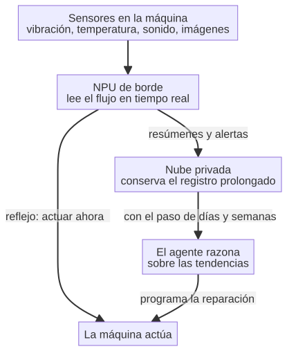

# Capítulo 12 --- La telemetría como sistema nervioso de la fábrica

## La sangre de la nueva máquina

Hemos hablado de la máquina que piensa, de la nube que guarda su secreto, y del agente que un día razonará sobre todo lo que la máquina produce. Pero entre la máquina y el agente --- entre el sensor sobre el huso y la mente en la oficina --- debe haber una *corriente*. Debe haber un flujo continuo de información que transporte, en tiempo real, el informe de lo que la máquina está haciendo y de cómo se siente. Esta corriente se llama **telemetría**, y es la sangre de la nueva fábrica. Sin ella, la máquina que pensaría pensaría en el vacío; la nube que guarda su secreto no tendría nada que guardar; el agente que razonaría no tendría nada sobre qué razonar. La telemetría es lo que hace de la fábrica una cosa viva en lugar de una colección de metal inerte.

Comprendamos la telemetría correctamente, porque esta palabra se lanza con soltura en los días de hoy, y porque entenderla es esencial para entender la cadena entera. La telemetría es simplemente *datos que se miden en un lugar y se reportan, automática y continuamente, a otro lugar.* La palabra proviene del griego *tele*, "lejos", y *metron*, "medida" --- la medida de cosas lejanas. Nació en la cabina de un avión, donde los instrumentos reportaban el estado de los motores al piloto en tiempo real, y de allí viajó hacia la informática, donde llegó a significar la recolección y transmisión automáticas de datos operativos.

Vale la pena detenerse en ese origen, porque la palabra lleva su significado en sus huesos. La telemetría fue, de hecho, nacida de la *temor* --- el temor del astronauta o del piloto que debe confiar, por completo, en una máquina cuya supervivencia depende de datos que no puede ver con sus propios ojos. Los cohetes de los primeros programas espaciales, el programa Apollo en particular, estuvieron entre los primeros usuarios a gran escala de la telemetría, porque un cohete es el ejemplo definitivo de una máquina cuyo estado interno --- temperatura, presión, flujo de combustible --- no puede observarse directamente una vez que ha salido del suelo. La única manera de saber lo que estaba haciendo era *medirla en un lugar y reportarla, continuamente, a otro.* La fábrica de la sexta revolución enfrenta una dependencia idéntica, si más silenciosa: no podemos *ver*, con nuestros propios ojos, si un huso está a punto de fallar; solo podemos medir su estado y reportarlo. La metáfora no es decorativa; es estructural. La fábrica, también, debe confiar en su telemetría.

## Qué reporta la máquina

En un piso de fábrica, la telemetría que una máquina moderna puede producir es, de hecho, sorprendentemente rica --- mucho más rica que el puñado de números que un PLC antiguo jamás reportaría. Una máquina equipada con la tarjeta inteligente de los capítulos anteriores puede reportar, continuamente:

- **Vibración y aceleración**, en múltiples direcciones, revelando la salud de los cojinetes, husos y piezas móviles. Un cojinete que comienza a esfalerarse no falla con un grito; falla con una *frecuencia*, una pequeña perturbación periódica en la señal de vibración que un oído humano nunca notaría pero que un sensor registra por completo.
- **Temperatura**, en varios puntos, advirtiendo de sobrecalentamiento, fricción o cambio ambiental.
- **Corriente y voltaje eléctricos**, revelando la carga sobre un motor y, sutilmente, la calidad del corte o de la prensa. Una herramienta de corte que se vuelve roma dibuja, casi imperceptiblemente, más corriente; la telemetría *ve* el desgaste antes de que la pieza sea desechada.
- **Sonido**, mediante un micrófono, revelando cambios en el timbre de una máquina que preceden a la falla. Este es el dominio de la *emisión acústica*: los "gemidos" de alta frecuencia que hace una máquina mientras una grieta crece, inaudibles para un trabajador pero inconfundibles para un micrófono afinado a la banda correcta.
- **Imágenes**, mediante una cámara, reportando --- como vimos en la parte anterior --- la calidad y posición de cada pieza.
- **Posición, velocidad y fuerza**, para cualquier máquina que se mueva, revelando si opera dentro de su envolvente pretendida.
- **Escombros de fluido y aceite**, revelando el desgaste de componentes internos a medida que partículas microscópicas son transportadas a través de un lubricante, cada partícula un pequeño registro de lo que la máquina ha estado haciendo.

Cada una de estas corrientes, por sí sola, es un número que cambia con el tiempo. Juntas, son una *historia*: la narrativa continua del estado de la máquina. Y es aquí donde la inteligencia de la sexta revolución entra, no en la *recolección* de la telemetría --- esa parte es mecánica y barata --- sino en su *lectura*. La NPU en la máquina lee la corriente no como una lista de números sino como una *señal de salud*, reconociendo el momento en que la historia cambia de "bien" a "advertencia". La nube recibe la corriente y la guarda, consistente y buscable, sin nunca leerla. El agente razona sobre la corriente y decide qué hacer con ella.

## El costo y la ubiquidad del sensing

Hay un hecho económico que hace posible la sexta revolución, y vale la pena nombrarlo, porque las revoluciones solo son posibles cuando los componentes necesarios han hecho en baratos. El sensor --- el acelerómetro, el termopar, el micrófono --- ha hecho, en las últimas dos décadas, en asombrosamente barato. Un acelerómetro MEMS moderno, lo suficientemente pequeño como para descansar sobre la punta de un dedo, cuesta centavos en volumen; un micrófono para emisión acústica es también barato; una cámara para visión de máquinas es, por la misma lógica, ordinaria. Esta es la misma historia que hizo posible el teléfono inteligente y que hizo posible la nube: los componentes que hacen afeordable el sensing continuo han caído en precio más rápido de lo que nadie predicó, y la fábrica simplemente ha heredado esa barata.

Es por eso que la recolección de la telemetría es, como dijimos, "mecánica y barata". La parte difícil --- la parte que es genuinamente difícil --- nunca es la *medición*; es la *lectura*. Cien sensores en una máquina son inútiles a menos que algo pueda dar sentido a la corriente que producen. La sexta revolución no gana añadiendo más sensores; gana añadiendo más *atención* a los datos que los sensores ya producen. La barata del sensing es un dado; la inteligencia de la lectura es la tarea entera.

## El requisito de tiempo real

Los capítulos anteriores establecieron que la máquina debe percibir y actuar *localmente*, en tiempo real, porque un viaje de ida y vuelta a la nube es demasiado lento y filtra privacidad. La telemetría debe por tanto entenderse en dos niveles, y ayuda mantenerlos separados.

En el **borde** --- en la máquina misma --- la telemetría más urgente se procesa localmente y al instante. La señal de vibración que dice "un cojinete está a punto de fallar" se lee en el acto, por la NPU, porque la decisión que apoya debe hacerse en microsegundos. Aquí la telemetría es un reflejo.

En la **nube** --- la nube privada, de conocimiento nulo, mantenida dentro de las paredes --- la telemetría se recolecta, almacena y hace buscable con el tiempo. Aquí no es un reflejo sino una *memoria*: el registro continuo de la vida de la máquina, que el agente puede razonar con días, semanas y meses. Aquí el valor no es la velocidad sino la *historia*: la capacidad de ver, en retrospectiva, cómo ha envejecido una máquina, si está emergiendo un patrón de fallas, cómo comparan dos máquinas en dos líneas.

Los dos niveles no están en conflicto. El borde procesa lo que debe decidirse *ahora*; la nube recuerda lo que debe entenderse *con el tiempo*. Ambos son telemetría. Ambos alimentan la sexta revolución. El borde es el reflejo; la nube es la memoria. El agente es la mente que lee ambos.

## La lección de la Apollo 13

La palabra "telemetría" fue, como dijimos, nacida en la cabina y la sala de control, y la lección más famosa en su poder llegó en abril de 1970, cuando la nave Apollo 13 sufrió una explosión en un tanque de oxígeno en su camino hacia la Luna. La historia es bien conocida, pero usualmente se cuenta como una historia de coraje e improvisación. Vale la pena contarla, por un momento, como una historia *sobre la telemetría*, porque es lo que hizo posible el coraje y la improvisación.

Una vez que la nave había salido de la Tierra, la tripulación no podía *ver* el daño con sus propios ojos; solo podía verla a través de los instrumentos y las lecturas que se reportaban, continuamente, al Control de Misión en Houston. Cuando ocurrió la explosión, la telemetría le dijo a los controladores de vuelo lo que nunca habrían podido ver desde el suelo: qué sistemas se estaban fallando, qué rápido se escapaba el oxígeno, qué estaba haciendo la temperatura y la presión en los tanques. Era la telemetría --- el informe continuo y honesto del estado interno de la máquina --- lo que permitió a los controladores entender, en minutos, que la misión no podía aterrizar en la Luna y que la tarea real se había convertido en traer de vuelta a la tripulación.

Y aquí está la parte que importa para la fábrica. Los controladores no meramente *leyeron* la telemetría; *razonaron* sobre ella, y razonaron con los ingenieros que construyeron la máquina, hasta que pudieron convertir la corriente cruda de números en un plan. El famoso filtro de dióxido de carbono improvisado --- construido, en el espacio, de cinta adhesiva, cartón y una bolsa de plástico --- fue la *acción* en el extremo lejano de la telemetría: los datos hicieron visible el problema, el razonamiento convirtió el problema en un plan, y el plan se convirtió en un acto. Medida en un lugar (la nave), reportado continuamente a otro (Houston), razonado por un tercero (el equipo de vuelo), y finalmente sobre el cual se actuó --- esta es la cadena entera de la sexta revolución, comprimida en una sola semana desesperada en 1970.

La fábrica no tiene astronautas ni Luna, pero tiene, en miniatura, la misma dependencia. El ingeniero que no puede *ver* el cojinete desgándose solo puede *medirlo* y leer el informe. La diferencia es que la sexta revolución coloca el razonamiento *más cerca* de los datos --- en el chip, en la nube dentro de las paredes --- para que el plan y el acto no tengan que esperar a una sala llena de controladores, y la máquina pueda, en los sistemas más nuevos, actuar sobre su propia telemetría sin un humano en el lazo de ninguna manera. La Apollo 13 es el ancestro de la máquina que piensa; es simplemente que la máquina ha aprendido a ser su propio Control de Misión.

## El problema del volumen

Hay una dificultad práctica que la descripción romántica de la telemetría tiende a ocultar, y vale la enfrentar honestamente: los datos que produce una máquina moderna son *enormes*. Un único sensor de vibración, muestreando muchas veces por segundo, produce millones de lecturas en un día. Multiplique eso por una docena de sensores en una máquina, cien máquinas en una línea, y una flota de plantas, y la corriente se convierte en una inundación --- terabytes por día, en una operación grande. Ninguna nube, por privada que sea, puede simplemente *guardarlo todo para siempre*; y ningún humano, por diligente que sea, puede leer una inundación.

Es por eso que la telemetría de la sexta revolución no es un tamaño de datos a una velocidad, sino un diseño *de dos niveles*, y vale dibujarlo claramente:

En el **borde**, la máquina lee su propia corriente a resolución completa, porque el reflejo debe ser instantáneo y la señal cruda debe examinarse en todos sus detalles. En la **nube**, la máquina envía *resúmenes* --- historias submuestreadas, características extraídas, alertas, y la ventana de resolución completa ocasional alrededor de un evento --- para que el registro largo se guarde sin guardar cada byte. El borde lee la inundación; la nube guarda la historia; el agente razona sobre la historia. Así es como una fábrica puede ver todo sin ahogarse en ello: los datos crudos se consumen donde se producen, y solo su *significado* se envía hacia adelante, cifrado, a la nube privada.

Este diseño tiene un segundo beneficio, más silencioso, y vale nombrarlo. El problema del volumen es también un problema de *privacidad*: si todo se enviara a la nube, todo estaría en riesgo. Al resumir en el borde, la máquina envía el *mínimo* que se necesita --- la alerta, la tendencia, la característica extraída --- y guarda el dato profundo, crudo, íntimo de su propia operación localmente. La telemetría que viaja es por tanto no meramente cifrada; es *reducida*. La fábrica comparte la historia, no la confesión cruda. Y eso, en un mundo que ha aprendido a desconfiar de la nube, es exactamente la forma correcta de confianza.

## La corriente como verdad compartida

Hay una más calidad que hace especial esta corriente, y se ata directamente a la nube privada del capítulo anterior. En la vieja fábrica, la telemetría usualmente era *local*: se mostraba en la máquina, o se registraba a un archivo en una sala, visible solo para quienquiera que pasara a estar allí. La sexta revolución hace la telemetría *compartida* --- continuamente sincronizada, en tiempo real, en toda la empresa, a cada máquina, oficina y agente que tiene derecho a ella. Esto es lo que logra una nube privada: una sola copia viva de la telemetría de la fábrica, siempre consistente, siempre disponible, nunca saliendo del control de la empresa.

Hay una frase del mundo de las bases de datos que describe precisamente esta calidad, y vale tomarla prestada, porque nombra una lección ganada con dificultad. Se llama **consistencia fuerte**: la garantía de que cada lector, en cada momento, ve la *misma* copia de los datos --- que no hay una versión en una máquina y una versión diferente en otra, derivando lentamente separadas. En la vieja fábrica, dos técnicos podrían mirar dos máquinas diferentes y llegar a dos conclusiones diferentes, porque su telemetría no era compartida. La sexta revolución elimina esa posibilidad: con una nube privada, fuertemente consistente, el sensor sobre el huso, el modelo en la nube, y el agente en la oficina están todos mirando a --- y actuando sobre --- la *misma* verdad viva. No hay otra manera de correr una fábrica que debe ser cierta; no puedes ser cierto de una cosa que es diferente en cada máquina que la observa.

Esta telemetría compartida, en tiempo real, es el tejido conectivo de la cadena entera. Es lo que permite al sensor sobre el huso, al modelo en la nube privada, y al agente en la oficina estar todos mirando a --- y actuando sobre --- la *misma* verdad viva. Es la sangre que fluye desde la máquina, a través de la nube, hacia la oficina, y de vuelta otra vez. Y ahora, habiendo establecido qué es esta sangre y cómo fluye, podemos girar hacia la pregunta final de la cadena entera: *quién la lee, y cómo?* Para la sangre, como en cualquier cuerpo vivo, debe ser leída por una mente. Esa mente es el sujeto de la próxima parte de este libro, y es donde la historia toma su giro más sorprendente, porque la mente que lee la telemetría no es, en los sistemas más nuevos, un humano de ninguna manera.
