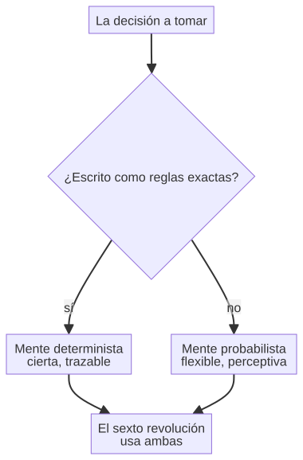

# Capítulo 13 --- Dos tipos de mente

## La elección que nadie nos pide

Existe una decisión que casi todo el que construye la sexta revolución toma sin notarla jamás, y es la decisión más importante de toda la historia. No es "¿deberíamos usar IA?" Es "¿qué *tipo* de IA?" Y es una elección entre dos filosofías fundamentalmente distintas de la inteligencia, dos tipos de mente, que coinciden en casi nada salvo en sus resultados externos.

Para entender la elección, consideremos el ejemplo más simple posible: una máquina que debe decidir si una pieza que está inspeccionando es buena o defectuosa. Hay dos formas de tomar esa decisión, y provienen de dos mundos distintos.

## La primera mente: la mente que adivina

El primer tipo de mente es el que ya has conocido, en el sensor del husillo. Es la mente del modelo *probabilista* --- la red neuronal que ha aprendido, de entre miles de ejemplos, a *adivinar* la respuesta más probable. Esta es la inteligencia de la era del aprendizaje profundo: se alimentan de muchos ejemplos de piezas buenas y defectuosas, y se ajusta hasta que sus adivinaciones coinciden con la realidad. Cuando llega una nueva pieza, no aplica una regla; produce una *respuesta probable*, ponderada por todo lo que ha visto.

Esta mente que adivina es un milagro de la era moderna, y es asombrosamente buena en las tareas para las que fue entrenada. Puede reconocer un arañazo, predecir un fallo, leer un código de barras en la oscuridad. Destaca donde las reglas no pueden escribirse explícitamente pero la respuesta correcta sí puede *mostrarse* --- en la percepción, en el reconocimiento de patrones, en el manejo de datos desordenados y reales. Es por esto que el aprendizaje profundo conquistó el reconocimiento de imágenes, la traducción y el lenguaje en un solo avance: en todos ellos, no puedes escribir las reglas, pero sí puedes mostrar un millón de ejemplos.

Pero la mente que adivina tiene un carácter que debemos nombrar con cuidado, porque ese carácter es toda la diferencia en la sexta revolución. Es **probabilista**. Da su mejor adivinación, pero hasta este punto te ha dado siempre una adivinación. Puede equivocarse, incluso cuando suena segura. Lleva dentro de sí, por su propia naturaleza, un *elemento discrecional*: los datos de entrenamiento contienen sesgos, y la inferencia es una aproximación aprendida, no una certeza. Para reconocer un arañazo en una botella, una adivinación es perfectamente válida. Para decidir si el sistema de frenos de un coche es seguro, una adivinación no es simplemente insuficiente; es inaceptable.

## La segunda mente: la mente que calcula

Hay un segundo tipo de mente, y es más antigua que la primera en más de medio siglo. Es la mente del cálculo *determinista*. No adivina; *computa*. No aprende de ejemplos; aplica reglas fijas a entradas dadas y produce, una a una, *la misma respuesta con certeza matemática*. Esta es la mente del compilador, la mente que convierte tu código fuente en instrucciones de máquina exactamente una vez, cada vez, para siempre, sin discreción ni sesgo, sin deriva ni adivinación.

Has conocido esta mente también, aunque quizá no la hayas llamado "inteligencia". Cuando compilas un programa, el compilador aplica reglas fijas a tu código y produce un resultado fijo. No puede estar "equivocado" de la forma en que lo está un modelo que adivina; solo puede ser correcto o incorrecto, y su corrección es demostrable. No tiene opiniones. No tiene mal día. Dada la misma entrada, produce la misma salida, con la misma certeza de que dos más dos hacen cuatro. Este no es el mente que reconoce una cara o traduce una frase --- eso es imposible para ella. Pero es la mente que *garantiza*, y esa garantía vale su peso en oro exactamente en esos lugares donde una adivinación sería peligrosa.

## La línea que los separa

Las dos mentes no son rivales en el sentido habitual; son *complementarias*, cada una fuerte donde la otra es débil. La mente que adivina es flexible, creativa e indispensable para la percepción y el lenguaje, pero no es cierta. La mente que calcula es perfectamente cierta, pero no es flexible --- solo hace lo que sus reglas dictan, y sus reglas son, por construcción, completas y sin ambigüedad.

La pregunta decisiva es esta: **¿qué mente debe conducir las decisiones que más importan?** Donde el resultado es una clasificación o una adivinación --- un arañazo o una superficie lisa --- la mente que adivina no es simplemente adecuada; es la única que funciona. Pero donde el resultado debe ser *cierto* --- donde una adivinación equivocada hiere a alguien, pierde dinero o rompe la confianza --- la mente que calcula es la única que es segura.

Para entender por qué la mente que calcula es segura, ayuda ver con precisión qué significa "cierto" aquí, porque la palabra está haciendo un gran trabajo. Un sistema determinista es aquel cuya salida es *totalmente determinada* por su entrada y sus reglas, sin espacio para la casualidad, sin aleatoriedad incrustada en el proceso, y --- crucialmente --- sin espacio *adversarial* para maniobrar. Una mente que adivina, en contraste, puede ser desviada de su curso por entradas que son similares pero no idénticas --- un fenómeno que el mundo del aprendizaje automático llama *ejemplos adversarios*: un cambio diminuto e imperceptible en una entrada que puede voltear una adivinación segura en un error seguro. La mente que calcula no tiene tal debilidad, porque sus reglas son fijas y completas; no hay hueco por el que una entrada pueda caer. Esto, más que cualquier discurso abstracto sobre la "certidumbre", es por lo que la mente que calcula es la única que puede confiarse con las decisiones que deben ser conocidas como correctas.

## Las dos tribus de la IA

Los dos tipos de mente no son una metáfora inventada para este libro; son las dos grandes tribus de la inteligencia artificial, y la historia de su rivalidad es una de las narraciones más instructivas de todo el campo. Vale la pena contarla, brevemente, porque explica por qué la sexta revolución puede ahora hacer lo que ninguna tribu podía hacer sola.

La primera tribu es la escuela **simbólica**, a veces llamada "IA buena y antigua". Su creencia era que la inteligencia es la manipulación de símbolos de acuerdo con reglas explícitas --- que si pudieras escribir suficiente lógica, podrías capturar el propio pensamiento. Su gran logro fue el *sistema experto*: un programa que codificaba el conocimiento de un especialista humano como un conjunto de reglas de tipo si-entonces. En las décadas de 1970 y 1980, los sistemas expertos se construyeron para la medicina (MYCIN, para diagnosticar infecciones), para la química (DENDRAL, para identificar moléculas) y para los negocios (XCON, para configurar órdenes de computadora), y durante un tiempo fueron la forma de IA de mayor éxito comercial jamás construida. Eran, en esencia, la mente que calcula: deterministas, basadas en reglas, auditables y ciertas dentro de su dominio. Su debilidad era igualmente clara --- eran *frágiles*. Funcionaban dentro del conjunto estrecho de reglas que se les daba, y fallaban malmente fuera de él, porque el mundo real está lleno de casos para los que nadie escribió una regla. Cuando el mercado de los sistemas expertos colapsó a finales de los 1980, se llevó consigo la reputación de la primera tribu.

La segunda tribu es la escuela **conexionista** --- las redes neuronales. Su creencia era casi lo opuesto: que la inteligencia no es un conjunto de reglas escritas sino un *patrón aprendido de ejemplos*, una red de unidades simples que se ajusta hasta que coincide con el mundo. La idea es más antigua de lo que la mayoría de la gente piensa: Frank Rosenblatt construyó el *perceptrón* en 1958, una máquina de aprendizaje simple, y fue recibido con enorme optimismo. Pero el perceptrón tenía límites, y un famoso libro de 1969 de Marvin Minsky y Seymour Papert los expuso de forma tan efectiva que la investigación de las redes neuronales se silenció por más de una década --- el "invierno de la IA" de la tribu conexionista. Se tardó hasta las décadas de 1980 para que la *retropropagación* diera a las redes neuronales una forma de aprender estructuras profundas, y hasta 2012 para que la combinación de grandes datos y chips rápidos (el momento de AlexNet que conocimos en la línea de tiempo) las hiciera de repente, espectacularmente buenas. Esa segunda tribu es la mente que adivina: flexible, perceptiva y probabilista.

Durante décadas las dos tribus pelearon, y cada una desestimaba a la otra. Los simbólicos decían que los conexionistas no tenían teoría ni garantías; los conexionistas decían que los simbólicos nunca podrían manejar el desorden del mundo real. Cada uno tenía razón sobre la debilidad del otro y era ciego ante la propia. La discreta intuición de la sexta revolución --- la que este capítulo se construye para transmitir --- es que la pelea siempre fue un error. Las dos tribus no son rivales por el mismo trono; son dos *herramientas distintas para dos trabajos distintos*, y la fábrica que piensa necesita ambas.

El diagrama es todo el argumento en una sola imagen. Cuando la decisión puede escribirse como reglas exactas --- cuando la especificación es completa y la entrada está bien definida --- la mente determinista es la herramienta correcta, y es *superior*, porque es cierta. Cuando la decisión no puede escribirse como reglas, pero solo puede *mostrarse* a través de ejemplos --- reconocimiento, lenguaje, predicción --- la mente probabilista es la única herramienta que funciona. La fábrica sabia no elige una tribu; pregunta, de cada decisión, qué tribu tiene la herramienta que encaja, y usa esa. Esa es la sexta revolución, y es la resolución de un argumento de cincuenta años.

## La posición controversial

Es aquí donde los proyectos detrás de este libro adoptan una posición distintiva y, según algunos, controversial. Argumentan que mucho más de las decisiones de la fábrica de lo que la mayoría de los ingenieros admiten puede --- y debería --- hacerse por la mente *determinista*, por reglas fijas y especificaciones exactas, en lugar de por la mente que adivina. Argumentan que gran parte de lo que llamamos casualmente "IA" es, de hecho, servida perfectamente bien por el cálculo determinista, y que apoderarse de un modelo probabilista donde la certidumbre es posible no es simplemente innecesario sino *peligroso*.

Esto no es un rechazo luddita del aprendizaje automático. Es, todo lo contrario, la creencia de que la mente cierta debe usarse dondequiera que pueda, de modo que la mente incierta se reserve --- con moderación --- para las tareas en las que solo ella tiene éxito. Para entender esta posición plenamente, debemos mirar el proyecto que la encarna de forma más completa, una tecnología que convierte un programa compilado en una especificación que puede ejecutarse sin ninguna adivinación en absoluto. Ese es el tema del siguiente capítulo.

## Qué compra realmente una garantía

Vale la pena preguntar, concretamente, qué vale la garantía de la mente determinista --- porque "certidumbre" puede sonar como la palabra de un filósofo hasta que ves lo que ocurre cuando está ausente. La historia de la computación tiene algunas lecciones sobrias, y dos de ellas valen la pena contarlas, porque muestran, en sangre y dinero, por qué la sexta revolución no puede descansar sobre adivinaciones donde se requiere certidumbre.

La primera es la **Therac-25**, una máquina de terapia de radiación controlada por computadora usada en las décadas de 1980. Se diseñó para administrar dosis precisas de radiación a pacientes de cáncer, y dependía de software para controlar el haz. Una serie de errores de programación --- bugs sutiles e interactivos, el tipo que ningún test único habría capturado --- permitieron a la máquina, bajo ciertas secuencias de entrada del operador, administrar sobredosis masivas. Varios pacientes murieron o resultaron gravemente heridos. El software de la máquina era, en un sentido, "determinista" --- hacía exactamente lo que estaba escrito para hacer --- pero *no fue verificado*, y su determinismo entregó el resultado equivocado con perfecta certidumbre. La lección no es que la determinismo es malo; es que el determinismo sin verificación es simplemente una forma confiable de estar equivocado.

La segunda es el cohete **Ariane 5**, que explotó en su vuelo inaugural en 1996, menos de un minuto después del lanzamiento. La causa fue un desbordamiento de software: un valor que había sido perfectamente seguro en el Ariane 4 más pequeño excedía el rango de una variable de 16 bits en el más poderoso Ariane 5, y el error resultante estrelló el sistema de guía. El código era, de nuevo, determinista; hacía exactamente lo que había sido escrito para hacer. Pero había sido escrito para una máquina diferente, y nadie había verificado que las suposiciones seguían vigentes. El cohete no falló por un glitch aleatorio; falló porque un sistema determinista, aplicado fuera de su dominio verificado, es *ciertamente* incorrecto.

Estas historias son la razón por la que los dominios de certificación --- aviación, medicina, energía nuclear --- no aceptan "funciona en la demostración". Exigen *prueba*: que el comportamiento del software ha sido verificado contra su especificación, que cada suposición está documentada, y que toda la cadena puede auditarse. Esta es la disciplina que la industria de la aviación llama **DO-178C** --- un estándar que gobierna cómo se desarrollan y verifican los software a bordo, y que requiere, entre otras cosas, que los requisitos sean trazables hasta el fondo hasta el código y de vuelta. Es un estándar construido sobre una sola convicción: un sistema que lleva personas a través del aire debe ser *conocido* como correcto, no simplemente *probable* que lo sea.

Esto es exactamente lo que la mente determinista, usada correctamente, puede entregar --- y lo que la mente que adivina no puede. Un sistema determinista construido desde una especificación verificada puede trazarse, paso a paso, desde el código fuente hasta la decisión, y toda la cadena puede comprobarse. Un modelo probabilista puede probarse, y puede mostrarse que es preciso en un conjunto de pruebas, pero no puede *demostrarse* correcto, porque su comportamiento es, por construcción, una aproximación aprendida. Donde el costo de una respuesta equivocada se mide en vidas o en fortunas, la diferencia entre "probado" y "demostrado" es la diferencia entre un producto y una responsabilidad. La garantía no es un lujo; es la licencia para operar.

## Por qué la mente que calcula puede demostrarse

Hay una cosa más que hace que la mente que calcula valga su lugar en la sexta revolución, y es una cosa que la mente que adivina nunca puede proporcionar: una *prueba*. Cuando un sistema determinista decide algo, es posible --- en principio, y a menudo en la práctica --- *demostrar*, rigurosamente y de forma completa, que la decisión es correcta. Esta es la promesa de la disciplina conocida como *verificación formal*: la máquina aplica reglas fijas a una especificación fija, y toda la cadena de razonamiento puede comprobarse por una máquina, con la misma certeza que una prueba matemática. No puede demostrarse una adivinación; una prueba sí puede.

Esto es exactamente la calidad que los dominios de certificación requieren --- los dominios que conoceremos en los capítulos siguientes, donde una decisión que debe ser cierta también tiene que ser *mostrada* como cierta. Un modelo probabilista puede decirte que está un 99.9% seguro; no puede decirte *por qué*, y no puede probar que el 0.1% restante no morderá. Un sistema determinista puede hacer ambas cosas. La mente que calcula es, en el sentido más estricto de la palabra, la única mente que puede presentarse ante un auditor --- ante un evaluador ISO, un examinador de SOC 2, un revisor de HIPAA --- y demostrar, paso a paso, que su decisión es correcta. Eso no es una curiosidad técnica; es toda la garantía.
