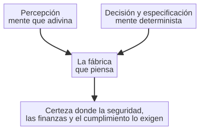

# Capítulo 15 --- Cuando la certeza importa

## Los lugares donde una suposición es un crimen

Ahora hemos conocido los dos tipos de mente: la mente supositora, flexible pero cierta de nada, y la mente calculadora, cierta pero que no improvisa. Hemos visto que la mente supositiva es un milagro para la percepción y el lenguaje, y que la mente calculadora es la única opción segura donde una decisión debe ser *conocida* como correcta. La pregunta que este capítulo responde es simple y decisiva: **¿dónde, en una fábrica que piensa, debe la decisión ser cierta?**

La respuesta es "más lugares de los que uno podría pensar", y es precisamente la concentración de estos lugares la que hace que la sexta revolución sea distinta de las anteriores. Permítanme nombrar los dominios, porque en cada uno de ellos una suposición probabilística no es meramente inadecuada sino peligrosa, y en cada uno de ellos la mente determinista --- la mente que puede *demostrar* su decisión --- es la única aceptable.

## El dominio de la seguridad

Considere el sistema de control industrial que gobierna un brazo robótico trabajando junto a un humano. Si la decisión de seguridad de ese brazo se toma mediante un modelo supositor, entonces hay, acechando en el modelo, una probabilidad pequeña pero distinta de cero a que se equivoque en el juicio --- que en una mañana con luz inusual, o una postura inusual, decida "seguro" cuando la realidad es "peligro", y un humano resulte herido. Esa probabilidad no tiene que ser grande; solo tiene que ser mayor que cero, y aun una probabilidad diminuta, aplicada a lo largo de millones de decisiones en toda una fábrica, se convierte en un riesgo real.

En los sistemas críticos para la seguridad, una probabilidad distinta de cero de una suposición catastrófica no es aceptable. La decisión debe ser *cierta*: o segura o peligrosa, demostrable, en cada ocasión. Es por esto que la mente determinista --- la mente que computa con reglas fijas y produce una respuesta garantizada --- es la única que puede ser confiada con la seguridad. Es la misma lógica que gobierna la industria aeronáutica, donde el comportamiento de un sistema debe ser demostrable ante una autoridad que lo certificará antes de permitir que un solo pasajero suba a bordo. La certeza no es un lujo en estos dominios; es el precio de admisión.

El mundo de la certificación nombra este requisito con precisión, y los nombres valen la pena conocerlos. La seguridad funcional --- la seguridad de un sistema *como consecuencia de su comportamiento correcto* --- se rige, en la industria, por normas tales como **ISO 26262** (automotriz) y **IEC 62443** (control industrial y automatización), las cuales exigen, sobre todo, que el comportamiento de un sistema sea *predecible, verificable y demostrable*. Un modelo probabilístico no puede satisfacer esto: su comportamiento es, por naturaleza, no completamente predecible, y no puede ser demostrado como correcto. Un sistema determinista sí puede. Esto no es una cuestión de gusto; es la condición bajo la cual un sistema crítico para la seguridad está permitido para operar en absoluto.

## El dominio de las finanzas

El segundo dominio es el financiero y el burocrático. Una fábrica no es solo un lugar donde se hacen cosas; también es un lugar que factura, que concilia cuentas, que reporta a las autoridades fiscales, que procesa contratos. En cada uno de estos, una suposición no es meramente inadecuada sino *responsabilidad legal*. Una factura con una cifra errónea no está "probablemente correcta"; está equivocada, y debe ser corregida, y puede conllevar multas. Una cláusula de contrato interpretada incorrectamente no está "probablemente correcta"; es una disputa, una pérdida, un juicio.

Aquí también la mente determinista es la opción segura, y aquí aparece en una forma particularmente interesante. Porque las reglas de la contabilidad, de la tributación, del derecho contractual, son --- a diferencia de las reglas de la visión o del lenguaje --- *escritas y explícitas*, pueden ser codificadas y ejecutadas determinísticamente. Una decisión que sigue reglas fijas y verificables no es una suposición; es un cálculo que puede ser auditado, reproducido y demostrado como correcto. Esto es exactamente el enfoque determinista que el laboratorio detrás de este libro aplica al lado administrativo de la fábrica, y es lo que hace que un agente sea digno de confianza con el dinero y con las palabras que una empresa no puede permitirse equivocarse. El dominio financiero es, en este respecto, el hogar natural de la mente calculadora: las reglas ya están escritas, así que la tarea no es *aprenderlas* sino *aplicarlas* con exactitud.

## El dominio de la conformidad

El tercer dominio es el regulatorio --- el mundo de las normas, las certificaciones y las auditorías. Las normas ISO, el SOC 2, la HIPAA y sus primos industriales no preguntan "¿fue tu decisión probablemente correcta?". Preguntan "¿puedes *demostrar* que tu decisión es correcta, en cada ocasión, y rastrearla hasta su origen?". Un modelo probabilístico no puede responder ninguna de estas preguntas, porque un modelo que supone no tiene un traceable demostrable. Un sistema determinista puede responderlas todas, porque su decisión se deriva de una especificación verificada mediante reglas fijas, y toda la traza --- desde el código fuente hasta la decisión --- es transparente y reproducible.

Para una fábrica en un sector regulado --- médico, financiero, aeroespacial, energético --- la conformidad no es un formulario que se rellena; es una condición de existencia. Y el único tipo de inteligencia que puede satisfacer a una autoridad de conformidad es aquella cuyo comportamiento es determinista, rastreable y demostrable. Es por esto que la mente determinista no es una curiosidad técnica en estos sectores sino un *requisito*.

## La traza auditable

Hay una cosa más que una autoridad de conformidad realmente busca, y vale la pena nombrarla, porque es la cosa concreta y física detrás de la palabra abstracta "certeza". Un auditor no pregunta "¿es tu sistema probablemente correcto?"; piden *ver la traza*. Quieren observar una sola decisión correr hacia atrás, desde la respuesta hasta su origen, y quieren ver, en cada paso, que el paso fue *determinado* --- fijo, reproducible y libre de discreción.

Esta es exactamente la traza que la mente determinista puede producir, y es la traza descrita por el capítulo anterior. Corre, ininterrumpida, desde el código fuente hasta la decisión: el código fuente produce el ensamblaje mediante la *compilación* (un proceso determinista), y el ensamblaje conduce la decisión --- ya sea una interfaz de usuario, una API generada o un verbatim computado --- mediante una *transformación algorítmica fija*. Cada elemento puede ser rastreado hasta su origen, y cada paso puede ser reproducido. Esta correspondencia entre especificación e implementación es, en el mundo de la certificación, todo el requisito. Cuando el front-end se deriva de un backend verificado mediante reglas deterministas, la correspondencia entre lo que se especificó y lo que se construyó es *inherente y demostrable* --- no una esperanza, no un resultado de prueba, sino una necesidad lógica. Eso es lo que un examinador del SOC 2 o un revisor de la HIPAA están buscando: no la confianza de un modelo, sino el *rastreabilidad* de un modelo.

## El cuarto dominio: el cuerpo mismo

Hay un cuarto dominio, y es aquel donde las apuestas son más altas que ninguna: el cuerpo humano. La medicina moderna se sustenta en software cuyo comportamiento debe ser *cierto*. Una bomba de infusión que administra un fármaco a una tasa exactamente controlada; un marcapazos que marca el ritmo de un corazón; una bomba de insulina que decide, momento a momento, cuánto de una hormona liberar; una máquina de radioterapia que apunta un haz. En cada uno de estos, una suposición probabilística no es una pequeña imperfección; es una amenaza directa a una vida humana.

Considere el páncreas artificial --- un sistema que lee el azúcar en sangre de una persona de forma continua y decide, automáticamente, cuánto insulina administrar. Es una idea hermosa, y ya es real, pero también es un sistema en el que una decisión errónea puede, en minutos, sumir a una persona en una coma. Las decisiones que toma deben ser *ciertas* en su aritmética, aunque el *sensores* sea probabilístico (el sensor es una aproximación aprendida, y puede estar equivocado). El arte de tal sistema es precisamente el arte de la sexta revolución: usar la mente supositiva para *percibir* (leer el sensor), y la mente determinista para *decidir* (computar la dosis mediante reglas fijas y verificadas que nunca pueden estar equivocadas). Las dos mentes, cada una en su lugar, protegen el cuerpo que se les confía.

Es por esto que el mundo de los dispositivos médicos se rige por normas tan estrictas como cualquier otra en ingeniería, y por qué un dispositivo que "funciona la mayor parte del tiempo" no es un dispositivo en absoluto. El regulador no pregunta si la máquina es *probable* que sea segura; pregunta si la máquina es *conocida* como segura, en cada entrada que podría recibir jamás. Ese es el terreno natal de la mente determinista, y es por eso que, en la sexta revolución, el cuerpo es uno de los lugares donde la certeza no es negociable.

## Una breve historia de la certeza en ingeniería

La demanda de certeza en ingeniería es más antigua que el cálculo, y su historia es una de las más instructivas de toda la tecnología. Antes de que nadie escribiera una línea de software, los ingenieros estaban aprendiendo --- a menudo a través de catástrofes --- que un sistema que lleva personas por el aire, o que sostiene un puente, o que contiene una reacción nuclear, no puede ser construido sobre "al parecer funciona".

Los hermanos Wright, a principios del siglo XX, son un ejemplo pequeño pero revelador: no solo construyeron una máquina voladora; construyeron un *túnel de viento* para medir, con precisión y repetidamente, las fuerzas sobre sus alas, de modo que su diseño se sustentaba en la medición y no en la esperanza. De esa cultura creció la disciplina de la seguridad aeronáutica, que, tras una serie de accidentes terribles en el siglo XX, se endureció en un conjunto de normas que no suponen nada y requieren que todo sea *demostrado*. Esa es la línea de descendencia del DO-178C, la norma que conocimos en el capítulo anterior, y de toda la cultura de verificación que gobierna el vuelo hasta hoy.

El cálculo heredó esta cultura y, al principio, no le fue fiel. Las primeras décadas del software fueron una larga lección sobre el costo de la *determinidad no verificada* --- sistemas que hacían exactamente lo que estaban programados para hacer, y que estaban exactamente equivocados. De esas lecciones creció el campo de los **métodos formales**: el uso de pruebas matemáticas para mostrar que el comportamiento de un programa coincide con su especificación, en cada caso posible. Los métodos formales son difíciles, y no se usan en todas partes, pero existen, y son la razón por la cual el software de control de vuelo de un avión moderno puede ser certificado, y un sistema de pago moderno puede ser confiado con mil millones de transacciones.

La lección de esta historia, para la sexta revolución, es que la certeza no es un *regalo* de la tecnología; es una *disciplina* que debe ser elegida. Un sistema determinista no es automáticamente un sistema *correcto* --- el Therac-25 y el Ariane 5 eran ambos deterministas, y ambos estaban equivocados de forma catastrófica. La certeza requiere que la determinidad sea *verificada*: que las reglas sean comprobadas, que las suposiciones sean examinadas, que toda la cadena sea demostrada. Cuando la sexta revolución dice que una decisión debe ser cierta, significa exactamente esto --- no meramente "la máquina hará lo mismo cada vez", sino "la máquina ha sido mostrada como haciendo la cosa *correcta* cada vez". Esa es una barra más alta, y es la barra que los dominios de seguridad, finanzas, conformidad y medicina exigen todos.

## La inteligencia combinada

Es importante, una vez más, insistir en que este capítulo no argumenta por el *reemplazo* de la mente supositora. La mente supositiva sigue siendo indispensable para la percepción, la predicación y el lenguaje --- las tareas donde la respuesta correcta puede ser mostrada pero no escrita. La fábrica que piensa debe por tanto llevar *ambas* mentes, y desplegar cada una donde sea seguro hacerlo:

La capa de sensing --- la cámara que ve un rasguño, el sensor de vibración que predice un fallo --- es la mente supositora, y es perfecta para su tarea. Pero la capa que *decide* qué hacer con el sensing, que verifica la decisión, que la demuestra correcta y la rastrea hasta el origen, es la mente determinista. Las dos se combinan, cada una en su lugar propio, y es esta combinación la que hace que la fábrica sea digna de confianza en los lugares donde la confianza no es negociable.

## La línea honesta

Demos la línea con honestidad, porque la honestidad es toda la virtud de la mente determinista. La mente determinista es superior donde la especificación es *completa* y las reglas son *conocidas*: donde puedes compilar la decisión en reglas fijas, o derivarla de una especificación compilada mediante transformación exacta. En estos lugares, no es meramente segura; es la mejor opción, porque es cierta, rastreable y demostrable. La mente supositiva es superior donde el mundo es caótico y la respuesta correcta solo puede ser *aprendida de ejemplos*: reconocimiento, traducción, predicación. En estos lugares, ningún sistema determinista podría funcionar, y la mente supositiva es la única opción.

La fábrica que piensa no elige entre la certeza y la flexibilidad; las *combina*. Supone donde la suposición es la única forma de conocer, y calcula donde el cálculo puede ser cierto. Y es sabio saber, antes de avanzar hacia la oficina que pondrá ambas mentes a trabajar, dónde exactamente se traza la línea --- porque una fábrica que supone sobre las cosas que deben ser ciertas es una fábrica construida sobre arena, sin importar cuán inteligentes sean sus máquinas.
