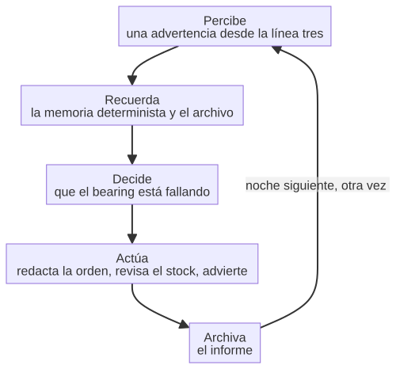

# Capítulo 16 --- La oficina a medianoche

## Se apagan las luces

Existe un tipo particular de silencio que se apodera de una oficina por la noche, una vez que la última persona ha recogido sus llaves y el guardia de seguridad ha completado su ronda. Las computadoras permanecen encendidas; los servidores zumban; la máquina de café, desconectada para bien de la tetera que nunca llega, conserva su pequeña calidez. Y en este silencio, algo ocurre que habría sido imposible hace una década, y que sigue siendo invisible para la mayoría de las personas que trabajan en oficinas durante el día. El trabajo no se detiene. Simplemente deja de ser realizado por una persona.

Esta es la visión que introduce este capítulo, y vale la pena formularla con claridad antes de adentrarnos en la mecánica, porque constituye la culminación de toda la cadena que hemos estado construyendo. La inteligencia que habita en la máquina (Parte II), la privacidad que mantiene los datos dentro de las paredes (Parte III), y la certeza que gobierna las decisiones que deben ser ciertas (Parte IV) --- todas estas se combinan aquí, en la oficina, para hacer real una posibilidad única y llamativa: una oficina que sigue trabajando tras el apagado de las luces, dirigida por un agente que conoce el negocio tan bien como cualquier empleado, y que nunca duerme, nunca se cansa y nunca filtra tus datos.

## La diferencia entre una herramienta y un empleado

Antes del agente, la oficina ya disponía de un gran número de herramientas. Había hojas de cálculo y procesadores de textos, clientes de correo electrónico y bases de datos, y --- cada vez más --- scripts que automatizaban tareas pequeñas y específicas. Una macro podía dar formato a un informe. Un script podía mover un archivo de una carpeta a otra. Estas son *herramientas*, y son útiles, pero son herramientas en el sentido estricto: hacen exactamente lo que se les ordena, sobre un documento o un archivo, y nada más. No tienen memoria del negocio, no comprenden qué significa el trabajo, ni capacidad para juzgar cuándo una tarea está concluida o para adaptarse a un caso inesperado.

El agente es distinto en su naturaleza, y la diferencia vale la pena nombrarla. Un agente no es una herramienta que hace una sola cosa; es un *empleado* al que se le asigna un *objetivo* --- "prepara el informe mensual", "concilia estas facturas", "advierte al gerente de que el cojinete de la línea tres se está dañando" --- y que por sí mismo da con la secuencia de pasos necesaria para alcanzar el objetivo, usando las herramientas que se le han dado, comprobando su propio trabajo a medida que avanza, y adaptándose cuando algo no transcurre como se planeó. Esta es la característica definitoria de lo que se llama un sistema *agentic*: no se limita a ejecutar una orden; *persigue un objetivo con un grado de autonomía*, planificando, actuando, observando el resultado y ajustándose.

Y, crucialmente, el agente tras este libro no es un chatbot genérico de estantería que responde preguntas en una ventana. Es un sistema autoalojado que ejecuta el conocimiento del *negocio propio* --- los documentos, los sistemas, la historia --- sobre tu propio hardware, manteniendo ese conocimiento por completo de tu lado de la pared. Es, en el sentido más pleno, un empleado que habita en tu edificio y nunca abandona tus instalaciones.

## Por qué la oficina es la frontera final

Quizá te preguntes por qué, en un libro sobre máquinas y nubes, dedicamos un capítulo a la oficina. La respuesta es que la oficina es el *eslabón final* de la cadena, y que además --- quizás sorprendentemente --- es el lugar donde la revolución es más, y más visiblemente, necesaria. Durante décadas, la revolución industrial transformó el *suelo de fábrica*: el trabajo físico de fabricar cosas. Pero la *oficina* --- el trabajo de coordinar, documentar, calcular y comunicarse --- se dejó casi por completo a los humanos. El contable aún hace el recuento; el oficinalista aún archiva; el gerente aún redacta; el oficial de adquisiciones aún escribe a los proveedores. Este trabajo de oficina es enorme, repetitivo y cada vez más rico en datos, y ha carecido, hasta ahora, de cualquier automatización que vaya más allá de algunas macros.

El sexto revolución lo alcanza. Lo alcanza no con un chatbot genérico, sino con un agente que está *anclado* a la fábrica --- que lee la telemetría procedente de las máquinas, los datos guardados a salvo en la nube privada, y las decisiones que deben ser ciertas --- y que *concluye el trabajo que esas cosas exigen*. El agente es el punto en que la inteligencia de la fábrica se convierte en la productividad de la oficina. La máquina percibe; la nube guarda el secreto; el agente decide y actúa. Y el trabajo sobre el que actúa es, a menudo, trabajo de oficina: la contabilidad, lo legal, las adquisiciones, los informes, el servicio al cliente.

## Una curiosidad: las fábricas que ya siguen trabajando en la oscuridad

Antes de descender más en la oficina a medianoche, vale la pena saber que la frase no es del todo nueva para la industria. Existe, en la manufactura moderna, un término bien establecido para una planta que transcurre toda la noche sin un solo humano en su interior --- una fábrica de *luces apagadas*. La palabra proviene de la circunstancia más literal: en algunas de estas plantas el aire es tan puro, y el proceso tan sellado, que mantener las luces encendidas sería un derroche; las máquinas no necesitan ver, y por eso no necesitan la luz, y por eso no necesitan a las personas que de otro modo necesitarían la luz para ver. La industria de los semiconductores, en particular, construyó salas limpias enteras que operan sin personas, porque un humano en una sala limpia es en sí mismo una fuente de contaminación --- células de la piel, fibras, la perturbación silenciosa de una respiración. Así que la fábrica aprendió, hace décadas, a trabajar en la oscuridad y en silencio, y a medir su producción no en los cambios de turno de su personal, sino en el flujo continuo de unidades que salen de una línea.

Esta es una curiosidad que vale la pena conservar, porque nos hace dos cosas a la vez. La primera es mostrar que "la oficina a medianoche" no es un sueño del futuro, sino la extensión lógica de algo que ya existe en el suelo de fábrica: un sistema que sigue produciendo mientras las personas se van a casa. La segunda es establecer una distinción que la oficina debe ahora aprender a hacer por sí misma. Una *fábrica de luces apagadas* trabaja por la noche porque su trabajo es físico, sellado y medible --- las máquinas no necesitan leer los contratos privados de una empresa ni responder al correo ansioso de un cliente. La oficina aún no sabe cómo oscurecerse, porque su trabajo no está sellado: está lleno de contexto, de historia, de los hechos exactos y irrepetibles de un negocio concreto. Es precisamente lo que el agente cambia. La oficina puede oscurecerse por fin, porque el agente es el primer empleado que no necesita ver la sala para hacer el trabajo --- solo necesita el conocimiento propio de la empresa, guardado a salvo, y un objetivo digno de perseguir.

## El mar del trabajo administrativo

Hay un hecho que hace que la oficina a medianoche se sienta tan grande como realmente es, y es un hecho sobre la *escala*, no meramente sobre la tecnología. El trabajo que ocurre en una oficina --- la coordinación, la documentación, el cálculo, la comunicación --- es, en las economías que la han construido, enormemente mayor que el trabajo del suelo de fábrica, y ha crecido sin cesar. La propia palabra para el trabajador de oficina es comparativamente joven: "white-collar" (cuello blanco) fue acuñada en 1899 por el periodista y autor estadounidense William H. White, para distinguir al oficinalista y al vendedor, que trabajaban en interiores con camisa y corbata, del trabajador "blue-collar" (cuello azul) del taller y del campo, que trabajaba con monos de trabajo. En los ciento veinte años transcurridos desde que esa palabra fue inventada, la fuerza laboral de cuello blanco ha crecido en muchos órdenes de magnitud. Donde una fábrica en 1920 podría haber empleado a un centenar de hombres en las máquinas y un puñado de oficinalistas en los escritorios, una fábrica hoy podría emplear a un centenar de hombres en las máquinas y a un par de cientos de oficinalistas, calculadores, archivistas, programadores y corresponsales en sus escritorios --- y el número de estos últimos sigue subiendo mientras los primeros se mecanizan.

Esta es la gran ironía de la historia de la productividad del siglo XX: a medida que las máquinas asumieron el trabajo *físico*, el trabajo *documental* creció en lugar de disminuir. La oficina no se encogió para llenar el espacio que las máquinas dejaron; se desbordó. El libro de contabilidad del contable, una vez guardado en un único libro encuaderado, hoy abarca sistemas, reguladores y códigos tributarios; el archivado del oficinalista, una vez asunto de tinta e índice, hoy abarca documentos, versiones y las palabras exactas de una conversación sostenida hace tres meses; la redacción del gerente, una vez una carta, hoy abarca informes, cotizaciones y el lenguaje preciso de cumplimiento de una docena de jurisdicciones. Este es un trabajo de carácter enorme, repetitivo y cada vez más rico en datos --- y durante la mayor parte de su historia ha carecido de cualquier automatización que vaya más allá de algunas macros. El sexto revolución lo alcanza, porque el agente es el primer empleado que puede leer todo ese mar de documentación de la manera en que lo haría un oficinalista experimentado, sin cansarse, sin filtrar y sin olvidar una sola palabra de ella.

## La oficina a medianoche, paso a paso

Para ver que esto no es meramente una visión, sino una secuencia --- una cosa real que ocurre en un orden real --- ayuda observar la propia noche del agente, dibujada como un pequeño flujo, de modo que el contorno del trabajo quede claro. Lo que el agente hace a medianoche no es una sola acción, sino una cadena, y la cadena es la misma que gobierna a la máquina: percibe, recuerda, decide, actúa, archiva.

Esta es la oficina a medianoche, dibujada en cinco pasos. No es ciencia ficción. Es la conclusión natural de la cadena --- y el agente que realiza este trabajo, con su memoria patentada y su entorno de contención, es el tema del próximo capítulo. Pero antes de descender en sus detalles, debemos comprender la forma de toda la cadena, la manera en que la máquina, la nube, el agente y la oficina se conectan en un único bucle continuo. Esa forma --- el gráfico de la "Industria 7.0" --- es el tema del capítulo que sigue al próximo. Por ahora, dejemos que la oficina a medianoche sirva como anticipo de lo que se avecina.

## Un ejemplo real: el turno de noche que nunca termina

Para hacer esto concreto, observemos una oficina específica a medianoche --- no la oficina de una fábrica, sino la oficina de contabilidad de un fabricante de tamaño medio, el tipo de oficina que existe en casi cada pueblo con una fábrica, y que siempre, hasta ahora, ha sido el lugar donde el trabajo del día se desfilaba silenciosamente hacia el día siguiente. Durante años, la contable del turno tarde llegaba a las seis de la tarde, y hacía lo que la oficina hace al final de un día: cerraba los libros sobre los pedidos del día, conciliaba las facturas que se habían emitido contra los envíos que habían salido del almacén, y redactaba el informe que el leería a las nueve de la mañana. Era un trabajo real, un trabajo cuidadoso, y era, por completo, manual. Si un envío había sido devuelto, o si una factura no coincidía con su pedido, se detenía y perseguía la discrepancia a mano --- por teléfono, por correo electrónico, releyendo el papeleo. El trabajo no se detenía cuando se iba; simplemente esperaba a que regresara.

Ahora la misma oficina trabaja a medianoche, y trabaja sin ella. El agente retoma el hilo exactamente como lo haría un oficinalista experimentado. Redacta el informe de cierre del día en el propio lenguaje y estilo de la empresa, y donde un humano habría adivinado una cifra faltante, *recupera* el contexto relevante preciso --- la factura, el envío, la devolución --- desde el propio archivo de la empresa y su nube privada, de forma exacta y sin volver a derivarla. Donde un humano habría hecho una hoja de cálculo a mano, el agente puede conducir la misma biblioteca de hojas de cálculo que usaría un oficinalista diestro, construyendo el libro con los datos, los estilos y el gráfico en una sola página A4, y entregando el archivo concluido. Y donde la contable del turno tarde una vez persiguió una discrepancia por teléfono hasta las diez de la noche, el agente comprueba en el almacén la pieza de repuesto o la cifra faltante no mediante una consulta rígida, sino de la manera en que lo haría un oficinalista experimentado --- leyendo el inventario, adaptándose a lo inesperado, y advirtiendo al gerente con palabras calmas y llanas. Hace todo esto sin un humano en el edificio, usando un conocimiento que nunca abandonó la empresa, y lo hace con la misma fiabilidad que gobierna a la máquina. A la mañana siguiente, la contable llega a las nueve; no *hace* el trabajo; *revisa* el trabajo del agente, y firma lo que es correcto. Ese es el turno de noche que nunca termina, y no es ciencia ficción.

## Los propios límites del agente

Sería deshonesto pintar al agente de la oficina como un trabajador ilimitado, y la honestidad aquí es más valiosa que el entusiasmo, porque los límites son exactamente lo que hacen que el agente sea digno de confianza. El agente tras este libro es un trabajador potente, pero es un *limitado*, y los límites son deliberados.

El primer límite es el entorno de contención. Las acciones del agente transcurren por un perímetro restringido incorporado en la arquitectura, de modo que una llamada a una herramienta no puede salirse de su ámbito asignado; las acciones sobre archivos son reversibles, gracias a la versión; y se le concede al agente, por diseño, cero capacidades de ejecución de código, precisamente para que no pueda crear ni ejecutar código. Este es un límite que un proveedor descuidado llamaría una función faltante, y que un cuidadoso llamaría la razón por la que el agente puede entregarse trabajo de negocio real en absoluto.

El segundo límite es el conocimiento. El agente solo conoce lo que se le ha dado --- los documentos de la empresa, su historia, su archivo --- y solo es tan bueno como ese material. Una empresa con un archivo desorganizado alimenta una memoria desorganizada; una empresa con un archivo claro alimenta uno claro. El agente es un reflejo del propio orden de la empresa, hecho permanente y recuperable, y no puede conocer lo que nadie le ha dicho.

El tercer límite es el criterio. El agente propone; no *responde*. Puede redactar el informe, comprobar el existente y advertir al gerente, pero no puede asumir la responsabilidad por el resultado --- eso, como insistirá la próxima parte del libro, sigue siendo humano. El agente es el empleado que hace el hacer; el humano es quien firma. Y esa división no es debilidad del agente; es la forma de la confianza.

## Por qué la oficina fue la última en mecanizarse

Hay una pregunta vale la pena responder con claridad, porque hace más clara la visión: ¿por qué, si el suelo de fábrica se mecanizó en ciento cincuenta años, la oficina llegó tan tarde a la revolución? La respuesta es que la oficina no carecía de herramientas; carecía de *contexto*. Durante décadas la oficina fue, si cabe, más completamente instrumentada que el suelo de fábrica --- hojas de cálculo, procesadores de textos, bases de datos, sistemas de correo electrónico, sistemas empresariales que ataban las cuentas a las adquisiciones a los envíos. Lo que nunca tuvo fue un empleado que realmente *usara* esas herramientas de la manera en que lo hace una persona diestra: leyendo contexto, recordando historia, juzgando cuándo una tarea está concluida y adaptándose al caso inesperado. Una macro puede dar formato a un informe; un script puede mover un archivo de una carpeta a otra; un sistema empresarial puede calcular una factura. Pero ninguno de ellos puede *conocer el negocio* --- los clientes, el estilo, la historia, las reglas no dichas de cómo hace su trabajo esta empresa concreta. Ninguno de ellos puede juzgar que una factura concreta es incorrecta, o que un cliente concreto merece una excepción, o que un informe concreto debe escribirse de una manera concreta.

Es precisamente lo que el agente cambia, y por eso la oficina fue la última frontera. La máquina se mecanizó primero porque su trabajo es *físico, sellado y medible* --- un husillo gira o no gira, y los sensores que lo vigilan no necesitan comprender la empresa. La oficina se mecanizó última porque su trabajo es *contextual, histórico e irrepetible* --- depende de conocer esta empresa, sus clientes, sus documentos y su historia, y ninguna cantidad de redacción de macros podría suplir ese conocimiento. El sexto revolución alcanza la oficina por fin no porque las herramientas finalmente llegaran, sino porque el *empleado* finalmente llegó: un agente que conoce el negocio, que se ejecuta en tu propio hardware, y que nunca filtra tus datos. Y una vez que ese empleado existe, la oficina a medianoche deja de ser un sueño y se convierte, sencillamente, en una oficina que trabaja.
