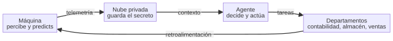

# Capítulo 18 --- La cadena: máquina, nube y departamento

## Retroceder para ver la forma

Hemos recorrido, pieza por pieza, todos los componentes de la sexta revolución industrial. Hemos conocido la máquina que piensa en un chip, la nube que guarda su secreto y el agente que conoce tu negocio y nunca olvida. Individualmente, cada uno es impresionante. Pero la razón por la que este momento —esta sexta revolución— es genuinamente distinto de toda revolución anterior es que los componentes no están meramente *presentes*; están *conectados*, en un único bucle continuo en el que la salida de uno se convierte en la entrada del siguiente, y el último retrocede hasta el primero. Este capítulo es ese paso atrás que te permite ver la forma entera de una vez, porque ver la forma marca la diferencia entre un montón de piezas y una sola máquina.

El bucle tiene cuatro etapas, y vale la pena tenerlas en mente juntas antes de ampliar cada una:

La máquina percibe su mundo y produce telemetría. La nube privada recibe esa telemetría y la guarda con seguridad, coherencia y capacidad de búsqueda. El agente recupera el contexto relevante y preciso desde la nube y desde tu base de conocimientos, decide qué hacer y actúa. Su acción es la automatización del trabajo de un departamento —la contabilidad, el almacén, las ventas, el soporte—. Y el trabajo del departamento, a su vez, genera nuevos requisitos y nuevas acciones que retroceden hacia la máquina y la nube. El bucle está cerrado. La fábrica es, en el sentido más pleno de la palabra, *auto-coordinada*.

## Una curiosidad: la palabra para un bucle

Vale la pena detenerse, en este capítulo sobre un bucle, para plantear una pregunta sencilla —¿qué significa realmente cuando llamamos a esta forma "bucle", y de dónde procede la palabra? El término que nombra con mayor precisión la idea que estamos usando es **cibernética**, acuñado en 1948 por el matemático estadounidense Norbert Wiener cuando publicó un libro con ese nombre. La palabra es más antigua que la disciplina; procede, sin cambios, del griego antiguo *kubernan* —gobernar un barco, sostener el timón—. Un *kubernetes* era el timonel, aquel que mantenía una embarcación en su rumbo leyendo, constantemente, la diferencia entre donde estaba el barco y donde pretendía estar, y corrigiendo esa diferencia a medida que cambiaba el mar. Esto es, exactamente, lo que hace nuestro bucle: lee, continuamente, la diferencia entre el estado de la fábrica y el estado en que la fábrica quiere estar, y corrige esa diferencia —a través de la máquina, a través de la nube, a través del agente, a través de los departamentos— mientras el bucle esté cerrado.

La palabra lleva consigo, en silencio, toda una filosofía del control. Antes de la cibernética, la ingen pensaba mayoritariamente en las máquinas como cosas que simplemente *hacían* lo que se les ordenaba, una sola vez. La cibernética enseñó a todo un campo a pensar en cambio en máquinas que *observan, comparan y ajustan* —el servomotor, el termostato, el regulador de una máquina de vapor, el conductor humano que mantiene el coche en su carril mirando constantemente a la carretera y girando la rueda un milímetro—. El bucle de la sexta revolución pertenece, en espíritu, a esa tradición. La fábrica que piensa es una fábrica que *se gobierna a sí misma*, y la palabra para eso es la palabra que hemos estado usando todo el tiempo, lo supiéramos o no.

## La oficina que ya estaba siendo conectada

Antes de la sexta revolución hubo intentos reales y documentados de hacer exactamente lo que hace este bucle —conectar las máquinas de una fábrica a la oficina que la gestiona—, y es honesto nombrarlas, porque muestran cuán lejos había llegado el mercado y cuán lejos todavía le quedaba por recorrer. La procedencia comienza, sorprendentemente, con la contabilidad de los materiales. En las décadas de 1950 y 1960, un hombre llamado Joseph Orlicky, que trabajaba en el control de inventarios, dio origen a **MRP** —Material Requirements Planning, o Planificación de Requisitos de Materiales—, una forma de calcular, a partir de una lista de materiales y un calendario de lo que se iba a fabricar, exactamente qué materiales se necesitaban y cuándo. En los 70 esto creció hasta **MRP II**, Manufacturing Resource Planning, o Planificación de Recursos de Fabricación, que reunió la programación de la fábrica, su inventario y su contabilidad de costos bajo un único cálculo integrado. Y en los 80 y 90 la idea se expandió más allá de las paredes de la fábrica hacia **ERP** —Enterprise Resource Planning, o Planificación de Recursos Empresariales—, los grandes sistemas integrados que intentan gestionar toda una empresa, desde sus pedidos hasta su nómina, como un único conjunto coherente de números.

Este es el precedente que debemos nombrar, porque la sexta revolución es, en un sentido, el *siguiente* paso por la misma carretera. El ERP fue una revolución en sí mismo —fue el primer software lo suficientemente ambicioso como para tratar a una empresa como un único sistema continuo en vez de una colección de escritorios—. Pero tenía un límite estructural que la sexta revolución supera, y ese límite vale la pena declararlo, porque es el límite que hace necesaria la nube interna. El ERP clásico conectaba la *oficina* consigo misma: las cuentas con la compra, con el almacén. Lo que no conectaba, y no podía conectar, era la *máquina* —la realidad física del piso de fábrica, vista a través de un chip en un husillo, en tiempo real—. Era un sistema de oficina mirando hacia dentro, al papeleo; la sexta revolución es un sistema de oficina mirando *hacia fuera*, a la máquina, y luego de vuelta hacia dentro de nuevo, en un bucle. La cadena que hemos dibujado es el matrimonio de esas dos procedencias: el cálculo integrado del ERP, finalmente unido a la percepción viva de la máquina y a la memoria privada de la nube.

## La dirección del bucle

No pasemos por alto el orden de estas etapas, porque el orden es significativo. El bucle comienza en lo *físico* —la máquina que percibe— porque la sexta revolución se trata fundamentalmente de introducir la inteligencia en el mundo físico de fabricar cosas, no meramente de el mundo del papel y los datos. La inteligencia no flota libre; está *anclada* al estado real de la fábrica. Luego fluye *hacia dentro* —a la nube privada, que la guarda con seguridad— y luego *hacia arriba* —al agente, que razona a partir de ella, y a los departamentos, que actúan sobre ella*. Esta es la dirección del valor: desde la realidad física de la máquina, a través de la memoria segura de la nube, hasta el juicio del agente, hasta la acción de la oficina.

Obsérvese también que esto es deliberadamente lo *opuesto* al modelo antiguo. En el modelo antiguo, la inteligencia vivía en una sala llena de ordenadores, y las máquinas del piso eran esclavas actuadores mudos; la inteligencia descendía *hacia el piso*, pobremente, como un conjunto de reglas. En la sexta revolución, la inteligencia está *integrada en* la máquina, y fluye *hacia fuera* —a través de una nube que la empresa controla, a través de un agente que conoce el negocio— para automatizar el trabajo que, hasta ahora, era enteramente humano. La dirección se invierte, y con ella toda la economía de la fábrica.

## La palabra clave: la nube interna

Hay una frase en el diagrama que merece ser repetida, porque es la frase que hace posible todo el bucle a nivel político y técnico: la nube **interna**, privada. Todo intento anterior de conectar las máquinas de una fábrica a su oficina pasaba por una nube *pública* —los gigantes centros de datos centralizados que datagate demostró que podían ser leídos, o compelidos a leer, por una tercera parte. Ese es un acuerdo que ninguna empresa que valore su futuro puede cerrar, porque la telemetría que fluye desde la máquina es precisamente la imagen del futuro de la empresa, hecha visible. Una nube pública convertiría ese activo más sensible en datos de otra persona.

La nube interna, privada, de conocimiento nulo —la nube que se mantiene dentro de las paredes— es lo que permite cerrar el bu sin traición. Recibe la telemetría de la máquina, la mantiene coherente y buscable en toda la empresa, y permite al agente recuperar el contexto relevante exacto —y en todo esto nunca conoce el contenido, porque la empresa guarda la clave—. El bucle puede por tanto correr continuamente, con seguridad y de forma privada, y esa es la única clase de bucle que una empresa puede confiar con su propio futuro. Este es el tema de la Parte III, repetido aquí porque es la razón por la que el bucle es incluso posible.

## El bucle, medido en datos

Para hacer concreto el bucle, ayuda ver exactamente qué fluye a través de él, porque un bucle no es una abstracción —es un flujo de cosas específicas, moviéndose en una dirección específica, a una tasa específica—. En la base del bucle, la máquina percibe, y lo que envía *hacia arriba* es telemetría: las lecturas de sus sensores, en tiempo real, cifradas mientras viajan, y guardadas con seguridad en la nube privada. Este es un dato sobre el estado físico de la fábrica —la temperatura de un husillo, la vibración de un motor, la energía que consume una máquina— recogido no para vigilar la máquina sino para *predecirla*. Desde la nube, lo que fluye *hacia arriba* no son datos sin procesar sino contexto: el agente no se ahoga en un flujo de números; recupera el contexto preciso y relevante desde la nube y desde la propia base de conocimientos de la empresa, y decide qué hacer con ese contexto. Y su decisión fluye *hacia arriba* una vez más, como una acción —una tarea automatizada o una especificación— hasta el departamento, que actúa sobre ella.

Ahora observa cómo se cierra el bucle, y observa qué fluye *de vuelta*. La acción del departamento —un pedido realizado, una factura conciliada, un proveedor avisado— genera nuevos requisitos y nuevas acciones, y esas retroceden *hacia abajo* hacia la máquina y la nube, informando del próximo ciclo de percepción, el próximo ciclo de memoria, el próximo ciclo de decisión y acción. El bucle no es un conducto que lleva datos en una sola dirección y se detiene; es un sistema cerrado en el que la salida de cada etapa se convierte en la entrada de la siguiente, continuamente, sin que un humano pase cada pieza de trabajo de un escritorio a otro a mano. Esto es lo que significa "auto-coordinada", concretamente: no una máquina que se *ordene* qué hacer, sino un sistema cuya propia salida impulsa su propia siguiente entrada, para siempre, mientras el bucle esté cerrado.

## Por qué el bucle no es una pirámide

Hay una distinción sutil pero importante que vale la pena trazar, porque es la distinción entre una máquina que meramente *ejecuta* y una máquina que *auto-coordina*. Una pirámide es una jerarquía: las órdenes fluyen hacia abajo desde la cima, y los informes fluyen hacia arriba desde la base, pero nada en la base cambia lo que hay en la cima —la jerarquía es *estable* en el sentido de que la cima siempre decide y la base siempre obedece. Un bucle, en cambio, no es estable de esa manera; es *dinámico*: la salida de la base retrocede hacia la cima y cambia lo que la cima decide a continuación. Esta es la diferencia entre una fábrica que se *manda* y una fábrica que se *auto-coordina*.

Es por esto por lo que el bucle importa tanto, y por lo que es el corazón del capítulo. Las seis revoluciones anteriores hicieron la máquina más poderosa, luego más conectada, luego más informatizada, pero en ningún momento la máquina *se coordinó a sí misma*: en ningún momento su propia salida impulsó su propia siguiente entrada, continuamente, sin un humano en el bucle. La sexta revolución es la primera que lo hace.

## La latencia del bucle

Hay una propiedad del bucle que es fácil pasar por alto y que decide, en la práctica, si funciona: su *velocidad*, y el hecho de que diferentes partes de él deben correr a distintas velocidades. Un único bucle que intentara correr todo a la velocidad de la parte más lenta sería inútil; un bucle que intentara correr todo a la velocidad de la parte más rápida sería inseguro. La sexta revolución funciona porque corresponde a cada decisión su propio escala de tiempo.

En el **borde**, el bucle corre en microsegundos. La máquina que percibe su propia vibración y actúa sobre ella —frenar un motor, ajustar una trayectoria, rechazar una pieza— debe decidir en el tiempo que tarda en completar la tarea física, a menudo milésimas de segundo. Este es el escala de tiempo del reflejo, y es por lo que la inteligencia debe vivir en la máquina, en el chip, y no en una sala.

En la **nube**, el bucle corre en segundos y minutos. La telemetría se resume y se envía, la nube privada la almacena y la hace buscable, y el agente recupera el contexto preciso y razona sobre él. Este es el escala de tiempo de la memoria y el juicio —suficientemente rápida para detectar una tendencia, suficientemente lenta para pensar—, y es por lo que la nube privada existe como una capa aparte, con su propio ritmo.

En la **oficina**, el bucle corre en horas y días. El agente redacta la orden de mantenimiento, el almacén pide la pieza, la contabilidad concilia la factura, se le dice al cliente la fecha de entrega. Este es el escala de tiempo del trabajo que un humano habría hecho a lo largo de un día, ahora terminado durante la noche, y es por lo que la automatización de la oficina es la cima del bucle y no su base.

El arte de la sexta revolución, en términos de ingeniería, es *corresponder la decisión a la escala de tiempo*. Una decisión de seguridad que debe tomarse en un milímetro de segundo no puede esperar a la nube; una decisión estratégica que debería ponderar un año de historia no puede tomarse en el borde. El bucle funciona porque cada capa corre a la velocidad que su propia pregunta exige —reflejo, memoria, trabajo—, y porque las capas están conectadas, de modo que un reflejo rápido y un juicio lento pueden seguir siendo parte del mismo entero.

## El bucle es la revolución

Cerremos este capítulo con la idea que lo ata a todo el libro, porque es la idea para la que el libro está construido para transmitir. La sexta revolución industrial no es la máquina, ni la nube, ni el agente, ni la automatización de los departamentos. Es el *bucle* —el flujo continuo y auto-coordinado desde la máquina, a través de la nube privada, a través del agente, hasta los departamentos, y de vuelta otra vez. Es el momento en que la fábrica se convierte en un único sistema auto-coordinado en vez de una colección de máquinas inteligentes y oficinas inteligentes que por casualidad están situadas cerca las unas de las otras.

Y hay una dimensión humana del bucle que aún no hemos nombrado, porque es la más importante. El bucle que hemos dibujado es un bucle de *máquinas y agentes*. Pero no es un bucle que *reemplace* al humano; es un bucle que *reubica* al humano, promoviendo al último eslabón de la cadena hacia arquitecto y director de todo el conjunto. La máquina percibe; el agente decide; el humano *sostiene la autoridad para vetar, para juzgar si la decisión vale la pena ser ejecutada, y para asumir la responsabilidad del resultado*. El bucle no es libre de humanos; es humanos-elevado. Esa elevación —ese paso del último eslabón al director— es el contenido humano de la sexta revolución, y es el tema de la próxima parte de este libro.

Por ahora, dejemos que el bucle se mantenga: la máquina, la nube, el agente y el departamento, conectados en un único sistema continuo y auto-coordinado. El próximo capítulo abrirá el departamento y mostrará qué hace exactamente la automatización en la contabilidad, el almacén, las ventas y el soporte. Y el capítulo siguiente dará nombre y forma a todo el bucle, el gráfico de la "Industry 7.0".
