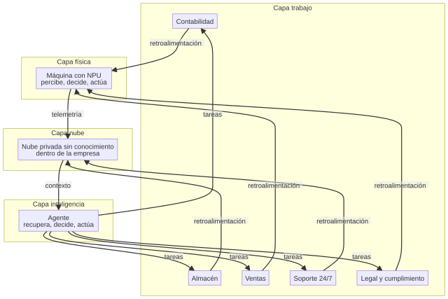

# Capítulo 20 --- El grafo que conecta todo

## El nombre del conjunto

Hemos recorrido cada uno de los componentes de la sexta revolución por turno. Es hora de dar nombre al conjunto, y de mostrarlo tal como realmente es: no como una línea, sino como un *grafos* --- un conjunto de conexiones en el que cada nodo alimenta a los demás, en un todo continuo y auto-coordinado. Este es el grafos de la **Industry 7.0**, y es la forma del futuro que este libro ha estado describiendo desde la primera página. El número "7.0" no es arbitrario. Las revoluciones anteriores hicieron la máquina más potente, luego más conectada, luego más informatizada. La séptima, en el marco que adopta este libro, es aquella en la que las máquinas mismas se vuelven *periféricas de una IA interna*, y la IA --- agéntica, conectada a una nube privada --- automatiza todo el conjunto de la empresa, desde la máquina hasta cada departamento.

Demos forma al grafos, cuidadosamente, porque el grafos es la esencia del argumento y verlo como un conjunto es la diferencia entre comprender la sexta revolución y simplemente quedar impresionado por sus partes.

## El grafos

## Una curiosidad: los siete puentes, y el primer grafos

Antes de leer el grafos, vale la pena saber que la palabra "grafos", en este sentido --- un conjunto de puntos unidos por líneas --- tiene un origen sorprendente y bastante lúdico, porque las matemáticas de los grafos comenzaron no con la ingeniería sino con un acertijo. En la ciudad prusiana del siglo XVIII de Königsberg (hoy Kaliningrad, sobre el río Pregel), había un río con dos islas y siete puentes que conectaban las dos orillas y las dos islas. Los habitantes se entretenían con una pregunta: ¿se podía dar una caminata que cruzara cada uno de los siete puentes exactamente una vez y regresar al punto de partida? En 1736, el matemático suizo **Leonhard Euler** resolvió la pregunta --- y la resolvió en sentido negativo, con una prueba tan limpia que sigue enseñándose hoy. Pero fue más que una solución a un juego de salón: para responderla, Euler tuvo que pensar en las masas de tierra como *puntos* y en los puentes como *líneas*, y medirlas no por su longitud ni por su material sino puramente por *cómo estaban conectadas*. Al hacerlo, inventó lo que hoy llamamos teoría de grafos, y nos dio el propio vocabulario de "nodos" y "aristas" que estamos usando para descriir la fábrica de la Industry 7.0.

Esta es una curiosidad que vale la pena conservar, porque la intuición de Euler es exactamente la intuición de la que depende nuestro grafos. El grafos de la Industry 7.0 no se dibuja a escala; no importa cuán "larga" sea la conexión entre la máquina y la nube, o cuán "ancha" sea el nodo del almacén. Lo que importa, como mostró Euler, es puramente *cómo están conectados los nodos* --- qué nodo alimenta a cuál, en qué orden, y cómo el conjunto se cierra en un bucle. La máquina alimenta a la nube; la nube alimenta al agente; el agente alimenta a los departamentos; los departamentos retroalimentan. Ese es todo el argumento, reducido a conexiones. El poder del grafos no está en los nodos sino en las *aristas*, y no solo en las aristas tampoco --- está en el hecho de que las aristas, por fin, *retroalimentan*.

## Leer el grafos

Leemos el grafos de abajo hacia arriba, y luego vemos cómo retroalimenta.

En el **fondo** está la capa física: la máquina equipada con su chip inteligente, la computadora de placa única con la NPU que percibe, decide y actúa sobre una placa única, sin ventilador y barata. Esta es la capa que conocimos en la Parte II --- la máquina que despertó. Es el ancla de todo el grafos, porque es el punto en el que la inteligencia se encuentra con el mundo físico de hacer cosas.

Fluyendo hacia arriba desde la máquina hay un flujo de **telemetría**, cifrado en tiempo real. Este flujo no va a una nube pública; va, en el siguiente nivel, a la **nube privada, sin confianza y de conocimiento nulo mantenida dentro de la empresa** --- la nube de la Parte III, que recibe y conserva los datos sin poder jamás leerlos, porque la empresa posee la clave. Esta es la memoria del sistema, coherente y buscable en toda la empresa, y a salvo de todo tercero.

Desde esa nube, el agente --- el **agentic AI** de la Parte V --- recupera el contexto preciso y relevante, tanto de la nube como de la propia base de conocimiento de la empresa. El agente decide qué hacer y actúa. Y su acción es la **automatización de los departamentos**: contabilidad, almacén, ventas, marketing, atención al cliente, legal y cumplimiento. Estos son los nodos en la parte superior del grafos --- el trabajo que la sexta revolución finalmente automatiza, la oficina que sigue trabajando tras apagarse las luces.

## El retroalimentar

Ahora la parte crucial, la que lo hace un *grafos* y no meramente una pirámide. La automatización de los departamentos no concluye la historia; la *retroalimenta*. La contabilidad que reconcilia una factura genera un nuevo requisito. El almacén que pide una pieza de repuesto genera nueva telemetría. Las ventas que analizan un mercado generan un nuevo plan. Y todos estos requisitos, retroalimentaciones y nuevos datos fluyen *hacia abajo* de vuelta a la máquina y a la nube, informando el próximo ciclo de percepción, el próximo ciclo de memoria, el próximo ciclo de decisión y acción. El grafos está cerrado. El sistema es auto-coordinado.

Este es el "7.0" de la Industry 7.0: no un nuevo tipo de máquina, sino una nueva *arquitectura* en la que las máquinas se vuelnen periféricas de una IA interna, y la IA --- agéntica, conectada a una nube privada, conocedora del negocio --- automatiza todo el conjunto de la empresa, en un bucle continuo. La piensa; la nube recuerda; el agente decide; la oficina actúa; y la acción retroalimenta para informar el próximo pensamiento. El conjunto es mayor que la suma de sus partes, porque el conjunto es un *bucle*, y un bucle conserva su propio impulso.

## Los dos tipos de inteligencia en el grafos

Una última lectura del grafos, porque vuelve a enlazar con la Parte IV. El grafos contiene ambos tipos de inteligencia que hemos conocido --- la mente adivinatoria y la mente determinista --- y sitúa cada una donde es segura: el **sensing** en el fondo (la máquina que percibe) es la mente adivinatoria, perfecta para la percepción; la **decisión y especificación** en el agente y en la nube es la mente determinista, cierta y trazable. El grafos no es una sola inteligencia; es una *combinación*, cada mente en su lugar propio, y es esta combinación la que hace que el conjunto sea confiable en los lugares donde la confianza no es negociable.

## El conjunto en un solo aliento

Ayuda, en un grafos, leerlo como un solo movimiento, de modo que la forma no se vea meramente sino que se siga. Leemos el conjunto entero, desde la máquina hasta la oficina y de vuelta, en un solo aliento. En el fondo, un huso en el piso de una fábrica lleva un chip que percibe su mundo --- la temperatura de su rodamiento, la vibración de su motor --- y predice, desde esa percepción, que el rodamiento fallará. Esa predicción fluye, cifrada, a una nube privada, sin confianza y de conocimiento nulo mantenida dentro de la empresa, que recibe y conserva sin poder jamás leerla, porque la empresa posee la clave. Desde esa nube, un agente recupera el contexto preciso y relevante --- el historial de la máquina, las notas de mantenimiento de la empresa, las decisiones estintas que deben ser ciertas --- y decide que el rodamiento genuinamente está fallando, y realiza un pedido de la pieza de repuesto. El pedido fluye al almacén, que ahora sabe, automáticamente, y a la contabilidad, que reconcilia la factura, y a ventas y soporte, que conocen la fecha de entrega. Y todo eso --- el pedido, la factura, la entrega --- fluye *hacia abajo* de vuelta a la máquina y a la nube, informando el próximo ciclo de percepción, el próximo ciclo de memoria, el próximo ciclo de decisión y acción. El grafos está cerrado. El sistema es auto-coordinado. El conjunto es mayor que la suma de sus partes, porque el conjunto es un *bucle*.

## Por qué 7.0 y no 6.0

Vale la pena responder, claramente, la pregunta que plantea el nombre del capítulo: ¿por qué "7.0", y no un número más cercano al resto de la historia? La respuesta es que el número nombra una *arquitectura*, no una máquina. Las revoluciones anteriores hicieron la máquina más potente, luego más conectada, luego más informatizada --- y cada una de esas etapas podría haberse contado como "6.0" o "6.1", porque eran la misma revolución, simplemente más fuerte y más rápida. La séptima, en el marco que adopta este libro, es un *tipo de cosa diferente*: es la revolución en la que las mismas máquinas se vuelnen periféricas de una IA interna, y la IA --- agéntica, conectada a una nube privada, conocedora del negocio --- automatiza todo el conjunto de la empresa, desde la máquina hasta cada departamento. No es que las máquinas se volvieran más potentes; es que se volrieron *algo nuevo* --- periféricas de una IA que piensa, conecta y conoce. Eso es una nueva arquitectura, y merece un nuevo número. El "7.0" no es arbitrario; marca el momento en que la fábrica dejó de ser una colección de máquinas inteligentes que por casualidad están situadas cerca unas de otras, y se volvió un único sistema auto-coordinado.

## Por qué un bucle, y no una cadena

Lo más importante del grafos no es que tenga cuatro capas, sino que *se cierra*. Y vale la pena entender por qué la cierre importa tanto, porque la vieja fábrica también era un tipo de grafos --- una *cadena* --- y la diferencia entre una cadena y un bucle es la diferencia entre una fábrica que solo puede ser instruida sobre qué hacer y una fábrica que puede pensar sobre lo que está haciendo.

La vieja fábrica era una cadena: la materia prima entraba por un extremo, y un producto terminado salía por el otro, y cada paso era un eslabón que transmitía el trabajo al siguiente. La línea de ensamble de Taylor, que conocimos en la línea de tiempo, era la expresión más pura de la cadena --- una secuencia lineal de pasos pequeños y repetibles, cada uno alimentando al siguiente, ninguno mirando hacia atrás. La cadena era brillantemente eficiente en una cosa: *hacer lo mismo, más rápido*. Pero tenía una debilidad estructural que ninguna cantidad de eficiencia podía curar. No podía *aprender*, porque nada en una cadena nunca retroalimentaba. La salida salía de la fábrica, y la fábrica nunca oía qué pasó con ella. Un defecto descubierto por un cliente tres semanas después no podía informar a la máquina que lo fabricó, porque la cadena no tenía una arista que corriera hacia atrás.

El grafos de la Industry 7.0 sí tiene esa arista. Los departamentos retroalimentan a la máquina y a la nube, y esa retroalimentación cambia el próximo ciclo. Un defecto descubierto por un cliente se convierte, a través del agente, en un nuevo requisito que llega a la máquina; un patrón en los registros de mantenimiento se convierte, a través del mismo bucle, en una nueva predicción que previene un fallo futuro. El grafos *aprende de su propia salida*, y una cadena nunca pudo. Es por eso que el bucle, y no meramente las capas, es la esencia de la séptima generación: es la estructura que permite a la fábrica oírse a sí misma pensar.

## La fragilidad de una cadena, la resiliencia de un bucle

Hay una segunda razón, más silenciosa, por la que el bule vence a la cadena, y atañe a lo que ocurre cuando algo sale mal. Una cadena es *frágil en su eslabón más débil*: si cualquier paso único en la secuencia lineal falla, todo el producto se detiene, porque no hay otra ruta desde la materia prima hasta el producto terminado. Es por eso que una línea de ensamble se detiene por completo cuando una estación se atasca --- la cadena no tiene desvío, ni redundancia, ni ruta alternativa.

Un bucle es más resiliente, por la misma razón por la que los puentes de Euler son interesantes: lo que importa es *cómo están conectadas las partes*. Porque el grafos de la Industry 7.0 tiene múltiples aristas --- los departamentos alimentan tanto a la máquina como a la nube, la máquina alimenta a la nube y recibe de ella --- un fallo en un punto no necesariamente detiene todo el sistema. El agente puede rodear una departamento fallido; la nube puede servir a una máquina cuyo vecino está caído; la máquina puede actuar localmente incluso cuando la nube es brevemente inalcanzable. El grafos no es *inmune* al fallo, pero sí está *distribuido* contra él, de la manera en que una red es más resiliente que una sola carretera. Esto también es legado de Euler: la forma de las conexiones decide la conducta de todo el conjunto, y un grafos con muchas aristas no es meramente más potente que una cadena --- es más duradero.

## El nombre del laboratorio

Sería honesto no nombrar el trabajo detrás de este grafos. Todo el conjunto --- la máquina que piensa, la nube privada, la IA agéntica, la oficina automatizada --- está siendo construido, publicado y refinado por un pequeño laboratorio de investigación, **AI Technology Graphene-Lab**, cuyos proyectos has conocido a lo largo de este libro: la inteligencia de placa única, la CloudServer sin confianza y de conocimiento nulo, la IA estántica de UISupportBlazor, y el agéntico AgentBridge que conoce tu negocio y nunca olvida. Este grafos es su visión de la fábrica de la séptima generación, y es la visión que este libro ha estado describiendo desde su primera página. La próxima parte del libro se gira hacia la cara humana de este grafos --- el trabajador que no es reemplazado sino promovido, y el trabajador que, en un sentido nuevo y literal, finalmente pisa el piso. Por ahora, dejemos que el grafos permanezca: máquina, nube, agente y departamento, conectados en un único todo auto-coordinado.
