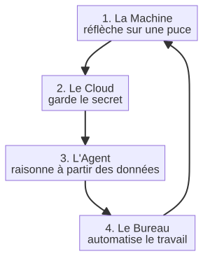

# Chapitre 1 --- Les révolutions qui ont fait la terre

## Les feux

Toute révolution de l'industrie a commencé par un feu. Non métaphoriquement : la première d'entre elles brûlait du vrai charbon, et les autres ont suivi une logique similaire de combustion contrôlée. La révolution industrielle est, à sa base, une histoire où une espèce apprend à concentrer l'énergie et à la diriger où elle le choisit. Avant cette concentration, le travail se répandait finement entre les humains et les muscles, la patience du temps qu'il faisait, et l'endurance limitée des bêtes de somme. La richesse d'une nation était, à la lettre, la somme de ses dos et de ses brises. La révolution s'est produite le jour où une espèce a découvert qu'elle pouvait stocker l'énergie --- dans la vapeur compressée d'une chaudière, plus tard dans le oil brûlé d'un moteur, plus tard dans la rivière détournée d'un réseau électrique --- et ainsi sortir des limites quotidiennes de la graisse et du vent.

Le récit classique enseigne quatre révolutions. La première fut la vapeur et les machines, d'environ 1760 à 1830. La seconde fut l'électricité et la ligne d'assemblage, d'environ 1870 à 1914. La troisième fut l'informatique et l'internet, d'environ 1960 au début des années 2000. Nous sommes, propose ce livre, debout dans la cinquième --- appelons-là automatisation et intelligence --- bien que le nombre populaire pour celle-ci soit six, car certains narrateurs divisent la vague de l'électricité-et-l'informatique en deux. Le numérotation ne compte pas; le caractère de chaque vague compte, et j'arriverai à ce caractère dans peu de temps. Pour l'moment, remarquez seulement que chaque révolution a fait ce que la précédente ne pouvait pas faire du tout, et l'a fait plus vite.

## Les feux qui ont tout changé

Pour sentir le poids de la première révolution, il aide à se tenir, un moment, à l'intérieur d'une mine avant le moteur à vapeur. Au début du XVIIIe siècle, les mines devenaient plus profondes à mesure que le charbon de surface venait à manquer, et les mines profondes avaient un problème que aucune quantité de chevaux de force en surface ne pouvait résoudre : l'eau continuait d'entrer. Une mine qui descend atteint finalement la nappe d'eau, et une fois l'eau arrivée, la mine est inutile à moins que l'eau ne soit élevée à la main ou par des bêtes tournant une roue à tour de rôle. Les mines étaient limitées non par ce que les humains pouvaient excaver, mais par ce que l'eau pouvait être sortie avant que l'excaveur ne se noie.

Thomas Savery, en 1712, puis Thomas Newcomet, en 1712, ont construit des moteurs à vapeur --- bruts, gaspilleurs et monumentaux --- dont le seul but était de pomper l'eau hors des mines. Il est facile de sous-estimer ces moteurs, qui brûlaient du charbon pour bouillir une chaudière, qui poussaient un piston, qui élevaient l'eau, et qui faisaient presque rien d'autre. Mais considérez la logique : une machine qui brûle du charbon pour libérer plus de charbon. C'était un seul appétit, mécaniquement satisfait, mais il a établi le premier commandement de la révolution industrielle --- *stocker l'énergie dans la vapeur, puis la libérer à la demande.* Et une fois ce commandement établi, le reste de l'histoire a suivi presque inévitablement.

Le moteur à vapeur n'est pas resté une pompe à eau longtemps. James Watt, travaillant en Écosse dans les années 1760 et 1770, l'a rendu utile pour bien plus que pomper, en séparant le condenseur du cylindre et en tournant un motion rotatif hors du haut et bas du piston. Avec l'amélioration de Watt, le moteur à vapeur pouvait tourner, et en tournant pouvait tout entraîner. Il pouvait tourner mille fuseaux où mille hommes auraient pu tourner dix. Il pouvait tourner les grands arbres à transmission des nouvelles usines. Le moteur avait un corps énormément puissant, mais --- et voici le point vers lequel je reviendrai constamment --- toujours sans esprit. Il pouvait multiplier la force, mais il n'avait aucun avis sur quels fuseaux tourner, aucune mémoire de la demande d'hier, aucun plan pour la réparation de demain. C'était un corps énormément puissant avec l'esprit d'un roc très patient.

## Le partenariat qui l'a rendu réel

Il y a une curiosité à consigner ici, car elle répond silencieusement à la question « pourquoi cela a-t-il pris si longtemps ? » Le condenseur séparé de Watt était un miracle de physique, mais un miracle de physique n'est pas une révolution tant que quelqu'un n'est pas prêt à le construire. Watt lui-même était un mauvais commerçant, et son moteur, dans sa forme la plus ancienne, fonctionnait à peine et se vendait à peine. Ce qui a tourné le moteur en une industrie ne fut pas une autre insight de physique mais une autre insight de *fabrication* : le partenariat entre Watt et Matthew Boulton, dont la fonderie Soho à Birmingham pouvait réellement couler et usiner le fer lourd et sujet aux fuites qu'un moteur à vapeur exige. Watt fournissait l'idée et le brevet; Boulton fournissait le capital, l'atelier, et la ténacité à continuer de construire des moteurs qui continuaient de se briser jusqu'à ce qu'ils fonctionnent. La firme de Watt et Boulton a fait l'affaire du moteur à vapeur pendant des décennies à perte avant de payer, précisément parce que la chose était si difficile à faire.

La leçon est utile pour plus tard, quand nous rencontrerons la sixième révolution : une idée n'est jamais le goulot d'étranglement. Le goulot d'étranglement est toujours le *corps* --- la capacité de faire la chose, de faire confiance à la chose, de mettre à l'échelle la chose. La vapeur avait le problème du corps sans esprit résolu d'ici 1800. La révolution de l'intelligence a son propre problème du corps encore en cours de résolution, et il vaut la peine de se souvenir de qui fut la tâche de résoudre le premier.

## La révolution a rétréci le continent

Le moteur à vapeur ne s'est pas arrêté à l'usine. Une fois le principe établi --- stocker l'énergie dans la vapeur, la libérer à la demande, et la tourner vers ce que vous choisissez --- le même moteur qui drainait les mines fut bientôt demandé pour faire ce qu'aucune machine de surface n'avait jamais tenté : se déplacer. Richard Trevithick a fait rouler la première locomotive ferroviaire à vapeur à pleine échelle en 1802, et George Stephenson, avec son *Rocket*, a gagné les épreuves de Rainhill de 1829. En octobre de cette année la *Rocket* a tiré un train en montée sur la ligne de Liverpool à Manchester, et en septembre 1830 cette ligne s'est ouverte comme le premier chemin de fer interurbain entièrement à vapeur pour les passagers du monde. Ceci est une de ces faits qui ne sont compréhensibles que si vous en sentez le poids. Avant une locomotive, une nation était une collection de villes qui ne pouvaient pas se atteindre plus vite que les chevaux ne pouvaient trotter --- des jours entre des villes situées à cent miles l'une de l'autre, des marchandises qui pourrissaient sur la route, une économie qui ne pouvait pas être nationale car un pays est, géographiquement, simplement trop grand pour être traversé rapidement.

La vapeur a rétréci le continent. Le chemin de fer a rendu possible une seule économie nationale pour la première fois, en tournant la distance en un nombre mesuré en minutes plutôt qu'en jours. C'est un petit fait étrange que le même principe qui drainait une mine --- l'énergie concentrée libérée à la demande --- soit aussi ce qui a rendu le monde moderne *proche*. La distance est morte, et avec elle l'isolement qui avait défini la vie humaine pendant dix mille ans. Chaque révolution industrielle a concentré une différente ressource : la vapeur a concentré la force, l'électricité a concentré un courant, et l'informatisme a concentré l'information. La vapeur, au moins, a aussi concentré *le lieu*, pliant le continent de sorte que deux villes à une journée de cheval l'une de l'autre soient maintenant à une journée de train l'une de l'autre.

## Le fil humain

Ce que les quatre précédentes révolutions avaient en commun --- et ceci est le fil que ce livre tirera jusqu'à la toute fin --- est qu'elles ont toutes fait de l'humain le dernier maillon de la chaîne. Le moteur à vapeur était opéré par un humain. La ligne d'assemblage était cadencée par un humain. L'ordinateur était nourri par un humain, et ses résultats étaient lus par un humain. Dans chaque cas la machine pouvait multiplier la force, le rythme, et la mémoire, mais elle ne pouvait pas, de son propre chef, fermer la boucle entre remarquer une chose dans le monde et faire quelque chose à ce sujet. L'humain se tenait à la fin de chaque processus, le juge final et la main finale. La machine pensait --- dans le sens étroit dans lequel une machine de cette époque pouvait penser --- mais l'humain agissait.

Et cela suffisait, et c'était prospère, pendant longtemps. Les précédentes révolutions ont élevé la vie humaine si dramatiquement --- l'espérance de vie doublée, la production par travailleur multipliée, des marchandises qui autrefois n'appartenaient qu'aux rois devenues assez bon marché pour tous --- que personne ne s'est arrêté pour demander si le dernier maillon pouvait aussi être automatisé. Il semblait simplement évident que l'humain à la fin de la chaîne était le but de la chaîne, la raison pour laquelle l'énergie était concentrée dès le départ.

Il y a une petite anecdote utile ici. Quand le métier à tisser mécanique s'est répandu en Angleterre au début du XIXe siècle, les travailleurs qui tissaient le tissu à la main ne se sont pas contentés de protester; ils ont détruit les métiers. Ils étaient les Luddites --- souvent mal rappelés comme des réactionnaires anti-technologie, quand en fait beaucoup d'entre eux étaient des artisans qualifiés voyant leur artisanat et leur subsistance disparaître en une nuit. Les Luddites avaient tort sur l'avenir, mais ils n'avaient pas tort qu'un avenir venait qui n'aurait pas eu besoin d'eux. Leur colère n'était pas idiote; elle était simplement prématurée. Chaque révolution industrielle a produit des Luddites dont la colère était logique dans le moment et fausse sur le long terme. La sixième révolution les produit maintenant, et ses Luddites s'inquiètent de quelque chose de encore plus nouveau : non la perte de leurs muscles, mais la perte de leurs esprits.

## La révolution a fait une classe

Il y a une chose de plus que chaque révolution a faite, et elle est facile à manquer entre les moteurs et le code. Une révolution ne change pas seulement les machines; elle change *les humains* en nouvelles sortes d'humains, et elle réarrange la carte pour les contenir. La révolution industrielle n'a pas seulement construit des usines --- elle a créé deux nouvelles classes, les propriétaires des usines et les gens qui y travaillaient, et elle les a sortis du village et mis dans la ville. Avant la vapeur, le travail se répandait finement dans la campagne : un tisserand à un métier dans une cottage, un fermier dans son champ, un forgeron dans son atelier. La vapeur, et les machines qu'elle entraînait, exigeaient *la concentration*. Les gens devaient se rassembler là où était la machinerie, et ainsi la ville d'usine --- et plus tard la grande ville industrielle --- s'est développée presque en une nuit autour du moulin qui leur donnait leur travail et leur nom. C'est pourquoi la ville moderne, avec ses chemins de fer, ses égouts, ses foules et sa fumée, est elle-même un produit de la première révolution, non simplement un arrière-plan à celle-ci.

Il vaut la peine de garder ceci dans l'esprit, car la sixième révolution fait la même chose à une différente sorte de travail. Elle rassemble les travailleurs --- non vers un moulin, mais vers un *système* --- et elle crée de nouvelles sortes d'humains qui n'existaient pas il y a une décennie : l'ingénieur de données, le superviseur d'agents, celui qui garde la machine honnête. Les machines changent; les gens changent avec elles; et la carte change pour les contenir. Chaque révolution industrielle, au final, est une histoire au sujet d'une nouvelle sorte d'être humain, rendu possible par une nouvelle sorte de machine.

> **Une curiosité.** Le mot pour la nouvelle classe ouvrière n'est pas accidentel. Avant les usines, la plupart des gens cultivaient, ou commerçaient, ou servaient. Le *prolétariat* --- du latin *plebs*, le peuple commun --- et l'idée même d'« un travailleur » comme catégorie sociale distincte sont des produits de ce moment. Même le langage de l'époque a dû être inventé pour le décrire : le sifflet d'usine, la journée de travail, le quart, la grève. Une révolution ne change pas seulement ce que les gens font; elle change les mots dont elle a besoin pour parler de ce qu'ils font. La sixième révolution invente déjà son propre vocabulaire --- la requête, l'agent, la garde-fou, la fenêtre de contexte --- et dans une décennie nous ne nous souviendrons pas d'une journée sans eux.

## La rupture

La cinquième et la sixième révolutions sont différentes parce qu'elles visent ce dernier maillon. Elles ne demandent pas de multiplier le muscle d'un humain, ou son rythme, ou sa mémoire. Elles demandent de multiplier le jugement d'un humain et de porter ce jugement jusqu'au bout dans le monde, dans l'action, sans s'arrêter à un humain qui décide. La machine remarquera le défaut, raisonnera à son sujet, décidera la bonne réponse, parlera au cloud, dispatchera la réponse par un bureau, et dans les usines les plus nouvelles même marchera vers le défaut dans un corps métallique et le réparera. La boucle se ferme. L'humain n'est plus le dernier maillon; l'humain est l'architecte d'un système qui peut finir ce qu'il a commencé.

C'est pourquoi le numérotation --- cinquième ou sixième --- semble si différente des autres. Les révolutions antérieures ont étendu ce qu'un humain pouvait faire. Celle-ci étute ce qu'un humain peut décider et voir jusqu'au bout, sans mains intervenantes. C'est la différence entre un outil qui rend un travailleur plus rapide et un système qui rend un travailleur un conducteur.

## Une petite carte de la route à venir

Avant de voyager, il aide de connaître le territoire. La chaîne qui rend la sixième révolution possible a quatre composants, et ils apparaissent dans ce livre dans l'ordre dans lequel ils doivent être assemblés:

Le premier maillon, la machine qui pense, est le sujet de la Partie II. La seconde, le cloud privé, est la Partie III. La troisième et la quatrième, l'agent de raisonnement et le bureau automatisé, sont la Partie V. Entre eux se situe la Partie IV, qui pose la question unique la plus importante de toute l'histoire : non comment faire de l'intelligence, mais quelle sorte d'intelligence une usine peut faire confiance avec sa propre sécurité. Nous reviendrons à cela, et il vaut la peine de savoir maintenant que la réponse est ce qui rend cette révolution --- et ce livre --- sans pareil à tout ce qui est venu avant.

## La question du numérotation

Il vaut la peine de s'arrêter sur le nombre, car les lecteurs le rencontreront et il est honnête de l'aborder. Le terme populaire pour la vague actuelle est la « sixième révolution industrielle », mais les historiens de la technologie ne sont pas d'accord, et le désaccord est lui-même informatif. Certains narrateurs comptent cinq révolutions, se terminant par l'automatisation; d'autres divisent la vague numérique et comptent six; quelques-uns comptent seulement trois ou quatre et plissent tout dans « la révolution numérique ». Le nombre que vous choisissez dit plus sur votre méthode que sur le monde.

Il y a, cependant, un cadrage qui est utile pour ce livre, et il se présente ainsi. Chaque révolution peut être caractérisée par la ressource dominante qu'elle a domptée : la première a dompté la vapeur (énergie thermique stockée), la seconde l'électricité (énergie électrique stockée s'écoulant par les fils), la troisième l'informatisme et l'internet (information stockée et transmise), et la quatrième (dans ce cadrage) l'automatisation et la robotique (machines qui agissent sans direction humaine continue). La cinquième, dans le cadrage que ce livre adopte, est l'intelligence --- les machines qui perçoivent, décident, et coordonnent; la sixième est l'*intégration* de cette intelligence dans un tout auto-coordonné, l'usine de l'Industry 7.0 que nous rencontrerons dans la Partie V. Sous cette lecture, la sixième révolution n'est pas simplement « plus d'intelligence»; c'est le moment où l'intelligence cesse d'être une caractéristique des machines individuelles et devient le tissu conjonctif d'une entreprise entière. C'est la distinction que ce livre défendra de la première à la dernière page.

## Pourquoi l'histoire compte pour un lecteur

Vous pouvez vous demander, justement, pourquoi un livre sur l'avenir de l'automatisation industrielle passe un chapitre à regarder en arrière. La réponse est que l'histoire n'est pas un luxe ici; c'est un outil de décision. Chaque génération d'IA a promis plus qu'elle n'a livré, et connaître le motif vous rend plus difficile à duper. Quand un vendeur vous dit que leur produit va « transformer votre usine avec l'IA », le mot « transformer » a été utilisé pendant deux cents années, et chaque utilisation antérieure se référait à une révolution qui était réelle mais plus étroite que ne le suggérait le marketing. La personne qui comprend le motif est mieux équipée pour séparer la véritable révolution de l'hype rebaptisé.

De plus, les échecs se répètent avec un nouveau vocabulaire. Chaque fois que l'IA a stagné, elle a stagné pour une raison nommable : pas assez de données, pas assez de puissance de calcul, ou un problème plus dur qu'il n'y paraissait. Ces mêmes trois raisons décident encore si votre propre projet d'adoption fonctionne. La personne qui a vu le motif une fois le verra de nouveau; la personne qui n'a entendu que le dernier hype sera surprise la deuxième fois. Ce livre vous armera du motif, de sorte que quand les promesses de la sixième révolution sont faites, vous puissiez les juger contre les révol qui sont venues avant.

Il aide d'avoir un cas concret en tête, car « les échecs se répètent » est plus facile à se souvenir quand vous pouvez nommer la dernière fois que cela s'est produit. Le XXe siècle a eu ses propres hivers de l'intelligence artificielle. À la fin des années 1960, une poignée des informaticiens les plus proéminents de l'époque ont annoncé, avec une vraie autorité, qu'une machine à penser à usage général était « à portée de main » dans une génération; quand les machines ne sont pas venues --- parce que la mémoire était trop petite, le calcul trop faible, et les problèmes trop non structurés pour les algorithmes disponibles --- un désenchantement a suivi. Un rapport de 1973 en Britain a conclu que le champ avait trop promis, et le financement de la recherche s'est asséché pendant des années. Puis, à mesure que le matériel et les algorithmes et les données rattrapaient finalement, le champ est revenu, plus fort qu'auparavant, à sa promesse originelle. Le motif n'est pas que les scientifiques étaient des idiots; c'est qu'ils étaient *prématurés*, et prématuré est indiscernable de faux jusqu'à ce que le troisième des trois ingrédients manquants --- le calcul, les données, ou un algorithme adéquat --- apparaisse enfin. La personne qui a observé un hiver apprend à poser une seule question calme à toute nouvelle promesse : *quel est l'inguent manquant qui rendra ceci possible, et combien de temps jusqu'à ce qu'il ne soit plus manquant?* Cette question est tout le contenu de ce chapitre.

Prenons maintenant et compressons tout l'arc en une timeline compacte, de sorte que le rythme à lequel chaque révolution est arrivée soit visible, et de sorte que la lenteur distinctive de la révolution de l'intelligence --- et son accélération soudaine et récente --- puissent être vues en un seul coup d'œil. C'est le sujet du prochain chapitre.
