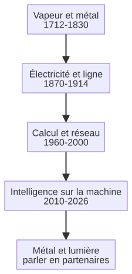

# Chapitre 3 --- Une brève chronologie du métal et de la lumière

## L'idée

Si vous voulez comprendre la sixième révolution, il vous faut un aperçu de l'longue trajectoire, compressée. L'histoire de l'industrie est, dans son essence, l'histoire de deux matériaux. Le premier est le *métal* : les machines qui concentrent la force. Le second est la *lumière* : les signaux, l'électricité, et enfin les photons et les impulsions d'électrons qui portent l'information. Pendant la majeure partie de la trajectoire, le métal dominait et la lumière n'était que son serviteur --- un sifflet, un drapeau, un relais. Les trente dernières années, la lumière est devenue un maître à part entière, et les deux ont enfin commencé à converser. Ce chapitre est la chronologie de cette conversation, racontée à travers la poignée de moments qui ont réellement changé la direction de la route.

## La chronologie

**1712 --- La machine à pomper.** Thomas Savery, puis Thomas Newcomet, construisirent des machines à vapeur qui pompaient l'eau des mines. Les machines étaient incapables de toute autre chose ; elles brûlaient du charbon pour faire bouillir une chaudière, qui aspirait l'eau hors d'une mine, qui permettait à la mine de s'enfoncer plus profondément, qui laissait sortir plus de charbon. C'était une machine au service d'un seul appétit. Mais elle établit le schéma : *emmagasiner l'énergie dans la vapeur, puis la libérer à la demande.* C'est le premier des commandements industriels.

**1785 --- Le métier à tisser mécanique.** Edmund Cartwright transforma la vapeur en un *processus*, non pas simplement une pompe. Le métier à tisser filait le fil en continu, mécaniquement, et le métier du filage à la main amorça sa longue mort. Le métal ne se contentait plus simplement de déplacer des objets ; il les *transformait*.

**1804 --- L'idée du programme stocké (par accident).** En 1804, le métier à tisser de Joseph Marie Jacquard acceptait des cartes perforées qui dictaient un motif. Les cartes ne produisaient pas le tissu ; elles *décrivaient* le tissu, et le métier à tisser obéissait à la description. Changez les cartes et le produit change. C'est l'ancêtre du logiciel, conçu par un tisserand, cent cinquante années avant que quiconque n'ait le mot « ordinateur ». Le métal a appris à suivre des instructions.

**1822 --- La machine qui devait penser (et qui ne l'a que très peu fait).** Le mathématicien anglais Charles Babbage conçut l'Analytical Engine, une calculatrice mécanique à entrée par cartes perforées qui pouvait, en principe, calculer *tout ce qui est calculable* --- non pas parce qu'un fil était réarrangé, mais parce qu'une liste d'instructions, un *programme*, était inséré. Il avait, en réalité, inventé l'ordinateur à usage général un siècle avant l'électronique permettant de le construire, et il manquait simplement l'argent et les machines pour en faire une. Sa machine était un fantôme --- un dessin, un rêve, un échec à se matérialiser --- pourtant elle prouva qu'une machine pouvait être *programmée* plutôt que *câblée*, et la programmation signifierait plus tard qu'une seule machine pouvait être reconfigurée, sans cesse, pour faire presque tout. Babbage est l'ancêtre du programme stocké, et de l'idée qu'une machine n'a pas à être construite pour un seul appétit mais pourrait recevoir n'importe quelle tâche en ne changeant que ses instructions.

**1831 --- Faraday et le générateur électrique.** Michael Faraday découvrit que le déplacement d'un aimant produisait de l'électricité, et le monde entier s'inclina. Pour la première fois, l'énergie pouvait être *créée* à la demande, partout, et déplacée le long des fils. C'est le moment où la *lumière* --- le signal de l'écoulement des électrons --- entra dans l'histoire comme force. L'électricité fut la première force porteuse d'information que les humains pouvaient contrôler à vitesse.

**1844 --- Le télégraphe.** Le peintre devenu scientifique américain Samuel Morse envoya le premier message électrique sur un fil en 1844, de Washington à Baltimore, et les mots --- souvent cités comme « Qu'a fait Dieu » --- ne furent pas, en eux-mêmes, remarquables. Ce qui fut remarquable, c'est qu'ils *voyagèrent sur l'électricité plutôt que sur un cheval*, arrivant des heures avant qu'un cavalier ne puisse l'être. Pour la première fois, l'information pouvait battre le objet physique qui la portait, se déplaçant à la vitesse du courant. Le télégraphe transforma la nation, puis le monde, en un lieu où un message pouvait arriver avant qu'un homme ne puisse s'en porter avec lui. C'est la graine de chaque signal, de chaque ligne de commande, de chaque réseau --- et de chaque nuage qui existerait jamais --- qui a suivi depuis, et c'est le moment où la *lumière* (le signal de l'écoulement des électrons) a commencé à porter du travers de la distance, à vitesse.

**1876 --- Le téléphone.** Alexander Graham Bell transforma le son en un signal électronique, et l'information amorça sa longue liberté de l'objet physique qu'elle portait. Un mot pouvait désormais voyager plus vite qu'un cheval. C'est la graine de chaque communication, de chaque signal de commande, de chaque nuage qui existerait jamais.

**1896 --- La ligne d'assemblage (à l'état d'embryon, puis en pleine floraison).** Frederick Winslow Taylor mesura le travail en secondes. Henry Ford, en 1913, fit la ligne mobile, coupant le temps de construction d'une voiture de douze heures à quatre-vingt-dix minutes. Le humain fut intégré au rythme ; la machine fixait le tempo.

**1936 --- L'idée de la machine universelle.** Alan Turing, un jeune mathématicien en Grande-Bretagne, publia un article décrivant une machine qui pouvait calculer *tout ce qui est calculable* en suivant une liste stockée de règles. C'était de la pure lumière --- de l'pure information --- sans aucun métal en elle du tout au-delà de l'abstraction. Turing prouva qu'une machine pouvait être *programmée* plutôt que *câblée*, et la programmation signifierait plus tard qu'une seule machine pouvait être récâblée, sans cesse, pour faire n'importe quoi.

**1947 --- Le transistor.** L'invention du transistor aux Bell Labs remplaça les tubes à vide chauds par un petit morceau de semi-conducteur gravé, et il est facile de sous-estimer ceci. Le transistor était petit, bon marché, et pouvait commuter un signal un million de fois par sans se réchauffer. Chaque pièce d'intelligence moderne --- dans un téléphone, dans une voiture, dans un capteur d'usine --- repose sur ce petit interrupteur argenté. C'est l'atome de l'âge de l'information.

**1957 --- Le premier signal dans l'espace.** Lorsque l'Union soviétique plaça Sputnik 1 en orbite, il renvoya le premier signal électronique au-delà de l'atmosphère, et le monde réalisa, en une seule nuit froide, que l'information pouvait désormais quitter la terre entièrement. La course que Sputnik amorça --- la course à l'espace --- fut, sous les drapeaux et les fusées, une course *de calcul* : une course pour emmagasiner, traiter, et transmettre l'information plus vite et plus fiablement que l'autre côté. Sputnik est souvent rappelé comme un moment en politique ou en physique ; il fut, plus discrètement, un moment en l'autorité de la lumière. Il confirma, pour les gouvernements et pour l'industrie à égalité, que le côté information de l'histoire --- le signal, le courant, le programme stocké --- était désormais assez fort pour atteindre les étoiles, et les dépenses et l'ingénierie qui suivirent versèrent le béton pour l'ensemble de la révolution de l'information.

**1969 --- Le premier message.** Un réseau appelé ARPANET envoya son premier paquet en 1969, un petit, peu fiable, et momentueux premier pas vers ce qui deviendrait l'internet. Avant ARPANET, les ordinateurs se tenaient seuls ; après lui, ils pourraient, de façon titubante, *parler* les uns aux autres. Le message lui-même est presque oublié (il bégaya après trois lettres), mais le principe ne l'était pas : les machines pourraient partager l'information par un réseau distribué, assez résilient pour survivre à la perte de n'importe quel nœud unique. C'est l'ancêtre de l'internet moderne, et du nuage --- non le nuage *public* qui observe, mais le *réseau* qui finirait par héberger les nuages privés de ce livre. C'est le moment où la lumière devint non seulement un signal mais une *conversation*, et le moment où la machine commença, discrètement, à parler à d'autres machines.

**1971 --- Le microprocesseur.** Intel plaça un unité de traitement centrale entière sur un seul chip. L'ordinateur n'était plus une pièce ; c'était une pièce de monnaie. C'est ce qui a finalement rendu possible le capteur sur la broche, et il vaut la peine de se souvenir que tout le cerveau du capteur est un descendant de cette pièce de monnaie.

**1977 --- L'ordinateur personnel atteint le bureau.** Une machine à usage général que quiconque pourrait garder sur un bureau et programmer pour ses propres tâches atteignit enfin le bureau, puis la maison. Avant ceci, l'ordinateur puissant était une pièce pleine de machines et une pièce pleine de spécialistes ; après ceci, la capacité de calculer, d'emmagasiner, et de scripter était à portée de main de n'importe quel travailleur individuel. L'ordinateur personnel fut le pont entre la machine monstrueuse des années 1960 et l'appareil intime des années 2000, et il vaut la peine de se souvenir qu'il fut *bon marché* --- assez pour un bureau, puis une maison, et finalement une machine sur un sol d'usine. Il porta le même principe que le microprocesseur : le cerveau d'un ordinateur entier, assez petit et assez bon marché pour s'asseoir sur une broche.

**1991 --- Le World Wide Web.** Tim Berners-Lee rendit l'information librement et facilement partageable. L'internet devint le système nerveux de l'économie moderne, et le nuage qui finirait par héberger cela commença, discrètement, à être pensé comme un *lieu* --- un bâtiment sans portes, gardé quelque part, que vous pourriez atteindre.

**2006 --- Le nuage devient un utilitaire.** Lorsque Amazon lança ses services web en 2006, le calcul cessa d'être une machine que vous possédiez et devint un service que vous payiez à l'heure. Cela sonne comme un petit changement, mais c'est celui qui a rendu le nuage --- public et, plus tard, privé --- économiquement possible à chaque échelle. Avant lui, une compagnie qui voulait plus de calcul devait acheter plus de machines ; après lui, une compagnie pourrait le louer, à l'heure, pour le prix d'un café. Le nuage cessa d'être un *bâtiment à maintenir* et devint un *robinet à ouvrir*, et c'est exactement la qualité que la sixième révolution nécessite sur le sol d'usine : une intelligence que vous pouvez ouvrir, à l'heure, sans acheter l'ensemble de l'appareil.

**2007 --- L'appareil dans votre poche.** Lorsque le premier smartphone moderne arriva, il porta, dans une seule plaque de la taille d'une main, l'ordinateur à usage général du bureau, la caméra de perception, le réseau du nuage, et --- discrètement, presque invisiblement --- un processeur dédié à l'exécution de modèles appris. Pour la première fois, une machine pourrait *apprendre à voir et à décider* sur une batterie, dans votre poche, sans poser de question à un centre de données. C'est la graine de l'intelligence sur machine que la sixième révolution bâtira : non une machine qui parle au nuage, mais une machine qui *pense pour elle-même*, localement, en microsecondes, gratuitement de bande passante. Le smartphone prouva, à échelle commerciale, que l'ensemble de la chaîne --- percevoir, décider, agir --- pourrait vivre sur un petit chip.

**2012 --- La percée de l'apprentissage profond.** Un réseau appelé AlexNet gagna un concours majeur de reconnaissance d'images d'une large marge, prouvant qu'une machine pourrait *apprendre à voir* à partir d'exemples plutôt que d'être instruite des règles. C'est le moment où la machine gagna, d'une façon pratique, quelque chose que nous pourrions appeler *perception*.

**2016 --- Le NPU arrive dans votre poche.** Apple, puis Qualcomm et autres, commencèrent à intégrer des processeurs neuronaux dédiés --- NPUs --- sur leurs chips mobiles. Pour la première fois, une machine pourrait exécuter un modèle appris du monde *localement*, sans poser de question au nuage, en microsecondes, sans dépenser la batterie sur un aller-retour. C'est la graine de l'intelligence sur machine que la sixième révolution sera bâtie.

**2017 --- L'idée qui porte attention.** Un article intitulé « Attention Is All You Need » introduisit le transformer, une architecture qui permettait à un modèle de pondérer l'importance de chaque pièce d'information contre chaque autre, plutôt que de le traiter un mot ou une lecture à la fois. Cette unique idée devint le squelette de chaque grand modèle linguistique et de chaque agent moderne qui suivrait ; c'est le mécanisme qui permet à un programme de lire un document entier --- ou de lire toute la télémétrie d'une machine --- et de savoir, à la fois, ce qui compte. Sans le transformer, l'agent de ce livre n'existerait pas ; avec lui, la machine pourrait enfin raisonner sur de longs, riches flux d'information plutôt qu'un mince filet d'instructions. C'est l'esprit que le chip sur machine finirait par abriter.

**2022--2026 --- La conversation des machines.** Les grands modèles linguistiques, les chips d'edge bon marché et puissants, et les nuages privés convergèrent. Des machines qui perçoivent, raisonnent, et parlent commencèrent à se connecter --- non à un nuage public qui les observe, mais à un nuage privé à l'intérieur de la compagnie, pilotées par des agents qui terminent le travail. La trajectoire se ferme, et la machine qui rêva dans le prologue devient possible.

## La conversation du métal et de la lumière

Si vous regardez la chronologie dans son ensemble, une forme émerge. Pendant environ deux cents cinquante ans, l'histoire fut presque entièrement *métal* : des machines qui déplaçaient, pressaient, filaient, et coupaient. Le côté information --- la lumière --- était un serviteur du contrôle : un sifflet, un signal, un relais. Puis, dans la dernière moitié de siècle, la lumière rattrapa. Le transistor, le microprocesseur, le réseau, le réseau neuronal --- ceux-ci donnèrent à la lumière un *esprit* à elle seule. Et maintenant, dans la sixième révolution, le métal et la lumière ne sont plus maître et serviteur. Ils sont *partenaires*, et le partenariat s'appelle l'usine qui pense. Vous pouvez lire toute la trajectoire en un seul regard :

Pendant deux siècles le métal dominait et la lumière n'était que son serviteur ; puis la lumière, donnée un esprit à elle seule par le transistor, le microprocesseur, le réseau, et le réseau neuronal, commença à converser avec le métal. Dans la sixième révolution les deux ne sont plus maître et serviteur mais partenaires, et le partenariat est l'usine qui pense.

## La chronologie enseigne une leçon

Si vous regardez la chronologie dans son ensemble, au-delà des dates individuelles, une forme émerge qui est plus intéressante que n'importe quel événement unique : le *rythme* lui-même accélère. Pendant environ deux cents cinquante ans, l'histoire se déplaçait lentement, et chaque révolution attendait que la précédente soit entièrement construite avant que la suivante puisse commencer. La vapeur naquit dans les mines, mûrit sur les chemins de fer et dans les usines, et seulement alors --- seulement après que les machines, les travailleurs, les lois, et les villes eurent toutes settled --- l'électricité arriva. L'électricité, à son tour, remplit le monde de fils et de machines avant que le calcul puisse s'établir. Les révolutions s'empilaient lentement, une génération à la fois.

Puis quelque chose changea. Dans la dernière centaine d'années, le rythme de l'histoire brisa son ancien rythme. Le transistor suivit le tube à vide de quelques décennies ; le microprocesseur suivit le transistor de quelques autres ; le réseau suivit le microprocesseur presque au galop ; le réseau neuronal suivit le réseau en une affaire d'années ; et la machine qui pourrait percevoir, décider, et parler suivit le réseau neuronal en une seule, à couper le souffle, décennie. Les intervalles continuaient de rétrécir. Le côté information de l'histoire n'est pas simplement à rattraper le métal ; il est *à le battre* lui-même, bâtissant la prochaine génération de la précédente plus vite que n'importe quelle révolution précédente n'a jamais bougé.

C'est la caractéristique distinctive de la sixième révolution, et c'est pourquoi la chronologie, prise dans son ensemble, est plus effrayante et plus porteuse d'espoir que n'importe quelle entrée unique. Les révolutions antérieures étaient lentes parce que chacune devait bâtir son corps depuis zéro --- pierre, fer, cuivre, verre --- et les corps prennent du temps à faire. Le corps de la révolution de l'information est fait d'information, et l'information peut être copiée, améliorée, et redéployée à la vitesse de la lumière. C'est un petit fait vertigineux que toute la trajectoire, de la machine à pomper à l'agent sur machine, se lit moins comme une série d'événements séparés et plus comme un seul processus qui a, dans les dernières années, enfin atteint la vitesse de sa propre nature. C'est le moment où la machine qui rêva dans le prologue devient possible, et le moment où la conversation du métal et de la lumière devient l'usine qui pense.

Il y a une leçon de plus dans la chronologie, et elle est discrètement rassurante. Chacune des entrées depuis 1936 --- la machine universelle de Turing, le transistor, le microprocesseur, le réseau, le réseau neuronal, le transformer, le NPU --- fut une pièce de *lumière*, pas de métal. L'étendue de deux cents cinquante ans de la chronologie fut presque entièrement métal ; la dernière centaine d'années, l'ensemble du mouvement de la route a été porté par la lumière. Le métal de l'usine n'est pas remplacé par la lumière ; il est *complété* par elle, donné un système nerveux, un réflexe, un esprit. La chronologie ne se termine pas par la machine pensant sur un chip. Elle *est* cette machine, arrivant --- lentement, puis soudainement --- à la fin de sa propre longue construction. Le chip sur la broche est le moment où ce partenariat devint physique et bon marché. C'est le sujet de la prochaine partie de ce livre.

## L'étape suivante

Le chip sur la broche n'est pas une petite carte boulonnée à une machine ; c'est le moment où toute la chronologie --- de la machine à pomper au transformer --- descend enfin et se pose sur le sol d'usine. Chaque composant de la sixième révolution a maintenant été assemblé dans la chronologie de ce chapitre : la machine qui pense (le NPU), le nuage qui garde le secret (le nuage privé), l'agent qui raisonne (le grand modèle linguistique), et le bureau qui automatise (le front-end déterministe). Ce qui reste est de voir comment ils sont fix ensemble sur une seule broche, et à quoi une usine ressemble une fois qu'elle peut percevoir, décider, et agir pour elle-même. La machine a rêvé ; il est temps de la laisser se réveiller.

C'est le sujet du prochain chapitre --- l'ordinateur à carte unique basé sur un processeur ARM avec un processeur neuronal intégré, et la façon dont il permet à une machine de toucher le champ directement, sans aller-retour vers n'importe quel ailleurs.
