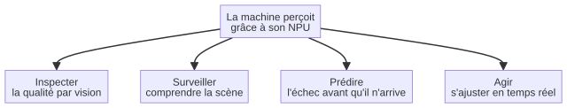

# Chapitre 6 --- Intelligence sur l'atelier

## Les quatre tâches

Lorsqu'une petite puce intelligente est placée à l'intérieur d'une machine, elle se voit confier, en réalité, quatre tâches presque humaines qui n'avaient jamais été possibles auparavant sans une salle entière de spécialistes et un aller-retour lent vers un cloud. Ces quatre tâches --- **inspecter, surveiller, prévoir et agir** --- constituent tout le vocabulaire de l'intelligence sur machine, et une fois que vous les avez, vous pouvez les voir partout.

Prenons-les une par une, car chacune accomplit déjà un travail réel dans de vraies usines, et chacune est un petit miracle du type dont ce livre parle.

## 1. Inspecter --- l'œil qui ne cligne jamais

La plus mature des quatre tâches est l'inspection visuelle automatisée. Une usine qui fabrique quelque chose a, traditionnellement, dû inspecter ses produits, et traditionnellement cela signifiait soit un œil humain se fatiguant après la vingt-ième pièce, soit une caméra fixe à règles rigides qui ne pouvait pas s'adapter. La NPU change les deux.

Imaginez une caméra regardant le long d'un convoyeur transportant des blocs-moteurs usinés. Un inspecteur humain, à la fin d'un quart de travail, a manqué des défauts qui étaient juste devant lui, parce que les humains se fatiguent, parce que les humains détournent le regard, parce qu'un défaut vu mille fois se fond dans l'arrière-plan. La caméra intelligente ne fait rien de tout cela. Elle a appris, à partir de milliers d'exemples de pièces bonnes et mauvaises, à quoi un défaut *ressemble*, et elle classe chaque pièce en millisecondes --- non pas avec des règles rigides mais avec le jugement flexible d'un modèle appris. Elle ne se fatigue pas. Elle ne détourne pas le regard. Elle fonctionne entièrement sur la machine, sur l'atelier, donc les images ne quittent jamais le bâtiment et l'inspection n'attend jamais le cloud.

C'est l'« inspection qualité automatisée », et c'est le cheval de travail silencieux de la révolution de la machine qui pense. Elle apparaît dans les soudures, dans les pièces moulées, dans les circuits imprimés, dans les étiquettes d'une bouteille. Partout où un produit doit être jugé selon une norme qu'un humain peut formuler mais qu'un ordinateur ne peut pas facilement coder à la main, un modèle appris sur une puce locale bat à la fois l'œil humain fatigué et la caméra à règles rigides.

## 2. Surveiller --- l'esprit derrière la caméra de surveillance

La deuxième tâche est la surveillance intelligente, là où la caméra cesse simplement d'*enregistrer* pour commencer à *comprendre*. Un système CCTV traditionnel enregistre ce qui se passe et rien de plus ; les images ne sont utiles qu'après coup, pour un détective cherchant une plaque d'immatriculation. Un système intelligent, alimentant une NPU locale, comprend la scène à mesure qu'elle se déroule : il reconnaît qu'une personne est entrée dans une zone où elle n'est pas autorisée à entrer, qu'une barrière de sécurité a été franchie, qu'un feu a commencé avant qu'il y ait de la fumée, qu'un chariot élévateur se déplace trop vite vers un piéton.

Le point essentiel --- et la raison pour laquelle cela appartient à la sixième révolution plutôt qu'à la troisième ordinaire --- est que la compréhension se fait *localement*. Les caméras peuvent alerter un gardien, arrêter une machine, ou émettre un avertissement en temps réel, sans envoyer un flux vidéo en direct de l'atelier vers un service externe. À une époque où un flux vidéo en direct d'une usine est exactement le genre de données sensibles qui ne devrait jamais quitter le bâtiment, la compréhension locale n'est pas seulement pratique ; c'est le seul choix responsable.

## 3. Prévoir --- la machine qui sait qu'elle est sur le point de tomber en panne

La troisième tâche est la maintenance prédictive, et c'est peut-être la plus belle des quatre. Une machine émet des signaux en continu --- la vibration de ses roulements, la température de son moteur, la forme du courant qu'elle tire, le son qu'elle produit. Ce sont les *signaux de santé* de la machine, et ils ont toujours été là, attendant d'être lus. La NPU les lit, non pas comme des nombres bruts mais comme une *histoire*.

Le modèle a appris, à partir d'une longue histoire des signaux d'une machine particulière, le son de cette machine au travail et le son d'une machine en détresse. Il reconnaît, des jours ou des heures avant une panne, le léger changement qui dit *je commence à me plaindre*. Il ne se contente pas alors d'émettre un alarme ; il raisonne sur l'avenir. Il peut dire à l'équipe de maintenance, bien à l'avance et avec un véritable délai de préparation, qu'un roulement spécifique va probablement tomber en panne sur une ligne spécifique, et il peut coordonner la réparation *avant* la panne --- avant que la ligne s'arrête, avant qu'un client soit retardé, avant qu'une pièce de remplacement doive être expédiée par coursier nocturne.

C'est la différence entre réparer une chose quand elle est cassée et la réparer quand elle *vous dit* qu'elle est sur le point de se briser. C'est la différence entre une urgence coûteuse et non planifiée et une intervention bon marché et planifiée. C'est, en bref, l'argent que la machine qui pense rembourse à l'usine, en continu, en versements silencieux.

## 4. Agir --- la machine qui fait quelque chose

La quatrième tâche est celle qui transforme l'intelligence en *agence* : la machine qui utilise ce qu'elle perçoit, prévoit et surveille pour réellement *faire* quelque chose. Un bras ajuste son parcours parce qu'une caméra a vu que la pièce était décalée. Une main robotique relâche sa prise parce qu'un capteur a senti la fragilité de l'objet. Une boucle de contrôle se resserre ou se détend en réponse aux conditions changeantes de la coupe. C'est la frontière entre une machine qui *signale* simplement et une machine qui *agit*, et c'est là que l'intelligence sur machine devient véritablement révolutionnaire.

La raison pour laquelle la NPU locale rend possible --- en fait, rend *nécessaire* --- cette quatrième tâche est la vitesse. Pour agir sur le monde en temps réel, la décision doit être prise localement, sur la machine, en microsecondes. Un aller-retour vers le cloud serait trop lent ; au moment où la réponse reviendrait, le moment d'agir serait passé. La NPU, sur la machine, est ce qui permet à la perception de devenir action assez vite pour compter.

## 5. La boucle qui se ferme sur elle-même

Les quatre tâches ne sont pas côte à côte ; elles forment une boucle qui se ferme sur elle-même, et dessiner cette boucle rend le chapitre entier plus clair que n'importe quelle liste de quatre. La machine inspecte le monde, surveille ce qui change, prévoit ce qui va changer ensuite, et agit --- et en agissant, elle change le monde même qu'elle inspecte, donc la boucle recommence un instant plus tard. Sur l'atelier, cette boucle ne tourne pas une fois par jour ; elle tourne des milliers de fois par seconde, dans le temps qu'il faut pour fabriquer une seule pièce.

C'est le vocabulaire de tout le chapitre en un coup d'œil : percevoir, puis surveiller, puis prévoir, puis agir, et encore. Chaque étape nourrit la suivante, et la flche d'*Agir* vers *Inspecter* est le point --- la machine ne lit pas une liste d'instructions fixes ; elle relit continuellement le monde qu'elle vient de changer. Un réflexe, une fois de plus, reste dans le corps ; cette boucle reste dans la machine.

## L'œil qui a appris

Il vaut la peine de s'attarder sur la première tâche, car l'inspection visuelle automatisée est celle qui a parcouru la plus longue route, et car elle enseigne toute la leçon en miniature. Pendant la majeure partie du XXe siècle, inspecter une pièce par caméra signifiait écrire des règles --- mesure cette longueur, vérifie que cet angle est carré, signale la couleur en dehors de cette plage. Une telle *vision machine à règles* est encore largement utilisée et est excellente pour une tâche fixe et bien définie. Mais les règles sont fragiles : changez l'éclairage, décalez la pièce d'un demi-millimètre, et les règles soit échouent soit doivent être réécrites à la main, encore et encore, par un spécialiste qui est payé une grosse somme pour faire exactement cela.

Le modèle appris transforme cela d'une corvée en un cadeau, et il le fait d'une manière qui imite comment un inspecteur humain voit réellement. Au lieu de donner à la caméra une liste de contrôle de mesures rigides, vous lui donnez un large ensemble d'exemples --- des photographies de bonnes pièces, des photographies de pièces défectueuses --- et vous lui laissez découvrir, par elle-même, les caract qui séparent les deux. Elle peut trouver une fissure filiforme qu'aucun rédacteur de règles n'a jamais pensé à spécifier, car une règle ne peut dire que ce qu'un humain s'est souvenu d'écrire, tandis qu'un modèle voit ce qui est réellement là. C'est pourquoi, sur de vraies tâches d'inspection, le modèle appris sur une NPU locale est venu battre à la fois l'œil humain fatigué et la caméra à règles rigides : elle ne se fatigue pas, elle ne détourne pas le regard, et elle a vu plus de défauts qu'un seul inspecteur ne le pourra jamais. L'histoire du domaine --- des premiers systèmes de vision à règles des années 1970 aux modèles appris d'aujourd'hui --- est l'histoire d'une industrie apprenant à cesser d'instruire la caméra et simplement à lui montrer le monde.

## Une ligne en pratique

Il aide à voir les quatre tâches ensemble dans un réel cadre, ainsi le vocabulaire abstrait devient une usine que vous pouvez imaginer. Imaginez une petite ligne qui usine des pièces métalliques de précision pour l'industrie automobile : une machine-outil CNC coupe chaque pièce, un bras robotisé le déplace vers une station de lavage, puis vers une caméra d'inspection, puis vers une station d'emballage, et un convoyeur emporte les pièces finies. Adaptez une carte intelligente bon marché à cette ligne et les quatre tâches prennent vie ensemble.

La caméra *inspecte* chaque pièce fraîchement coupée --- non pas avec des règles rigides mais avec un modèle appris qui sait à quoi une bonne pièce ressemble et signale celles qui sont hors tolérance. Le bras *surveille* son propre mouvement à travers le courant qu'il tire et la régularité de son parcours ; s'il sent un à-coup qui dit qu'un guide s'use, la carte le note. Un capteur de vibration sur la broche de l'outil *prévoit* : sur des semaines, la carte apprend le son d'un outil sain et signale, des jours avant qu'il se brise, le léger changement qui signifie qu'un outil est sur le point de s'écailler --- bien plus tôt que la pièce ne montrerait le défaut à la caméra. Et la carte *agit* : elle réroute le bras autour de la station suspecte, ralentit la ligne, et message l'équipe de maintenance avec l'outil exact à remplacer et la pièce actuellement dessus, ainsi le changement se produit pendant une pause planifiée plutôt qu'en plein processus. Quatre tâches, une carte, une ligne, pas d'aller-retour vers aucun cloud. C'est l'intelligence sur machine au travail, dans le miracle ordinaire d'une usine ordinaire.

## Quand la machine est fautive

Il y a aussi un chapitre honnête à écrire ici, car une machine qui perçoit est une machine qui peut se tromper, et le domaine doit traiter avec cela plutôt que de prétendre l'éloigner. Un modèle appris est entraîné sur des exemples, et donc il ne peut être que bon comme les données qu'il a vues. Si les exemples sont rares, biaisés, ou non représentatifs, le modèle fera des erreurs confiantes --- jugera mal un défaut qui n'a jamais été dans son entraînement, ou signalera une pièce parfaitement bonne comme mauvaise. Ce n'est pas un défaut à éliminer ; c'est une condition à gérer. La pratique qui la gère est simple : nourrir le modèle de bons exemples représentatifs et à jour ; surveiller comment il performe sur le réel atelier ; et le réentraîner quand le monde change --- une nouvelle pièce, un nouvel éclairage, un nouveau fournisseur. C'est la même discipline qu'un ingénieur honnête applique à n'importe quel instrument honnête : aucune mesure n'est infaillible, mais une bien entretenue est digne de confiance, et une mal entretenue ne l'est pas.

Le rôle humain, donc, ne disparaît pas quand la machine perçoit ; il change. L'opérateur ne plus inspecte chaque vingt-ième pièce à l'œil ; à la place l'opérateur, avec l'équipe de maintenance, curate les exemples, surveille les jugements de la machine dans le temps, et reste l'autorité finale là où les enjeux sont élevés --- où un faux signal signifie un envoi rappelé, ou où un défaut manqué signifie qu'une pièce défectueuse part vers un client. La caméra intelligente sur l'atelier ne remplace pas le humain ; elle élève le humain à une tâche plus haute, de tourner un cadran chaque vingt-ième pièce à garder l'œil de la machine en santé. C'est la nouvelle honnête et meilleure de tout le chapitre : l'intelligence sur machine n'enlève pas le humain de l'atelier ; elle élève le travail du humain d'un cran, de la répétition à la supervision.

## Le coût d'une pièce manquée

Il y a une raison de plus pour laquelle les quatre tâches comptent, et c'est la raison pour laquelle le propriétaire de l'usine s'en soucie réellement : l'économie d'une pièce manquée. Un défaut qui s'échappe de l'inspection est rarement gratuit. Il coûte la pièce rejetée, oui, mais aussi la pièce qu'il endommage en aval, le temps d'arrêt qu'il cause, le client qu'il perd, et le rappel --- parfois le rappel --- qu'un seul défaut invisible peut enclencher. Sur une ligne rapide, un défaut manqué ne reste pas un petit coût ; il se compound, et à la fin du quart de travail il peut s'élever à une crise. C'est l'arithmétique que la caméra intelligente transforme d'un passif en un actif.

L'économie sort naturellement. Un inspecteur humain, fatiguant après la vingt-ième pièce, pourrait attraper neuf défauts sur dix, laissant le dixième s'échapper --- et le dixième est celui qui atteint un client. Une caméra à règles, fragile à l'éclairage et au décalage d'un demi-millimètre d'une pièce, pourrait manquer ceux qui bougent. Le modèle appris sur une NPU locale manque presque rien, car elle ne se fatigue pas, elle ne détourne pas le regard, et on lui a montré plus d'examples qu'un humain ne pourrait survoler en une vie. Le résultat n'est pas une amélioration marginale mais un genre différent d'économie : où un humain ou une caméra rigide laisse passer une petite fraction de défauts --- une fraction qui, à haute vitesse de ligne, est un flot --- la caméra intelligente laisse presque rien passer, et les économies sont donc grandes, et continues, et silencieuses. C'est l'argent que la machine qui pense rembourse à l'usine, en versements silencieux, pendant des années. Et ce n'est pas l'argent d'un miracle ; c'est l'argent d'une machine qui fait simplement, mieux que n'importe quel humain ou n'importe quelle règle, les quatre tâches pour lesquelles elle a été construite.

## Le fil unique

Inspecter. Surveiller. Prévoir. Agir. Ces quatre tâches sont tout de l'intelligence sur machine, et elles partagent toutes une qualité essentielle : elles se font *sur la machine*, localement, instantanément, privément. C'est le fil qui relie ce chapitre à tout autre chapitre de la Partie II. L'intelligence n'est pas un invité dans une pièce ; c'est un résident du champ, sur la broche, touchant le champ directement. Et une fois que la machine peut voir, surveiller, prévoir et agir pour elle-même, une question suit naturellement : *qu'est-ce que nous remplaçons pour rendre cela possible ?* La réponse, surprenamment, est une des pièces de matériel les plus durables et les plus fiables de l'usine moderne. C'est le sujet du prochain chapitre.
