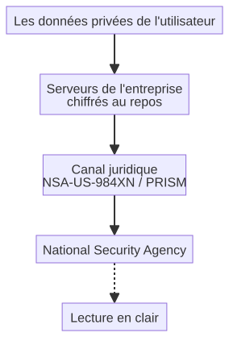

# Chapitre 10 --- Quand le cloud a volé votre entreprise

## Le matin où le monde a changé

Le six juin deux mille treize, deux journaux --- *The Guardian* et *The Washington Post* --- ont publié, le même jour, une histoire qui changerait discrètement et définitivement la façon dont le monde pensait les données. Depuis des années, une agence américaine appelée la National Security Agency menait un programme de collecte de quantités massives de communications privées, et les documents nouvellement publiés révélaient non seulement que le programme existait, mais que les grandes entreprises technologiques y *participaient*, remettant les données de leurs utilisateurs à l'agence. Le programme avait un nom : **PRISM**.

Un homme avait porté ces histoires à la lumière. Son nom était Edward Snowden, un contractant américain qui, le mois précédent, avait volé vers Hong Kong avec des documents qui changeraient tout. Les journaux qui ont publié sa part de l'histoire, *The Guardian* et *The Washington Post*, partageraient plus tard le prix Pulitzer de 2014 pour le service public. Il vaut la peine de se souvenir de ce moment non parce qu'il est lointain, mais parce qu'il est le moment où le cloud moderne --- le cloud vers lequel ce livre finira par relier l'usine --- est devenu, pour la plupart des gens, un endroit vers lequel il faut être *prudent*.

Le jour où l'histoire a éclaté, la réaction n'a pas été la réponse froide et analytique des ingénieurs, mais la réaction plus chaude et plus vive de gens qui se sentent trahis. Un service que vous *avez choisi* d'utiliser --- un service que vous aviez précisé confiance précisément parce qu'il était pratique --- avait, sans votre connaissance et sans votre consentement, remis vos messages privés à un gouvernement. Le sentiment de trahison est le point : nous n'avons pas d'empêchement à ce qu'un état *puisse* lire notre courrier ; nous avons d'empêchement à ce qu'il l'ait fait, discrètement, par les entreprises mêmes que nous avions choisies pour le protéger. Et cette distinction --- la différence entre une *capacité* et une *trahison* --- est tout le poids moral du datagate, et c'est aussi tout le poids moral du chapitre qui suit.

## Le nom italien

Dans le monde anglophone, le scandale est connu sous plusieurs noms : PRISM, la NSA, l'état de surveillance. Dans la presse italienne, où l'histoire a été suivie avec une intensité particulière, elle a son propre nom : **datagate** --- un suffixe qui emprunte le « -gate » inventé par Watergate pour marquer tout scandale impliquant un abus de pouvoir. La presse italienne a recouru à ce suffixe parce que l'histoire était, à son fond, une histoire sur le pouvoir abusé : le pouvoir d'un état de lire ce que les gens privés supposaient rester privé.

Le nom technique du programme est PRISM, avec la désignation de la NSA **US-984XN**. Il n'est pas apparu du jour au lendemain. Son fondement juridique a été consolidé dans la **Section 702 de la loi sur les amendements à la FISA de 2008** --- plus tard réautorisée, en 2012 et encore en 2024 --- et elle a fonctionné, selon les documents publiés, depuis environ 2007. Ainsi, quand nous disons que le scandale a éclaté en 2013, nous voulons dire qu'il a éclaté *alors* pour le public ; la machinerie avait fonctionné, pendant des années, entièrement hors de vue.

## Le mécanisme de la trahison

Ce que les documents publiés ont fait de plus efficace a été de montrer non *que* les entreprises participaient, mais *comment*. Le mécanisme était, à sa façon, banal, et sa banalité est ce qui le rend important. PRISM ne nécessitait pas que la NSA s'infiltre dans les systèmes des entreprises --- c'est là le cinéma de l'espionnage, pas sa pratique. À la place, chaque entreprise maintenait, par la loi, un canal direct par lequel elle pouvait être *demandée* --- et, dans la plupart des cas, *contrainte* --- à remettre les données d'un utilisateur donné. L'entreprise, plutôt que d'être infiltrée, est devenue une *gardienne* : un point par lequel les données de tous ses utilisateurs pouvaient, à la demande, être déversées vers l'agency.

C'est là une distinction subtile mais cruciale, et il vaut la peine de la tenir avec soin, parce qu'elle change la façon dont nous pensons la responsabilité. Une entreprise dont les systèmes sont *piratés* est une victime. Une entreprise qui maintient une porte par laquelle l'état peut entrer --- une porte que la loi la contraint à garder ouverte --- est, pour utiliser un mot inconfortable, une *partenaire*. Les documents publiés suggéraient, pour la plupart des entreprises sur la liste, le second cas : pas une main forcée, mais une main volontaire, ou au moins une main coopérative, jusqu'au point où la loi exigeait davantage. Le balance précise de la contrainte et de la coopération variait d'entreprise à entreprise et au fil des années ; le record publié ne tranche pas cette question, et je ne feindrai pas qu'il le fasse.

L'entreprise qui gardait la porte ouverte ne lisait pas vos messages et ne les remettait pas à la main. Elle maintenait, au niveau de l'architecture, un point à lequel vos données *pouvaient être prises*. La trahison n'était pas personnelle ; elle était *structurelle*. Elle était cuite dans la conception du service, dans les conditions de service que vous aviez acceptées sans lire, dans le cadre juridique qui rendait la résistance impossible sans résistance à la loi elle-même. Et c'est là le détail que le maître d'usine doit intérioriser, parce que la sixième révolution fera face à un choix structurel identique.

Le diagramme ci-dessus est une image simplifiée du mécanisme : vos données, détenues par une entreprise derrière ses propres murs, traversaient un *canal légal* vers l'agency, qui pouvait les lire en clair. Le mot-clé est *canal* --- l'entreprise n'a pas perdu le contrôle des données au profit d'un voleur ; elle a maintenu volontairement une entrée par laquelle l'état pouvait passer. Voilà la différence entre un cambriolage et une conspiration, et datagate était, au fond, une conspiration intégrée à l'architecture du cloud moderne.

## La liste des participants

Le détail le plus frappant dans les documents publiés était une liste. Elle nommait, avec l'année de leur adhésion, les grandes entreprises technologiques qui avaient accepté --- sous contrainte légale ou, comme le record le suggère, en coopération volontaire --- de donner à la NSA accès aux données de leurs utilisateurs. La liste ressemble à un qui-est-qui de l'ère numérique :

  Entreprise                  Année d'adhésion à PRISM
  ------------------------- --------------------------
  Microsoft                 2007
  Yahoo                     2008
  Google                    2009
  Facebook (aujourd'hui Meta)   2009
  Paltalk                   2009
  YouTube                   2010
  AOL                       2011
  Skype                     2011
  Apple                     2012

Neuf des noms les plus familiers dans la technologie, datés, comme sur un inventaire. C'est là le détail qui a fait coller l'histoire dans l'esprit public : non l'idée abstraite de surveillance, mais une *liste*, alphabétique et complète, des entreprises qui ne se seraient pas interposées entre leurs utilisateurs et l'état. Il est facile de rejeter ceci comme politique, et une bonne partie de la couverture de datagate l'a effectivement été. Mais il y a ici une leçon pour le maître d'usine et pour l'entreprise, et elle est celle-ci : **quand vous envoyez vos données vers un cloud public, vous donnez, de la même façon exacte, à un tiers quelconque l'accès à celles-ci --- que ce tiers soit un état, un pirate, ou une entreprise vendant de l'attention.** Le mécanisme de trahison est le même. La seule question est de savoir à qui vous avez remis les clés.

## Le coût personnel

Il vaut la peine de s'attarder sur le détail humain, parce que les statistiques de millions estompent l'horreur, et parce que les documents publiés ont nommé, avec le temps, des personnes précises qui ont été prises dans la machinerie. L'exemple le plus fréquemment cité est celui d'un citoyen allemand, rapporté par *The Guardian* en 2014, dont le nom apparaissait sur une liste de surveillance de la Central Intelligence Agency presque entièrement à cause des choses qu'il *aimait* sur Facebook --- une poignée d'intérêts qui, pour un service de renseignement étranger, suffisaient à mériter de l'attention. Il n'avait rien fait d'illégal ; il avait simplement *aimé* quelques pages, et une base de données, construite pour collecter les communications de tous, l'avait balayé avec tous. Il n'y avait, dans le rapport, aucune indication qu'il eût jamais été menacé --- seulement qu'il avait été *vu*, automatiquement, par une machine qui ne se souciait pas qu'il fût coupable.

## La réaction et le repentir

Il vaut la peine de s'attarder sur la réaction, parce qu'elle montre comment le public a enfin compris le danger --- tardivement, mais indéniablement. La première et la plus influente des réponses ne vint pas des utilisateurs affectés, mais des fondateurs des entreprises elles-mêmes. En 2013, Bill Gates écrivit une lettre ouverte largement lue dans laquelle il arguait, avec une discrète urgence, que le chiffrement devait être préservé et que les États-Unis « allaient dans la mauvaise direction » en matière de surveillance ; que le remède n'était pas de faire davantage confiance à l'état, mais de *lui faire moins confiance* en rendant les données illisibles même pour leur détenteur. Cette année-là, les fondateurs de dix des entreprises technologiques les plus influentes --- Google, Apple, Microsoft, et autres --- signèrent publiquement une lettre, adressée au Président des États-Unis, arguant pour la préservation d'un chiffrement fort ; c'était, en effet, une industrie reconnaissant, ensemble, que datagate avait montré que l'ancien supposait était faux.

L'industrie, lentement, a commencé à prendre leur côté : le chiffrement de bout en bout s'est répandu des applications de messagerie vers le stockage cloud, précisément parce que la leçon de datagate était qu'une entreprise qui peut lire vos données peut aussi être *contrainte* de lire vos données. Voilà le tournant crucial, et c'est la charnière sur laquelle le reste de ce livre bascule. Le public a réalisé, dans l'après-coup de datagate, que la vraie garantie de la vie privée n'était pas la *bonne foi* de l'opérateur de cloud mais son *incapacité à lire*. Un coffre-fort gardé par un gardien honnête reste vulnérable --- le gardien peut être corrompu, renvoyé, ou assigné par assignation à comparaître. Un coffre-fort dont la serrure n'est détenue que par vous ne l'est pas. Cette intuition --- que la sécurité doit être une propriété de l'*architecture* et non du *caractère de l'opérateur* --- est toute la prémisse du cloud sans confiance et à connaissance nulle que ce scandale a forcé à exister.

## Le nombre qui ne fut jamais réglé

Un nombre que les documents publiés ne purent jamais trancher fut la simple quantité de données collectées. Différentes estimations variaient largement, d'environ cinquante mille documents jusqu'à autant que un million et demi. La fourchette n'est pas un défaut dans le rapport ; elle est elle-même le point. Même l'estimation *la plus basse* est assez grande pour compter, et le fait que personne ne put s'accorder sur le *total* est précisément la preuve de combien de choses étaient prises. Les données d'une entreprise --- ses chiffres de production, ses contrats de fournisseur, ses listes de clients, ses plans --- pourraient, en principe, être parmi ces millions de bytes collectés, et personne ne pourrait vous dire lesquels, ou s'ils ont jamais été lus.

Le nombre non réglé est, en fait, un cadeau pour le lecteur attentif, parce qu'il enseigne une règle générale que je porterai à travers ce livre : **quand vous ne pouvez pas nommer combien de données ont été prises, vous ne pouvez pas faire confiance au fait qu'une quelconque de vos données ait été épargnée.** Une entreprise qui collecte « tout, indifféremment » collecte *vous* parmi le tout, et la seule façon d'être sûr que vous n'êtes pas collecté est de rendre vos données telles qu'elles ne puissent être lus même si prises. Voilà la promesse du cloud gardé à l'intérieur des murs.

## Ce qu'une entreprise peut faire

La leçon de datagate n'est pas seulement avertissante ; elle est *actionnable*, et il vaut la peine de dire clairement ce qu'une entreprise --- n'importe quelle entreprise, de quelle que taille que ce soit --- peut faire pour éviter l'erreur que le scandale a exposée. Les principes sont peu nombreux, et aucun d'eux n'est exotique.

Le premier est de *garder la clé*. Toute valeur de données à protéger doit être chiffrée avec une clé que l'entreprise elle-même détient, de sorte que même le système qui stocke et déplace les données ne puisse les lire. C'est là le mouvement le plus important, et c'est celui qui transforme « nous faisons confiance à notre fournisseur de cloud » en « nous n'avons pas à faire confiance à notre fournisseur de cloud. »

Le deuxième est de *garder le cloud à l'intérieur*. Là où les données sont l'image de l'avenir de l'entreprise --- sa production, ses fournisseurs, ses clients --- le cloud qui les détient doit être sous le contrôle propre de l'entreprise, non un géant du cloud public détenu par une poignée d'entreprises. Un cloud privé et à connaissance nulle n'est pas un luxe pour le paranoïaque ; c'est la prudence ordinaire d'une entreprise qui a appris ce qu'un cloud public peut être contraint de faire.

Le troisième est d'*n'envoyer que ce qui est nécessaire*. Le problème de volume du chapitre précédent est aussi un problème de vie privée : en réduisant les données à la périphérie, l'entreprise envoie des résumés et des alertes plutôt que la confession brute de ses opérations, et garde le détail profond et intime localement. La moindre quantité de données qui voyage est la moindre quantité de données à risque.

Ces trois mouvements ne nécessitent pas de staff spécialisé ni de budget de data-center ; ils nécessitent une décision, prise une fois, de traiter les données de l'entreprise comme les siennes. Et cette décision est, au fond, la même demande que la sixième révolution fait à chaque usine : garder l'intelligence, et les données, et la clé, de votre côté du mur.

## La leçon pour l'usine

Pourquoi un scandale sur les espions importe-t-il à une usine qui construit une machine intelligente ? Parce que la sixième révolution a la tendance à envoyer une grande partie des données de cette usine *vers l'extérieur*. Une machine qui perçoit, prédit et rapportera produira des télémètres --- taux de production, images de composants, informations de fournisseur, motifs opérationnels --- et cette télémétrie doit aller *quelque part*. Pour la plupart de l'ère du cloud, « quelque part » signifiait le cloud public : les géants des data centers détenu par une poignée d'entreprises, les entreprises mêmes de cette liste.

Datagate fut le moment où le public comprit, de la façon qu'un scandale produit toujours, qu'un cloud public n'est pas un coffre-fort. C'est l'ordinateur de quelqu'un d'autre, et l'opérateur de cet ordinateur peut être contraint --- ou peut être volontaire --- de lire tout ce que vous y stockez. L'usine qui envoie sa télémétrie précieuse vers un cloud public est, de la même façon exacte que les utilisateurs de cette liste, donnant à un tiers accès à ses informations les plus sensibles. C'est une leçon que la sixième révolution ne peut se permettre d'ignorer, parce que les données d'une usine sont, à la lettre même, son avenir rendu visible. Le prochain chapitre est sur la réponse que ce scandale a forcé à exister : le cloud qui garde son secret, le cloud gardé *à l'intérieur* des murs.
