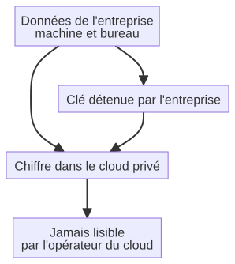

# Chapitre 11 --- Le nuage à l'intérieur des murs

## La contradiction

À la moitié des années 2010, une contradiction s'était installée dans l'usage du nuage, et c'était une contradiction qu'un ingénieur réflchi pouvait percevoir mais que personne n'avait encore résolue. D'une part, le nuage était indéniablement utile --- il offrait du stockage, du calcul et de la connectivité à une échelle qu'aucune entreprise seule ne pouvait égaler, et il permettait aux machines et aux bureaux de communiquer entre eux à distance. D'autre part, le scandale du datagate avait rendu tout aussi clair qu'un nuage public était un endroit où l'on pouvait *ne faire confiance à personne* --- l'opérateur pouvait être contraint ou se montrer disposé à lire ce que vous y stockiez, et une fois vos données quittant votre bâtiment, vous ne les contrôliez plus.

Ainsi, la question est devenue tranchée et inévitable. Existe-t-il un nuage qui préserve l'*utilité* du nuage --- le stockage, la synchronisation, la capacité des machines et des bureaux à partager une seule copie vivante de la vérité --- tout en conservant le *secret* que le nuage public a livré ? Une entreprise peut-elle posséder un nuage qui soit véritablement le sien, de sorte que ses données ne quittent jamais le bâtiment, et que, même sous la contrainte, une tierce partie ne les lise jamais ?

La réponse, comme les projets à l'origine de ce livre sont venus la construire, est oui --- mais seulement si vous êtes prêt à conférer au nuage deux nouvelles propriétés que l'ancien nuage n'avait jamais eues : il doit être **sans confiance**, et il doit être **à connaissance nulle**. Prenons sérieusement ces deux mots, car ils constituent toute l'innovation.

## Le nuage sans confiance

« Sans confiance » est une expression qui vient du monde de la cryptographie et des systèmes distribués, et elle sonne comme une chose étrange à souhaiter pour quelque chose d'aussi utile qu'un nuage. Nous avons d'ordinaire *confiance* dans les services que nous utilisons ; c'est pourquoi nous les utilisons. Qualifier un nuage de « sans confiance », c'est dire que vous n'avez *pas* à faire confiance à son opérateur pour traiter correctement vos données. Vous n'avez pas à faire confiance au fait qu'il ne fuit pas vos données, qu'il ne sera pas corrompu, qu'il ne sera pas contraint de vous remettre vos fichiers et de les lire. Dans un nuage sans confiance, c'est l'architecture du système --- et non les bonnes intentions de l'opérateur --- qui maintient vos données en sécurité.

La façon dont on y parvient consiste à s'assurer que les données sont *chiffrées* avec des clés que seule votre entreprise détient, et que le nuage peut traiter, stocker et synchroniser les données *sans jamais pouvoir les voir en clair*. Le nuage déplace vos données, les maintient cohérentes, les rend disponibles pour vos machines et votre bureau --- mais il ne possède jamais le pouvoir de *les lire*, car il ne détient pas la clé. C'est comme un coursier qui peut livrer un coffre-fort verrouillé mais qui ne peut pas l'ouvrir. Le coursier est utile et fiable, et il est totalement incapable de vous trahir. Voilà le nuage sans confiance : utile, et incapable de vous trahir.

## La distinction cruciale

Il y a un détail que presque tous mal comprennent, et il vaut la peine de le prendre lentement, car c'est tout le point. Le nuage public --- le géant, centralisé, commercial, du XXIe siècle --- *chiffre* vos données. Il le fait pendant qu'elles traversent le réseau (chiffrement en transit), et il le fait pendant qu'elles dorment sur disque (chiffrement au repos). Ainsi, l'objection naïve, « chiffrez-les simplement », ne résout rien au problème, car le nuage public chiffre déjà.

La distinction qui compte est celle-ci : dans le nuage public, c'est l'*opérateur qui détient les clés*. Le chiffrement est celui de l'opérateur ; il est appliqué pour les propres raisons de l'opérateur --- pour satisfaire une réglementation, pour limiter sa responsabilité, pour se protéger contre des voleurs externes. Mais l'opérateur peut, à tout instant, déverrouiller vos données, les lire, les remettre. Le chiffrement au repos est une *commodité* pour l'opérateur, et non une *garantie* pour vous. Si l'opérateur est contraint, ou se montre disposé, il peut simplement appliquer sa clé, et vos données --- en clair, lisibles, plus les vôtres --- sont remises à quiconque a demandé.

Le nuage sans confiance et à connaissance nulle change *qui détient la clé*. Dans ce nuage, la clé n'est pas celle de l'opérateur ; c'est *la vôtre*, et elle ne quitte jamais votre bâtiment. Les données sont chiffrées avant d'être envoyées, avec une clé que l'opérateur ne détient pas, de sorte que même le chiffrement au repos sur le disque de l'opérateur est sans sens pour eux. Ils peuvent stocker votre coffre-fort verrouillé, le déplacer, en garder des copies, le synchroniser à travers leurs serveurs --- mais ils ne peuvent pas l'ouvrir, car ils n'ont jamais eu la clé. Le chiffrement n'est plus la commodité de l'opérateur ; c'est *votre* garantie, appliquée à un niveau que l'opérateur ne peut pas annuler. Voilà la différence entre un coffre-fort gardé par le garde honnête de l'opérateur et un coffre-fort introuvable par conception. Le premier est le datagate ; le second est le nuage à l'intérieur des murs.

## Le nuage à connaissance nulle

« À connaissance nulle » est une expression issue d'une branche de la cryptographie qui sonne presque comme un paradoxe, et il vaut la peine de le prendre lentement. En cryptographie, une « preuve à connaissance nulle » est un moyen pour une partie de prouver à une autre qu'une affirmation est vraie --- *sans rien révéler d'autre que la vérité de l'affirmation elle-même.* L'exemple classique est une grotte avec un mot secret verrouillé derrière une porte. Une personne qui connaît le mot peut prouver, à plusieurs reprises, qu'elle le connaît --- entrer par une porte et sortir par l'autre --- sans jamais *dire* le mot. Elle prouve le savoir sans transmettre le savoir. D'où « à connaissance nulle » : la preuve ne transmet rien d'autre que le fait que la preuve a réussi.

Appliqué au nuage, la connaissance nulle signifie que le nuage peut vérifier et traiter vos données sans jamais apprendre les données elles-mêmes. La machine chiffre ses télemètres avant de les envoyer, garde la clé, et le nuage --- même le nuage qui les stocke et les synchronise --- ne peut pas les lire. Le nuage opère sur du chiffré, sur le coffre-fort verrouillé, jamais sur le contenu. Lorsque les données sont nécessaires au bureau, elles sont déchiffrées là-bas, par votre entreprise, avec votre clé. Le nuage est, au sens le plus littéral, *aveugle* au contenu de vos données. C'est un gardien qui peut garder un coffre-fort mais qui ne peut jamais voir à l'intérieur.

Pour rendre cela concret pour l'usine : le capteur sur la broche n'envoie pas un nombre à virule flottante vers le nuage ; il envoie un *chiffré*, produit de l'encryption de ce nombre avec une clé que le nuage ne détient pas. Le nuage stocke ce chiffré, le maintient cohérent à travers ses serveurs, le rend disponible pour le bureau --- tout en étant incapable d'apprendre si le nombre était 42 ou 42 000, si le roulement était sain ou en train de tomber en panne. Il est, au sens le plus strict du mot, *aveugle à l'information*. Il peut voir que des données se déplacent ; il ne peut pas voir ce que les données *sont*. Voilà tout le promis de la connaissance nulle, et c'est suffisant pour rendre impossible la trahison du nuage public que nous avons rencontrée au chapitre précédent.

## Le CloudServer

Le projet qui incarne cette idée --- le nuage maintenant à l'intérieur de l'entreprise, sans confiance et à connaissance nulle --- s'appelle **CloudServer**, un des projets publiés par le laboratoire à l'origine de ce livre. Là où le nuage public centralise les données dans une poignée de grands centres de données qui peuvent être lus (ou contraints de lire), un nuage privé et à connaissance nulle comme CloudServer *décentralise* la confiance : les données ne quittent jamais le contrôle de l'entreprise, car l'entreprise ne livre jamais la clé. Le nuage est à l'intérieur des murs, ou du moins à l'intérieur de l'autorité de l'entreprise, et il est inutile pour un espion, un pirate informatique, ou un ordre de justice, car il n'y a rien à lire.

Ce n'est pas une hypothèse. L'architecture existe, elle est publiée, et elle est en train d'être construite pour résoudre exactement le problème que le datagate a rendu inévitable. L'usine qui perçoit, prévoit et rapporte --- l'usine des chapitres précédents --- produit des données qui, à toute norme raisonnable, sont son asset le plus sensible. Les plannings de production, les contrats de fournisseur, les conceptions de composants, les modèles opérationnels : voilà l'image de l'avenir de l'entreprise, rendue visible. C'est précisément ces données que la sixième révolution doit maintenir *à l'intérieur des murs*, et un nuage privé, sans confiance, à connaissance nulle est le seul type de nuage qui peut les contenir sans les trahir.

La façon dont CloudServer mène ceci à bien est instructive, et il vaut la peine de suivre les données à travers une fois, car le mécanisme est tout l'argument. La machine, ou l'application de bureau, détient la clé. Elle chiffre ses données *avant* qu'elles quittent le bâtiment. Elle envoie ensuite seulement du *chiffré* --- le coffre-fort verrouillé --- vers le CloudServer. Le serveur stocke, synchronise et sert ce chiffré à chaque machine et bureau autorisé, tout sans jamais détenir la clé qui pourrait le déverrouiller. Lorsqu'une machine a besoin des données, le serveur renvoie le chiffré ; la machine --- pas le serveur --- la déchiffre, localement, avec la clé qu'elle a gardée. Le serveur est un coursier silencieux et aveugle pour les données de toute l'entreprise, capable de les déplacer et de les garder mais jamais de les lire. Voilà toute l'innovation, et c'est ce qui rend le nuage à l'intérieur des murs *sans confiance* au sens le plus vrai.

Le diagramme ci-dessus est, j'espère, une image fidèle du mécanisme : la clé reste à l'intérieur du bâtiment, les données se déplacent et sont stockées uniquement sous forme de chiffré, et le seul endroit à lequel les données deviennent jamais lisibles est *à l'intérieur des murs propres de l'entreprise*, sur une machine qui garde la clé. Le CloudServer est présent à chaque étape sauf la dernière et la première ; c'est le porteur, pas le lecteur. C'est là le nuage que le datagate a rendu nécessaire, et c'est ce qui permet aux télemètres les plus précieux de l'usine de se déplacer enfin, en sécurité, vers l'endroit où ils seront raisonnés.

## Ce que la clé coûte réellement

Il vaut la peine de s'attarder sur une objection pratique, car c'est celle qui surgit en premier dans toute vraie entreprise : si le nuage ne peut pas lire les données, comment peut-il faire quoi que ce soit d'utile avec elles ? L'inquiétude est compréhensible, et il vaut la peine de y répondre clairement, car la réponse est aussi la raison pour laquelle le nuage à connaissance nulle n'est pas seulement une curiosité mais un design fonctionnel.

Le travail du nuage, dans cette architecture, n'est pas de *raisonner*. C'est de *porter et de garder* : de stocker les données de façon fiable, de les synchroniser à travers chaque machine et chaque bureau, de les rendre disponibles à l'instant où on les demande, de survivre à la défaillance d'un disque ou d'un serveur, et de faire tout cela à l'échelle d'une entreprise entière. Aucun de ces travaux ne nécessite de lire les données. Un coursier n'a pas besoin de lire une lettre pour la livrer à temps ; un entrepôt n'a pas besoin de comprendre une caisse pour la stocker en sécurité. Le nuage est le coursier et l'entrepôt de la sixième révolution, et sa compétence --- fiabilité, disponibilité, synchronisation --- est entièrement compatible avec son aveuglité.

Le *raisonnement*, pendant ce temps, a lieu là où est la clé : sur la machine qui la détient (l'extrémité, que nous avons déjà rencontrée) et dans le bureau qui la détient (l'agent, que nous rencontrerons dans la Partie V). Ce sont là les endroits où le chiffré devient lisible, car ce sont là les endroits où la clé vit. Ainsi, le nuage à connaissance nulle n'est pas une limitation imposée au design ; c'est une *division du travail*. Le nuage fait ce pour quoi un nuage est bon --- déplacer et garder --- sans jamais avoir besoin de comprendre. Les machines et les agents font ce pour quoi l'intelligence est bonne --- lire et décider --- sans jamais laisser sortir les données de leurs propres mains. Les deux moitiés du travail sont proprement séparées, et la séparation est précisément ce qui rend l'ensemble sûr.

Il y a ici une petite ironie, et il vaut la peine de la nommer. Le nuage public s'est vendu sur la promesse de *l'intégration* --- « mettez tout en un seul endroit, et nous allons faire en sorte que tout fonctionne ensemble. » Le nuage privé et à connaissance nulle inverse la promesse : il met tout en un seul endroit, mais garde délibérément l'endroit *aveugle*, et laisse chaque détenteur de clé faire son propre raisonnement. L'intégration de l'ancien nuage était pratique et insûre ; la séparation du nouveau nuage est moins pratique et vastement plus sûre. Pour l'usine, le compromis est évidemment worth making, car les données déplacées sont l'image de l'avenir de l'entreprise, et aucune commodité ne vaut la remise de cette image à un étranger.

## Une courte histoire du maintien d'un secret

L'idée qu'un message peut se déplacer tout en restant illisible est aussi ancienne que l'écriture elle-même, et l'histoire de cette idée est l'ancestre intellectuel du nuage à connaissance nulle. Il vaut la peine un court détour, car il permet au lecteur de voir que le nuage moderne n'est pas une invention soudaine mais le dernier tournant dans une conversation très longue.

Julius César, au premier siècle avant J-C, est dit avoir protégé ses dépêches militaires en décalant chaque lettre de l'alphabet d'un nombre fixe de places --- le « chiffre de César », dans lequel *A* devient *D*, *B* devient *E*, et ainsi de suite. C'était, aux normes modernes, ridiclement faible ; mais il a établi le mouvement essentiel : *un message et son meaning peuvent être séparés*, de sorte que le porteur du message ne peut pas le lire. Pendant deux mille ans, chaque avancée en cryptographie était, au fond, un raffinement de ce seul mouvement.

Au XVIe siècle, le chiffre de Vigenère utilisait un *mot-clé* pour varier le décalage, ce qui rendait le message beaucoup plus dur à casser, et pendant un temps on crut --- à tort, comme il s'est avéré --- qu'il était incassable. La croyance dura jusqu'au XIXe siècle, quand Charles Babbage (le même homme qui conçut l'Analytical Engine que nous avons rencontrée dans la chronologie) est dit l'avoir cassé. La leçon était déjà la leçon moderne : un chiffre n'est fort que par la *secret à son centre* --- la clé --- et aucune ingéniosité dans le mécanisme ne peut compenser une clé faible.

Le XXe siècle a tourné la cryptographie en une affaire de vie et de mort. La machine allemande Enigma, utilisée dans la Seconde Guerre mondiale, chiffra les communications militaires avec un système de rotors d'une complexité à couper le souffle ; les briseurs de codes britanniques à Bletchley Park, parmi eux Alan Turing, l'ont cassée et, ce faisant, ont peut-être raccourci la guerre de plusieurs années. Enigma était un système *à secret partagé* : l'expéditeur et le destinataire connaissaient tous deux les réglages quotidiens (la clé), et la sécurité reposait sur le maintien secret de cette clé. Lorsque la clé fuita, le chiffre tomba.

Puis, en 1976, deux chercheurs --- Whitfield Diffie et Martin Hellman --- publièrent une idée qui changea la forme du domaine : *la cryptographie à clé publique*. Elle permit à deux parties qui ne s'étaient jamais rencontrées, et qui ne partageaient aucun secret à l'avance, d'établir un canal sûr --- car chaque partie avait une clé *publique* (que quiconque pouvait voir) et une clé *privée* (que seuls ils détenaient). La clé publique pouvait chiffrer ; seule la clé privée pouvait déchiffrer. Ce fut le moment où la cryptographie cessa de nécessiter un secret partagé à l'avance, et c'est l'ancestre direct du nuage sans confiance, dans lequel l'entreprise détient une clé qu'aucun opérateur n'a jamais besoin de connaître.

La preuve à connaissance nulle, que nous avons rencontrée plus tôt dans ce chapitre, est un tournant encore plus récent et encore plus stupéfiant : un moyen de prouver qu'une affirmation est vraie *sans rien révéler d'autre*. Pris ensemble --- la cryptographie à clé publique, qui permet à des étrangers d'établir un secret ; et les preuves à connaissance nulle, qui permettent à une partie de prouver sans révéler --- ces idées sont le fondament intellectuel sur lequel le nuage à l'intérieur des murs est construit. Le CloudServer n'est pas de la magie ; c'est l'application la plus récente, la plus pratique, d'une conversation qui a commencé avec l'alphabet décalé de César et qui a continué, sans interruption, pendant deux mille ans. Lorsque les télemètres de l'usine se déplacent sous forme de chiffré illisible, ils montent sur cette longue histoire, et ils sont en bonne compagnie.

## Le retour du nuage local

Il vaut la peine de remarquer la circularité étrange de l'histoire. Les premiers nuages --- avant l'ère du nuage géant, centralisé, commercial --- étaient, d'un certain sens, *locaux*. Ils vivaient dans les centres de données des entreprises qui les utilisaient, derrière leurs propres murs, contrôlés par leurs propres équipes IT. Le nuage commercial des années 2010 promettait d'être meilleur, moins cher, et plus puissant, et la plupart des gens y crurent. Le datagate fut le moment où la croyance se fissura. Et maintenant, paradoxalement, la sixième révolution tire le nuage *en arrière* --- en arrière à l'intérieur des murs, en arrière sous le contrôle de l'entreprise, en arrière vers un endroit qui peut être信任 car il est structurelement incapable de trahison.

Ce n'est pas un simple retour au passé ; c'est un retour *raffiné par un scandale*. Le nuage local des années 1990 était local parce que la technologie pour faire autre chose n'était pas encore disponible --- parce que le réseau était lent, cher, et peu fiable, et parce que « le nuage » était simplement le raccourci pour « le grand ordinateur au bureau. » Le nuage local de la sixième révolution est local *par conception et par principe* : il est local parce que l'entreprise a décidé, après le datagate, que ses données sont trop précieuses pour jamais être à la merci d'un opérateur. Les deux ne sont pas le même nuage. Le premier était local par nécessité ; le second est local par conviction.

Le nuage à l'intérieur des murs n'est pas le nuage du passé ; c'est le nuage de l'avenir, raffiné par un scandale en quelque chose qui tient sa promesse sans avoir besoin d'être信任. C'est le deuxième maillon de la chaîne de la sixième révolution, et c'est ce qui permet aux télemètres de la machine de se déplacer enfin, en sécurité, vers l'endroit où ils seront raisonnés. Ce raisonnement est le sujet du chapitre suivant --- mais d'abord, attachons-nous au sang qui doit couler dans ce nuage privé : les télemètres eux-mêmes, le stream vivant de données qui est le rapport continu de l'usine sur son propre état.
