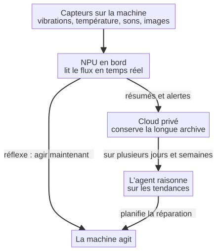

# Chapitre 12 --- La télémétrique comme système nerveux de l'usine

## Le sang de la nouvelle machine

Nous avons parlé de la machine qui pense, du cloud qui garde son secret, et de l'agent qui un jour raisonnera sur tout ce que la machine produit. Mais entre la machine et l'agent --- entre le capteur sur la broche et l'esprit dans le bureau --- il doit y avoir un *flux*. Il doit y avoir un flux continu d'information qui transporte, en temps réel, le rapport de ce que la machine fait et de ce qu'elle ressent. Ce flux s'appelle **la télémétrique**, et c'est le sang de la nouvelle usine. Sans elle, la machine qui penserait penserait dans le vide ; le cloud qui garde son secret n'aurait rien à garder ; l'agent qui raisonnerait n'aurait rien sur quoi raisonner. La télémétrique est ce qui fait de l'usine une chose vivante plutôt qu'une collection de métal inerte.

Comprenons correctement la télémétrique, car ce mot est lancé à toutes vents ces jours-ci, et car comprendre est essentiel à la compréhension de toute la chaîne. La télémétrique est simplement *des données mesurées à un endroit et rapportées, automatiquement et en continu, vers un autre endroit.* Le mot vient du grec *tele*, « loin », et *metron*, « mesure » --- la mesure des choses lointaines. Il est né dans le cockpit d'un avion, où les jauges rapportaient l'état des moteurs au pilote en temps réel, et il a voyagé de là vers l'informatique, où il est venu signifier la collecte et la transmission automatiques des données opérationnelles.

Il vaut la peine de s'attarder sur cette origine, car le mot porte son sens dans ses os. La télémétrique fut, en fait, née de la *peur* --- la peur de l'astronaute ou du pilote qui doit faire une confiance totale à une machine dont le support vital dépend de données qu'il ne peut pas voir de ses propres yeux. Les fusées des premiers programmes spatiaux, le programme Apollo en particulier, furent parmi les premiers utilisateurs à grande échelle de la télémétrique, car une fusée est l'exemple ultime d'une machine dont l'état interne --- température, pression, débit de carburant --- ne peut pas être observé directement une fois qu'elle a quitté le sol. La seule façon de savoir ce qu'elle faisait était de la *mesurer à un endroit et de la rapporter, en continu, vers un autre.* L'usine de la sixième révolution fait face à une dépendance identique, si elle est plus discrète : nous ne pouvons pas *voir*, de nos propres yeux, si une broche est sur le point de tomber en panne ; nous ne pouvons que mesurer son état et le rapporter. La métaphore n'est pas décorative ; elle est structurelle. L'usine, elle aussi, doit faire confiance à sa télémétrique.

## Ce que la machine rapporte

Sur un sol d'usine, la télémétrique qu'une machine moderne peut produire est, en fait, remarquablement riche --- bien plus riche que la poignée de nombres qu'un vieux PLC aurait jamais rapporté. Une machine équipée de la carte intelligente des chapitres précédents peut rapporter, en continu :

- **Les vibrations et l'accélération**, dans plusieurs directions, révélant la santé des roulements, des broches, et des pièces mobiles. Un roulement qui commence à s'écailler ne tombe pas en panne avec un cri ; il tombe en panne avec une *fréquence*, une petite perturbation périodique dans le signal de vibration qu'une oreille humaine n'aurait jamais remarqué mais qu'un capteur enregistre en entier.
- **La température**, à plusieurs points, avertissant de la surchauffe, de l'attrition, ou du changement environnemental.
- **Le courant et la tension électrique**, révélant la charge sur un moteur et, subtilement, la qualité de la coupe ou de la presse. Un outil de coupe qui devient mat tire, presque imperceptiblement, plus de courant ; la télémétrique *voit* l'usure avant que la pièce ne soit mise au rebut.
- **Le son**, par un microphone, révélant les changements dans le timbre d'une machine qui précèdent la panne. C'est le domaine de l'*émission acoustique* : les « gémissements » à haute fréquence qu'une machine fait quand une fissure grandit, inaudibles pour un travailleur mais incontestables pour un microphone accordé à la bonne bande.
- **Les images**, par une caméra, rapportant --- comme nous l'avons vu dans la partie précédente --- la qualité et la position de chaque pièce.
- **La position, la vitesse, et la force**, pour toute machine qui bouge, révélant si elle opère dans son enveloppe prévue.
- **Les fluides et les débris d'huile**, révélant l'usure des composants internes à mesure que des particules microscopiques sont transportées dans un lubrifiant, chaque particule étant un petit récit de ce que la machine a fait.

Chacune de ces rivières, à elle seule, est un nombre changeant dans le temps. Ensemble, elles sont une *histoire* : le récit continu de l'état de la machine. Et c'est ici que l'intelligence de la sixième révolution entre, non dans la *collecte* de la télémétrique --- cette partie est mécanique et bon marché --- mais dans sa *lecture*. Le NPU sur la machine lit le flux non comme une liste de nombres mais comme un *signal de santé*, reconnaissant le moment où l'histoire change de « bien » à « alerte ». Le cloud reçoit le flux et le garde, cohérent et cherchable, sans jamais le lire. L'agent raisonne sur le flux et décide quoi faire à son sujet.

## Le coût et l'ubiquité de la détection

Il y a un fait économique qui rend la sixième révolution possible, et il vaut la peine de le nommer, car les révolutions ne sont possibles que lorsque les composants nécessaires sont devenus bon marché. Le capteur --- l'accéléromètre, le thermocouple, le microphone --- est devenu, au cours des deux dernières décennies, étonnamment bon marché. Un accéléromètre MEMS moderne, assez petit pour reposer sur la pointe d'un doigt, coûte des sous en volume ; un microphone pour l'émission acoustique est de même bon marché ; une caméra pour la vision machine est, par le même raisonnement, ordinaire. C'est la même histoire qui a rendu le smartphone possible et qui a rendu le cloud possible : les composants qui rendent la détection continue abordable ont vu leur prix baisser plus vite que quiconque ne l'avait prévu, et l'usine a simplement hérité de cette bon marché.

C'est pourquoi la collecte de la télémétrique est, comme nous l'avons dit, « mécanique et bon marché ». La partie dure --- la partie qui est vraiment dure --- n'est jamais la *mesure* ; c'est la *lecture*. Cent capteurs sur une machine sont inutiles à moins que quelque chose ne puisse donner un sens au flux qu'ils produisent. La sixième révolution ne gagne pas en ajoutant plus de capteurs ; elle gagne en ajoutant plus *d'attention* aux données que les capteurs produisent déjà. La bon marché de la détection est un donné ; l'intelligence de la lecture est toute la tâche.

## L'exigence du temps réel

Les chapitres précédents ont établi que la machine doit percevoir et agir *localement*, en temps réel, car un aller-retour vers le cloud est trop lent et fuit la confidentialité. La télémétrique doit donc être comprise à deux niveaux, et il aide de les garder séparés.

Sur l'**edge** --- sur la machine elle-même --- la télémétrique la plus urgente est traitée localement et instantanément. Le signal de vibration qui dit « un roulement est sur le point de tomber en panne » est lu sur place, par le NPU, car la décision qu'il supporte doit être prise en microsecondes. Ici la télémétrique est un réflexe.

Sur le **cloud** --- le cloud privé, à connaissance nulle, gardé à l'intérieur des murs --- la télémétrique est collectée, stockée, et rendue cherchable dans le temps. Ici elle n'est pas un réflexe mais une *mémoire* : le record continu de la vie de la machine, que l'agent peut raisonner sur des jours, des semaines, et des mois. Ici la valeur n'est pas la vitesse mais l'*histoire* : la capacité à voir, en retour, comment une machine a vieilli, si un motif de pannes émerge, comment deux machines sur deux lignes se comparent.

Les deux niveaux ne sont pas en conflit. L'edge traite ce qui doit être décidé *maintenant* ; le cloud souvient de ce qui doit être compris *dans le temps*. Tous deux sont la télémétrique. Tous deux nourrissent la sixième révolution. L'edge est le réflexe ; le cloud est la mémoire. L'agent est l'esprit qui lit les deux.

## La leçon d'Apollo 13

Le mot « télémétrique » fut, comme nous l'avons dit, né dans le cockpit et la salle de contrôle, et la leçon la plus célèbre dans son pouvoir survint en avril 1970, quand le vaisseau Apollo 13 subit une explosion dans un réservoir d'oxygène sur le chemin vers la Lune. L'histoire est bien connue, mais elle est généralement racontée comme une histoire de courage et d'improvisation. Il vaut la peine de la raconter, un moment, comme une histoire *à propos de la télémétrique*, car c'est ce qui a rendu le courage et l'improvisation possibles.

Une fois le vaisseau quitté la Terre, l'équipe ne pouvait pas *voir* les dégâts de ses propres yeux ; elle ne pouvait le voir que par les instruments et les lectures qui étaient rapportées, en continu, vers le Contrôle de Mission à Houston. Quand l'explosion survint, la télémétrique dit aux contrôleurs de vol ce qu'ils n'auraient jamais pu voir depuis le sol : quels systèmes tombaient en panne, à quelle vitesse l'oxygène était évacué, ce que faisaient la température et la pression dans les réservoirs. C'était la télémétrique --- le rapport continu et honnête de l'état interne de la machine --- qui permit aux contrôleurs de comprendre, en quelques minutes, que la mission ne pouvait pas se poser sur la Lune et que la vraie tâche era venue de ramener l'équipe à la maison.

Et voici la partie qui compte pour l'usine. Les contrôleurs ne *lirent* pas simplement la télémétrique ; ils *raisonnèrent* dessus, et ils raisonnèrent avec les ingénieurs qui construisirent la machine, jusqu'à ce qu'ils puissent transformer le flux brut de nombres en un plan. Le filtre famous au dioxyde de carbone improvisé --- construit, dans l'espace, de ruban adhésif, de carton, et d'un sac en plastique --- fut l'*action* à l'extrémité lointaine de la télémétrique : les données rendirent le problème visible, le raisonnement transforma le problème en un plan, et le plan devint un acte. Mesuré à un endroit (le vaisseau), rapporté en continu vers un autre (Houston), raisonné par un troisième (l'équipe de vol), et enfin sur lequel agi --- voilà toute la chaîne de la sixième révolution, compressée en une seule semaine désespérée en 1970.

L'usine n'a ni astronautes ni Lune, mais elle a, en miniature, la même dépendance. L'ingénieur qui ne peut pas *voir* le roulement s'user ne peut que le *mesurer* et lire le rapport. La différence est que la sixième révolution place le raisonnement *plus près* des données --- sur la puce, dans le cloud à l'intérieur des murs --- de sorte que le plan et l'acte n'ont pas à attendre une salle pleine de contrôleurs, et que la machine peut, dans les systèmes les plus neufs, agir sur sa propre télémétrique sans être humain dans la boucle. Apollo 13 est l'ancêtre de la machine qui pense ; c'est simplement que la machine a appris à être son propre Contrôle de Mission.

## Le problème du volume

Il y a une difficulté pratique que la description romantique de la télémétrique tend à masquer, et il vaut la peine de la confronter honnêtement : les données qu'une machine moderne produit sont *énormes*. Un seul capteur de vibration, échantillonnant plusieurs fois par seconde, produit des millions de lectures en une journée. Multipliez cela par une douzaine de capteurs sur une machine, une centaine de machines sur une ligne, et une flotte d'usines, et le flux devient un déluge --- des téraoctets par jour, dans une grande opération. Aucun cloud, aussi privé soit-il, ne peut simplement *garder tout pour toujours* ; et aucun humain, aussi diligent soit-il, ne peut lire un déluge.

C'est pourquoi la télémétrique de la sixième révolution n'est pas une seule taille de données à une seule vitesse, mais un design *à deux niveaux*, et il vaut la peine de le dessiner clairement :

À l'**edge**, la machine lit son propre flux à pleine résolution, car le réflexe doit être instantané et le signal brut doit être examiné dans tous ses détails. Au **cloud**, la machine envoie des *résumés* --- des histoires sous-échantillonnées, des caractéristiques extraites, des alertes, et la fenêtre de pleine résolution occasionnelle autour d'un événement --- de sorte que le record long soit gardé sans garder chaque octet. L'edge lit le déluge ; le cloud garde l'histoire ; l'agent raisonne sur l'histoire. C'est ainsi qu'une usine peut tout surveiller sans s'y noyer : les données brutes sont consommées là où elles sont produites, et seule leur *signification* est envoyée plus loin, chiffrée, vers le cloud privé.

Ce design a un deuxième bénéfice, plus discret, et il vaut la peine de le nommer. Le problème du volume est aussi un problème de *confidentialité* : si tout était expédié vers le cloud, tout serait à risque. En résumant à l'edge, la machine envoie le *minimum* qui est nécessaire --- l'alerte, la tendance, la caractéristique extraite --- et garde le données profondes, brutes, intimes de sa propre opération localement. La télémétrique qui voyage est donc non seulement chiffrée ; elle est *réduite*. L'usine partage l'histoire, pas la confession brute. Et cela, dans un monde qui a appris à se méfier du cloud, est exactement la bonne forme de confiance.

## Le flux comme vérité partagée

Il y a une qualité de plus qui rend ce flux spécial, et elle se lie directement au cloud privé du chapitre précédent. Dans l'ancienne usine, la télémétrique était généralement *locale* : elle était affichée sur la machine, ou journalisée dans un fichier dans une salle, visible uniquement pour celui qui arrivait à être là. La sixième révolution rend la télémétrique *partagée* --- constamment synchronisée, en temps réel, dans toute l'entreprise, vers chaque machine, bureau, et agent qui y a droit. C'est ce qu'accomplit un cloud privé : une seule copie vivante de la télémétrique de l'usine, toujours cohérente, toujours disponible, ne quittant jamais le contrôle de l'entreprise.

Il y a une phrase du monde des bases de données qui décrit précisément cette qualité, et il vaut la peine de l'emprunter, car elle nomme une leçon acquise au prix de grands efforts. Elle s'appelle **la forte cohérence** : la garantie que chaque lecteur, à chaque moment, voit la *même* copie des données --- qu'il n'y a pas une version sur une machine et une version différente sur une autre, dérivant lentement l'une de l'autre. Dans l'ancienne usine, deux techniciens pouvaient regarder deux machines différentes et atteindre deux conclusions différentes, car leur télémétrique n'était pas partagée. La sixième révolution supprime cette possibilité : avec un cloud privé, fortement cohérent, le capteur sur la broche, le modèle dans le cloud, et l'agent dans le bureau sont tous à regarder --- et à agir sur --- la *même* vérité vivante. Il n'y a pas d'autre façon de faire fonctionner une usine qui doit être certaine ; vous ne pouvez pas être certain d'une chose qui est différente sur chaque machine qui l'observe.

Cette télémétrique partagée, en temps réel, est le tissu conjonctif de toute la chaîne. C'est ce qui permet au capteur sur la broche, au modèle dans le cloud privé, et à l'agent dans le bureau d'être tous à regarder --- et à agir sur --- la *même* vérité vivante. C'est le sang qui coule de la machine, à travers le cloud, vers le bureau, et de nouveau. Et maintenant, ayant établi ce que ce sang est et comment il coule, nous pouvons nous tourner vers la question finale de toute la chaîne : *qui le lit, et comment ?* Car le sang, comme dans tout corps vivant, doit être lu par un esprit. Cet esprit est le sujet de la prochaine partie de ce livre, et c'est ici que l'histoire prend son tournant le plus surprenant, car l'esprit qui lit la télémétrique n'est pas, dans les systèmes les plus neufs, un humain du tout.
