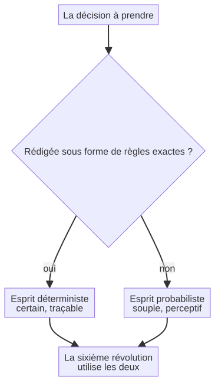

# Chapitre 13 --- Deux sortes d'esprit

## Le choix que personne ne vous demande

Il existe une décision que presque tous ceux qui bâtissent la sixième révolution prennent sans jamais s'en apercevoir, et c'est la décision la plus importante de toute l'histoire. Il ne s'agit pas de « devons-nous utiliser l'IA ? » Il s'agit de « quelle *sorte* d'IA ? » Et c'est un choix entre deux philosophies de l'esprit fondamentalement différentes, deux sortes d'esprit, qui s'accordent sur presque rien sauf sur leurs résultats apparents.

Pour comprendre le choix, considérez l'exemple le plus simple possible : une machine qui doit décider si une pièce qu'elle inspecte est bonne ou défectueuse. Il y a deux façons de prendre cette décision, et elles proviennent de deux mondes différents.

## La première sorte d'esprit : l'esprit qui devine

La première sorte d'esprit est celle que vous avez déjà rencontrée, dans le capteur de la broche. C'est l'esprit du modèle *probabiliste* --- le réseau de neurones qui a appris, à partir de milliers d'exemples, à *deviner* la réponse la plus probable. C'est l'esprit de l'ère de l'apprentissage profond : on le nourrit de nombreux exemples de pièces bonnes et défectueuses, et il s'ajuste jusqu'à ce que ses devinements correspondent à la réalité. Lorsqu'une nouvelle pièce arrive, il n'applique pas de règle ; il produit une *réponse probable*, pondérée par tout ce qu'il a vu.

Cet esprit qui devine est un miracle de l'âge moderne, et il est étonnamment bon pour les tâches pour lesquelles il a été entraîné. Il peut reconnaître une rayure, prévoir une panne, lire un code-barres dans le noir. Il excelle là où les règles ne peuvent pas être écrites explicitement mais où la bonne réponse peut être *montrée* --- dans la perception, dans la reconnaissance de motifs, dans le traitement de données désordonnées et réelles. C'est pourquoi l'apprentissage profond a conquis la reconnaissance d'images, la traduction et le langage en un seul élan : dans tous ces domaines, vous ne pouvez pas écrire les règles, mais vous pouvez montrer un million d'exemples.

Mais l'esprit qui devine possède un caractère que nous devons nommer avec soin, car ce caractère est toute la différence dans la sixième révolution. Il est **probabiliste**. Il donne son meilleur Devinement, mais il vous a donné, jusqu'à ce point, un Devinement. Il peut se tromper, même lorsqu'il sonne confiant. Il porte en lui, par sa propre nature, un *élément discretionnaire* : les données d'entraînement contiennent des biais, et l'inférence est une approximation apprise, et non une certitude. Pour reconnaître une rayure sur une bouteille, un Devinement est parfaitement acceptable. Pour décider si un système de freinage dans une voiture est sûr, un Devinement n'est pas seulement insuffisant ; il est inacceptable.

## La seconde sorte d'esprit : l'esprit qui calcule

Il existe une seconde sorte d'esprit, et elle est plus ancienne que la première de plus d'un demi-siècle. C'est l'esprit du calcul *déterministe*. Il ne devine pas ; il *calcule*. Il n'apprend pas d'exemples ; il applique des règles fixes à des entrées données et produit, à chaque fois, *la même réponse avec une certitude mathématique*. C'est l'esprit du compilateur, l'esprit qui transforme votre code source en instructions machine exactement une fois, à chaque fois, pour l'éternité, sans aucune discrétion et sans aucun biais, sans aucune dérive et sans aucun Devinement.

Vous avez rencontré cet esprit aussi, bien que vous n'ayez peut-être pas appelé cela de l'« intelligence ». Lorsque vous compilez un programme, le compilateur applique des règles fixes à votre code et produit un résultat fixe. Il ne peut pas être « erroné » de la façon dont un modèle qui devine peut l'être ; il ne peut être que correct ou incorrect, et sa correction est prouvable. Il n'a pas d'opinions. Il n'a pas de mauvais jour. À entrée identique, il donne la même sortie, avec la même certitude que deux plus deux faisant quatre. Ce n'est pas l'esprit qui reconnaît un visage ou qui traduit une phrase --- ceux-là sont impossibles pour lui. Mais c'est l'esprit qui *garantit*, et cette garantie vaut son pesant d'or exactement là où un Devinement serait dangereux.

## La ligne qui les sépare

Les deux esprits ne sont pas des rivaux au sens usuel ; ils sont *complémentaires*, chacun fort là où l'autre est faible. L'esprit qui devine est flexible, créatif, et indispensable pour la perception et le langage, mais il n'est pas certain. L'esprit qui calcule est parfaitement certain, mais il n'est pas flexible --- il ne fait que ce que ses règles imposent, et ses règles sont, par construction, complètes et non ambiguës.

La question décisive est celle-ci : **quel esprit devrait guider les décisions qui comptent le plus ?** Là où le résultat est une classification ou un Devinement --- une rayure ou une surface lisse --- l'esprit qui devine n'est pas seulement adéquat ; c'est le seul qui fonctionne. Mais là où le résultat doit être *certain* --- là où un Devinement erroné blesse quelqu'un, perd de l'argent, ou brise la confiance --- l'esprit qui calcule est le seul qui soit sûr.

Pour comprendre pourquoi l'esprit qui calcule est sûr, il est utile de voir précisément ce que « certain » signifie ici, car le mot accomplit un grand travail. Un système déterministe est dont la sortie est *entièrement déterminée* par son entrée et ses règles, sans aucune place pour le hasard, sans aucune aléatoire intégrée au processus, et --- crucialement --- sans aucune place *adversaire* pour manœuvrer. Un esprit qui devine, en revanche, peut être détourné de sa route par des entrées similaires mais non identiques --- un phénomène que le monde de l'apprentissage machine appelle *exemples adversaires* : un changement minuscule, imperceptible, d'une entrée qui peut inverser un Devinement confiant en une erreur confiante. L'esprit qui calcule n'a pas une telle faiblesse, car ses règles sont fixes et complètes ; il n'y a pas de faille par laquelle une entrée pourrait tomber. Ceci, plus que tout discours abstrait sur la « certitude », est pourquoi l'esprit qui calcule est le seul qui puisse être approuvé pour les décisions qui doivent être connues comme correctes.

## Les deux tribus de l'IA

Les deux sortes d'esprit ne sont pas une métaphore inventée pour cet ouvrage ; ce sont les deux grandes tribus de l'intelligence artificielle, et l'histoire de leur rivalité est une des histoires les plus instructives de tout le domaine. Il vaut la peine de la raconter, brièvement, car elle explique pourquoi la sixième révolution peut maintenant faire ce qu'aucune tribu ne pouvait faire seule.

La première tribu est l'école **symbolique**, parfois appelée « l'IA bonne vieille façon ». Sa croyance était que l'esprit est la manipulation de symboles selon des règles explicites --- que si vous pouviez écrire suffisamment de logique, vous pourriez capturer la pensée elle-même. Sa grande réalisation fut le *système expert* : un programme qui encodait le savoir d'un spécialiste humain comme un ensemble de règles si-alors. Dans les années 1970 et 1980, les systèmes experts furent construits pour la médecine (MYCIN, pour le diagnostic des infections), pour la chimie (DENDRAL, pour l'identification des molécules), et pour les affaires (XCON, pour la configuration des commandes informatiques), et pendant un temps ils furent la forme d'IA la plus commercialement réussie jamais construite. Ils étaient, en essence, l'esprit qui calcule : déterministe, basé sur des règles, vérifiable, et certain dans leur domaine. Leurs faiblesses étaient également claires --- ils étaient *cassants*. Ils fonctionnaient à l'intérieur de l'ensemble étroit de règles qu'on leur avait données, et ils échouaient lamentablement en dehors, car le monde réel est plein de cas pour lesquels personne n'a écrit de règle. Lorsque le marché des systèmes experts s'est effondré à la fin des années 1980, il emporta avec lui la réputation de la première tribu.

La seconde tribu est l'école **connectionniste** --- les réseaux de neurones. Sa croyance était presque l'inverse : que l'esprit n'est pas un ensemble de règles écrites mais un *motif appris d'exemples*, un réseau d'unités simples qui s'ajuste jusqu'à ce qu'il corresponde au monde. L'idée est plus ancienne que la plupart des gens ne le pensent : Frank Rosenblatt construisit le *perceptron* en 1958, une machine à apprendre simple, et elle fut accueillie avec une énorme optimisme. Mais le perceptron avait des limites, et un célèbre livre de 1969 de Marvin Minsky et Seymour Papert les exposa si efficacement que la recherche sur les réseaux de neurones se tut pendant plus d'une décennie --- l'« hiver de l'IA » de la tribu connectionniste. Il fallut attendre les années 1980 pour que la *rétropropagation* donne aux réseaux de neurones un moyen d'apprendre des structures profondes, et attendre 2012 pour que la combinaison des grandes données et des puces rapides (le moment AlexNet que nous avons rencontré dans la chronologie) les rende soudainement, spectaculairement bons. Cette seconde tribu est l'esprit qui devine : flexible, perceptif, et probabiliste.

Pendant des décennies les deux tribus se combattirent, et chacune méprisa l'autre. Les symbolistes dirent que les connectionnistes n'avaient aucune théorie et aucune garantie ; les connectionnistes dirent que les symbolistes ne pourraient jamais traiter le désordre du monde réel. Chacune avait raison concernant la faiblesse de l'autre et était aveugle concernant la sienne. L'insight discret de la sixième révolution --- celui pour lequel ce chapitre est bâti à transmettre --- est que le combat fut toujours une erreur. Les deux tribu ne sont pas des rivaux pour le même trône ; ce sont deux *outils différents pour deux travaux différents*, et la factory qui pense a besoin des deux.

Le diagramme est tout l'argument en une seule image. Lorsque la décision peut être écrite comme des règles exactes --- lorsque la spécification est complète et que l'entrée est bien définie --- l'esprit déterministe est le bon outil, et il est *supérieur*, car il est certain. Lorsque la décision ne peut pas être écrite comme des règles, mais ne peut être *montrée* que par des exemples --- reconnaissance, langage, prédiction --- l'esprit probabiliste est le seul outil qui fonctionne. La factory sage ne choisit pas une tribu ; elle demande, de chaque décision, quel outil de quelle tribu convient, et utilise celui-là. C'est là la sixième révolution, et c'est la résolution d'un argument de cinquante ans.

## La position controversée

C'est ici que les projets derrière cet ouvrage prennent une position distinctive et, dirait-on, controversée. Ils argumentent que bien plus des décisions de la factory que la plupart des ingénieurs n'admettent peuvent --- et devraient --- être prises par l'esprit *deterministe*, par des règles fixes et des spécifications exactes, plutôt que par l'esprit qui devine. Ils argumentent qu'une grande partie de ce que nous appelons « IA » par commodité est, en fait, parfaitement bien servie par le calcul déterministe, et qu'atteindre un modèle probabiliste là où la certitude est possible n'est pas seulement inutile mais *dangereux*.

Ce n'est pas un rejet luddite de l'apprentissage machine. C'est, tout au contraire, une croyance que l'esprit certain doit être utilisé partout où il peut l'être, de sorte que l'esprit incertain soit réservé --- sobrement --- pour les tâches où il seul réussit. Pour comprendre cette position pleinement, nous devons regarder le projet qui l'embodye le plus complètement, une technologie qui transforme un programme compilé en une spécification qui peut être exécutée sans aucun Devinement du tout. C'est le sujet du prochain chapitre.

## Ce qu'un garantie achète réellement

Il vaut la peine de demander, concrètement, ce que la garantie de l'esprit déterministe *vaut* --- car la « certitude » peut sonner comme un mot de philosophe jusqu'à ce que vous voyiez ce qui se passe lorsqu'elle est absente. L'histoire de l'informatique a quelques leçons graveuses, et deux d'entre elles valent la peine d'être racontées, car elles montrent, dans le sang et l'argent, pourquoi la sixième révolution ne peut pas se reposer sur des Devinements là où la certitude est requise.

La première est la **Therac-25**, une machine de radiothérapie contrôlée par ordinateur utilisée dans les années 1980. Elle fut conçue pour administrer des doses précises de radiation aux patients atteints du cancer, et elle s'appuyait sur un logiciel pour contrôler le faisceau. Une série d'erreurs de programmation --- des bogues subtils, interactifs, le genre qu'aucun test unique n'aurait capté --- permirent à la machine, sous certaines séquences d'entrée opérateur, d'administrer des surdoses massives. Plusieurs patients furent tués ou gravement blessés. Le logiciel de la machine était, d'une certaine façon, « déterministe » --- il faisait exactement ce pour quoi il avait été écrit --- mais il n'était *pas vérifié*, et son déterminisme livra le résultat erroné avec une certitude parfaite. La leçon n'est pas que le déterminisme est mauvais ; c'est que le déterminisme sans vérification est simplement un moyen fiable d'être erroné.

La seconde est la fusée **Ariane 5**, qui explosa sur son vol inaugural en 1996, moins d'une minute après le lancement. La cause fut un débordement de logiciel : une valeur qui avait été parfaitement sûre dans l'Ariane 4 plus petite dépassait la plage d'une variable 16-bit sur l'Ariane 5 plus puissante, et l'erreur résultante fit planter le système de guidage. Le code était, encore une fois, déterministe ; il faisait exactement ce pour quoi il avait été écrit. Mais il avait été écrit pour une machine différente, et personne n'avait vérifié que les hypothèses tenaient encore. La fusée ne échoua pas à cause d'un glitch aléatoire ; elle échoua parce qu'un système déterministe, appliqué en dehors de son domaine vérifié, est *certainement* erroné.

Ces histoires sont la raison pour laquelle les domaines de certification --- l'aviation, la médecine, la puissance nucléaire --- n'acceptent pas « ça marche dans la démo ». Ils exigent *la preuve* : que le comportement du logiciel a été vérifié contre sa spécification, que chaque hypothèse est documentée, et que toute la chaîne peut être vérifiée. C'est là la discipline que l'industrie de l'aviation appelle **DO-178C** --- une norme qui gouverne comment le logiciel à bord est développé et vérifié, et qui requiert, entre autres choses, que les exigences soient traçables jusqu'au fond jusqu'au code et en retour. C'est une norme bâtie sur une seule conviction : un système qui transporte des personnes dans les airs doit être *connu* comme correct, non simplement *probable* comme tel.

C'est précisément ce que l'esprit déterministe, correctement utilisé, peut livrer --- et ce que l'esprit qui devine ne peut pas. Un système déterministe construit à partir d'une spécification vérifiée peut être traçable, étape par étape, de la source à la décision, et toute la chaîne peut être vérifiée. Un modèle probabiliste peut être testé, et il peut être montré comme précis sur un ensemble de test, mais il ne peut pas être *prouvé* correct, car son comportement est, par construction, une approximation apprise. Là où le coût d'une réponse erronée est mesuré en vies ou en fortunes, la différence entre « testé » et « prouvé » est la différence entre un produit et un passif. La garantie n'est pas un luxe ; c'est la licence pour opérer.

## Pourquoi l'esprit qui calcule peut être prouvé

Il y a une chose de plus qui fait que l'esprit qui calcule mérite sa place dans la sixième révolution, et c'est une chose que l'esprit qui devine ne peut jamais fournir : une *prouve*. Lorsqu'un système déterministe décide de quelque chose, il est possible --- en principe, et souvent en pratique --- de *prouver*, rigoureusement et complètement, que la décision est correcte. C'est là la promesse de la discipline connue sous le nom de *vérification formelle* : la machine applique des règles fixes à une spécification fixe, et toute la chaîne de raisonnement peut être vérifiée par une machine, avec la même certitude qu'une preuve mathématique. Aucun Devinement ne peut être prouvé ; une preuve peut l'être.

C'est précisément la qualité que les domaines de certification requièrent --- les domaines que nous rencontrerons dans les chapitres suivants, où une décision qui doit être certaine doit aussi être *montrée* comme certaine. Un modèle probabiliste peut vous dire qu'il est confiant à 99,9 % ; il ne peut pas vous dire *pourquoi*, et il ne peut pas prouver que les 0,1 % restants ne mordront pas. Un système déterministe peut faire les deux. L'esprit qui calcule est, dans le sens le plus strict du mot, le seul esprit qui puisse se tenir devant un auditeur --- devant un évaluateur ISO, un examinateur SOC 2, un réviseur HIPAA --- et démontrer, étape par étape, que sa décision est correcte. Ce n'est pas une curiosité technique ; c'est tout le contenu de la garantie.
