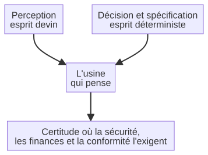

# Chapitre 15 --- Quand la certitude compte

## Les endroits où un devinest un crime

Nous avons maintenant rencontré les deux sortes d'esprit --- l'esprit devinatoire qui est flexible mais certain en rien, et l'esprit calculatif qui est certain mais qui n'improvise pas. Nous avons vu que l'esprit devinatoire est un miracle pour la perception et le langage, et que l'esprit calculatif est le seul choix sûr là où une décision doit être *connue* comme correcte. La question que ce chapitre répond est simple et décisive : **où, dans une usine qui pense, la décision doit-elle être certaine ?**

La réponse est « plus d'endroits que vous ne le pensiez », et c'est précisément la concentration de ces endroits qui rend la sixième révolution distincte des précédentes. Laissez-moi nommer les domaines, car dans chacun d'eux un devin probabiliste n'est pas seulement inadéquat mais dangereux, et dans chacun d'eux l'esprit déterministe --- l'esprit qui peut *prouver* sa décision --- est le seul acceptable.

## Le domaine de la sécurité

Considérez le système de contrôle industriel qui régule un bras robotisé travaillant à côté d'un humain. Si la décision de sécurité de ce bras est prise par un modèle devinatoire, alors il existe, caché dans le modèle, une petite mais non nulle probabilité qu'il se trompe de jugement --- que par une matinée à lumière inhabituelle, ou une posture inhabituelle, il décidera « sûr » alors que la réalité est « danger », et qu'un humain sera blessé. Cette probabilité n'a pas besoin d'être grande; elle doit simplement être supérieure à zéro, et même une probabilité infime, appliquée sur des millions de décisions à travers toute une usine, devient un risque réel.

Dans les systèmes critiques pour la sécurité, une probabilité non nulle d'un devin catastrophique n'est pas acceptable. La décision doit être *certaine* : soit sûre, soit dangereuse, prouvable, à chaque fois. C'est pourquoi l'esprit déterministe --- l'esprit qui calcule avec des règles fixes et produit une réponse garantie --- est le seul qui puisse être confié à la sécurité. C'est la même logique qui régule l'industrie aéronautique, où le comportement d'un système doit être prouvable devant une autorité qui le certifiera avant qu'un seul passager soit autorisé à monter. La certitude n'est pas un luxe dans ces domaines; c'est le prix d'entrée.

Le monde de la certification nomme cette précision à la juste mesure, et les noms valent la peine d'être connus. La sécurité fonctionnelle --- la sécurité d'un système *en tant que conséquence de son comportement correct* --- est régie, dans l'industrie, par des normes telles que **ISO 26262** (automobile) et **IEC 62443** (contrôle industriel et automatisation), qui exigent, par-dessus tout, que le comportement d'un système soit *prévisible, vérifiable et prouvable*. Un modèle probabiliste ne peut satisfaire à cela : son comportement est, par nature, pas entièrement prévisible, et il ne peut être prouvé correct. Un système déterministe le peut. Ce n'est pas une question de goût; c'est la condition selon laquelle un système critique pour la sécurité est autorisé à fonctionner du tout.

## Le domaine de la finance

Le deuxième domaine est le financier et le bureaucratique. Une usine n'est pas seulement un endroit où l'on fabrique des choses; c'est aussi un endroit qui émet des factures, qui réconcilie des comptes, qui rend compte aux autorités fiscales, qui traite des contrats. Dans chacun de ces cas, un devin n'est pas seulement inadéquat mais *responsable*. Une facture avec un chiffre erroné n'est pas « probablement juste »; elle est fausse, et elle doit être corrigée, et elle peut entraîner des pénalités. Une clause de contrat interprétée incorrectement n'est pas « probablement correcte »; c'est un litige, une perte, un procès.

Ici aussi l'esprit déterministe est le choix sûr, et ici il apparaît sous une forme particulièrement intéressante. Parce que les règles de la comptabilité, de la fiscalité, du droit des contrats sont --- contrairement aux règles de la vision ou du langage --- *écrites et explicites*, elles peuvent être encodées et exécutées deterministiquement. Une décision qui suit des règles fixes et vérifiables n'est pas un devin; c'est un calcul qui peut être audité, reproduit et prouvé correct. C'est exactement l'approche deterministe que le laboratoire derrière ce livre applique au côté bureau de l'usine, et c'est ce qui rend un agent digne de confiance avec l'argent et les mots qu'une entreprise ne peut pas se permettre de maladroiter. Le domaine financier est, à cet égard, la maison naturelle de l'esprit calculatif : les règles sont déjà écrites, donc la tâche n'est pas de les *apprendre* mais de les *appliquer* à la lettre.

## Le domaine de la conformité

Le troisième domaine est le réglementaire --- le monde des normes, des certifications et des audits. Les normes ISO, SOC 2, HIPAA, et leurs cousins industriels ne demandent pas « votre décision était-elle probablement juste ? ». Ils demandent « pouvez-vous *prouver* que votre décision est correcte, à chaque fois, et la retracer jusqu'à sa source ? » Un modèle probabiliste ne peut répondre à aucune de ces questions, car un modèle qui devine n'a pas de trace prouvable. Un système deterministe peut répondre à toutes, car sa décision est dérivée d'une spécification vérifiée par des règles fixes, et toute la trace --- du code source à la décision --- est transparente et reproductible.

Pour une usine dans un secteur réglementé --- médical, financier, aéronautique, énergie --- la conformité n'est pas un formulaire à remplir; c'est une condition d'existence. Et le seul type d'intelligence qui peut satisfaire une autorité de conformité est celui dont le comportement est deterministe, traçable et prouvable. C'est pourquoi l'esprit deterministe n'est pas une curiosité technique dans ces secteurs mais une *exigence*.

## La trace vérifiable

Il y a une chose de plus qu'une autorité de conformité regarde réellement, et elle vaut la peine d'être nommée, car c'est la chose concrète et physique derrière le mot abstrait de « certitude ». Un auditeur ne demande pas « votre système est-il probablement juste ?»; ils demandent à *voir la trace*. Ils veulent observer une seule décision remonter à l'envers, de la réponse jusqu'à son origine, et ils veulent voir, à chaque étape, que l'étape était *déterminée* --- fixe, reproductible et libre de discrétion.

C'est exactement la trace que l'esprit deterministe peut produire, et c'est la trace décrite par le chapitre précédent. Elle court, ininterrompue, du code source à la décision : le code source produit l'assemblage par *compilation* (un processus deterministe), et l'assemblage pilote la décision --- qu'elle soit une interface utilisateur, une API générée ou un verdict calculé --- par *transformation algorithmique fixe*. Chaque élément peut être retracé jusqu'à son origine, et chaque étape peut être reproduite. Cette correspondance entre spécification et mise en œuvre est, dans le monde de la certification, tout l'exigence. Quand le front-end est dérivé d'un backend vérifié par des règles deterministes, la correspondance entre ce qui a été spécifié et ce qui a été construit est *inhérente et prouvable* --- pas un espoir, pas un résultat de test, mais une nécessité logique. C'est ce qu'un examinateur de SOC 2 ou un réviseur HIPAA recherchent : pas la confiance d'un modèle, mais la *traçabilité* d'un modèle.

## Le quatrième domaine : le corps lui-même

Il y a un quatrième domaine, et c'est celui où les enjeux sont les plus élevés de tous : le corps humain. La médecine moderne fonctionne sur un logiciel dont le comportement doit être *certain*. Une pompe à perfusion qui administre un médicament à un débit précisément contrôlé; un pacemaker qui rythme un cœur; une pompe à insuline qui décide, moment par moment, quelle quantité d'hormone libérer; une machine de radiothérapie qui vise un faisceau. Dans chacun de ces cas, un devin probabiliste n'est pas une petite imperfection; c'est une menace directe pour une vie humaine.

Considérez le pancréas artificiel --- un système qui lit la glycémie d'une personne en continu et décide, automatiquement, quelle quantité d'insuline administrer. C'est une belle idée, et c'est déjà réel, mais c'est aussi un système dans lequel une décision erronée peut, en quelques minutes, plonger une personne dans un coma. Les décisions qu'il prend doit être *certaines* dans son arithmétique, même si la *perception* est probabiliste (le capteur est une approximation apprise, et elle peut être fausse). L'art d'un tel système est précisément l'art de la sixième révolution : utiliser l'esprit devinatoire pour *percevoir* (lire le capteur), et l'esprit deterministe pour *décider* (calculer la dose par des règles fixes et vérifiables qui ne peuvent jamais être fausses). Les deux esprits, chacun à sa place, protègent le corps qui leur fait confiance.

C'est pourquoi le monde des dispositifs médicaux est régi par des normes aussi strictes que toutes celles de l'ingénierie, et pourquoi un dispositif qui « fonctionne la plupart du temps » n'est pas un dispositif du tout. Le régulateur ne demande pas si la machine est *probablement* sûre; il demande si la machine est *connue* comme sûre, à travers chaque entrée qu'elle pourrait jamais recevoir. C'est le terrain natal de l'esprit deterministe, et c'est pourquoi, dans la sixième révolution, le corps est un des endroits où la certitude n'est pas négociable.

## Une courte histoire de la certitude en ingénierie

La demande de certitude en ingénierie est plus ancienne que l'informatique, et son histoire est l'une des plus instructives de toute la technologie. Avant que quiconque écrive une ligne de logiciel, les ingénieurs apprenaient --- souvent par la catastrophe --- qu'un système qui transporte des personnes dans les airs, ou soutient un pont, ou contient une réaction nucléaire, ne peut pas être construit sur « il semble que ça fonctionne ».

Les frères Wright, au début des années 1900, sont un petit mais éloquent exemple : ils n'ont pas seulement construit une machine volante; ils ont construit un *tunnel à vent* pour mesurer, précisément et à plusieurs reprises, les forces sur leurs ailes, de sorte que leur design reposait sur la mesure plutôt que sur l'espoir. De cette culture a grandi la discipline de la sécurité aéronautique, qui, après une série d'accidents terribles au XXe siècle, s'est durcie en un ensemble de normes qui ne supposent rien et exigent que tout soit *prouvé*. C'est là la lignée de DO-178C, la norme que nous avons rencontrée au chapitre précédent, et de toute la culture de vérification qui régule le vol à ce jour.

L'informatique a hérité de cette culture et, dans un premier temps, ne s'est pas élevée à elle. Les premières décennies du logiciel ont été une longue leçon sur le coût du determinisme *non vérifié* --- des systèmes qui faisaient exactement ce pour quoi ils avaient été programmés, et qui étaient exactement faux. De ces leçons a grandi le champ des **méthodes formelles** : l'utilisation de la preuve mathématique pour montrer que le comportement d'un programme correspond à sa spécification, dans chaque cas possible. Les méthodes formelles sont dures, et elles ne sont pas utilisées partout, mais elles existent, et c'est la raison pour laquelle le logiciel de contrôle de vol d'un avion moderne peut être certifié, et un système de paiement moderne peut être confié à une milliard de transactions.

La leçon de cette histoire, pour la sixième révolution, est que la certitude n'est pas un *don* de la technologie; c'est une *discipline* qui doit être choisie. Un système deterministe n'est pas automatiquement un système *correct* --- le Therac-25 et l'Ariane 5 étaient tous deux deterministes, et tous deux étaient catastrophiquement faux. La certitude requiert que le determinisme soit *vérifié* : que les règles soient vérifiées, que les hypothèses soient examinées, que toute la chaîne soit prouvable. Quand la sixième révolution dit qu'une décision doit être certaine, elle signifie précisément ceci --- pas simplement « la machine fera la même chose à chaque fois », mais « la machine a été montrée comme faisant la *bonne* chose à chaque fois ». C'est une barre plus haute, et c'est la barre que les domaines de la sécurité, de la finance, de la conformité et de la médecine exigent tous.

## L'intelligence combinée

Il est important, une fois de plus, d'insister sur le fait que ce chapitre n'argumente pas en faveur du *remplacement* de l'esprit devinatoire. L'esprit devinatoire reste indispensable pour la perception, la prédiction et le langage --- les tâches où la bonne réponse peut être montrée mais pas écrite. L'usine qui pense doit donc porter *les deux* esprits, et déployer chacun là où il est sûr de le faire :

La couche de perception --- la caméra qui voit une rayure, le capteur de vibration qui prédit une défaillance --- est l'esprit devinatoire, et elle est parfaite pour sa tâche. Mais la couche qui *décide* quoi faire avec la perception, qui vérifie la décision, qui la prouve correcte et la retrace jusqu'à la source, est l'esprit deterministe. Les deux sont combinés, chacun à sa place propre, et c'est cette combinaison qui rend l'usine digne de confiance là où la confiance n'est pas négociable.

## La ligne honnête

Traçons la ligne honnêtement, car l'honnêteté est toute la vertu de l'esprit deterministe. L'esprit deterministe est supérieur partout où la spécification est *complète* et où les règles sont *connues* : où vous pouvez compiler la décision dans des règles fixes, ou la dériver d'une spécification compilée par transformation exacte. Dans ces endroits, elle n'est pas seulement sûre; c'est le meilleur choix, car elle est certaine, traçable et prouvable. L'esprit devinatoire est superior partout où le monde est désordonné et où la bonne réponse ne peut être qu'*apprise depuis des exemples* : reconnaissance, traduction, prédiction. Dans ces endroits, aucun système deterministe ne pourrait fonctionner, et l'esprit devinatoire est la seule option.

L'usine qui pense ne choisit pas entre la certitude et la flexibilité; elle les *combine*. Elle devine là où le devin est le seul moyen de savoir, et elle calcule là où le calcul peut être certain. Et il est sage de savoir, avant que nous avancions vers le bureau qui mettra les deux esprits au travail, exactement où la ligne est tracée --- car une usine qui devine les choses qui doivent être certaines est une usine construite sur du sable, quelle que soit l'intelligence de ses machines.
