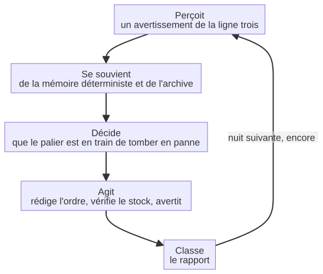

# Chapitre 16 --- Le bureau à minuit

## Les lumières s'éteignent

Il existe un genre particulier de silence qui tombe sur un bureau la nuit, une fois la dernière personne partie avec ses dernières clés et le vigile ayant terminé son tour. Les ordinateurs restent allumés ; les serveurs bourdonnent ; la machine à café, débranchée pour le sake de la bouilloire qui n'existe jamais, conserve sa petite chaleur. Et dans ce silence, quelque chose se produit qui aurait été impossible il y a une décennie, et qui reste encore invisible pour la plupart des personnes qui travaillent dans des bureaux pendant la journée. Le travail ne s'arrête pas. Il s'arrête simplement d'être fait par une personne.

C'est là la vision que ce chapitre introduit, et il vaut la peine de l'énoncer clairement avant d'entrer dans les mécanismes, car elle est l'aboutissement de toute la chaîne que nous avons été en train d'assembler. L'intelligence qui vit sur la machine (Partie II), la confidentialité qui garde les données à l'intérieur des murs (Partie III), et la certitude qui gouverne les décisions qui doivent être certaines (Partie IV) --- toutes ces choses se réunissent ici, dans le bureau, pour rendre réel une seule possibilité, frappante : un bureau qui continue de travailler après que les lumières se sont éteintes, géré par un agent qui connaît l'entreprise aussi bien que n'importe quel employé, et qui ne dort jamais, ne se fatigue jamais, et ne fuit jamais vos données.

## La différence entre un outil et un employé

Avant l'agent, le bureau avait déjà un grand nombre d'outils. Il y avait des tableurs et des processeurs de texte, des clients de messagerie et des bases de données, et --- de plus en plus --- des scripts qui automatisaient de petites tâches spécifiques. Une macro pouvait mettre en forme un rapport. Un script pouvait déplacer un fichier d'un dossier à un autre. Ce sont là des *outils*, et ils sont utiles, mais ce sont des outils au sens étroit : ils font exactement ce qu'on leur ordonne, à un document ou un fichier, et rien de plus. Ils n'ont aucune mémoire de l'entreprise, aucune compréhension de ce que le travail *signifie*, aucune capacité à juger qu'une tâche est terminée ou à s'adapter à un cas inattendu.

L'agent est différent en espèce, et la différence vaut la peine d'être nommée. Un agent n'est pas un outil qui fait une seule chose ; c'est un *travailleur* à qui l'on donne un *objectif* --- « préparer le rapport mensuel », « réconcilier ces factures », « alerter le gestionnaire que le roulement sur la ligne trois est en train de tomber en panne » --- et qui découvre, de lui-même, la séquence d'étapes nécessaire pour atteindre l'objectif, utilisant les outils qu'il a été donné, vérifiant son propre travail au fur et à mesure, et s'adaptant quand quelque chose ne se passe pas comme prévu. C'est là la caractéristique définissante de ce qu'on appelle un système *agentique* : il n'exécute pas simplement une commande ; il *poursuit un objectif avec un degré d'autonomie*, planifiant, agissant, observant le résultat, et s'adaptant.

Et crucialement, l'agent derrière ce livre n'est pas un chatbot générique, tout prêt, qui répond à des questions dans une fenêtre. C'est un système auto-hébergé qui fait tourner *le connaissance de votre entreprise* --- les documents, les systèmes, l'histoire --- sur *votre* matériel, gardant cette connaissance entièrement de votre côté du mur. C'est, au sens le plus plein, un employé qui vit dans votre bâtiment et ne quitte jamais vos premises.

## Pourquoi le bureau est la dernière frontière

Vous vous demanderez peut-être pourquoi, dans un livre sur les machines et les nuages, nous passons un chapitre sur le bureau. La réponse est que le bureau est le *dernier maillon* de la chaîne, et c'est aussi --- peut-être surprenant --- le lieu où la révolution est la plus, et la plus visiblement, nécessaire. Pendant des décennies, la révolution industrielle a transformé le *sol de l'usine* : le travail physique de fabrication de choses. Mais le *bureau* --- le travail de coordination, de documentation, de calcul, et de communication --- a été laissé presque entièrement aux humains. Le comptable encore fait le total ; le clerc encore classe ; le gestionnaire encore compose ; l'officier d'approvisionnement encore écrit des emails aux fournisseurs. Ce travail de bureau est énorme, répétitif, et de plus en plus riche en données, et il a, jusqu'à maintenant, eu une automatisation qui ne va pas au-delà de quelques macros.

La sixième révolution l'atteint. Elle l'atteint non pas avec un chatbot générique, mais avec un agent qui est *ancré* à l'usine --- qui lit la télémétrie venant des machines, les données gardées sûres dans le cloud privé, et les décisions qui doivent être certaines --- et qui *termine le travail que ces choses exigent*. L'agent est le point à lequel l'intelligence de l'usine devient la productivité du bureau. La machine perçoit ; le cloud garde le secret ; l'agent décide et agit. Et le travail sur lequel elle agit est, souvent, un travail de bureau : la comptabilité, le juridique, l'approvisionnement, le reporting, le service client.

## Une curiosité : les usines qui gardent déjà de travailler dans le noir

Avant que nous descendions plus avant dans le bureau à minuit, il vaut la peine de savoir que la phrase n'est pas entièrement nouvelle pour l'industrie. Il existe, dans la fabrication moderne, un terme bien établi pour une usine qui tourne pendant la nuit sans un seul humain en elle --- une *usine lights-out* (à lumières éteintes). Le mot vient de la circonstance la plus littérale : dans certaines de ces usines l'air est si pur, et le processus si scellé, que garder les lumières allumées serait un gaspillage ; les machines n'ont pas besoin de voir, et donc elles n'ont pas besoin de la lumière, et donc elles n'ont pas besoin des personnes qui autrement auraient besoin de la lumière pour voir. L'industrie des semi-conducteurs, en particulier, a construit des salles propres entières qui tournent sans personnes, car un humain dans une salle propre est lui-même une source de contamination --- des cellules de peau, des fibres, la perturbation silencieuse d'un souffle respiré. Donc l'usine a appris, il y a des décennies, à travailler dans le noir et dans le silence, et à mesurer sa production non pas dans les changements de poste de son personnel mais dans le flux continu d'unités sortant d'une ligne.

C'est là une curiosité qui vaut la peine d'être conservée, car elle fait deux choses pour nous à la fois. La première est de montrer que « le bureau à minuit » n'est pas un rêve de l'avenir mais l'extension logique d'une chose qui existe déjà sur le sol de l'usine : un système qui continue de produire pendant que les personnes partent chez elles. La seconde est de faire une distinction que le bureau doit maintenant apprendre à faire pour lui-même. Une *usine à lumières éteintes* travaille la nuit parce que son travail est physique, scellé, et mesurable --- les machines n'ont pas besoin de lire les contrats privés d'une entreprise ou de répondre à l'email anxieux d'un client. Le bureau ne sait pas encore comment aller au noir, parce que son travail n'est pas scellé : il est plein de contexte, d'histoire, des faits exacts et non répétables d'une entreprise particulière. C'est précisément ce que l'agent change. Le bureau peut aller au noir enfin, parce que l'agent est le premier travailleur qui n'a pas besoin de voir la pièce pour faire le travail --- elle n'a besoin que de la connaissance propre de l'entreprise, gardée sûre, et d'un objectif qui vaut la peine d'être poursuivi.

## La mer du travail de col-blanc

Il y a un fait qui fait sentir au bureau à minuit qu'il est aussi grand qu'il l'est réellement, et c'est un fait sur l'*échelle*, non pas seulement sur la technologie. Le travail qui se produit dans un bureau --- la coordination, la documentation, le calcul, la communication --- est, dans les économies qui l'ont construit, énormément plus grand que le travail du sol de l'usine, et il a grandi sans cesser. Le mot même pour le travailleur de bureau est comparativement jeune : « white-collar » (travailleur de col-blanc) a été inventé en 1899 par le journaliste et auteur américain William H. White, pour distinguer le clerc et le vendeur, qui travaillaient à l'intérieur dans une chemise et une cravate, du travailleur « blue-collar » (de col-bleu) de la boutique et du champ, qui travaillait dans des combilones. Dans les cent vingt années depuis que ce mot a été inventé, la main-d'œuvre de col-blanc a grandi de plusieurs ordres de grandeur. Où une usine en 1920 aurait pu employer une centaine d'hommes aux machines et une poignée de clercs aux bureaux, une aujourd'hui pourrait employer une centaine d'hommes aux machines et quelques centaines de clercs, de calculateurs, de classeurs, de planificateurs, et de correspondants à leurs bureaux --- et le nombre de ces derniers continue de monter même pendant que les premiers sont mécanisés.

C'est là la grande ironie de l'histoire de productivité du vingtième siècle : à mesure que les machines prenaient en charge le *travail physique*, le *travail documentaire* a plutôt grandi qu'il n'a rétréci. Le bureau ne s'est pas rétréci pour remplir l'espace que les machines ont laissé ; il a débordé. Le grand livre du comptable, une fois gardé dans un seul livre relié, s'étend maintenant sur des systèmes et des régulateurs et des codes fiscaux ; le classement du clerc, une fois une affaire d'encre et d'index, s'étend maintenant sur des documents et des versions et les mots exacts d'une conversation tenue il y a trois mois ; la composition du gestionnaire, une fois une lettre, s'étend maintenant sur des rapports et des devis et la langue de conformité précise d'une douzaine de juridictions. C'est un travail d'énorme, de répétitif, de de plus en plus riche en données --- et pour la plupart de son histoire il a eu une automatisation qui ne va pas au-delà de quelques macros. La sixième révolution l'atteint, parce que l'agent est le premier travailleur qui peut lire tout cet océan de documentation comme un clerc expérimenté le ferait, sans se fatiguer, sans fuir, et sans oublier un seul mot de celui-ci.

## Le bureau à minuit, étape par étape

Pour voir que ce n'est pas simplement une vision mais une séquence --- une chose réelle qui se produit dans un ordre réel --- il aide à regarder la propre nuit de l'agent, dessinée comme un petit flux, de sorte que le contour du travail soit clair. Ce que l'agent fait à minuit n'est pas une seule action mais une chaîne, et la chaîne est la même qui gouverne la machine : elle perçoit, elle se souvient, elle décide, elle agit, elle classe.

C'est là le bureau à minuit, dessiné en cinq étapes. Ce n'est pas de la science-fiction. C'est l'achèvement naturel de la chaîne --- et l'agent qui effectue ce travail, avec sa mémoire propriétaire et son bac à sable, est le sujet du chapitre suivant. Mais avant que nous descendions dans ses détails, nous devrions comprendre la forme de toute la chaîne, la façon dont la machine, le cloud, l'agent, et le bureau se connectent en une seule boucle continue. Cette forme --- le graphe de « Industrie 7.0 » --- est le sujet du chapitre d'après-demain. Pour l'heure, laissons le bureau à minuit se tenir comme un aperçu de ce qui arrive.

## Un vrai exemple : le poste de nuit qui ne se termine jamais

Pour rendre ceci concret, regardons un bureau spécifique à minuit --- non pas un bureau d'usine, mais le bureau de comptabilité d'un fabricant de taille moyenne, le genre de bureau qui existe dans presque chaque ville avec une usine, et qui a toujours, jusqu'à maintenant, été le lieu où le travail du jour se répandait silencieusement vers le jour suivant. Pendant des années, le comptable du poste tardif arrivait à six heures du soir, et elle faisait ce que le bureau fait à la fin d'une journée : elle clôtrait les livres sur les commandes du jour, elle réconciliait les factures qui avaient été émises contre les expéditions qui étaient parties du magasin, et elle ébauchait le rapport que le gestionnaire lirait à neuf heures du matin. C'était un vrai travail, un travail soigné, et c'était, entièrement, manuel. Si une expédition avait été retournée, ou si une facture ne correspondait pas à sa commande, elle s'arrêtait et poursuivait l'écart à la main --- par téléphone, par email, en relisant les papiers. Le travail ne s'arrêtait pas quand elle partait ; il s'arrêtait simplement à attendre son retour.

Maintenant le même bureau travaille à minuit, et il travaille sans elle. L'agent reprend le fil exactement comme un clerc expérimenté le ferait. Il ébauche le rapport de clôture du jour dans la propre langue et le propre style de l'entreprise, et où un humain aurait deviné une figure manquante, il *récupère* le contexte pertinent précis --- la facture, l'expédition, le retour --- de la propre archive de l'entreprise et de son cloud privé, exactement et sans le redériver. Où un humain aurait fait un seul tableur à la main, l'agent peut piloter le même bibliothèque de tableurs qu'un clerc qualifié utiliserait, construisant le classeur avec les données, les styles, et le diagramme sur une seule page A4, et livrant le fichier terminé. Et où le comptable du poste tardif poursuivait une fois un écart par téléphone jusqu'à dix heures du soir, l'agent vérifie le magasin pour la pièce de rechange ou la figure manquante non pas par une requête rigide, mais à la façon d'un clerc expérimenté --- lisant l'inventaire, s'adaptant à l'inattendu, et alertant le gestionnaire dans des mots calmes et clairs. Il fait tout ceci sans un humain dans le bâtiment, utilisant une connaissance qui n'est jamais partie de l'entreprise, et il le fait avec la même fiabilité qui gouverne la machine. Le lendemain matin, le comptable arrive à neuf ; elle ne *fait* pas le travail ; elle *révise* le travail de l'agent, et signe ce qui est correct. C'est là le poste de nuit qui ne se termine jamais, et ce n'est pas de la science-fiction.

## Les propres limites de l'agent

Ce serait malhonnête de peindre l'agent de bureau comme un travailleur illimité, et l'honnêteté ici est plus précieuse que l'enthousiasme, parce que les limites sont exactement ce qui fait que l'agent peut être confié en toute sécurité. L'agent derrière ce livre est un travailleur puissant, mais c'est un *borné* (limité), et les limites sont délibérées.

La première limite est le bac à sable. Les actions de l'agent passent par un périmètre contraint intégré dans l'architecture, de sorte qu'un appel d'outil ne peut pas sortir de son étendue assignée ; les actions sur fichiers sont réversibles, grâce à la versioning ; et l'agent est donné, par conception, aucune capacité d'exécution de code, précisément de sorte qu'il ne puisse pas créer ou exécuter du code. C'est là une limite qu'un vendeur négligent appellerait une fonction manquante, et qu'un vendeur soigneux appelle la raison pour laquelle l'agent peut être confié du vrai travail d'entreprise du tout.

La seconde limite est la connaissance. L'agent ne connaît que ce qu'il a été donné --- les documents de l'entreprise, son histoire, son archive --- et il n'est bon que comme ce matériau. Une entreprise avec une archive désorganisée nourrit une mémoire désorganisée ; une entreprise avec une archive claire nourrit une claire. L'agent est un miroir de l'ordre propre de l'entreprise, rendu permanent et récupérable, et il ne peut pas connaître ce que personne ne lui a dit.

La troisième limite est le jugement. L'agent propose ; il ne *répond* pas. Il peut ébaucher le rapport, vérifier le stock, et alerter le gestionnaire, mais il ne peut pas prendre la responsabilité de l'issue --- ce, comme la prochaine partie du livre l'insistera, reste humain. L'agent est le travailleur qui fait le faire ; le humain est celui qui signe. Et cette division n'est pas une faiblesse de l'agent ; c'est la forme de la confiance.

## Pourquoi le bureau fut le dernier à être mécanisé

Il y a une question qui vaut la peine d'être répondue clairement, parce qu'elle rend la vision plus claire : pourquoi, si le sol de l'usine a été mécanisé sur une centaine et cinquante années, le bureau a-t-il été si tardif à la révolution ? La réponse est que le bureau n'a pas manqué de outils ; il a manqué de *contexte*. Pendant des décennies le bureau a été, si quelque chose, plus complètement instrumenté que le sol de l'usine --- des tableurs, des processeurs de texte, des bases de données, des systèmes de messagerie, des systèmes d'entreprise qui reliaient les comptes à l'approvisionnement à le magasin. Ce qu'il n'a jamais eu était un travailleur qui pourrait réellement *utiliser* ces outils à la façon d'une personne qualifiée : lire le contexte, se souvenir de l'histoire, juger qu'une tâche est terminée, et s'adapter au cas inattendu. Une macro peut mettre en forme un rapport ; un script peut déplacer un fichier d'un dossier à un autre ; un système d'entreprise peut calculer une facture. Mais aucun d'eux ne peut *connaître l'entreprise* --- les clients, le style, l'histoire, les règles non dites de comment cette entreprise particulière fait son travail. Aucun d'eux ne peut juger qu'une facture particulière est fausse, ou qu'un client particulier mérite une exception, ou qu'un rapport particulier devrait être écrit d'une façon particulière.

C'est précisément ce que l'agent change, et c'est pourquoi le bureau fut la dernière frontière. La machine a été mécanisée en premier parce que son travail est *physique, scellé, et mesurable* --- un arbre de rotation soit tourne soit il ne le fait pas, et les capteurs qui le surveillent n'ont pas besoin de comprendre l'entreprise. Le bureau a été mécanisé en dernier parce que son travail est *contextuel, historique, et non répétable* --- il dépend de connaître cette entreprise, ses clients, ses documents, et son histoire, et aucune quantité d'écriture de macros ne pourrait fournir cette connaissance. La sixième révolution atteint le bureau enfin non pas parce que les outils sont enfin arrivés, mais parce que le *travailleur* est enfin arrivé : un agent qui connaît l'entreprise, tourne sur votre matériel, et ne fuit jamais vos données. Et une fois que ce travailleur existe, le bureau à minuit cesse d'être un rêve et devient, tout simplement, un bureau qui travaille.
