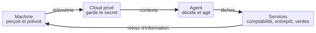

# Chapitre 18 --- La chaîne : machine, cloud et service

## Faire un pas en arrière pour voir la forme

Nous avons maintenant parcouru, pièce par pièce, tous les composants de la sixième révolution industrielle. Nous avons rencontré la machine qui pense sur une puce, le cloud qui garde son secret, et l'agent qui connaît votre activité et n'oublie jamais. Individuellement, chacun est impressionnant. Mais la raison pour laquelle ce moment --- cette sixième révolution --- est véritablement distinct de toutes les révolutions qui l'ont précédée est que les composants ne sont pas simplement *présents* ; ils sont *connectés*, formant une seule boucle continue dans laquelle la sortie de l'un devient l'entrée du suivant, et le dernier revient au premier. Ce chapitre est le pas en arrière qui vous permet de voir la forme entière d'un coup, car voir la forme fait la différence entre un tas de pièces et une seule machine.

La boucle comporte quatre étapes, et il vaut la peine de les garder en tête ensemble avant que nous n'étions chacune :

La machine perçoit son monde et produit des télemètres. Le cloud privé reçoit ces télemètres et les garde sûrs, cohérents et consultables. L'agent récupère le contexte précis et pertinent du cloud et de votre base de connaissances, décide quoi faire, et agit. Son action est l'automatisation du travail d'un service --- la comptabilité, l'entrepôt, les ventes, le support. Et le travail du service, à son tour, génère de nouvelles exigences et de nouvelles actions qui reviennent dans la machine et le cloud. La boucle est fermée. L'usine est, au sens le plus complet du mot, *autoregulée*.

## Une curiosité : le mot pour une boucle

Il vaut la peine de s'arrêter, sur ce chapitre sur une boucle, pour poser une question simple --- que voulons-nous réellement dire quand nous appelons cette forme une « boucle », et d'où vient le mot ? Le terme qui nomle plus précisément l'idée que nous utilisons est la **cybernétique**, inventée en 1948 par le mathématicien américain Norbert Wiener lorsqu'il publia un livre de ce nom. Le mot est plus ancien que la discipline ; il vient, inchangé, du grec ancien *kubernan* --- piloter un navire, tenir la barre. Un *kubernetes* était le timonier, celui qui maintenait un vaisseau sur sa route en lisant, constamment, la différence entre où le navire était et où il voulait être, et en corrigeant cette différence à mesure que la mer changeait. C'est, exactement, ce que fait notre boucle : elle lit, en continu, la différence entre l'état de l'usine et l'état que l'usine veut être, et elle corrige cette différence --- par la machine, par le cloud, par l'agent, par les services --- tant que la boucle est fermée.

Le mot porte, discrètement, toute une philosophie du contrôle. Avant la cybernétique, l'engineering pensait surtout les machines comme des choses qui *faisaient* simplement ce qu'on leur disait, une fois. La cybernétique a appris à tout un champ à penser à la place des machines qui *regardent, comparent et ajustent* --- le servo, le thermostat, le régulateur sur une machine à vapeur, le conducteur humain qui maintient la voiture dans sa voie en jetant constamment un regard sur la route et en tournant le volant d'un millimètre. La boucle de la sixième révolution appartient, dans l'esprit, à cette tradition. L'usine qui pense est une usine qui *se pilote elle-même*, et le mot pour cela est le mot que nous avons utilisé tout au long, que nous le sachions ou non.

## Le bureau qui était déjà connecté

Avant la sixième révolution, il y eut de véritables tentatives documentées pour faire exactement ce que cette boucle fait --- connecter les machines d'une usine au bureau qui la fait tourner --- et il est honnête de les nommer, car elles montrent à la fois jusqu'où le marché era venu et jusqu'où il avait encore à aller. La lignée commence, de façon surprenante, par la comptabilité des matériaux. Dans les années 1950 et 60, un homme nommé Joseph Orlicky, travaillant sur le contrôle des stocks, donna naissance à **MRP** --- Material Requirements Planning --- un moyen de calculer, à partir d'une nomenclature et d'un calendrier de ce qui devait être construit, exactement quels matériaux étaient nécessaires et quand. Dans les années 70 ceci grandit vers **MRP II**, Manufacturing Resource Planning, qui amena la planification de l'usine, ses stocks et ses coûts sous un seul calcul intégré. Et dans les années 80 et 90 l'idée s'étendit au-delà des murs de l'usine vers **ERP** --- Enterprise Resource Planning --- les grands systèmes intégrés qui tentent de faire tourner une entreprise entière, de ses commandes à sa paie, comme un seul ensemble cohérent de nombres.

C'est le prédécesseur que nous devons nommer, car la sixième révolution est, dans un sens, l'*étape suivante* sur la même route. L'ERP fut une révolution à part entière --- c'était le premier logiciel assez ambitieux pour traiter une entreprise comme un seul système continu plutôt qu'une collection de bureaux. Mais il avait une limite structurelle que la sixième révolution dépasse, et la limite vaut la peine d'être énoncée, car c'est la limite qui rend le cloud interne nécessaire. L'ERP classique connectait le *bureau* à lui-même : les comptes à l'achat à l'entrepôt. Ce qu'il ne connectait pas, et ne pouvait pas connecter, était la *machine* --- la réalité physique de l'atelier, vue par une puce sur un broche, en temps réel. C'était un système de bureau regardant vers l'intérieur, sur des papiers ; la sixième révolution est un système de bureau regardant *vers l'extérieur*, sur la machine, puis revenant vers l'intérieur encore, dans une boucle. La chaîne que nous avons dessinée est le mariage de ces deux lignées : le calcul intégré de l'ERP, enfin joint à la perception vivante de la machine et à la mémoire privée du cloud.

## La direction de la boucle

N'omettons pas l'ordre de ces étapes, car l'ordre est significatif. La boucle commence à la *physique* --- la machine qui perçoit --- car la sixième révolution est fondamentalement à propos de l'apport de l'intelligence dans le monde physique de faire les choses, non seulement à propos du monde du papier et des données. L'intelligence ne flotte pas libre ; elle est *ancrée* à l'état réel de l'usine. Elle s'écoule ensuite *vers l'intérieur* --- vers le cloud privé qui la garde sûre --- puis *vers le haut* --- vers l'agent qui raisonne à partir d'elle, et vers les services qui agissent sur elle. C'est la direction de la valeur : de la réalité physique de la machine, par la mémoire sûre du cloud, vers le jugement de l'agent, vers l'action du bureau.

Remarquez aussi que c'est délibérément l'*opposé* de l'ancien modèle. Dans l'ancien modèle, l'intelligence vivait dans une pièce remplie d'ordinateurs, et les machines sur l'atelier étaient des esclaves actionneurs muets ; l'intelligence venait *vers le bas* sur l'atelier, mal, comme un ensemble de règles. Dans la sixième révolution, l'intelligence est *intégrée dans* la machine, et elle s'écoule *vers l'extérieur* --- par un cloud que l'entreprise contrôle, par un agent qui connaît l'activité --- pour automatiser le travail qui fut, jusqu'à maintenant, entièrement humain. La direction est inversée, et avec elle toute l'économie de l'usine.

## Le mot clé : le cloud interne

Il y a une phrase dans le diagramme qui mérite d'être répétée, car c'est la phrase qui rend la boucle entière politiquement et techniquement possible : le cloud **interne**, privé. Chaque précédente tentative de connecter les machines d'une usine à son bureau passa par un cloud *public* --- les géants centres de données centralisés que datagate prouvaît pouvaient être lus, ou contraints de l'être, par un tiers. C'est un accord qu'aucune entreprise qui valorise son futur ne peut faire, car le télemètre s'écoulant de la machine est précisément la picture du futur de l'entreprise, rendu visible. Un cloud public transformerait cet asset le plus sensible en données pour quelqu'un d'autre.

Le cloud interne, privé, à connaissance nulle --- le cloud gardé à l'intérieur des murs --- est ce qui permet à la boucle de se fermer sans trahison. Il reçoit le télemètre de la machine, il le garde cohérent et consultable dans toute l'entreprise, et il permet à l'agent de récupérer le contexte pertinent exact --- et dans tout ceci il n'apprend jamais les contenus, car l'entreprise garde la clé. La boucle peut donc tourner en continu, en sécurité, et en privé, et c'est le seul type de boucle qu'une entreprise peut faire confiance avec son propre futur. C'est le thème de la Partie III, répété ici car c'est la raison pour laquelle la boucle est même possible.

## La boucle, mesurée en données

Pour rendre la boule concrète, il aide de voir exactement ce qui s'écoule à travers elle, car une boucle n'est pas une abstraction --- c'est un flux de choses spécifiques, se déplaçant dans une direction spécifique, à un rythme spécifique. Au fond de la boucle, la machine perçoit, et ce qu'elle envoie *vers le haut* est le télemètre : les lectures de ses capteurs, en temps réel, chiffrées à mesure qu'elles voyagent, et gardées sûres dans le cloud privé. Ceci est des données sur l'état physique de l'usine --- la température d'un broche, la vibration d'un moteur, l'énergie qu'une machine consomme --- recueillies non pour regarder la machine mais pour *prédire* elle. Du cloud, ce qui s'écoule *vers le haut* n'est pas de données brutes mais du contexte : l'agent ne se noie pas dans un flux de nombres ; il récupère le contexte précis et pertinent du cloud et de la base de connaissances de l'entreprise, et il décide quoi faire de ce contexte. Et sa décision s'écoule *vers le haut* une fois de plus, comme une action --- une tâche automatisée ou une spécification --- vers le service, qui agit sur elle.

Regardez maintenant la boule se fermer, et remarquez ce qui s'écoule *en retour*. L'action du service --- une commande passée, une facture réconciliée, un fournisseur averti --- génère de nouvelles exigences et de nouvelles actions, et celles-ci reviennent *vers le bas* vers la machine et le cloud, informant le prochain cycle de perception, le prochain cycle de mémoire, le prochain cycle de décision et d'action. La boule n'est pas un pipeline qui transporte des données dans une direction et s'arrête ; c'est un système fermé dans lequel la sortie de chaque étape devient l'entrée de l'étape suivante, en continu, sans un humain passant chaque pièce de travail à la main d'un bureau à l'autre. C'est ce que « autoregulée » signifie, concrètement : non une machine qui est *demandée* quoi faire, mais un système dont propre sortie pilote sa propre prochaine entrée, pour toujours, tant que la boule est fermée.

## Pourquoi la boule n'est pas une pyramide

Il y a une distinction subtile mais importante vale la peine d'être tirée, car c'est la distinction entre une machine qui *exécute* simplement et une machine qui *autoregule*. Une pyramide est une hiérarchie : les commandes s'écoulent vers le bas depuis le haut, et les rapports s'écoulent vers le haut depuis le bas, mais rien au bas ne change ce qui est en haut --- la hiérarchie est *stable* dans le sens où le haut décide toujours et le bas obéit toujours. Une boule, au contraire, n'est pas stable de cette façon ; elle est *dynamique* : la sortie du bas revient dans le haut et change ce que le haut décide ensuite. C'est la différence entre une usine qui est *commandée* et une usine qui est *autoregulée*.

C'est pourquoi la boule importe tant, et pourquoi elle est le cœur du chapitre. Les six révolutions précédentes firent la machine plus puissante, puis plus connectée, puis plus informatisée, mais à aucun moment la machine *se coordina elle-même* : à aucun moment sa propre sortie pilota sa propre prochaine entrée, en continu, sans un humain dans la boule. La sixième révolution est la première qui le fait.

## La latence de la boule

Il y a une propriété de la boule qui est facile à manquer et qui décide, en pratique, si elle fonctionne : sa *vitesse*, et le fait que différentes parties d'elle doivent tourner à différentes vitesses. Une unique boule qui tenterait de tout tourner à la vitesse de la partie la plus lente serait inutile ; une boule qui tenterait de tout tourner à la vitesse de la partie la plus rapide serait dangereuse. La sixième révolution fonctionne parce qu'elle correspond à chaque décision à son propre échelle de temps.

À l'**edge**, la boule tourne en microsecondes. La machine qui perçoit sa propre vibration et agit sur elle --- arrêtant un moteur, ajustant un chemin, rejetant une pièce --- doit décider dans le temps qu'il prend à compléter la tâche physique, souvent des millièmes de seconde. C'est l'échelle de temps du réflexe, et c'est pourquoi l'intelligence doit vivre sur la machine, sur la puce, et non dans une pièce.

Dans le **cloud**, la boule tourne en secondes et minutes. Le télemètre est résumé et envoyé, le cloud privé le stocke et le rend consultable, et l'agent récupère le contexte précis et raisonne à son sujet. C'est l'échelle de temps de la mémoire et du jugement --- assez rapide pour attraper une tendance, assez lent pour penser --- et c'est pourquoi le cloud privé existe comme couche séparée, avec son propre rythme.

Dans le **bureau**, la boule tourne en heures et jours. L'agent brouille la commande de maintenance, l'entrepôt commande la pièce, la comptabilité réconcilie la facture, le client est informé de la date de livraison. C'est l'échelle de temps du travail qu'un humain aurait fait sur une journée, maintenant terminé la nuit, et c'est pourquoi l'automatisation de bureau est le haut de la boule et non son bas.

L'art de la sixième révolution, en termes d'engineering, est de *correspondre la décision à l'échelle de temps*. Une décision de sécurité qui doit être faite en un millimètre de seconde ne peut pas attendre le cloud ; une décision stratégique qui devrait peser une année d'histoire ne peut pas être faite sur l'edge. La boule fonctionne parce que chaque couche tourne à la vitesse que sa propre question exige --- réflexe, mémoire, travail --- et parce que les couches sont connectées, de sorte qu'un réflexe rapide et un jugement lent peuvent encore faire partie du même entier.

## La boule est la révolution

Fermons ce chapitre avec l'idée qui la relie à tout le livre, car c'est l'idée que le livre est construit pour transmettre. La sixième révolution industrielle n'est pas la machine, ou le cloud, ou l'agent, ou l'automatisation des services. C'est la *boule* --- le flux continu, autoregulé de la machine, par le cloud privé, par l'agent, vers les services, et de nouveau en arrière. C'est le moment où l'usine devient un seul système autoregulé plutôt qu'une collection de machines intelligentes et de bureaux intelligents qui arrivent à être assis près les uns des autres.

Et il y a une dimension humaine à la boule que nous n'avons pas encore nommée, car c'est la plus importante. La boule que nous avons dessinée est une boule de *machines et d'agents*. Mais ce n'est pas une boule qui *remplace* l'humain ; c'est une boule qui *déplace* l'humain, les promouvant du dernier lien de la chaîne vers l'architecte et le chef d'orchestre de tout. La machine perçoit ; l'agent décide ; l'humain *detient l'autorité de veto, de juger si la décision vaut la peine d'être agie, et de prendre responsabilité de l'issue*. La boule n'est pas sans humain ; elle est humaine-élevée. Cette élévation --- ce mouvement du dernier lien vers le chef d'orchestre --- est le contenu humain de la sixième révolution, et c'est le sujet de la prochaine partie de ce livre.

Pour l'heure, laissons la boule se tenir : la machine, le cloud, l'agent, et le service, connectés en un seul système continu et autoregulé. Le prochain chapitre ouvrira le service et montrera ce que l'automatisation fait réellement à la comptabilité, à l'entrepôt, aux ventes, et au support. Et le chapitre suivant donnera à toute la boule son nom et sa forme, le graphe « Industry 7.0 ».
