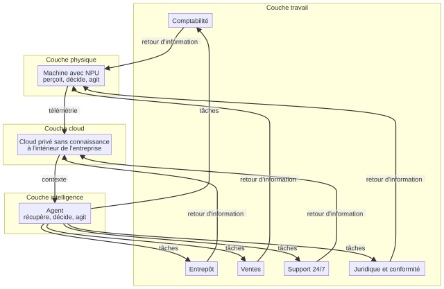

# Chapitre 20 --- Le graphe qui relie tout

## Le nom du tout

Nous avons parcouru chaque composant de la sixième révolution à tour de rôle. Il est temps de donner son nom au tout, et de le montrer tel qu'il est véritablement : non pas une ligne, mais un *graph* --- un ensemble de connexions dans lequel chaque node nourrit chaque autre, dans un tout continu et auto-coordonné. C'est le graphe de l'**Industry 7.0**, et c'est la forme de l'avenir que cet ouvrage décrit depuis la première page. Le chiffre « 7.0 » n'est pas arbitraire. Les révolutions précédentes ont rendu la machine plus puissante, puis plus connectée, puis plus informatisée. La septième, selon le cadrage adopté par cet ouvrage, est celle dans laquelle les machines elles-mêmes deviennent *des périphériques un AI interne*, et l'AI --- agentic, connectée à un cloud privé --- automatise l'ensemble de l'entreprise, de la machine à chaque département.

Traçons le graphe, avec soin, car le graphe est l'essence de l'argument et le voir dans son entier fait la différence entre comprendre la sixième révolution et simplement être impressionné par ses parties.

## Le graphe

## Une curiosité : les sept ponts, et le premier graphe

Avant de lire le graphe, il vaut la peine de savoir que le mot « graphe », dans ce sens --- un ensemble de points reliés par des lignes --- a une origine surprenante et plutôt ludique, car les mathématiques des graphes n'ont pas commencé avec l'ingénierie mais avec une énigme. Dans la ville prussienne du XVIIIe siècle de Königsberg (aujourd'hui Kaliningrad, sur la rivière Pregel), il y avait une rivière avec deux îles et sept ponts reliant les deux rives et les deux îles. Les habitants s'amusaient avec une question : pouvait-on faire une promenade traversant chacun des sept ponts exactement une fois et revenant au point de départ ? En 1736, le mathématicien suisse **Leonhard Euler** trancha la question --- et il la trancha par la négative, avec une preuve si limpide qu'elle est encore enseignée aujourd'hui. Mais il s'agissait de plus qu'une solution à un jeu de salon : pour y répondre, Euler dut penser les masses terrestres comme des *points* et les ponts comme des *lignes*, et les mesurer non par leur longueur ni par leur matériau mais purement par *comment ils étaient connectés*. En faisant cela, il inventa ce que nous appelons aujourd'hui la théorie des graphes, et il nous donna le vocabulaire même de « nodes » et d'« edges » que nous utilisons pour décrire la factory de l'Industry 7.0.

C'est une curiosité qui vaut la peine d'être conservée, car l'ap d'Euler est exactement l'ap sur lequel notre graphe repose. Le graphe de l'Industry 7.0 n'est pas dessiné à l'échelle ; il n'importe pas combien de « long » est la connexion entre la machine et le cloud, ni combien de « wide » est le node warehouse. Ce qui compte, comme Euler l'a montré, est purement *comment les nodes sont connectés* --- quel node nourrit quel autre, dans quel ordre, et comment le tout se ferme en boucle. La machine nourrit le cloud ; le cloud nourrit l'agent ; l'agent nourrit les départements ; les départements nourrissent en retour. Voilà l'argument entier, réduit à des connexions. La puissance du graphe n'est pas dans les nodes mais dans les *edges*, et pas seulement dans les edges non plus --- elle est dans le fait que les edges, enfin, *reviennent en boucle*.

## Lire le graphe

Lisons le graphe du bas vers le haut, puis voyons comment il revient en boucle.

Au **bas** se trouve la couche physique : la machine équipée de son puce intelligente, l'ordinateur à carte unique avec le NPU qui perçoit, décide et agit sur une carte sans ventilateur et bon marché. C'est la couche que nous avons rencontrée dans la Partie II --- la machine qui s'est réveillée. C'est l'ancrage de tout le graphe, car c'est le point à lequel l'intelligence rencontre le monde physique de fabrication des choses.

S'élevant vers le haut depuis la machine coule un flot de **telemetry**, chiffré en temps réel. Ce flot ne va pas vers un cloud public ; il va, au niveau suivant, vers le **cloud privé, trustless, zero-knowledge gardé à l'intérieur de l'entreprise** --- le cloud de la Partie III, qui reçoit et conserve les données sans jamais pouvoir les lire, car l'entreprise détient la clé. C'est la mémoire du système, cohérente et consultable dans toute l'entreprise, et à l'abri de tout tiers.

Depuis ce cloud, l'agent --- l'**agentic AI** de la Partie V --- récupère le contexte précis et pertinent, à la fois du cloud et de la base de connaissances de l'entreprise. L'agent décide quoi faire et agit. Et son action est l'**automatisation des départements** : accounting, warehouse, sales, marketing, customer support, legal, et compliance. Ce sont les nodes au sommet du graphe --- le travail que la sixième révolution automatise enfin, le bureau qui continue de travailler après que les lumières sont éteintes.

## La boucle de retour

Maintenant la partie cruciale, la partie qui en fait un *graph* et non simplement une pyramide. L'automatisation des départements ne conclut pas l'histoire ; elle *la nourrit en retour*. L'accounting qui réconcilie une invoice génère une nouvelle exigence. Le warehouse qui commande une pièce de rechange génère une nouvelle telemetry. Le sales qui analyse un marché génère un nouveau plan. Et toutes ces exigences, ces feedbacks, et ces nouvelles données coulent *vers le bas* jusqu'à la machine et le cloud, informant le prochain cycle de perception, le prochain cycle de mémoire, le prochain cycle de décision et d'action. Le graphe est fermé. Le système est auto-coordonné.

C'est le « 7.0 » de l'Industry 7.0 : pas un nouveau type de machine, mais une nouvelle *architecture* dans laquelle les machines deviennent des périphériques un AI interne, et l'AI --- agentic, connectée à un cloud privé, connaissant le métier --- automatise l'ensemble de l'entreprise, dans une boucle continue. La machine pense ; le cloud se souvient ; l'agent décide ; le bureau agit ; et l'action revient en boucle pour informer la prochaine pensée. Le tout est plus grand que la somme de ses parties, car le tout est une *boucle*, et une boucle conserve sa propre dynamique.

## Les deux types d'intelligence dans le graphe

Une dernière lecture du graphe, car elle revient à la Partie IV. Le graphe contient les deux types d'intelligence que nous avons rencontrés --- l'esprit devinant et l'esprit déterministe --- et il place chacun là où il est sûr : le **sensing** au bas (la machine qui perçoit) est l'esprit devinant, parfait pour la perception ; la **decision et specification** dans l'agent et le cloud est l'esprit déterministe, certain et traçable. Le graphe n'est pas une seule intelligence ; c'est une *combinaison*, chaque esprit à sa place propre, et c'est cette combinaison qui rend le tout digne de confiance là où la confiance est non-négociable.

## Le tout en une seule respiration

Il est utile, sur un graphe, de le lire comme un seul mouvement, de sorte que la forme ne soit pas seulement vue mais suivie. Lisons le tout, de la machine au bureau et retour, en une seule respiration. Au bas, un spindle sur un plan de factory porte une puce qui perçoit son monde --- la température de son bearing, la vibration de son motor --- et prédit, depuis cette perception, que le bearing va défaillir. Cette préditation coule, chiffrée, vers un cloud privé, trustless, zero-knowledge gardé à l'intérieur de l'entreprise, qui reçoit et conserve sans jamais pouvoir la lire, car l'entreprise détient la clé. Depuis ce cloud, un agent récupère le contexte précis et pertinent --- l'histoire de la machine, les notes de maintenance de l'entreprise, les décisions déterministes qui doivent être certaines --- et il décide que le bearing défaillit véritablement, et passe commande de la pièce de rechange. La commande coule vers le warehouse, qui sait maintenant automatiquement, et vers l'accounting, qui réconcilie l'invoice, et vers le sales et le support, qui connaissent la date de livraison. Et tout cela --- la commande, l'invoice, la livraison --- coule *vers le bas* jusqu'à la machine et le cloud, informant le prochain cycle de perception, le prochain cycle de mémoire, le prochain cycle de décision et d'action. Le graphe est fermé. Le système est auto-coordonné. Le tout est plus grand que la somme de ses parties, car le tout est une *boucle*.

## Pourquoi 7.0 et non 6.0

Il vaut la peine de répondre, clairement, à la question que le nom du chapitre soulève : pourquoi « 7.0 », et non un chiffre plus proche du reste de l'histoire ? La réponse est que le chiffre nomme une *architecture*, non une machine. Les révolutions précédentes ont rendu la machine plus puissante, puis plus connectée, puis plus informatisée --- et chacune de ces étapes aurait pu être comptée comme « 6.0 » ou « 6.1 », car c'était la même révolution, simplement devenant plus forte et plus rapide. La septième, selon le cadrage adopté par cet ouvrage, est un *autre type de chose* : c'est la révolution dans laquelle les machines elles-mêmes deviennent *des périphériques un AI interne*, et l'AI --- agentic, connectée à un cloud privé, connaissant le métier --- automatise l'ensemble de l'entreprise, de la machine à chaque département. Ce n'est pas que les machines sont devenues plus puissantes ; c'est qu'elles sont devenues *quel chose de nouveau* --- des périphériques un AI qui pense, connecte et connaît. C'est une nouvelle architecture, et elle mérite un nouveau chiffre. Le « 7.0 » n'est pas arbitraire ; il marque le moment où la factory a cessé d'être une collection de machines intelligentes qui se trouvent simplement l'une près de l'autre, et est devenue un seul système auto-coordonné.

## Pourquoi une boucle, et non une chaîne

La chose la plus importante du graphe n'est pas qu'il a quatre couches, mais qu'il *se ferme*. Et il vaut la peine de comprendre pourquoi la fermeture importe autant, car l'ancienne factory était aussi une sorte de graphe --- une *chaîne* --- et la différence entre une chaîne et une boucle est la différence entre une factory qui ne peut être instruite de ce qu'elle doit faire et une factory qui peut penser à ce qu'elle fait.

L'ancienne factory était une chaîne : la matière première entrait à une extrémité, et un produit fini sortait à l'autre, et chaque étape était un maillon qui transmettait le travail à l'étape suivante. La ligne d'assemblage de Taylor, que nous avons rencontrée dans la chronologie, était l'expression la plus pure de la chaîne --- une séquence linéaire d'étapes petites et répétables, chacune nourrissant la suivante, aucune d'elles regardant en arrière. La chaîne était brillamment efficace à une seule chose : *faire la même chose, plus vite*. Mais elle avait une faiblesse structurelle qu'aucune efficacité ne pouvait guérir. Elle ne pouvait pas *apprendre*, car rien dans une chaîne ne revenait en boucle. La sortie quittait la factory, et la factory n'entendait jamais ce qui s'était passé avec elle. Un défaut découvert par un client trois semaines plus tard ne pouvait pas informer la machine qui l'avait produite, car la chaîne n'avait aucune edge courant vers l'arrière.

Le graphe de l'Industry 7.0 possède cette edge. Les départements nourrissent en retour la machine et le cloud, et ce feedback change le prochain cycle. Un défaut découvert par un client devient, par l'agent, une nouvelle exigence qui atteint la machine ; un motif dans les logs de maintenance devient, par la même boucle, une nouvelle préditation qui empêche un défaut futur. Le graphe *apprend de sa propre sortie*, et une chaîne n'aurait jamais pu. C'est pourquoi la boucle, et non simplement les couches, est l'essence de la septième génération : c'est la structure qui permet à la factory de s'entendre penser.

## La fragilité d'une chaîne, la résilience d'une boucle

Il y a une seconde raison, plus discrète, pour laquelle la boucle bat la chaîne, et elle concerne ce qui se passe quand quelque chose se passe mal. Une chaîne est *fragile à son maillon le plus faible* : si une seule étape dans la séquence linéaire échoue, tout le produit s'arrête, car il n'y a pas d'autre chemin de la matière première au produit fini. C'est pourquoi une ligne d'assemblage s'arrête entièrement quand une station se coince --- la chaîne n'a pas de détour, pas de redondance, pas de route alternative.

Une boucle est plus résiliente, pour la même raison que les ponts d'Euler sont intéressants : ce qui compte est *comment les parties sont connectées*. Parce que le graphe de l'Industry 7.0 a multiple edges --- les départements nourrissent à la fois la machine et le cloud, la machine nourrit le cloud et reçoit de lui --- un échec à un point ne s'arrête pas nécessairement tout le système. L'agent peut router autour d'un département défaillant ; le cloud peut servir une machine dont le voisin est hors ligne ; la machine peut agir localement même quand le cloud est brièvement injoignable. Le graphe n'est pas *immune* à l'échec, mais il est *réparti* contre lui, de la façon dont un réseau est plus résilient qu'une seule route. C'est aussi le legs d'Euler : la forme des connexions décide du comportement du tout, et un graphe avec beaucoup d'edges n'est pas seulement plus puissant qu'une chaîne --- il est plus durable.

## Le nom du lab

Il serait honnête de nommer le travail derrière ce graphe. Tout la chaîne --- la machine qui pense, le cloud privé, l'agentic AI, le bureau automatisé --- est en train d'être construite, publiée et affinée par un petit research lab, **AI Technology Graphene-Lab**, dont les projets vous avez rencontrés dans tout cet ouvrage : l'intelligence à carte unique, le CloudServer trustless et zero-knowledge, l'AI déterministe de UISupportBlazor, et l'AgentBridge agentic qui connaît votre métier et n'oublie jamais. Ce graphe est leur vision de la factory de la septième génération, et c'est la vision que cet ouvrage décrit depuis sa première page. La prochaine partie de l'ouvrage se tourne vers le visage humain de ce graphe --- le worker qui n'est pas remplacé mais promu, et le worker qui, dans un sens nouveau et littéral, enfin marche sur le floor. Pour l'instant, laissons le graphe se tenir : machine, cloud, agent, et département, connectés en un seul tout auto-coordonné.
