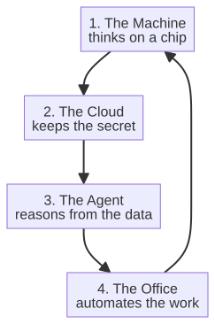

# Capitolo 1 --- Le rivoluzioni che hanno fatto la Terra

## I fuochi

Ogni rivoluzione dell'industria è cominciata con un fuoco. Non per metafora: la prima bruciava carbone vero, e le altre hanno seguito una logica simile di combustione controllata. La rivoluzione industriale è, alla base, la storia di esseri umani che imparano a concentrare l'energia e a dirigerla dove vogliono. Prima di quella concentrazione, il lavoro era distribuito in modo sottile sulle braccia e sui muscoli, sulla pazienza del clima e sulla resistenza limitata degli animali da tiro. La ricchezza di una nazione era, letteralmente, la somma delle sue schiene e delle sue brezze. La rivoluzione è avvenuta nell'istante in cui una specie ha scoperto di poter immagazzinare energia --- nel vapore compresso di una caldaia, poi nel petrolio bruciato di un motore, poi nel fiume deviato di una rete elettrica --- e quindi di uscire dai limiti quotidiani del grasso e del vento.

Il racconto classico insegna quattro rivoluzioni. La prima fu il vapore e le macchine, all'incirca dal 1760 al 1830. La seconda fu l'elettricità e la catena di montaggio, all'incirca dal 1870 al 1914. La terza fu l'informatica e internet, all'incirca dal 1960 ai primi anni Duemila. Siamo, propone questo libro, dentro la quinta --- chiamatela automazione e intelligenza --- anche se il numero diffuso è il sesto, perché alcuni narratori dividono in due l'onda dell'elettricità e dell'informatica. La numerazione non conta; conta il carattere di ciascuna onda, e a quel carattere arriverò tra poco. Per ora notate soltanto che ogni rivoluzione ha fatto qualcosa che la precedente non sapeva fare affatto, e l'ha fatto più in fretta.

## I fuochi che hanno cambiato tutto

Per sentire il peso della prima rivoluzione, aiuta stare per un momento dentro una miniera prima della macchina a vapore. Nei primi decenni del Settecento le miniere diventavano sempre più profonde man mano che il carbone affiorante si esauriva, e le miniere profonde avevano un problema che nessuna quantità di cavalli in superficie poteva risolvere: l'acqua continuava a entrare. Una miniera che scende prima o poi raggiunge la falda, e quando l'acqua arriva la miniera è inutile, a meno che non la si possa sollevare a mano o con animali che girano una ruota a turni. Le miniere erano limitate non da quanto duramente si potesse scavare, ma da quanta acqua si riuscisse a portare fuori prima che lo scavatore affogasse.

Thomas Savery, nel 1698, e poi Thomas Newcomen, nel 1712, costruirono macchine a vapore --- rozze, dispendiose e monumentali --- il cui unico scopo era pompare acqua fuori dalle miniere. È facile sottovalutare queste macchine, che bruciavano carbone per far bollire una caldaia, che spingeva un pistone, che sollevava acqua, e che non facevano quasi nient'altro. Ma considerate la logica: una macchina che bruciava carbone per liberare altro carbone. Era un unico appetito, soddisfatto meccanicamente, ma stabiliva il primo comandamento della rivoluzione industriale --- *immagazzina l'energia nel vapore, poi liberala a comando*. E una volta stabilito quel comandamento, il resto della storia è seguito quasi inevitabilmente.

La macchina a vapore non rimase a lungo una pompa per l'acqua. James Watt, lavorando in Scozia negli anni Sessanta e Settanta del Settecento, la rese utile a molto più che pompare, separando il condensatore dal cilindro e ricavando un moto rotatorio dal salire e scendere del pistone. Con il miglioramento di Watt, la macchina a vapore poteva girare, e girando poteva azionare qualsiasi cosa. Poteva far girare mille fusi dove mille uomini ne facevano girare dieci. Poteva far ruotare i grandi alberi delle nuove fabbriche. Il motore aveva un corpo enormemente potente, ma --- ed è il punto su cui continuerò a tornare --- ancora nessuna mente. Sapeva moltiplicare la forza, ma non aveva opinioni su quali fusi far girare, nessuna memoria della domanda di ieri, nessun piano per la riparazione di domani. Era un corpo enormemente potente con la mente di una roccia molto paziente.

## La società che lo rese reale

C'è una curiosità che vale la pena registrare, perché risponde in sordina alla domanda «perché ci è voluto così tanto?». Il condensatore separato di Watt era un miracolo della fisica, ma un miracolo della fisica non è una rivoluzione finché qualcuno non è disposto a costruirlo. Watt stesso era un cattivo uomo d'affari, e il suo motore, nella forma più antica, funzionava male e si vendeva peggio. A trasformare il motore in un'industria non fu un'ulteriore intuizione della fisica, ma un'ulteriore intuizione della *produzione*: la società tra Watt e Matthew Boulton, la cui fonderia di Soho a Birmingham sapeva davvero fondere e lavorare il ferro pesante e incline alle perdite che una macchina a vapore richiede. Watt forniva l'idea e il brevetto; Boulton forniva il capitale, l'officina e l'ostinazione necessaria a continuare a costruire motori che continuavano a rompersi finché non funzionarono. La ditta Watt e Boulton gestì il commercio delle macchine a vapore per decenni in perdita prima di guadagnare, proprio perché quella cosa era così difficile da fabbricare.

La lezione serve più avanti, quando incontreremo la sesta rivoluzione: un'idea non è mai il collo di bottiglia. Il collo di bottiglia è sempre il *corpo* --- la capacità di costruire la cosa, di fidarsi della cosa, di portarla a scala. Il vapore aveva risolto il problema del corpo senza mente già nel 1800. La rivoluzione dell'intelligenza ha ancora il proprio problema del corpo in via di soluzione, e vale la pena ricordare a chi toccò risolvere il primo.

## La rivoluzione restrinse il continente

La macchina a vapore non si fermò alla fabbrica. Una volta stabilito il principio --- immagazzina l'energia nel vapore, liberala a comando e volgila a ciò che preferisci --- lo stesso motore che prosciugava le miniere fu presto chiamato a fare qualcosa che nessuna macchina di superficie aveva mai tentato: muoversi. Richard Trevithick fece correre la prima locomotiva a vapore a scartamento pieno nel 1802, e George Stephenson, con la sua *Rocket*, vinse le gare di Rainhill nel 1829. Nell'ottobre di quell'anno la *Rocket* trainò un convoglio sulla linea da Liverpool a Manchester, e nel settembre 1830 quella linea aprì come prima ferrovia interurbana al mondo interamente a vapore per i passeggeri. È uno di quei fatti che si capiscono solo se se ne sente il peso. Prima di una locomotiva, una nazione era un insieme di città che non riuscivano a raggiungersi più in fretta del trotto di un cavallo: giorni tra città distanti centosessanta chilometri, merci che marcivano sulla strada, un'economia che non poteva essere nazionale perché un paese, geograficamente, è semplicemente troppo grande per essere attraversato in fretta.

Il vapore restrinse il continente. La ferrovia rese possibile per la prima volta una singola economia nazionale, trasformando la distanza in un numero misurato in minuti invece che in giorni. È un fatto piccolo e strano che lo stesso principio che prosciugava una miniera --- energia concentrata liberata a comando --- sia anche ciò che ha reso *vicino* il mondo moderno. La distanza morì, e con essa l'isolamento che aveva definito la vita umana per diecimila anni. Ogni rivoluzione industriale ha concentrato una risorsa diversa: il vapore concentrava la forza, l'elettricità concentrava una corrente, l'informatica concentrava l'informazione. Il vapore, almeno, concentrava anche il *luogo*, piegando il continente così che due città distanti una giornata a cavallo fossero ora a un pomeriggio di treno.

## Il filo umano

Ciò che le quattro rivoluzioni precedenti avevano in comune --- ed è il filo che questo libro tirerà fino alla fine --- è che tutte resero l'essere umano l'ultimo anello della catena. La macchina a vapore era azionata da un uomo. La catena di montaggio era scandita da un uomo. Il computer era alimentato da un uomo, e i suoi risultati erano letti da un uomo. In ogni caso la macchina sapeva moltiplicare la forza, il ritmo e la memoria, ma non sapeva, da sola, chiudere il ciclo tra l'accorgersi di qualcosa nel mondo e il fare qualcosa al riguardo. L'essere umano stava alla fine di ogni processo, giudice ultimo e mano ultima. La macchina pensava --- nel senso stretto in cui una macchina di quell'epoca poteva pensare --- ma l'uomo agiva.

E andava bene così, ed era prospero, per molto tempo. Le rivoluzioni precedenti avevano innalzato la vita umana in modo così spettacolare --- l'aspettativa di vita raddoppiata, la produzione per lavoratore moltiplicata, beni che un tempo appartenevano solo ai re diventati abbastanza economici per tutti --- che nessuno si fermò a chiedere se anche l'ultimo anello potesse essere automatizzato. Sembrava semplicemente ovvio che l'essere umano alla fine della catena fosse il senso della catena, la ragione per cui l'energia veniva concentrata.

C'è un piccolo aneddoto utile. Quando il telaio meccanico si diffuse in Inghilterra nei primi decenni dell'Ottocento, gli operai che tessevano a mano non protestarono soltanto: distrussero i telai. Erano i luddisti --- spesso ricordati male come reazionari ostili alla tecnologia, quando in realtà molti di loro erano artigiani esperti che vedevano sparire da un giorno all'altro il proprio mestiere e il proprio sostentamento. I luddisti si sbagliavano sul futuro, ma non si sbagliavano nel dire che stava arrivando un futuro che non avrebbe avuto bisogno di loro. La loro rabbia non era sciocca; era soltanto prematura. Ogni rivoluzione industriale ha prodotto luddisti la cui rabbia era logica nel momento e sbagliata nel lungo periodo. La sesta rivoluzione li sta producendo adesso, e i suoi luddisti si preoccupano di qualcosa di ancora più nuovo: non la perdita dei muscoli, ma la perdita delle menti.

## La rivoluzione fece una classe

C'è un'altra cosa che ogni rivoluzione ha fatto, ed è facile perderla tra i motori e il codice. Una rivoluzione non cambia soltanto le macchine: trasforma le *persone* in nuovi tipi di persone, e ridisegna la mappa per contenerle. La rivoluzione industriale non costruì soltanto fabbriche: creò due classi nuove, i proprietari delle fabbriche e coloro che vi lavoravano, e li spostò dal villaggio alla città. Prima del vapore, il lavoro era distribuito sottilmente nella campagna: un tessitore al telaio in una casetta, un contadino nel suo campo, un fabbro nella sua bottega. Il vapore, e le macchine che azionava, esigevano *concentrazione*. Le persone dovevano radunarsi dove stavano i macchinari, e così la città-fabbrica --- e più tardi la grande città industriale --- crebbe quasi da un giorno all'altro intorno al mulino che dava loro lavoro e nome. È per questo che la città moderna, con le sue ferrovie, le sue fognature, la sua folla e il suo fumo, è essa stessa un prodotto della prima rivoluzione, non soltanto uno sfondo.

Vale la pena tenerlo a mente, perché la sesta rivoluzione sta facendo la stessa cosa a un altro tipo di lavoro. Sta radunando i lavoratori --- non in un mulino, ma in un *sistema* --- e sta creando nuovi tipi di persone che dieci anni fa non esistevano: l'ingegnere dei dati, il supervisore degli agenti, colui che tiene onesta la macchina. Le macchine cambiano; le persone cambiano con loro; e la mappa cambia per contenerle. Ogni rivoluzione industriale, alla fine, è la storia di un nuovo tipo di essere umano, reso possibile da un nuovo tipo di macchina.

> **Una curiosità.** La parola per la nuova classe operaia non è casuale. Prima delle fabbriche, la maggior parte delle persone coltivava, commerciava o serviva. Il *proletariato* --- dal latino *plebs*, la gente comune --- e l'idea stessa di «un lavoratore» come categoria sociale distinta sono prodotti di questo momento. Perfino il linguaggio dell'epoca dovette essere inventato per descriverlo: il fischio della fabbrica, la giornata lavorativa, il turno, lo sciopero. Una rivoluzione non cambia solo ciò che le persone fanno; cambia le parole che servono a parlarne. La sesta rivoluzione sta già inventando il proprio vocabolario --- il prompt, l'agente, la barriera di sicurezza, la finestra di contesto --- e tra dieci anni non ricorderemo un giorno senza.

## La frattura

La quinta e la sesta rivoluzione sono diverse perché mirano a quell'ultimo anello. Non chiedono di moltiplicare il muscolo, il ritmo o la memoria di un essere umano. Chiedono di moltiplicare il suo giudizio e di portare quel giudizio fino in fondo, nel mondo, nell'azione, senza fermarsi davanti a un essere umano che decide. La macchina noterà il guasto, lo ragionerà, deciderà la risposta giusta, parlerà con la nuvola, inoltrerà la risposta attraverso un ufficio e, nelle fabbriche più recenti, camminerà perfino verso il guasto in un corpo di metallo e lo riparerà. Il ciclo si chiude. L'essere umano non è più l'ultimo anello; è l'architetto di un sistema che sa portare a termine ciò che ha iniziato.

È per questo che la numerazione --- quinta o sesta --- suona così diversa dalle altre. Le rivoluzioni precedenti estendevano ciò che un essere umano poteva fare. Questa estende ciò che un essere umano può decidere e poi vedere realizzato, senza mani che intervengano. È la differenza tra uno strumento che rende un lavoratore più veloce e un sistema che lo rende un direttore d'orchestra.

## Una piccola mappa della strada davanti

Prima di metterci in viaggio, aiuta conoscere il territorio. La catena che rende possibile la sesta rivoluzione ha quattro componenti, e compaiono in questo libro nell'ordine in cui devono essere assemblate:

Il primo anello, la macchina che pensa, è l'argomento della Parte II. Il secondo, la nuvola privata, è la Parte III. Il terzo e il quarto, l'agente che ragiona e l'ufficio automatizzato, sono la Parte V. Tra loro si colloca la Parte IV, che pone la domanda più importante dell'intera storia: non come costruire l'intelligenza, ma quale tipo di intelligenza una fabbrica possa affidare alla propria sicurezza. Ci torneremo, e vale la pena sapere fin d'ora che la risposta è ciò che rende questa rivoluzione --- e questo libro --- diversa da tutto ciò che è venuto prima.

## La questione del numero

Vale la pena soffermarsi sul numero, perché i lettori lo incontreranno ed è onesto affrontarlo. Il termine diffuso per l'onda attuale è «sesta rivoluzione industriale», ma gli storici della tecnologia non sono d'accordo, e il disaccordo è esso stesso istruttivo. Alcuni narratori contano cinque rivoluzioni, chiudendo con l'automazione; altri dividono l'onda digitale e ne contano sei; pochi ne contano solo tre o quattro e ripiegano tutto nella «rivoluzione digitale». Il numero che scegliete dice più del vostro metodo che del mondo.

C'è, però, una lettura utile per questo libro, ed è questa. Ogni rivoluzione si può caratterizzare con la risorsa dominante che ha messo al servizio dell'uomo: la prima ha messo il vapore (energia termica immagazzinata), la seconda l'elettricità (energia elettrica immagazzinata che scorre nei fili), la terza l'informatica e internet (informazione immagazzinata e trasmessa), la quarta (in questa lettura) l'automazione e la robotica (macchine che agiscono senza una direzione umana continua). La quinta, nella lettura che questo libro adotta, è l'intelligenza --- macchine che percepiscono, decidono e si coordinano; la sesta è l'*integrazione* di quell'intelligenza in un tutto che si coordina da sé, la fabbrica dell'Industria 7.0 che incontreremo nella Parte V. In questa lettura, la sesta rivoluzione non è semplicemente «più intelligenza»; è il momento in cui l'intelligenza smette di essere una funzione delle singole macchine e diventa il tessuto connettivo di un'intera impresa. È questa la distinzione che il libro difenderà dalla prima all'ultima pagina.

## Perché la storia conta per chi legge

Vi chiederete, giustamente, perché un libro sul futuro dell'automazione industriale dedichi un capitolo a guardarsi indietro. La risposta è che qui la storia non è un lusso: è uno strumento decisionale. Ogni generazione di intelligenza artificiale ha promesso più di quanto abbia mantenuto, e conoscere lo schema vi rende più difficile da ingannare. Quando un fornitore vi dice che il suo prodotto «trasformerà la vostra fabbrica con l'IA», la parola «trasformare» è in uso da duecento anni, e ogni uso precedente si riferiva a una rivoluzione reale ma più stretta di quanto suggerisse il marketing. Chi conosce lo schema è più attrezzato a separare la rivoluzione autentica dalla pubblicità riciclata.

Inoltre, i fallimenti si ripetono con un vocabolario nuovo. Ogni volta che l'intelligenza artificiale si è fermata, si è fermata per una ragione nominabile: dati insufficienti, potenza di calcolo insufficiente, o un problema più difficile di quanto sembrasse. Le stesse tre ragioni decidono ancora oggi se il vostro progetto di adozione funziona. Chi ha visto lo schema una volta lo rivedrà; chi ha sentito solo l'ultima pubblicità resterà sorpreso la seconda volta. Questo libro vi armerà dello schema, così che quando arriveranno le promesse della sesta rivoluzione possiate giudicarle contro le rivoluzioni che le hanno precedute.

Aiuta avere in mente un caso concreto, perché «i fallimenti si ripetono» è più facile da ricordare quando si può nominare l'ultima volta che è accaduto. Il Novecento ha avuto i propri inverni dell'intelligenza artificiale. Alla fine degli anni Sessanta alcuni dei più autorevoli informatici dell'epoca annunciarono, con vera autorità, che una macchina pensante di uso generale era «a portata di mano» entro una generazione; quando le macchine non arrivarono --- perché la memoria era troppo piccola, il calcolo troppo debole e i problemi troppo poco strutturati per gli algoritmi disponibili --- seguì la disillusione. Un rapporto britannico del 1973 concluse che il settore aveva promesso troppo, e i finanziamenti alla ricerca si prosciugarono per anni. Poi, quando hardware, algoritmi e dati alla fine si allinearono, il settore tornò, più rumoroso di prima, alla promessa originaria. Lo schema non è che gli scienziati fossero sciocchi: è che erano *in anticipo*, e l'anticipo è indistinguibile dall'errore finché non compare il terzo dei tre ingredienti mancanti --- calcolo, dati o un algoritmo adatto. Chi ha visto un inverno impara a rivolgere a ogni nuova promessa una domanda sola e calma: *qual è l'ingrediente mancante che renderà possibile questo, e quanto manca perché non manchi più?* Questa domanda è l'intero capitolo.

Comprimiamo ora l'intero arco in una cronologia compatta, così che il passo con cui è arrivata ogni rivoluzione sia visibile, e così che la lentezza caratteristica della rivoluzione dell'intelligenza --- e la sua improvvisa, recente accelerazione --- si vedano in un solo sguardo. È l'argomento del prossimo capitolo.
