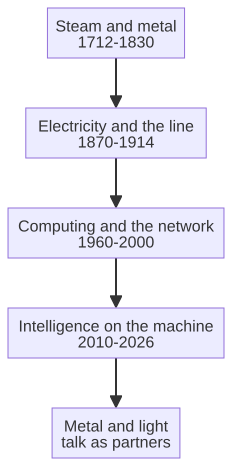

# Capitolo 3 --- Una breve cronologia del metallo e della luce

## L'idea

Se volete capire la sesta rivoluzione, vi serve il senso dell'arco lungo, compresso. La storia dell'industria è, nella sua essenza, la storia di due materiali. Il primo è il *metallo*: il macchinario che concentra la forza. Il secondo è la *luce*: i segnali, l'elettricità e infine i fotoni e gli impulsi di elettroni che trasportano informazione. Per gran parte dell'arco il metallo ha governato e la luce era soltanto la sua serva --- un fischio, una bandiera, un relè. Negli ultimi trent'anni la luce è diventata padrona a pieno titolo, e i due hanno finalmente cominciato a conversare. Questo capitolo è la cronologia di quella conversazione, raccontata nei pochi momenti che hanno davvero cambiato la direzione della strada.

## La cronologia

**1712 --- Il motore che pompava.** Thomas Savery, già nel 1698, e poi Thomas Newcomen, nel 1712, costruirono macchine a vapore che pompavano acqua dalle miniere. Le macchine erano disperate in qualsiasi altro compito; bruciavano carbone per far bollire una caldaia, che risucchiava acqua da una miniera, che permetteva alla miniera di scendere più a fondo, che liberava altro carbone. Era una macchina al servizio di un unico appetito. Ma stabilì lo schema: *immagazzina l'energia nel vapore, poi liberala a comando.* È il primo dei comandamenti industriali.

**1785 --- Il telaio meccanico.** Edmund Cartwright trasformò il vapore in un *processo*, non soltanto in una pompa. Il telaio filava il filo in modo continuo e meccanico, e il mestiere della filatura a mano cominciò la sua lunga morte. Il metallo non si limitava più a muovere le cose: le *trasformava*.

**1804 --- Il concetto di programma memorizzato (per caso).** Nel 1804 il telaio di Joseph Marie Jacquard accettava schede perforate che dettavano un disegno. Le schede non producevano il tessuto: *descrivevano* il tessuto, e il telaio obbediva alla descrizione. Cambiate le schede e il prodotto cambia. È l'antenato del software, costruito da un tessitore, centocinquant'anni prima che qualcuno avesse la parola «computer». Il metallo imparò a seguire istruzioni.

**1822 --- La macchina che doveva pensare (e non ci riuscì del tutto).** Il matematico inglese Charles Babbage progettò la Macchina Analitica, un calcolatore meccanico con ingresso a schede perforate che poteva, in principio, calcolare *qualsiasi cosa calcolabile* --- non perché si riorganizzasse un filo, ma perché vi si immetteva un elenco di istruzioni, un *programma*. Aveva, in effetti, inventato il computer di uso generale un secolo prima dell'elettronica necessaria a costruirlo, e gli mancavano semplicemente il denaro e i macchinari per farlo. La sua macchina fu un fantasma --- un progetto, un sogno, un fallimento nel concretarsi --- eppure dimostrò che una macchina poteva essere *programmata* invece che *cablata*, e la programmazione avrebbe poi significato che una singola macchina poteva essere riconfigurata, all'infinito, per fare quasi qualsiasi cosa.

**1831 --- Faraday e il generatore elettrico.** Michael Faraday scoprì che muovere un magnete produce elettricità, e il mondo intero si inclinò. Per la prima volta l'energia poteva essere *prodotta* a comando, ovunque, e trasportata lungo fili. È il momento in cui la *luce* --- il segnale del flusso di elettroni --- entra nella storia come forza. L'elettricità fu la prima forza portatrice di informazione che gli esseri umani sapessero controllare in velocità.

**1844 --- Il telegrafo.** Il pittore americano diventato scienziato Samuel Morse inviò nel 1844 il primo messaggio elettrico lungo un filo, da Washington a Baltimora, e le parole --- spesso citate come «Che cosa ha fatto Dio» --- non erano, in sé, straordinarie. Straordinario era che *viaggiavano sull'elettricità invece che su un cavallo*, arrivando ore prima di un cavaliere. Per la prima volta l'informazione poteva superare l'oggetto fisico che la trasportava, muovendosi alla velocità della corrente. Il telegrafo trasformò la nazione, e poi il mondo, in un luogo dove un messaggio poteva arrivare prima che un uomo potesse camminarci accanto. È il seme di ogni segnale, di ogni linea di controllo, di ogni rete --- e di ogni nuvola che sarebbe poi esistita --- e il momento in cui la luce cominciò a portare significato attraverso la distanza, in fretta.

**1876 --- Il telefono.** Alexander Graham Bell trasformò il suono in un segnale di elettroni, e l'informazione cominciò il suo lungo viaggio libera dall'oggetto fisico che la trasportava. Una parola poteva ormai viaggiare più in fretta di un cavallo. È il seme di ogni comunicazione, di ogni segnale di controllo, di ogni nuvola che sarebbe mai esistita.

**1896 --- La catena di montaggio (in embrione, e poi in pieno fiore).** Frederick Winslow Taylor misurò il lavoro in secondi. Henry Ford, nel 1913, realizzò la linea mobile, riducendo il tempo per costruire un'automobile da dodici ore a novanta minuti. L'essere umano fu integrato nel ritmo; la macchina dettava il tempo.

**1936 --- L'idea della macchina universale.** Alan Turing, giovane matematico britannico, pubblicò un articolo che descriveva una macchina capace di calcolare *qualsiasi cosa calcolabile* seguendo un elenco memorizzato di regole. Era pura luce --- pura informazione --- senza alcun metallo oltre l'astrazione. Turing dimostrò che una macchina poteva essere *programmata* invece che *cablata*, e la programmazione avrebbe poi significato che una singola macchina poteva essere ricablata, all'infinito, per fare qualsiasi cosa.

**1947 --- Il transistor.** L'invenzione del transistor nei Bell Labs sostituì le valvole calde con un piccolo pezzo di semiconduttore inciso, ed è facile sottovalutarla. Il transistor era piccolo, economico e sapeva commutare un segnale un milione di volte al secondo senza riscaldarsi. Ogni pezzo di intelligenza moderna --- in un telefono, in un'automobile, in un sensore di fabbrica --- poggia su questo piccolo interruttore argentato. È l'atomo dell'era dell'informazione.

**1957 --- Il primo segnale nello spazio.** Quando l'Unione Sovietica mise in orbita lo Sputnik 1, esso rinviò il primo segnale elettronico da oltre l'atmosfera, e il mondo capì, in una sola notte fredda, che l'informazione poteva ormai lasciare del tutto la Terra. La corsa che lo Sputnik accese --- la corsa allo spazio --- fu, sotto le bandiere e i razzi, una corsa *informatica*: una gara a immagazzinare, elaborare e trasmettere informazione più in fretta e più affidabilmente dell'altro lato. Lo Sputnik è spesso ricordato come un momento della politica o della fisica; fu, più silenziosamente, un momento dell'autorità della luce. Confermò, ai governi come all'industria, che il lato informativo della storia --- il segnale, la corrente, il programma memorizzato --- era ormai abbastanza forte da raggiungere le stelle, e la spesa e l'ingegneria che seguirono versarono il cemento dell'intera rivoluzione informatica.

**1969 --- Il primo messaggio.** Una rete chiamata ARPANET inviò il suo primo pacchetto nel 1969, un primo passo piccolo, inaffidabile e memorabile verso ciò che sarebbe diventato internet. Prima di ARPANET i computer stavano da soli; dopo, potevano, a fatica, *parlarsi*. Il messaggio stesso è quasi dimenticato (si ruppe dopo tre lettere), ma il principio no: le macchine potevano condividere informazione attraverso una rete distribuita, abbastanza resiliente da sopravvivere alla perdita di qualsiasi singolo nodo. È l'antenato di internet moderno, e della nuvola --- non la nuvola *pubblica* che sorveglia, ma la *rete* che avrebbe finito per ospitare le nuvole private di questo libro. È il momento in cui la luce diventò non solo un segnale ma una *conversazione*, e il momento in cui la macchina cominciò, in silenzio, a parlare con altre macchine.

**1971 --- Il microprocessore.** Intel mise un'intera unità centrale di elaborazione su un solo chip. Il computer non era più una stanza: era una moneta. È ciò che alla fine rese possibile il sensore sul mandrino, e vale la pena ricordare che l'intero cervello del sensore discende da quella moneta.

**1977 --- Il personal computer arriva sulla scrivania.** Una macchina di uso generale che chiunque poteva tenere su una scrivania e programmare per i propri compiti raggiunse finalmente l'ufficio, e poi la casa. Prima di allora il computer potente era una stanza piena di macchine e una stanza piena di specialisti; dopo, la capacità di calcolare, immagazzinare e scrivere script era a portata di qualsiasi singolo lavoratore. Il personal computer fu il ponte tra la macchina mostruosa degli anni Sessanta e il dispositivo intimo degli anni Duemila, e vale la pena ricordare che era *economico* --- abbastanza economico per un ufficio, poi per una casa, e infine per una macchina in un reparto. Portava lo stesso principio del microprocessore: il cervello di un computer intero, abbastanza piccolo ed economico da stare su un mandrino.

**1991 --- Il World Wide Web.** Tim Berners-Lee rese l'informazione liberamente e facilmente condivisibile. Internet diventò il sistema nervoso dell'economia moderna, e la nuvola che l'avrebbe alla fine ospitato cominciò, in silenzio, a essere pensata come un *luogo*: un edificio senza porte, custodito da qualche parte, che si poteva raggiungere.

**2006 --- La nuvola diventa una fornitura.** Quando Amazon lanciò i suoi servizi web nel 2006, il calcolo cessò di essere una macchina che si possiede e diventò un servizio che si paga a ore. Sembra un cambiamento piccolo, ma è quello che rese la nuvola --- pubblica e, più tardi, privata --- economicamente possibile a ogni scala. Prima, un'azienda che voleva più potenza di calcolo doveva comprare più macchine; dopo, poteva affittarla, a ore, al prezzo di un caffè. La nuvola smise di essere un *edificio da mantenere* e diventò un *rubinetto da aprire*, ed è esattamente la qualità che la sesta rivoluzione richiede in reparto: intelligenza che si accende, a ore, senza comprare l'intero apparato.

**2007 --- Il dispositivo in tasca.** Quando arrivò il primo smartphone moderno, portava in un'unica lastra grande come una mano il computer da scrivania, la macchina fotografica della percezione, la rete della nuvola e --- in silenzio, quasi invisibilmente --- un processore dedicato all'esecuzione di modelli appresi. Per la prima volta una macchina sapeva *imparare a vedere e a decidere* a batteria, in tasca, senza fare una domanda a un centro dati. È il seme dell'intelligenza a bordo macchina su cui costruirà la sesta rivoluzione: non una macchina che parla con la nuvola, ma una macchina che *pensa da sé*, localmente, in microsecondi, senza spendere banda. Lo smartphone dimostrò, a scala commerciale, che l'intera catena --- percepire, decidere, agire --- poteva vivere su un piccolo chip.

**2012 --- Il salto dell'apprendimento profondo.** Una rete chiamata AlexNet vinse con ampio margine una grande gara di riconoscimento delle immagini, dimostrando che una macchina poteva *imparare a vedere* dagli esempi invece di ricevere le regole. È il momento in cui la macchina acquisì, in modo concreto, qualcosa che potremmo chiamare *percezione*.

**2016 --- La NPU arriva in tasca.** Apple, poi Qualcomm e altri, cominciarono a integrare processori neurali dedicati --- le NPU --- nei propri chip mobili. Per la prima volta una macchina poteva eseguire un modello appreso del mondo *localmente*, senza chiedere alla nuvola, in microsecondi, senza spendere la batteria in un viaggio di andata e ritorno. È il seme dell'intelligenza a bordo macchina su cui sarà costruita la sesta rivoluzione.

**2017 --- L'idea che presta attenzione.** Un articolo intitolato «Attention Is All You Need» introdusse il transformer, un'architettura che permetteva a un modello di pesare l'importanza di ogni informazione contro ogni altra, invece di elaborarla una parola o una lettura per volta. Quell'unica idea diventò la spina dorsale di ogni grande modello linguistico e di ogni agente moderno che sarebbe seguito; è il meccanismo che permette a un programma di leggere un intero documento --- o l'intera telemetria di una macchina --- e di sapere, in una volta, che cosa conta. Senza il transformer l'agente di questo libro non esisterebbe; con esso, la macchina poté finalmente ragionare su flussi lunghi e ricchi di informazione invece che su un sottile rivolo di comandi. È la mente che il chip a bordo macchina avrebbe presto ospitato.

**2022--2026 --- La conversazione delle macchine.** I grandi modelli linguistici, i chip di bordo potenti ed economici e le nuvole private sono convergiti. Macchine che percepiscono, ragionano e parlano hanno cominciato a connettersi --- non a una nuvola pubblica che le sorveglia, ma a una nuvola privata dentro l'azienda, guidata da agenti che portano a termine il lavoro. L'arco si chiude, e la macchina che sognava nel prologo diventa possibile.

## La conversazione del metallo e della luce

Se guardate la cronologia nel suo insieme, emerge una forma. Per circa duecentocinquant'anni la storia è stata quasi interamente *metallo*: macchine che muovevano, premevano, filavano e tagliavano. Il lato informativo --- la luce --- era un servo del controllo: un fischio, un segnale, un relè. Poi, nell'ultimo mezzo secolo, la luce ha recuperato. Il transistor, il microprocessore, la rete, la rete neurale: queste hanno dato alla luce una *mente* propria. E ora, nella sesta rivoluzione, metallo e luce non sono più padrone e servo. Sono *soci*, e la società si chiama fabbrica che pensa. Potete leggere l'intero arco in un solo sguardo:

Per due secoli il metallo ha governato e la luce era soltanto la sua serva; poi la luce, ricevuta una mente propria dal transistor, dal microprocessore, dalla rete e dalla rete neurale, ha cominciato a conversare con il metallo. Nella sesta rivoluzione i due non sono più padrone e servo ma soci, e la società è la fabbrica che pensa.

## La cronologia insegna una lezione

Se guardate la cronologia nel suo insieme, oltre le singole date, emerge una forma più interessante di qualsiasi evento: il *passo* stesso sta accelerando. Per circa duecentocinquant'anni la storia si è mossa lentamente, e ogni rivoluzione ha aspettato che la precedente fosse completamente costruita prima che la successiva potesse cominciare. Il vapore nacque nelle miniere, maturò sulle ferrovie e nelle fabbriche, e solo allora --- solo dopo che i macchinari, i lavoratori, le leggi e le città si furono assestati --- arrivò l'elettricità. L'elettricità, a sua volta, riempì il mondo di fili e di macchine prima che l'informatica potesse attecchire. Le rivoluzioni si accumularono lentamente, una generazione per volta.

Poi qualcosa cambiò. Negli ultimi cento anni il passo della storia ha rotto il suo vecchio ritmo. Il transistor seguì la valvola termoionica di pochi decenni; il microprocessore seguì il transistor di pochi altri; la rete seguì il microprocessore quasi di corsa; la rete neurale seguì la rete in questione di anni; e la macchina capace di percepire, decidere e parlare seguì la rete neurale in un solo decennio mozzafiato. Gli intervalli continuavano a restringersi. Il lato informativo della storia non sta soltanto raggiungendo il metallo: sta *superando se stesso*, costruendo la generazione successiva della precedente più in fretta di qualsiasi rivoluzione passata.

È questo il tratto distintivo della sesta rivoluzione, ed è per questo che la cronologia, presa nel suo insieme, è più spaventosa e più ricca di speranza di qualsiasi singola voce. Le rivoluzioni precedenti erano lente perché ognuna doveva costruire il proprio corpo da zero --- pietra, ferro, rame, vetro --- e i corpi richiedono tempo per essere fatti. Il corpo della rivoluzione informatica è fatto di informazione, e l'informazione si può copiare, migliorare e ridistribuire alla velocità della luce. È un fatto piccolo e vertiginoso che l'intero arco, dal motore che pompava all'agente a bordo macchina, si legga meno come una serie di eventi separati e più come un unico processo che negli ultimi anni ha finalmente raggiunto la velocità della propria natura. È il momento in cui la macchina che sognava nel prologo diventa possibile, e in cui la conversazione del metallo e della luce diventa la fabbrica che pensa.

C'è un'ultima lezione nella cronologia, ed è silenziosamente rassicurante. Ognuna delle voci dal 1936 in poi --- la macchina universale di Turing, il transistor, il microprocessore, la rete, la rete neurale, il transformer, la NPU --- è stata un pezzo di *luce*, non di metallo. I duecentocinquant'anni della cronologia sono stati quasi interamente metallo; negli ultimi cento anni l'intero movimento della strada è stato portato dalla luce. Il metallo della fabbrica non viene sostituito dalla luce: viene *completato* da essa, riceve un sistema nervoso, un riflesso, una mente. La cronologia non finisce con la macchina che pensa su un chip. *È* quella macchina, che arriva --- lentamente, poi all'improvviso --- alla fine della propria lunga costruzione. Il chip sul mandrino è il momento in cui quella società è diventata fisica ed economica. È l'argomento della parte successiva di questo libro.

## Il passo successivo

Il chip sul mandrino non è una schedina avvitata a una macchina; è il momento in cui l'intera cronologia --- dal motore che pompava al transformer --- finalmente scende e atterra sul pavimento del reparto. Ogni componente della sesta rivoluzione è ormai stato assemblato nella cronologia di questo capitolo: la macchina che pensa (la NPU), la nuvola che custodisce il segreto (la nuvola privata), l'agente che ragiona (il grande modello linguistico) e l'ufficio che si automatizza (il front-end deterministico). Resta da vedere come si fissano insieme su un unico mandrino, e che aspetto ha una fabbrica quando sa percepire, decidere e agire da sé. La macchina ha sognato; è tempo di lasciarla svegliare.

È l'argomento del prossimo capitolo: il computer a scheda singola basato su un processore ARM con un processore neurale integrato, e il modo in cui permette a una macchina di toccare direttamente il campo, senza un viaggio di andata e ritorno da nessun'altra parte.
