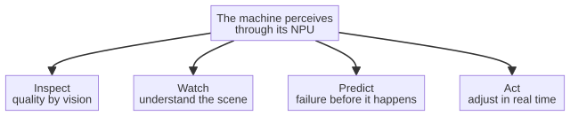

# Capitolo 6 --- Intelligenza in reparto

## I quattro mestieri

Quando un piccolo chip intelligente viene collocato dentro una macchina, riceve in effetti quattro mestieri quasi umani che prima erano impossibili senza una stanza piena di specialisti e un lento viaggio di andata e ritorno verso una nuvola. Questi quattro mestieri --- **ispezionare, sorvegliare, prevedere e agire** --- sono l'intero vocabolario dell'intelligenza a bordo macchina, e una volta che li possedete li vedete ovunque.

Prendiamoli uno per uno, perché ciascuno sta già facendo un lavoro reale in fabbriche reali, e ciascuno è un piccolo miracolo del tipo di cui questo libro si occupa.

## 1. Ispezionare --- l'occhio che non sbatte mai le palpebre

Il più maturo dei quattro mestieri è l'ispezione visiva automatizzata. Una fabbrica che produce qualsiasi cosa ha sempre dovuto ispezionare i propri prodotti, e tradizionalmente questo significava o un occhio umano che si stanca al ventesimo pezzo, o una telecamera fissa con regole rigide incapaci di adattarsi. La NPU cambia entrambe le cose.

Immaginate una telecamera che guarda un nastro trasportatore carico di blocchi motore lavorati. Un ispettore umano, alla fine di un turno, ha mancato difetti che aveva davanti agli occhi, perché gli esseri umani si stancano, perché distolgono lo sguardo, perché un difetto visto mille volte si confonde con lo sfondo. La telecamera intelligente non fa nulla di tutto questo. Ha imparato, da migliaia di esempi di pezzi buoni e pezzi difettosi, che aspetto ha un difetto, e classifica ogni pezzo in millisecondi --- non con regole rigide ma con il giudizio flessibile di un modello addestrato. Non si stanca. Non distoglie lo sguardo. Funziona interamente sulla macchina, in reparto, così le immagini non lasciano mai l'edificio e l'ispezione non aspetta mai la nuvola.

È l'«ispezione automatizzata della qualità», il cavallo da tiro silenzioso della rivoluzione della macchina che pensa. Compare nelle saldature, nelle fusioni, nei circuiti stampati, nelle etichette di una bottiglia. Ovunque un prodotto debba essere giudicato contro uno standard che un essere umano sa esprimere a parole ma un computer non sa facilmente tradurre in codice, un modello addestrato su un chip locale batte insieme l'uomo stanco e la telecamera a regole rigide.

## 2. Sorvegliare --- la mente dietro la telecamera di sicurezza

Il secondo mestiere è la sorveglianza intelligente, ed è il punto in cui la telecamera smette di limitarsi a *registrare* e comincia a *capire*. Un impianto tradizionale di videosorveglianza registra ciò che accade e nulla più; le immagini servono solo dopo, a un investigatore che cerca una targa. Un sistema intelligente, collegato a una NPU locale, capisce la scena mentre accade: riconosce che una persona è entrata in una zona vietata, che è stata superata una barriera di sicurezza, che è scoppiato un incendio prima che ci sia fumo, che un carrello elevatore si sta muovendo troppo velocemente verso un pedone.

Il punto essenziale --- e la ragione per cui questo appartiene alla sesta rivoluzione e non alla terza ordinaria --- è che la comprensione avviene *localmente*. Le telecamere possono avvisare una guardia, fermare una macchina o lanciare un allarme in tempo reale, senza mandare un flusso dal vivo del reparto a nessun servizio esterno. In un'epoca in cui un video in diretta di una fabbrica è esattamente il tipo di dato sensibile che non dovrebbe mai uscire dall'edificio, la comprensione locale non è soltanto comoda: è l'unica scelta responsabile.

## 3. Prevedere --- la macchina che sa di stare per guastarsi

Il terzo mestiere è la manutenzione predittiva, forse il più bello dei quattro. Una macchina emette segnali di continuo: la vibrazione dei suoi cuscinetti, la temperatura del suo motore, la forma della corrente che assorbe, il suono che fa. Sono i *segnali di salute* della macchina, e sono sempre stati lì, in attesa di essere letti. La NPU li legge, non come numeri grezzi ma come una *storia*.

Il modello ha imparato, da una lunga storia dei segnali di una macchina particolare, il suono di quella macchina al lavoro e il suono di una macchina in difficoltà. Riconosce, giorni o ore prima di un guasto, lo spostamento sottile che dice *sto cominciando a lamentarmi*. E allora non si limita a lanciare un allarme: ragiona sul futuro. Sa dire alla squadra di manutenzione, con largo anticipo e con un vero margine, che un cuscinetto specifico probabilmente cederà su una linea specifica, e può coordinare la riparazione *prima* del guasto --- prima che la linea si fermi, prima che un cliente resti in attesa, prima che un pezzo di ricambio debba essere spedito con corriere notturno.

È la differenza tra riparare una cosa quando è rotta e ripararla quando vi sta *dicendo* che sta per rompersi. È la differenza tra un'emergenza costosa e non programmata e un intervento economico e pianificato. È, in breve, il denaro che la macchina che pensa restituisce alla fabbrica, in rate silenziose.

## 4. Agire --- la macchina che fa qualcosa

Il quarto mestiere è quello che trasforma l'intelligenza in *azione*: la macchina che usa ciò che percepisce, prevede e sorveglia per *fare* davvero qualcosa. Un braccio corregge la propria traiettoria perché una telecamera ha visto che il pezzo era fuori posizione. Una mano robotica allenta la presa perché un sensore ha sentito la fragilità dell'oggetto. Un ciclo di controllo si stringe o si allenta in risposta alle condizioni mutevoli del taglio. È il confine tra una macchina che si limita a *riferire* e una macchina che *agisce*, ed è qui che l'intelligenza a bordo macchina diventa davvero rivoluzionaria.

La ragione per cui la NPU locale rende possibile --- anzi, *necessario* --- questo quarto mestiere è la velocità. Per agire sul mondo in tempo reale, la decisione deve essere presa localmente, sulla macchina, in microsecondi. Un viaggio di andata e ritorno verso la nuvola sarebbe troppo lento; quando la risposta tornasse, il momento per agire sarebbe passato. La NPU, sulla macchina, è ciò che permette alla percezione di diventare azione abbastanza in fretta da contare.

## 5. Il ciclo che si chiude su se stesso

I quattro mestieri non stanno uno accanto all'altro: formano un ciclo che si chiude su se stesso, e disegnarlo rende l'intero capitolo più chiaro di qualsiasi elenco. La macchina ispeziona il mondo, sorveglia ciò che cambia, prevede ciò che cambierà, e agisce --- e agendo cambia il mondo stesso che stava ispezionando, così il ciclo riparte un istante dopo. In reparto questo ciclo non compie un giro al giorno: ne compie migliaia al secondo, nel tempo necessario a fare un singolo pezzo.

È il vocabolario dell'intero capitolo in un solo sguardo: percepire, poi sorvegliare, poi prevedere, poi agire, e di nuovo. Ogni passo alimenta il successivo, e la freccia che da *Agire* torna a *Ispezionare* è il punto: la macchina non legge un elenco fisso di istruzioni, rilegge continuamente il mondo che ha appena cambiato. Un riflesso, ancora una volta, resta dentro il corpo; questo ciclo resta dentro la macchina.

## L'occhio che ha imparato

Vale la pena soffermarsi sul primo mestiere, perché l'ispezione visiva automatizzata è quello che ha percorso la strada più lunga, e perché insegna l'intera lezione in miniatura. Per gran parte del Novecento ispezionare un pezzo con una telecamera significava scrivere regole: misura questa lunghezza, controlla che quell'angolo sia retto, segnala il colore fuori da questo intervallo. La visione artificiale *a regole* è ancora largamente usata ed è eccellente per un compito fisso e ben definito. Ma le regole sono fragili: cambiate l'illuminazione, spostate il pezzo di mezzo millimetro, e le regole o falliscono o devono essere riscritte a mano, ancora e ancora, da uno specialista pagato molto proprio per farlo.

Il modello addestrato trasforma questo da incombenza in dono, e lo fa rispecchiando il modo in cui un ispettore umano vede davvero. Invece di consegnare alla telecamera una lista di misure rigide, le si consegna un grande insieme di esempi --- fotografie di pezzi buoni, fotografie di pezzi difettosi --- e la si lascia scoprire da sola i tratti che separano gli uni dagli altri. Può trovare una crepa sottile come un capello che nessun estensore di regole aveva pensato di specificare, perché una regola può dire solo ciò che un essere umano si è ricordato di scrivere, mentre un modello vede ciò che c'è davvero. È per questo che, su compiti di ispezione reali, il modello addestrato su una NPU locale è arrivato a battere insieme l'occhio umano stanco e la telecamera a regole rigide: non si stanca, non distoglie lo sguardo e ha visto più difetti di quanti ne vedrà mai un singolo ispettore. La storia del settore --- dai primi sistemi di visione a regole degli anni Settanta ai modelli addestrati di oggi --- è la storia di un'industria che impara a smettere di istruire la telecamera e a mostrarle semplicemente il mondo.

## Una linea in pratica

Aiuta vedere i quattro mestieri insieme in un ambiente reale, così che il vocabolario astratto diventi una fabbrica immaginabile. Immaginate una piccola linea che lavora pezzi metallici di precisione per l'industria automobilistica: una macchina a controllo numerico taglia ogni pezzo, un braccio robotico lo sposta a una stazione di lavaggio, poi a una telecamera di ispezione, poi a una stazione di imballaggio, e un nastro porta via i pezzi finiti. Montate su questa linea una scheda intelligente economica, e i quattro mestieri prendono vita insieme.

La telecamera *ispeziona* ogni pezzo appena tagliato --- non con regole rigide ma con un modello addestrato che sa che aspetto ha un pezzo buono e segnala quelli fuori tolleranza. Il braccio *sorveglia* il proprio movimento attraverso la corrente che assorbe e la fluidità della traiettoria; se avverte uno scatto che dice che una guida si sta consumando, la scheda lo annota. Un sensore di vibrazione sul mandrino *prevede*: in settimane la scheda impara il suono di un utensile sano e segnala, giorni prima che si rompa, lo spostamento impercettibile che significa che l'utensile sta per scheggiarsi --- molto prima che il pezzo mostri il difetto alla telecamera. E la scheda *agisce*: devia il braccio intorno alla stazione sospetta, rallenta la linea e manda alla manutenzione il nome esatto dell'utensile da sostituire e il pezzo che vi è montato, così il cambio avviene durante una pausa programmata invece che a metà lavorazione. Quattro mestieri, una scheda, una linea, nessun viaggio verso una nuvola. È l'intelligenza a bordo macchina al lavoro, nel miracolo ordinario di una fabbrica ordinaria.

## Quando la macchina sbaglia

Qui c'è anche un capitolo onesto da scrivere, perché una macchina che percepisce è una macchina che può sbagliare, e il settore deve affrontarlo invece di fingere che non esista. Un modello addestrato è addestrato su esempi, e dunque può essere buono solo quanto i dati che ha visto. Se gli esempi sono scarsi, distorti o poco rappresentativi, il modello farà errori sicuri di sé: giudicherà male un difetto che non è mai stato nel suo addestramento, o segnalerà come difettoso un pezzo perfettamente buono. Non è un difetto da eliminare; è una condizione da governare. La pratica che la governa è semplice: dare al modello esempi buoni, rappresentativi e aggiornati; osservare come si comporta nel reparto reale; e riaddestrarlo quando il mondo cambia --- un pezzo nuovo, un'illuminazione nuova, un fornitore nuovo. È la stessa disciplina che ogni ingegnere onesto applica a ogni strumento onesto: nessuna misura è infallibile, ma una ben mantenuta è affidabile, e una mal mantenuta non lo è.

Il ruolo umano, dunque, non scompare quando la macchina percepisce: cambia. L'operatore non ispeziona più ogni ventesimo pezzo a occhio; invece, insieme alla manutenzione, cura gli esempi, osserva nel tempo i giudizi della macchina e resta l'autorità finale dove la posta è alta --- dove una segnalazione sbagliata significa una spedizione da richiamare, o una mancata significa un pezzo difettoso che arriva al cliente. La telecamera intelligente in reparto non sostituisce l'essere umano: lo solleva a un compito più alto, dal girare una manopola ogni venti pezzi al tenere in salute l'occhio della macchina. È la notizia onesta e migliore dell'intero capitolo: l'intelligenza a bordo macchina non toglie l'essere umano dal reparto; solleva il suo lavoro di un gradino, dalla ripetizione alla supervisione.

## Il costo del falso allarme

C'è un rovescio della medaglia che nessuna brochure mostra, ed è l'economia del falso allarme. Un modello che segnala troppo poco lascia passare i difetti; un modello che segnala troppo consuma la fiducia di chi lo ascolta, e la fiducia è una risorsa che si esaurisce una volta sola. Se la telecamera segnala come difettoso un pezzo su dieci quando in realtà è difettoso un pezzo su mille, il reparto impara in una settimana a ignorare le segnalazioni, e il giorno in cui la segnalazione è vera nessuno la guarda. È il destino del ragazzo che gridava al lupo, applicato al silicio.

Per questo la taratura di una soglia non è un dettaglio tecnico ma una decisione economica, e va presa con i numeri davanti. Quanto costa un difetto che passa? Quanto costa un pezzo buono scartato? Quanto costa l'ora di un tecnico che va a controllare un allarme rivelatosi infondato? Le tre cifre non sono uguali, e il punto di equilibrio tra loro non è lo stesso per una fusione aeronautica e per un imballaggio alimentare. Un modello addestrato bene non è quello che segnala di più: è quello la cui soglia è stata scelta da qualcuno che sapeva quanto costavano i due errori. E anche qui, come sempre in questo libro, il mestiere umano non scompare: si sposta dal guardare i pezzi al decidere quanto debba essere severo lo sguardo.

## Il costo di un pezzo mancato

C'è un'altra ragione per cui i quattro mestieri contano, ed è quella che al proprietario della fabbrica interessa davvero: l'economia di un pezzo mancato. Un difetto che sfugge all'ispezione raramente è gratuito. Costa il pezzo scartato, sì, ma anche il pezzo che danneggia più avanti, il fermo che provoca, il cliente che perde e il richiamo --- a volte il richiamo --- che un solo difetto invisibile può mettere in moto. Su una linea veloce un difetto mancato non resta un costo piccolo: si accumula, e alla fine del turno può valere una crisi. È l'aritmetica che la telecamera intelligente trasforma da passività in attività.

I conti vengono da sé. Un ispettore umano, stanco al ventesimo pezzo, può cogliere nove difetti su dieci e lasciar passare il decimo --- e il decimo è quello che raggiunge un cliente. Una telecamera a regole, fragile all'illuminazione e al mezzo millimetro di scarto di un pezzo, può mancare proprio quelli che si muovono. Il modello addestrato su una NPU locale non manca quasi nulla, perché non si stanca, non distoglie lo sguardo e ha visto più esempi di quanti un essere umano potrebbe esaminarne in una vita. Il risultato non è un miglioramento marginale ma un'economia di genere diverso: dove un uomo o una telecamera rigida lasciano passare una piccola frazione di difetti --- frazione che, ad alta velocità di linea, è una piena --- la telecamera intelligente non ne lascia passare quasi nessuno, e il risparmio è dunque grande, continuo e silenzioso. È il denaro che la macchina che pensa restituisce alla fabbrica, in rate silenziose, per anni. E non è il denaro di un miracolo: è il denaro di una macchina che fa semplicemente, meglio di qualsiasi uomo e di qualsiasi regola, i quattro mestieri per cui è stata costruita.

## Il filo unico

Ispezionare. Sorvegliare. Prevedere. Agire. Questi quattro mestieri sono l'intero dell'intelligenza a bordo macchina, e condividono una qualità essenziale: accadono *sulla macchina*, localmente, all'istante, in privato. È il filo che lega questo capitolo a ogni altro capitolo della Parte II. L'intelligenza non è un ospite in una stanza; è un residente del campo, sul mandrino, che tocca il campo direttamente. E una volta che la macchina sa vedere, sorvegliare, prevedere e agire da sé, una domanda segue naturalmente: *che cosa stiamo sostituendo per rendere possibile tutto questo?* La risposta, sorprendentemente, è uno dei pezzi di hardware più durevoli e più fidati della fabbrica moderna. È l'argomento del prossimo capitolo.
