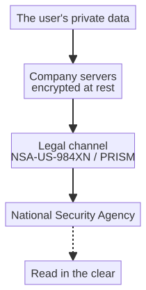

# Capitolo 10 --- Quando la nuvola rubò l'azienda

## Il mattino in cui il mondo cambiò

Il sei giugno duemilatredici due giornali --- *The Guardian* e *The Washington Post* --- pubblicarono nello stesso giorno una storia che avrebbe cambiato in silenzio e per sempre il modo in cui il mondo pensava ai dati. Per anni un'agenzia americana chiamata National Security Agency aveva gestito un programma di raccolta di enormi quantità di comunicazioni private, e i documenti appena pubblicati rivelavano non soltanto che il programma esisteva, ma che le grandi aziende tecnologiche vi avevano *partecipato*, consegnando all'agenzia i dati dei propri utenti. Il programma aveva un nome: **PRISM**.

Un uomo aveva portato quelle storie alla luce. Si chiamava Edward Snowden, un consulente americano che il mese precedente era volato a Hong Kong con documenti che avrebbero cambiato tutto. I giornali che pubblicarono la sua parte della storia, *The Guardian* e *The Washington Post*, avrebbero poi condiviso nel 2014 il premio Pulitzer per il servizio pubblico. Vale la pena ricordare quel momento non perché sia lontano, ma perché è il momento in cui la nuvola moderna --- la nuvola a cui questo libro finirà per collegare la fabbrica --- cominciò, per la maggior parte delle persone, a essere un posto di cui essere *prudenti*.

Il giorno in cui la storia uscì, la reazione non fu quella fredda e analitica degli ingegneri, ma quella più calda e più aspra delle persone che sentono di essere state tradite. Un servizio che avevate *scelto* di usare --- un servizio di cui vi fidavate proprio perché era comodo --- aveva, senza che lo sapeste e senza che lo acconsentiste, consegnato i vostri messaggi privati a un governo. Il senso di tradimento è il punto: non ci disturba che uno Stato *potrebbe* leggere la nostra posta; ci disturba che l'abbia fatto, in silenzio, proprio attraverso le aziende di cui ci fidavamo per proteggerla. E questa distinzione --- la differenza tra una *capacità* e un *tradimento* --- è tutto il peso morale del datagate, ed è anche tutto il peso morale del capitolo che segue.

## Il nome italiano

Nel mondo anglofono lo scandalo è noto con diversi nomi: PRISM, l'NSA, lo Stato di sorveglianza. Sulla stampa italiana, che seguì la vicenda con particolare intensità, ha un nome proprio: **datagate**, un suffisso che prende il «-gate» inventato dal Watergate per segnare qualsiasi scandalo che comporti un abuso di potere. La stampa italiana ricorse a quel suffisso perché la storia era, nel suo nucleo, una storia di potere abusato: il potere di uno Stato di leggere ciò che le persone private presumevano sarebbe rimasto privato.

Il nome tecnico del programma è PRISM, con la designazione NSA **US-984XN**. Non è comparso da un giorno all'altro. La sua base giuridica fu consolidata nella **Sezione 702 del FISA Amendments Act del 2008** --- poi rinnovata nel 2012 e ancora nel 2024 --- e secondo i documenti diffusi operava dal 2007 circa. Quando dunque diciamo che lo scandalo è scoppiato nel 2013, intendiamo che è scoppiato *allora* per il pubblico; il meccanismo funzionava, da anni, del tutto fuori dalla vista.

## Il meccanismo del tradimento

Ciò che i documenti diffusi fecero con più efficacia fu mostrare non *se* le aziende partecipassero, ma *come*. Il meccanismo era, a suo modo, banale, e la sua banalità è la ragione per cui conta. PRISM non richiedeva all'NSA di forzare i sistemi delle aziende: quello è il cinema dello spionaggio, non la sua pratica. Invece ogni azienda manteneva, per legge, un canale diretto attraverso il quale le si poteva *chiedere* --- e, nella maggior parte dei casi, *imporre* --- di consegnare i dati di un dato utente. L'azienda, più che essere scassinata, diventava un *guardiano di porta*: un punto attraverso il quale i dati di tutti i suoi utenti potevano, a richiesta, essere versati all'agenzia.

È una distinzione sottile ma cruciale, e vale la pena tenerla con cura, perché cambia il modo in cui pensiamo alla responsabilità. Un'azienda i cui sistemi vengono *violati* è una vittima. Un'azienda che mantiene una porta dalla quale lo Stato può entrare --- una porta che la legge le impone di tenere aperta --- è, per usare una parola scomoda, un *socio*. I documenti diffusi suggerirono, per la maggior parte delle aziende della lista, la seconda cosa: non una mano forzata, ma una mano consenziente, o almeno collaborativa, fino al punto in cui la legge richiese di più. Il dosaggio preciso di imposizione e collaborazione variava da azienda a azienda e negli anni; il registro diffuso non lo stabilisce, e non fingerò che lo faccia.

L'azienda che teneva aperta la porta non leggeva i vostri messaggi e non li consegnava a mano. Manteneva, a livello di architettura, un punto in cui i vostri dati *potevano essere presi*. Il tradimento non fu personale: fu *strutturale*. Era incorporato nel progetto del servizio, nelle condizioni d'uso che avete accettato senza leggere, nel quadro giuridico che rendeva impossibile resistere senza resistere alla legge stessa. Ed è il dettaglio che il proprietario di una fabbrica deve interiorizzare, perché la sesta rivoluzione affronterà una scelta strutturale identica.

Il diagramma qui sopra è un quadro semplificato del meccanismo: i vostri dati, tenuti da un'azienda dietro i propri muri, passavano attraverso un *canale legale* verso l'agenzia, che poteva leggerli in chiaro. La parola chiave è *canale*: l'azienda non perse il controllo dei dati a favore di un ladro; mantenne volontariamente un ingresso dal quale lo Stato poteva entrare. È la differenza tra un furto con scasso e un complotto, e il datagate fu, in fondo, un complotto costruito dentro l'architettura della nuvola moderna.

## La lista dei partecipanti

Il dettaglio più impressionante nei documenti diffusi era una lista. Nominava, con l'anno di adesione, le grandi aziende tecnologiche che avevano accettato --- per imposizione legale o, come suggerisce il registro, per collaborazione volontaria --- di dare all'NSA accesso ai dati dei propri utenti. La lista si legge come un chi è chi dell'età digitale:

  Azienda                 Anno di adesione a PRISM
  ----------------------- ------------------------
  Microsoft               2007
  Yahoo                   2008
  Google                  2009
  Facebook (oggi Meta)    2009
  Paltalk                 2009
  YouTube                 2010
  AOL                     2011
  Skype                   2011
  Apple                   2012

Nove dei nomi più familiari della tecnologia, datati, come su un inventario. È il dettaglio che fece restare la storia nella mente del pubblico: non l'idea astratta della sorveglianza, ma una *lista*, in ordine alfabetico e completa, delle aziende che non si sarebbero messe tra i propri utenti e lo Stato. È facile liquidare tutto questo come politica, e molta della copertura del datagate fu effettivamente politica. Ma qui c'è una lezione per il proprietario di una fabbrica e per l'impresa, ed è questa: **quando mandate i vostri dati a una nuvola pubblica, state, esattamente allo stesso modo, dando a una terza parte accesso ad essi --- che quella terza parte sia uno Stato, un pirata informatico o un'azienda che vende attenzione.** Il meccanismo del tradimento è lo stesso. L'unica domanda è a chi avete consegnato le chiavi.

## Il costo personale

Vale la pena soffermarsi sul dettaglio umano, perché le statistiche in milioni sfumano l'orrore, e perché i documenti diffusi nominarono, col tempo, persone specifiche rimaste impigliate nella macchina. L'esempio più citato è quello di un cittadino tedesco, riferito da *The Guardian* nel 2014, il cui nome comparve su una lista di sorveglianza della Central Intelligence Agency quasi soltanto per le cose che gli *piacevano* su Facebook: una manciata di interessi che, per un servizio di intelligence straniero, bastavano a meritare attenzione. Non aveva fatto nulla di illegale; aveva semplicemente messo un «mi piace» su qualche pagina, e un database costruito per raccogliere le comunicazioni di tutti lo aveva raccolto tra tutti. Nel servizio non c'era alcun indizio che fosse mai stato minacciato: solo che era stato *visto*, automaticamente, da una macchina a cui non importava se fosse innocente.

## La reazione e il rimorso

Vale la pena soffermarsi sulla reazione, perché mostra come il pubblico capì finalmente il pericolo: in ritardo, ma innegabilmente. La prima e più influente risposta non venne dagli utenti colpiti ma dai vertici delle aziende stesse. Nel 2013 Bill Gates pubblicò un editoriale molto letto in cui sosteneva, con urgenza quieta, che la cifratura doveva essere preservata e che gli Stati Uniti stavano «andando nella direzione sbagliata» sulla sorveglianza; che il rimedio non era fidarsi di più dello Stato, ma fidarsi di meno rendendo i dati illeggibili perfino a chi li custodisce. Quell'anno le dieci aziende tecnologiche più influenti --- Google, Apple, Microsoft e altre --- firmarono pubblicamente una lettera indirizzata al Presidente degli Stati Uniti in difesa della cifratura forte; fu, in effetti, un settore che ammetteva, insieme, che il datagate aveva dimostrato falso il vecchio assunto.

Il settore, lentamente, cominciò a schierarsi. La cifratura end-to-end si diffuse dalle app di messaggistica all'archiviazione in nuvola, precisamente perché la lezione del datagate era che un'azienda capace di leggere i vostri dati può anche essere *costretta* a leggerli. È la svolta cruciale, ed è il cardine su cui ruota il resto di questo libro. Il pubblico capì, sulle macerie del datagate, che la vera garanzia della riservatezza non era la *buona fede* del gestore della nuvola ma la sua *incapacità di leggere*. Una cassaforte custodita da una guardia onesta resta vulnerabile: la guardia può essere corrotta, licenziata o citata in giudizio. Una cassaforte il cui lucchetto è solo vostro no. Questa intuizione --- che la sicurezza debba essere una proprietà dell'*architettura* e non del *carattere del gestore* --- è l'intera premessa della nuvola trustless e a conoscenza zero che questo scandalo ha costretto a far nascere.

## Il numero che non fu mai stabilito

Un numero che i documenti diffusi non riuscirono mai a stabilire fu la quantità stessa dei dati raccolti. Le stime variavano selvaggiamente, da circa cinquantamila documenti fino a un milione e mezzo. L'intervallo non è un difetto del giornalismo: è esso stesso il punto. Perfino la stima *più bassa* è abbastanza grande da contare, e il fatto che nessuno riuscisse a mettersi d'accordo sul *totale* è precisamente la prova di quanto venisse preso. I dati di un'azienda --- le sue cifre di produzione, i contratti con i fornitori, le liste dei clienti, i suoi piani --- potevano, in principio, essere tra quei milioni di byte raccolti, e nessuno sapeva dire quali, né se fossero mai stati letti.

Il numero non stabilito è, in realtà, un dono per il lettore attento, perché insegna una regola generale che porterò con me in tutto il libro: **quando non sapete dire quanti dati sono stati presi, non potete fidarvi che nessuno dei vostri sia stato risparmiato.** Un'azienda che raccoglie «tutto, senza distinzione» raccoglie *voi* dentro il tutto, e l'unico modo per essere certi di non essere raccolti è rendere i propri dati tali che non si possano leggere nemmeno se presi. È la promessa della nuvola tenuta dentro i muri.

## Che cosa può fare un'azienda

La lezione del datagate non è soltanto di avvertimento: è *operativa*, e vale la pena dire con chiarezza che cosa un'azienda --- qualsiasi azienda, di qualsiasi dimensione --- può fare per evitare l'errore che lo scandalo ha esposto. I principi sono pochi, e nessuno è esotico.

Il primo è *tenersi la chiave*. Ogni dato che valga la pena proteggere dovrebbe essere cifrato con una chiave che l'azienda stessa possiede, così che perfino il sistema che immagazzina e sposta i dati non possa leggerli. È la mossa singola più importante, ed è quella che trasforma «ci fidiamo del nostro fornitore di nuvola» in «non dobbiamo fidarci del nostro fornitore di nuvola».

Il secondo è *tenersi la nuvola dentro*. Dove i dati sono l'immagine del futuro dell'azienda --- la produzione, i fornitori, i clienti --- la nuvola che li custodisce dovrebbe essere sotto il controllo dell'azienda, non un gigantesco centro dati pubblico di proprietà di una manciata di imprese. Una nuvola privata a conoscenza zero non è un lusso per i paranoici; è la prudenza ordinaria di un'impresa che ha imparato che cosa si può imporre a una nuvola pubblica.

Il terzo è *mandare solo ciò che serve*. Il problema del volume, di cui parleremo, è anche un problema di riservatezza: riducendo i dati al margine, l'azienda manda riassunti e allarmi invece della confessione grezza delle proprie operazioni, e tiene il dettaglio profondo e intimo in locale. Meno dati viaggiano, meno dati sono a rischio.

Queste tre mosse non richiedono personale specialistico né un budget da centro dati; richiedono una decisione, presa una volta, di trattare i dati dell'azienda come propri. E quella decisione è, alla fine, la stessa che la sesta rivoluzione chiede a ogni fabbrica: tenere l'intelligenza, i dati e la chiave dalla propria parte del muro.

## La lezione per la fabbrica

Perché uno scandalo di spie dovrebbe interessare una fabbrica che costruisce una macchina intelligente? Perché la sesta rivoluzione ha la tendenza a mandare *fuori* una grande quantità dei dati di quella fabbrica. Una macchina che percepisce, prevede e riferisce produce telemetria --- ritmi di produzione, immagini dei componenti, informazioni sui fornitori, schemi operativi --- e quella telemetria deve andare *da qualche parte*. Per gran parte dell'era della nuvola, «da qualche parte» significava la nuvola pubblica: i giganteschi centri dati di proprietà di una manciata di aziende, le stesse aziende di quella lista.

Il datagate è stato il momento in cui il pubblico ha capito, nel modo in cui uno scandalo riesce sempre a produrre, che una nuvola pubblica non è una cassaforte. È il computer di qualcun altro, e chi gestisce quel computer può essere costretto --- o può essere consenziente --- a leggere qualsiasi cosa vi mettiate. La fabbrica che manda la propria telemetria preziosa a una nuvola pubblica sta, esattamente come gli utenti di quella lista, dando a una terza parte accesso alle proprie informazioni più sensibili. È una lezione che la sesta rivoluzione non può permettersi di ignorare, perché i dati di una fabbrica sono, letteralmente, il suo futuro reso visibile. Il prossimo capitolo parla della risposta che questo scandalo ha costretto a far nascere: la nuvola che custodisce il proprio segreto, la nuvola tenuta *dentro* i muri.
